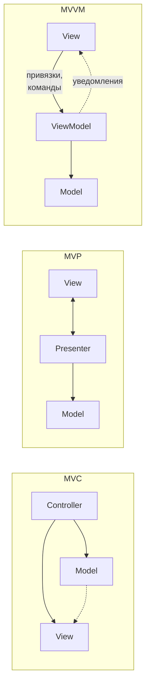
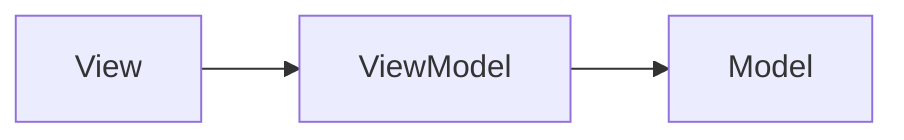
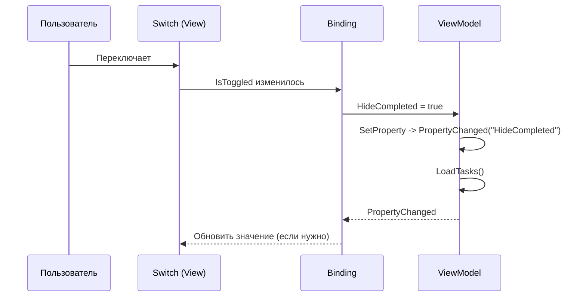

Первый MVVM-проект: ViewModel, привязки, команды

| | |
|---|---|
| **Дисциплина** | Разработка мобильных приложений на .NET MAUI |
| **Объём** | 4 академических часа (180 минут) |
| **Предыдущая лекция** | Лекция 7. Многовкладочная навигация на базе Shell |
| **Практика по теме** | Практическая работа №8 «Первый MVVM-проект: перенос приложения из code-behind в MVVM» |
| **Сквозной проект** | Task Manager |

---

## 1. План лекции

| № | Раздел | Время |
|---|---|---|
| 1 | Повторение и мотивация: чем плох code-behind | 20 мин |
| 2 | Паттерны MVC, MVP, MVVM: идея и история | 20 мин |
| 3 | MVVM в .NET MAUI: роли и правила зависимостей | 20 мин |
| 4 | Привязка данных: `BindingContext`, режимы, путь | 25 мин |
| 5 | `INotifyPropertyChanged` и `ObservableCollection<T>` | 25 мин |
| *—* | *Перерыв* | *10 мин* |
| 6 | Команды: `ICommand`, `Command`, `CommandParameter` | 25 мин |
| 7 | Компилируемые привязки и связывание View с ViewModel через DI | 15 мин |
| 8 | Разбор переноса `TaskListPage` по шагам | 25 мин |
| 9 | Что допустимо в code-behind, MVVM Toolkit, тестируемость, ошибки | 15 мин |
| | **Итого** (с учётом перерыва) | **180 мин** |

**Цели лекции.** После занятия студент:

- объясняет, какие проблемы решает MVVM, и описывает роли `Model`, `View`, `ViewModel`;
- формулирует правило зависимостей между слоями;
- настраивает `BindingContext` и выбирает режим привязки;
- реализует `INotifyPropertyChanged` и применяет `ObservableCollection<T>`;
- создаёт команды и передаёт в них параметры, в том числе из шаблона элемента;
- включает компилируемые привязки и читает их ошибки;
- переносит страницу из code-behind в `ViewModel` последовательно и без поломки поведения;
- определяет, какой код допустимо оставить на странице.

---

## 2. Повторение и мотивация

### 2.1. Что было в практических работах №2–№7

| Работа | Как организован код |
|---|---|
| №2 | Вся логика в обработчиках событий страницы |
| №3 | Стили и ресурсы, но логика всё ещё на странице |
| №6 | Появились `TaskService` и навигация, но страницы сами вызывают сервис |
| №7 | Три вкладки, общие сервисы, обновление в `OnAppearing` |

Страницы выросли: каждая сама читает данные, сама их фильтрует, сама присваивает `ItemsSource`, сама реагирует на нажатия и сама переходит между экранами.

### 2.2. Пример: code-behind страницы «Задачи»

```csharp
public partial class TaskListPage : ContentPage
{
    private readonly TaskService _service;
    private readonly SettingsService _settings;
    private bool _isNavigating;

    protected override void OnAppearing()
    {
        base.OnAppearing();
        HideCompletedSwitch.IsToggled = _settings.HideCompleted;   // ручное обновление элемента
        RefreshList();
    }

    private void RefreshList()
    {
        var tasks = _service.GetAll();
        TasksView.ItemsSource = HideCompletedSwitch.IsToggled      // данные зависят от состояния элемента
            ? tasks.Where(t => !t.IsCompleted).ToList()
            : tasks.ToList();
    }

    private void OnHideCompletedToggled(object? s, ToggledEventArgs e)
    {
        _settings.HideCompleted = e.Value;
        RefreshList();
    }

    private async void OnAddClicked(object? s, EventArgs e) => await NavigateAsync(nameof(AddTaskPage));
    // ... OnCardTapped, NavigateAsync
}
```

### 2.3. Проблемы такого подхода

| Проблема | Проявление |
|---|---|
| **Смешение ответственности** | Один класс знает про разметку, данные, правила фильтрации, навигацию |
| **Жёсткая связь с элементами** | Логика обращается к `HideCompletedSwitch`, `TasksView` по имени; переименовали элемент и код сломался |
| **Данные зависят от интерфейса** | Решение «что показывать» принимается по состоянию переключателя, а не по состоянию приложения |
| **Трудно тестировать** | Чтобы проверить фильтрацию, нужна страница, а значит, и графическая платформа |
| **Трудно менять интерфейс** | Другой экран для планшета потребует копировать логику |
| **Раздувание классов** | Каждая новая функция увеличивает страницу |

> **Вопрос аудитории.** Где в этом коде находится «правило» фильтрации выполненных задач? Можно ли проверить его, не запуская интерфейс?

---

## 3. Паттерны MVC, MVP, MVVM

### 3.1. Общая идея

Все три паттерна отвечают на один вопрос: **как развести интерфейс и логику**. Различается способ, которым они общаются.

| Паттерн | Состав | Как интерфейс связан с логикой |
|---|---|---|
| **MVC** (Model–View–Controller) | Контроллер принимает действия и обновляет модель; вид читает модель | Контроллер управляет видом и моделью |
| **MVP** (Model–View–Presenter) | Presenter управляет видом через интерфейс вида | Presenter напрямую вызывает методы вида |
| **MVVM** (Model–View–ViewModel) | `ViewModel` хранит состояние экрана и команды | Связь **через привязку данных**: `ViewModel` о виде ничего не знает |

### 3.2. Откуда взялся MVVM

Паттерн принято связывать с командой Microsoft и технологией WPF (около 2005 года); он развивает идею Presentation Model Мартина Фаулера. Ключевой механизм — **привязка данных**: вид подписывается на свойства `ViewModel`, а не наоборот. Поддержку привязок и команд унаследовали Silverlight, Xamarin.Forms и .NET MAUI.

### 3.3. Почему MVVM подходит для XAML

В XAML привязки встроены в язык: `{Binding Tasks}`, `{Binding AddTaskCommand}`. Благодаря этому вид декларативно описывает, **откуда** взять данные, а не **как** их туда положить.



---

## 4. MVVM в .NET MAUI

### 4.1. Три роли

| Слой | Что содержит | В Task Manager |
|---|---|---|
| **Model** | Данные, правила предметной области, доступ к хранилищу | `TaskItem`, `TaskService`, `SettingsService`, `TaskStatistics` |
| **View** | Разметка и всё визуальное | `TaskListPage.xaml` |
| **ViewModel** | Состояние экрана, команды, подготовка данных для вида | `TaskListViewModel` |

### 4.2. Правила зависимостей



1. `View` знает о `ViewModel`: через привязки и `BindingContext`.
2. `ViewModel` знает о `Model`: вызывает сервисы.
3. `ViewModel` **не знает** о `View`: не хранит ссылок на страницы и элементы.
4. `Model` не знает ни о ком.

Обратная связь от `ViewModel` к `View` идёт только через уведомления об изменениях (`PropertyChanged`, `CollectionChanged`).

### 4.3. Что делает ViewModel

| Задача | Пример |
|---|---|
| Хранит состояние экрана | `HideCompleted`, `IsBusy`, `Tasks` |
| Подготавливает данные для показа | Фильтрует задачи, форматирует строки |
| Реагирует на действия пользователя | Команды `AddTaskCommand`, `OpenTaskCommand` |
| Вызывает сервисы | `TaskService.GetAll()` |
| Управляет переходами | `GoToAsync(...)` (лучше через интерфейс) |

### 4.4. Что получаем

| Выгода | Пояснение |
|---|---|
| Читаемость | Каждый класс отвечает за своё |
| Тестируемость | `ViewModel` проверяется без интерфейса |
| Повторное использование | Одну `ViewModel` можно показать в разных `View` |
| Параллельная работа | Один делает разметку, другой логику |
| Горячая перезагрузка | Меняем XAML, не трогая логику |

### 4.5. Мини-упражнение 1 (5 минут)

Распределите по слоям (`Model`, `View`, `ViewModel`):

1. Список `Tasks` для показа.
2. Класс `TaskItem`.
3. Цвет рамки карточки.
4. Метод «пометить выполненной».
5. Метод чтения из файла.
6. Анимация появления кнопки.

*Ответы:* 1 — ViewModel; 2 — Model; 3 — View (стили; либо значение из ViewModel/Model, если цвет зависит от данных); 4 — Model (правило) и ViewModel (команда-вызов); 5 — Model (сервис); 6 — View.

---

## 5. Привязка данных

### 5.1. Анатомия привязки

```xml
<Label Text="{Binding Title}" />
```

| Часть | Роль |
|---|---|
| Целевой объект (target) | `Label` |
| Целевое свойство | `Text` |
| Источник (source) | Объект из `BindingContext` |
| Путь (path) | `Title` |

Привязка связывает **свойство элемента** со **свойством источника**: значение копируется из источника в элемент и (в зависимости от режима) обратно.

### 5.2. BindingContext

`BindingContext` — это объект, относительно которого вычисляются пути привязок. Свойство **наследуется** вниз по дереву элементов: если у `Grid` не задан контекст, он берётся у страницы.

```csharp
BindingContext = viewModel;   // в конструкторе страницы
```

| Где задан | Кого касается |
|---|---|
| Страница | Все элементы страницы |
| Контейнер (`Grid`, `Border`) | Только его потомки |
| Шаблон элемента (`DataTemplate`) | Контекстом становится **конкретный элемент коллекции** |

**Важное следствие.** Внутри `DataTemplate` `{Binding Title}` обращается к `TaskItem.Title`, а не к свойству `ViewModel`. Чтобы получить доступ к `ViewModel` страницы, нужен `RelativeSource` (раздел 7.3).

### 5.3. Режимы привязки

| Режим | Направление | Типичный пример |
|---|---|---|
| `OneTime` | Один раз при создании | Постоянная подпись |
| `OneWay` | Источник → элемент | `Label.Text` (по умолчанию для большинства свойств) |
| `TwoWay` | Источник ↔ элемент | `Switch.IsToggled`, `Entry.Text`, `CheckBox.IsChecked` |
| `OneWayToSource` | Элемент → источник | Редко |

Для интерактивных свойств (`Entry.Text`, `Switch.IsToggled`) режим по умолчанию уже `TwoWay`, указывать его не нужно.

### 5.4. Полезные возможности привязки

| Возможность | Запись |
|---|---|
| Форматирование строки | `{Binding CreatedAt, StringFormat='{0:dd.MM.yyyy}'}` |
| Значение по умолчанию | `{Binding Name, FallbackValue='—'}` |
| Привязка к самому элементу | `{Binding .}` |
| Привязка к другому элементу | `{Binding Source={x:Reference MyEntry}, Path=Text}` |
| Конвертер значений | `{Binding IsDone, Converter={StaticResource BoolToTextConverter}}` |
| Привязка к предку | `Source={RelativeSource AncestorType={x:Type ...}}` |

### 5.5. Отладка привязок

| Признак | Что проверить |
|---|---|
| Элемент пуст, ошибки нет | Не задан `BindingContext`, либо неверное имя свойства (без компилируемых привязок) |
| В окне вывода предупреждение `Binding: ... property not found` | Опечатка в пути |
| Значение показывается один раз и не меняется | Нет `INotifyPropertyChanged` |
| Данные меняются в `ViewModel`, а не на экране | Изменение выполнено не на потоке интерфейса или не вызван `OnPropertyChanged` |

### 5.6. Мини-упражнение 2 (5 минут)

Что покажет элемент, если `BindingContext` страницы равен `null`?

```xml
<Label Text="{Binding Title}" />
```

*Ответ:* привязке не к чему обращаться; элемент остаётся пустым (ошибка в большинстве случаев не возникает).

---

## 6. Уведомления об изменениях

### 6.1. Зачем нужен INotifyPropertyChanged

Привязка читает значение при создании. Чтобы она узнала, что значение изменилось, объект обязан **сообщить об этом событием**:

```csharp
public interface INotifyPropertyChanged
{
    event PropertyChangedEventHandler? PropertyChanged;
}
```

Привязка подписывается на событие и при получении сообщения с нужным именем свойства перечитывает значение.



### 6.2. Типовая реализация

```csharp
public abstract class BaseViewModel : INotifyPropertyChanged
{
    public event PropertyChangedEventHandler? PropertyChanged;

    protected void OnPropertyChanged([CallerMemberName] string? propertyName = null)
        => PropertyChanged?.Invoke(this, new PropertyChangedEventArgs(propertyName));

    protected bool SetProperty<T>(ref T field, T value,
        [CallerMemberName] string? propertyName = null)
    {
        if (EqualityComparer<T>.Default.Equals(field, value))
            return false;

        field = value;
        OnPropertyChanged(propertyName);
        return true;
    }
}
```

| Элемент | Назначение |
|---|---|
| `[CallerMemberName]` | Компилятор подставляет имя вызывающего свойства; опечатки в строках исключены |
| Проверка равенства | Не рассылаем уведомления, если значение не изменилось |
| Возврат `bool` | Позволяет выполнить дополнительные действия только при реальном изменении |

Использование:

```csharp
private bool _hideCompleted;

public bool HideCompleted
{
    get => _hideCompleted;
    set
    {
        if (!SetProperty(ref _hideCompleted, value))
            return;

        _settings.HideCompleted = value;
        LoadTasks();
    }
}
```

### 6.3. Вычисляемые и зависимые свойства

Если одно свойство вычисляется из другого, при изменении исходного нужно уведомить и о зависимом:

```csharp
public int Completed
{
    get => _completed;
    set
    {
        if (SetProperty(ref _completed, value))
            OnPropertyChanged(nameof(Active));   // Active = Total - Completed
    }
}
```

`OnPropertyChanged(string.Empty)` сообщает, что изменились **все** свойства сразу: удобно для обновления «снимка» данных.

### 6.4. ObservableCollection и CollectionView

`CollectionView` умеет реагировать на изменения коллекции, если та реализует `INotifyCollectionChanged`. Готовая реализация — `ObservableCollection<T>`.

| Операция | `List<T>` | `ObservableCollection<T>` |
|---|---|---|
| Добавили элемент | Экран не обновится | Экран обновится |
| Удалили элемент | Экран не обновится | Экран обновится |
| Заменили всю коллекцию | Нужно переприсвоить `ItemsSource` | Лучше менять содержимое |

**Правила работы с коллекцией**

1. Объявляйте как свойство только для чтения и создавайте один раз: `public ObservableCollection<TaskItem> Tasks { get; } = new();`.
2. Меняйте **содержимое** (`Clear`, `Add`, `Remove`), а не ссылку.
3. Если всё-таки пересоздаёте коллекцию, вызывайте `OnPropertyChanged` для свойства.
4. Не меняйте её из фонового потока: это событие приходит в интерфейс.

### 6.5. Изменение отдельного элемента

`ObservableCollection<T>` сообщает о добавлении и удалении, но **не** о смене свойств внутри элемента. Если `TaskItem.IsCompleted` меняется программно и интерфейс должен отреагировать, `TaskItem` сам должен реализовать `INotifyPropertyChanged`. (В практической работе №8 это вынесено в дополнительное задание: флажок на карточке меняет значение через двустороннюю привязку, и интерфейс уже обновлён самим флажком.)

### 6.6. Мини-упражнение 3 (5 минут)

Студент написал так:

```csharp
public string Title { get; set; }

public void Rename() => Title = "Новое название";
```

Экран не обновляется. Исправьте.

*Ответ:* использовать поле и `SetProperty(ref _title, value)`; тогда присваивание вызовет `PropertyChanged`.

---

## 7. Команды

### 7.1. Проблема обработчиков событий

Обработчик `Clicked="OnAddClicked"` живёт на странице, имеет сигнатуру `(object sender, EventArgs e)` и привязан к конкретному элементу. `ViewModel` об элементах ничего знать не должна. Решение — **команда**.

### 7.2. ICommand

```csharp
public interface ICommand
{
    void Execute(object? parameter);
    bool CanExecute(object? parameter);
    event EventHandler? CanExecuteChanged;
}
```

| Член | Назначение |
|---|---|
| `Execute` | Выполняет действие |
| `CanExecute` | Сообщает, доступно ли действие сейчас |
| `CanExecuteChanged` | Просит элемент перечитать доступность |

Если `CanExecute` возвращает `false`, кнопка автоматически блокируется. Это заменяет ручное `button.IsEnabled = ...`.

### 7.3. Command и Command < T > в MAUI

```csharp
// без параметра
public ICommand AddTaskCommand { get; }

AddTaskCommand = new Command(
    execute: async () => await NavigateAsync(nameof(AddTaskPage)),
    canExecute: () => !IsBusy);

// с параметром
public ICommand OpenTaskCommand { get; }

OpenTaskCommand = new Command<TaskItem>(
    execute: async task => await OpenTaskAsync(task),
    canExecute: _ => !IsBusy);
```

После изменения условия доступности команду нужно оповестить:

```csharp
_addTaskCommand.ChangeCanExecute();
```

Для этого хранят команды в полях типа `Command` и вызывают `ChangeCanExecute()` в сеттере состояния (`IsBusy`).

### 7.4. Привязка команд

| Элемент | Свойства |
|---|---|
| `Button` | `Command`, `CommandParameter` |
| `ToolbarItem` | `Command`, `CommandParameter` |
| `TapGestureRecognizer` | `Command`, `CommandParameter` |
| `SwipeItem` | `Command`, `CommandParameter` |
| `RefreshView` | `Command` |

```xml
<Button Text="Добавить" Command="{Binding AddTaskCommand}" />
```

### 7.5. Команда внутри шаблона элемента

В `DataTemplate` контекстом является элемент коллекции, а команда лежит в `ViewModel` страницы. Решение:

```xml
<TapGestureRecognizer
    Command="{Binding OpenTaskCommand,
              Source={RelativeSource AncestorType={x:Type vm:TaskListViewModel}}}"
    CommandParameter="{Binding .}" />
```

| Фрагмент | Смысл |
|---|---|
| `OpenTaskCommand` | Путь внутри источника |
| `Source={RelativeSource AncestorType=...}` | Источник — ближайший предок с контекстом нужного типа |
| `CommandParameter="{Binding .}"` | Параметр — сам элемент текущего шаблона (`TaskItem`) |

### 7.6. Асинхронные команды

`Command` принимает `Action`. Асинхронная лямбда превращается в `async void`: исключение из неё не будет перехвачено вызывающим кодом и может «уронить» приложение. Правила:

- заворачивайте тело в `try/catch` там, где возможны ошибки;
- используйте `finally` для сброса флагов занятости;
- в крупных проектах применяют `AsyncRelayCommand` из MVVM Toolkit, который корректно обрабатывает исключения и отслеживает выполнение.

### 7.7. Защита от повторных нажатий

```csharp
private async Task NavigateAsync(string route)
{
    if (IsBusy) return;
    IsBusy = true;
    try   { await Shell.Current.GoToAsync(route); }
    finally { IsBusy = false; }
}
```

Флаг `IsBusy` вместе с `canExecute: () => !IsBusy` блокирует вторую команду, пока выполняется первая. Всё состояние находится во `ViewModel`, а не в страницах.

### 7.8. Мини-упражнение 4 (5 минут)

Кнопка «Сохранить» должна быть неактивна, пока поле `Title` пусто. Какие три изменения нужны во `ViewModel`?

*Ответ:* 1) свойство `Title` с `SetProperty`; 2) команда с `canExecute: () => !string.IsNullOrWhiteSpace(Title)`; 3) вызов `ChangeCanExecute()` в сеттере `Title`.

---

## 8. Компилируемые привязки и связывание View с ViewModel

### 8.1. Компилируемые привязки

Обычные привязки разбираются **во время работы** по именам: опечатка не мешает сборке, а проявляется пустым экраном. Компилируемые привязки проверяются **при сборке**.

Включение:

```xml
<ContentPage ...
             xmlns:vm="clr-namespace:TaskManager.ViewModels"
             x:DataType="vm:TaskListViewModel">

    ...
    <DataTemplate x:DataType="models:TaskItem">
```

| Преимущество | Пояснение |
|---|---|
| Ошибки при сборке | Опечатка в имени свойства — ошибка, а не пустой экран |
| Скорость | Нет отражения во время работы |
| Подсказки в Rider | Автодополнение путей привязок |
| Основа для обрезки (AOT/trimming) | Меньше проблем при публикации |

Ограничения: `x:DataType` нужно указывать на странице и в каждом `DataTemplate` отдельно; при привязке через `Source` или `x:Reference` тип источника выводится не всегда, и такие привязки требуют внимательности.

### 8.2. Три способа задать BindingContext

| Способ | Запись | Плюсы и минусы |
|---|---|---|
| **Через конструктор + DI** | `BindingContext = viewModel;` | Зависимости внедряются контейнером; **наш выбор** |
| **Экземпляр в XAML** | `<ContentPage.BindingContext><vm:MyViewModel/></ContentPage.BindingContext>` | Просто, но нужен конструктор без параметров |
| **Локатор** | Отдельный класс выбирает `ViewModel` | Гибко, сложнее |

### 8.3. Внедрение зависимостей

```csharp
// MauiProgram.cs
builder.Services.AddSingleton<TaskService>();       // общие данные
builder.Services.AddSingleton<SettingsService>();

builder.Services.AddTransient<TaskListViewModel>(); // свой экземпляр на страницу
builder.Services.AddTransient<TaskListPage>();
```

Страница получает `ViewModel`, `ViewModel` получает сервисы:

```csharp
public TaskListPage(TaskListViewModel viewModel) { ... }
public TaskListViewModel(TaskService service, SettingsService settings) { ... }
```

Цепочка создаётся контейнером автоматически, если страница создаётся через него (в `Shell` — через `ContentTemplate`, как в лекции 7).

| Время жизни | Применение |
|---|---|
| `Singleton` | Общие данные и настройки (`TaskService`, `SettingsService`) |
| `Transient` | Страницы и `ViewModel` экранов |
| `Scoped` | В MAUI используется редко |

### 8.4. Жизненный цикл страницы и ViewModel

Страницы вкладок `Shell` создаются один раз и переиспользуются (лекция 7), а у `ViewModel` нет событий жизненного цикла. Поэтому:

1. Страница ловит `OnAppearing`.
2. Страница вызывает `viewModel.Refresh()`.
3. Всё остальное делает `ViewModel`.

Альтернативы: поведения (`EventToCommandBehavior` в MAUI Community Toolkit), события жизненного цикла в базовой странице. Для первого проекта достаточно простой передачи вызова.

---

## 9. Разбор переноса TaskListPage

### 9.1. Стратегия

Переносим **поэтапно**, после каждого шага проект собирается и запускается:

| Шаг | Что делаем | Состояние приложения |
|---|---|---|
| 1 | Создаём `TaskListViewModel`, регистрируем в DI | Работает как прежде |
| 2 | Переносим коллекцию и загрузку | Работает как прежде |
| 3 | Устанавливаем `BindingContext` | Работает как прежде |
| 4 | Заменяем обработчики на привязки и команды | Уже работает через `ViewModel` |
| 5 | Проверяем | — |
| 6 | Удаляем мёртвый код | Работает через `ViewModel`, код-behind минимален |

Подход «не ломай рабочее» называется **рефакторингом**: поведение остаётся прежним, меняется устройство кода.

### 9.2. Сравнение «до» и «после»

**До:**

```csharp
private void RefreshList()
{
    var tasks = _service.GetAll();
    TasksView.ItemsSource = HideCompletedSwitch.IsToggled
        ? tasks.Where(t => !t.IsCompleted).ToList()
        : tasks.ToList();
}
```

**После (ViewModel):**

```csharp
public ObservableCollection<TaskItem> Tasks { get; } = new();

private void LoadTasks()
{
    IEnumerable<TaskItem> source = _service.GetAll();
    if (_hideCompleted)
        source = source.Where(t => !t.IsCompleted);

    Tasks.Clear();
    foreach (var task in source)
        Tasks.Add(task);
}
```

**После (View):**

```xml
<CollectionView ItemsSource="{Binding Tasks}" ... />
```

Важное отличие: **решение «что показывать» теперь принимается по состоянию `ViewModel` (`_hideCompleted`), а не по состоянию переключателя**. Переключатель только отражает это состояние.

### 9.3. Итоговый code-behind

```csharp
public partial class TaskListPage : ContentPage
{
    private readonly TaskListViewModel _viewModel;

    public TaskListPage(TaskListViewModel viewModel)
    {
        InitializeComponent();
        _viewModel = viewModel;
        BindingContext = viewModel;
    }

    protected override void OnAppearing()
    {
        base.OnAppearing();
        _viewModel.Refresh();
    }
}
```

Из ~70 строк осталось ~20, и ни одной строки бизнес-логики.

### 9.4. Тонкости, на которые обращают внимание

| Тонкость | Решение |
|---|---|
| `Refresh()` меняет `HideCompleted`; двусторонняя привязка вернёт значение в сеттер | В `Refresh()` меняем поле и вызываем `OnPropertyChanged`; сеттер увидит то же значение и не запустит загрузку повторно |
| Команда в шаблоне | `RelativeSource AncestorType` |
| Двойные нажатия | `IsBusy` + `canExecute` |
| Чек-бокс в карточке меняет `IsCompleted` | Двусторонняя привязка уже есть; при включённом фильтре карточка исчезнет при следующем `Refresh()` |

### 9.5. Мини-упражнение 5 (10 минут)

Для вкладки «Статистика» (работа №7) составьте карту миграции по образцу таблицы практической работы: что находится в code-behind, что станет свойством, что — командой, что останется на странице.

*Ориентир:* `TotalLabel.Text = ...` → свойство `Total`; `PercentLabel.Text` → `PercentText`; `OnOpenTasksClicked` → `OpenTasksCommand`; `OnAppearing` остаётся и вызывает `Refresh()`.

---

## 10. Допустимое в code-behind, MVVM Toolkit, тестирование

### 10.1. Что допустимо оставить на странице

| Допустимо | Недопустимо |
|---|---|
| `InitializeComponent`, установка `BindingContext` | Доступ к сервисам и данным |
| Проброс событий жизненного цикла во `ViewModel` | Правила предметной области |
| Чисто визуальные действия: анимация, фокус, прокрутка | Навигация между страницами |
| Обработка платформенных особенностей | Логика с ветвлением по данным |

**Критерий.** Если без изменения интерфейса этот код пришлось бы переписывать при смене правил приложения, ему не место в code-behind.

### 10.2. Что нежелательно в ViewModel

| Не стоит | Почему | Что делать |
|---|---|---|
| Ссылаться на страницы и элементы | Нарушается правило зависимостей, нельзя тестировать | Передавать данные через свойства |
| Вызывать `DisplayAlert` | Требует страницы | Интерфейс `IDialogService` |
| Использовать `Shell.Current` напрямую | Жёсткая связь с `Shell` | Интерфейс `INavigationService` |
| Использовать типы вида (`Color`, `Brush`) | Привязывают слой к интерфейсу | Хранить логические значения (приоритет), цвет подбирать конвертером или стилем |

В практической работе №8 допускаются два компромисса (`Shell.Current` и `Color` в `TaskItem`) ради простоты; они вынесены в дополнительные задания.

### 10.3. MVVM Toolkit (CommunityToolkit.Mvvm)

Рутину `INotifyPropertyChanged` и команд берут на себя генераторы кода:

```csharp
public partial class TaskListViewModel : ObservableObject
{
    [ObservableProperty]
    private bool _isBusy;                           // создаёт свойство IsBusy

    [RelayCommand]
    private async Task AddTaskAsync() { ... }       // создаёт AddTaskCommand
}
```

| Элемент Toolkit | Заменяет |
|---|---|
| `ObservableObject` | `BaseViewModel` |
| `[ObservableProperty]` | Свойство + поле + `SetProperty` |
| `[RelayCommand]` | Команда и метод |
| `AsyncRelayCommand` | `Command` для асинхронных операций |
| `WeakReferenceMessenger` | События между `ViewModel` без жёстких связей |

**Методическая позиция.** В первом проекте базовые механизмы пишутся вручную, чтобы понять, что происходит «под капотом». Затем переходят на Toolkit.

### 10.4. Тестируемость

`ViewModel`, не зависящая от интерфейса, проверяется обычным модульным тестом:

```csharp
[Fact]
public void HideCompleted_ShouldExcludeCompletedTasks()
{
    var service = new FakeTaskService(
        new TaskItem { Title = "A", IsCompleted = true },
        new TaskItem { Title = "B", IsCompleted = false });

    var vm = new TaskListViewModel(service, new FakeSettings());
    vm.HideCompleted = true;

    Assert.Single(vm.Tasks);
    Assert.Equal("B", vm.Tasks[0].Title);
}
```

Условие: зависимости заменяются интерфейсами-заглушками (`FakeTaskService`). В нашей учебной версии `TaskService` — конкретный класс, а `Command` относится к библиотеке MAUI, поэтому для настоящих тестов потребуется вынести интерфейсы и/или использовать команды из MVVM Toolkit. Сам принцип — **логика проверяется без экрана** — главная выгода паттерна.

### 10.5. Типичные ошибки

| Ошибка | Последствие |
|---|---|
| Не установлен `BindingContext` | Пустой экран |
| `List<T>` вместо `ObservableCollection<T>` | Интерфейс не реагирует на изменения |
| Свойство без `OnPropertyChanged` | Экран показывает старое значение |
| Команда в шаблоне без `RelativeSource` | Нажатие ничего не делает |
| Нет `CommandParameter` | В команду приходит `null` |
| Логика осталась в обработчиках | Дублирование и рассинхрон |
| `ItemsSource` присваивается в коде и привязывается в XAML | Привязка «перебита», данные из кода |
| Забыт `ChangeCanExecute` | Кнопка не разблокируется |
| Исключение в `async void` | Падение приложения |
| `ViewModel` держит ссылку на страницу | Утечки памяти, невозможность тестирования |

---

## 11. Итоги лекции

1. MVVM разделяет `Model`, `View`, `ViewModel`; `ViewModel` не знает о `View`.
2. Связь вида и `ViewModel` осуществляется привязками данных и командами.
3. `BindingContext` — источник данных для привязок; наследуется вниз по дереву; внутри `DataTemplate` равен элементу коллекции.
4. Изменения свойств сообщаются через `INotifyPropertyChanged`, изменения коллекции — через `ObservableCollection<T>`.
5. Действия пользователя передаются в `ViewModel` через `ICommand`; параметр — `CommandParameter`; команда из шаблона — через `RelativeSource`.
6. `x:DataType` включает компилируемые привязки и переносит ошибки на этап сборки.
7. `ViewModel` создаётся контейнером зависимостей; для страниц и `ViewModel` — `Transient`, для общих сервисов — `Singleton`.
8. В code-behind остаются конструктор, `BindingContext`, проброс жизненного цикла и чисто визуальные действия.
9. Рефакторинг проводят поэтапно: каждый шаг оставляет приложение рабочим.

---

## 12. Вопросы для самопроверки

1. Какие проблемы code-behind решает MVVM?
2. Чем MVVM отличается от MVP и MVC?
3. Какие зависимости между слоями допустимы, а какие нет?
4. Что такое `BindingContext` и как он наследуется?
5. Что является контекстом привязки внутри `DataTemplate`?
6. Какие режимы привязки существуют? Для каких свойств `TwoWay` включён по умолчанию?
7. Как работает `INotifyPropertyChanged`? Что делает `[CallerMemberName]`?
8. Зачем в `SetProperty` сравнивается старое и новое значение?
9. Чем `ObservableCollection<T>` отличается от `List<T>`? Почему менять нужно содержимое, а не ссылку?
10. Из чего состоит интерфейс `ICommand`? Для чего нужен `CanExecute`?
11. Как привязать команду из `ViewModel` страницы в шаблоне элемента списка?
12. Что даёт `x:DataType`?
13. Какими способами можно задать `BindingContext`?
14. Почему `ViewModel` регистрируют как `Transient`, а `TaskService` — как `Singleton`?
15. Что допустимо оставить в code-behind, а что нет?

---
