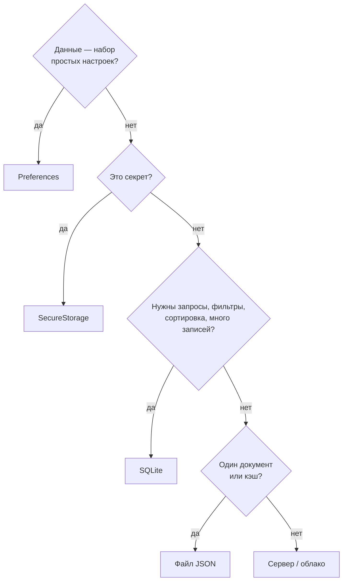
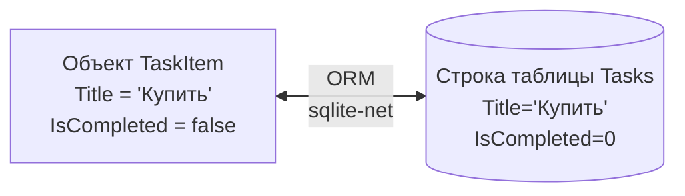
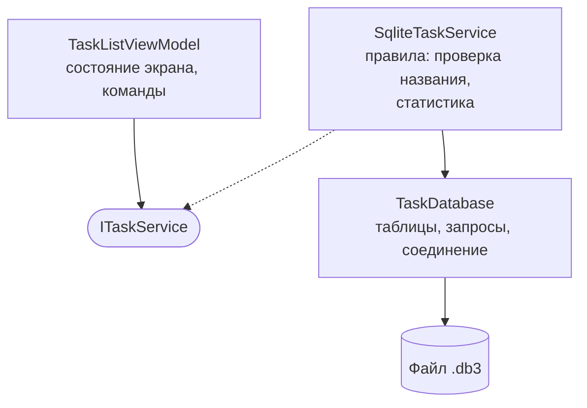

Локальное хранение данных: SQLite в .NET MAUI

| | |
|---|---|
| **Дисциплина** | Разработка мобильных приложений на .NET MAUI |
| **Объём** | 4 академических часа (180 минут) |
| **Предыдущая лекция** |  Binding, команды, Dependency Injection |
| **Практика по теме** | Практическая работа  «SQLite: делаем задачи постоянными» |
| **Сквозной проект** | Task Manager |

---

## 1. План лекции

| № | Раздел | Время |
|---|---|---|
| 1 | Повторение. Зачем приложению постоянное хранилище | 10 мин |
| 2 | Способы хранения данных в .NET MAUI | 20 мин |
| 3 | SQLite: устройство, возможности, ограничения | 15 мин |
| 4 | Подключение: пакет `sqlite-net-pcl`, ORM, альтернативы | 15 мин |
| *—* | *Перерыв* | *10 мин* |
| 5 | Модель данных: атрибуты, типы, соответствие столбцам | 20 мин |
| 6 | Класс доступа к базе: соединение, флаги, создание таблицы, асинхронность | 20 мин |
| 7 | Операции CRUD: Insert, Get, Update, Delete; запросы | 25 мин |
| 8 | Подключение к архитектуре: сервис, DI, `ViewModel`, ошибки | 25 мин |
| 9 | Схема и эксплуатация: миграции, транзакции, безопасность, итоги | 20 мин |
| | **Итого** (с учётом перерыва) | **180 мин** |

**Цели лекции.** После занятия студент:

- выбирает способ хранения данных под задачу и обосновывает выбор;
- объясняет, что такое SQLite, ORM, первичный ключ, транзакция;
- подключает пакет `sqlite-net-pcl`, описывает модель атрибутами;
- создаёт класс доступа к базе с ленивой инициализацией;
- реализует операции `Insert`, `Get`, `Update`, `Delete` и запросы с условиями;
- подключает базу к приложению через сервис и внедрение зависимостей;
- объясняет, почему асинхронный доступ меняет контракт сервиса;
- называет типичные проблемы: миграции, потоки, SQL-инъекции, потеря данных.

---

## 2. Повторение и постановка задачи

### 2.1. Что получено в предыдущих работах

| Достигнуто | Как |
|---|---|
| Интерфейс на MVVM | `TaskListViewModel`, команды, привязки |
| Слабая связанность | `ITaskService`, `TaskService`, внедрение через конструктор |
| Три вкладки, общее состояние | `Singleton`-сервисы |

### 2.2. Что не получено

Задачи живут в `List<TaskItem>` внутри объекта-одиночки. При закрытии приложения процесс завершается, память освобождается, **данные исчезают**.

```csharp
// TaskService.cs (работа №9)
private readonly List<TaskItem> _tasks = new();    // существует, пока работает процесс
```

Для настоящего приложения это неприемлемо. Нужно **постоянное (persistent) хранилище**.

### 2.3. Что поможет нам оценить архитектуру

В работе №9 мы выделили интерфейс `ITaskService`. Теперь проверим, оправдала ли себя эта абстракция: заменим хранилище, не переписывая интерфейс пользователя. Но, как покажет практика, интерфейс придётся изменить в одном важном месте — сделать асинхронным (раздел 8.1).

---

## 3. Способы хранения данных в .NET MAUI

### 3.1. Обзор

| Способ | Что хранит | Объём | Запросы | Типичное применение |
|---|---|---|---|---|
| **`Preferences`** | Пары «ключ — значение» простых типов | Малый | Нет | Тема, фильтр, последняя вкладка |
| **`SecureStorage`** | Секреты (шифрование средствами платформы) | Малый | Нет | Токены, пароли |
| **Файлы** (текст, JSON, XML) | Любые данные, сериализованные целиком | Средний | Нет (читаем весь файл) | Небольшие документы, кэш, экспорт |
| **SQLite** | Таблицы, строки, индексы | Большой | Да (SQL, LINQ) | Списки записей, офлайн-данные |
| **Облако / API** | Данные на сервере | Любой | Через сервер | Синхронизация, многопользовательские приложения |

### 3.2. Как выбрать



### 3.3. Почему для Task Manager выбран SQLite

| Требование | Как закрывает SQLite |
|---|---|
| Много однотипных записей | Таблица `Tasks` |
| Фильтры (скрыть выполненные), сортировка | Запросы `WHERE`, `ORDER BY` |
| Изменение одной записи без перезаписи всего | `UPDATE` по ключу |
| Работа без сети | Файл на устройстве |
| Без установки сервера | База встроена в приложение |

### 3.4. Мини-упражнение 1 (5 минут)

Выберите способ хранения:

1. Токен доступа к API.
2. Выбранная тема оформления.
3. Список из 5000 заметок с поиском по тексту.
4. Черновик одного длинного письма.

*Ответы:* 1 — `SecureStorage`; 2 — `Preferences`; 3 — SQLite; 4 — файл (или `Preferences` для очень короткого, но лучше файл).

---

## 4. SQLite

### 4.1. Что это

**SQLite** — встраиваемая реляционная СУБД. Вся база данных — **один файл** на устройстве. Нет отдельного сервера, не нужно настраивать подключение по сети, не требуется администратор.

| Свойство | Описание |
|---|---|
| Встраиваемость | Движок — часть приложения (библиотека), а не отдельный процесс |
| Один файл | Резервная копия = копия файла |
| Транзакции (ACID) | Изменения либо применяются целиком, либо не применяются вовсе |
| SQL | Стандартный язык запросов (с особенностями диалекта) |
| Кроссплатформенность | Android, iOS, Windows, macOS — один формат файла |
| Широкое распространение | Используется в браузерах, мобильных ОС, множестве приложений |

### 4.2. Ограничения, о которых нужно знать

| Ограничение | Следствие |
|---|---|
| Один писатель одновременно | Для приложения на устройстве достаточно; для высокой конкуренции не подходит |
| Динамическая типизация | Типы столбцов — «пожелание»; библиотека-ORM берёт на себя соответствие |
| Ограниченные возможности изменения схемы | Нельзя просто удалить или переименовать столбец старым способом (зависит от версии) |
| Файл лежит на устройстве | Удаление приложения удаляет данные; нужны синхронизация и резервные копии |
| Нет встроенных пользователей и прав | Защита — средствами ОС, шифрование — отдельными решениями |

### 4.3. Основы SQL: соответствие операциям

| Операция | SQL | Метод ORM в нашей работе |
|---|---|---|
| Создание таблицы | `CREATE TABLE Tasks (...)` | `CreateTableAsync<TaskItem>()` |
| Добавление | `INSERT INTO Tasks (...) VALUES (...)` | `InsertAsync(item)` |
| Чтение списка | `SELECT * FROM Tasks WHERE IsCompleted = 0 ORDER BY Id` | `Table<TaskItem>().Where(...).OrderBy(...).ToListAsync()` |
| Чтение по ключу | `SELECT * FROM Tasks WHERE Id = ?` | `FindAsync<TaskItem>(id)` |
| Изменение | `UPDATE Tasks SET ... WHERE Id = ?` | `UpdateAsync(item)` |
| Удаление | `DELETE FROM Tasks WHERE Id = ?` | `DeleteAsync<TaskItem>(id)` |

Знание SQL необходимо: ORM строит запросы за вас, но когда они работают неверно или медленно, диагностировать приходится на уровне SQL.

### 4.4. Где лежит файл

```csharp
Path.Combine(FileSystem.AppDataDirectory, "TaskManager.db3")
```

`FileSystem.AppDataDirectory` возвращает каталог данных приложения, доступный для записи на любой платформе. Путь разный на каждой ОС, поэтому вручную его не записывают.

| Платформа | Особенность |
|---|---|
| Android | Внутренняя память приложения; недоступна другим приложениям |
| iOS / macOS | Песочница приложения |
| Windows | Локальные данные приложения |

Данные удаляются вместе с приложением (кроме случаев резервного копирования средствами платформы).

---

## 5. Подключение: пакет и ORM

### 5.1. Пакет `sqlite-net-pcl`

Документация .NET MAUI показывает работу с SQLite через пакет **sqlite-net-pcl**.

| Поле | Значение |
|---|---|
| ID | `sqlite-net-pcl` |
| Authors | SQLite-net |
| Owners | praeclarum |

Существует много пакетов с похожими названиями: проверяйте реквизиты. Библиотека SQLite.NET является сторонней (репозиторий praeclarum/sqlite-net).

### 5.2. Что такое ORM

**ORM** (Object-Relational Mapping) связывает мир объектов и мир таблиц.

| Объектный мир | Реляционный мир |
|---|---|
| Класс `TaskItem` | Таблица `Tasks` |
| Объект | Строка |
| Свойство | Столбец |
| Ссылка на объект | Внешний ключ |
| `List<TaskItem>` | Результат `SELECT` |



### 5.3. Альтернативы

| Решение | Характеристика |
|---|---|
| **sqlite-net-pcl** | Простая ORM, минимум настроек; подходит для учебных и небольших проектов |
| **Microsoft.Data.Sqlite** | Низкоуровневый ADO.NET-провайдер: вы пишете SQL вручную |
| **Entity Framework Core + SQLite** | Мощная ORM: связи, миграции, LINQ; тяжелее |
| **Realm, LiteDB** | Другие встраиваемые хранилища (не реляционные) |

### 5.4. Мини-упражнение 2 (5 минут)

Назовите два преимущества и один недостаток использования ORM по сравнению с ручным SQL.

*Ответ (пример):* плюсы — меньше кода, проверка типов при компиляции; минус — «магия»: сложнее понять, какой SQL будет выполнен, возможна неэффективность.

---

## 6. Модель данных

### 6.1. Атрибуты

```csharp
[Table("Tasks")]
public class TaskItem
{
    [PrimaryKey, AutoIncrement]
    public int Id { get; set; }

    [MaxLength(100)]
    public string Title { get; set; } = string.Empty;

    public bool IsCompleted { get; set; }
    public TaskPriority Priority { get; set; }
    public DateTime CreatedAt { get; set; } = DateTime.Now;

    [Ignore]
    public Color PriorityColor => ...;     // не хранится
}
```

| Атрибут | Назначение |
|---|---|
| `[Table("имя")]` | Имя таблицы (иначе — имя класса) |
| `[PrimaryKey]` | Первичный ключ |
| `[AutoIncrement]` | Значение назначает база данных |
| `[MaxLength(n)]` | Метаданные длины строки (SQLite сама не проверяет) |
| `[Indexed]` | Индекс для ускорения поиска |
| `[Unique]` | Уникальность значения |
| `[NotNull]` | Обязательное значение |
| `[Ignore]` | Свойство не хранится |
| `[Column("имя")]` | Имя столбца |

### 6.2. Соответствие типов

| Тип C# | Как хранится | Замечание |
|---|---|---|
| `int`, `long` | Целое | |
| `string` | Текст | |
| `bool` | Целое 0/1 | В SQL: `IsCompleted = 1` |
| `double`, `float` | Вещественное | |
| `enum` | Целое (номер значения) | Не меняйте порядок значений перечисления: сломаются сохранённые данные |
| `DateTime` | По умолчанию число (тики) | Можно хранить текстом, но по умолчанию — число |
| `Guid` | Текст | |
| `byte[]` | BLOB | Для небольших бинарных данных |
| `Color`, коллекции, вложенные объекты | **Не хранятся** | Помечайте `[Ignore]` или вынесите в отдельную таблицу |

### 6.3. Требования к классу

| Требование | Причина |
|---|---|
| Публичный конструктор без параметров | Библиотека создаёт объекты при чтении |
| Публичные свойства с `get` и `set` | Через `set` заполняются значения |
| Ключ | Без ключа не работают `Update` и `Delete` по объекту |
| Вычисляемые свойства — `[Ignore]` | Иначе возникнет ошибка либо лишний столбец |

### 6.4. Модель в нескольких слоях: компромисс

Атрибуты хранения в классе, который также показывается в интерфейсе, — **практичное** решение для небольшого приложения. Недостатки:

- слой модели зависит от библиотеки хранения;
- в классе смешаны данные хранения, данные интерфейса (`PriorityColor`) и уведомления (`INotifyPropertyChanged`).

В крупных приложениях разделяют: `TaskEntity` (для базы), `TaskItem` (для предметной области), `TaskItemViewModel` (для показа). Это вынесено в дополнительные задания.

### 6.5. Идентификатор

| Вопрос | Ответ |
|---|---|
| Кто назначает `Id`? | База данных при вставке (`AutoIncrement`) |
| Что в `Id` до вставки? | 0 |
| Что после вставки? | Значение, сгенерированное базой (библиотека заполняет свойство) |
| Можно ли использовать `Id` как признак «новый объект»? | Да: `Id == 0` — запись ещё не сохранена |

### 6.6. Мини-упражнение 3 (5 минут)

В класс добавили свойство `public Color Background { get; set; }` без атрибутов. Что произойдёт при `CreateTableAsync`?

*Ответ:* тип `Color` не поддерживается для хранения; возникнет ошибка. Нужно пометить `[Ignore]`.

---

## 7. Класс доступа к базе данных

### 7.1. Роль класса

Класс доступа (`TaskDatabase`) — **единственное место**, которое знает о таблицах, соединении и SQL. Остальное приложение работает с ним через методы или через сервис.

| Решение | Выгода |
|---|---|
| Централизованный код запросов | Изменение схемы затрагивает один файл |
| Инициализация в одном месте | Не бывает «забытой» таблицы |
| Единственное соединение | Согласованный доступ к файлу |

### 7.2. Константы подключения

```csharp
public static class DatabaseConstants
{
    public const string DatabaseFilename = "TaskManager.db3";

    public const SQLite.SQLiteOpenFlags Flags =
        SQLite.SQLiteOpenFlags.ReadWrite |
        SQLite.SQLiteOpenFlags.Create |
        SQLite.SQLiteOpenFlags.SharedCache;

    public static string DatabasePath =>
        Path.Combine(FileSystem.AppDataDirectory, DatabaseFilename);
}
```

| Флаг | Значение |
|---|---|
| `ReadWrite` | Чтение и запись |
| `Create` | Создать файл, если его нет |
| `SharedCache` | Общий кэш для нескольких подключений |
| `FullMutex` / `NoMutex` | Режимы многопоточности |
| `ProtectionComplete…` (iOS) | Шифрование файла средствами ОС |

### 7.3. Асинхронное соединение

```csharp
var connection = new SQLiteAsyncConnection(path, flags);
```

`SQLiteAsyncConnection` выполняет операции в фоновом потоке и возвращает `Task`. Поэтому:

- интерфейс не блокируется при чтении или записи;
- вызовы пишутся с `await`;
- возвращаться из `await` нужно в поток интерфейса (без `ConfigureAwait(false)` во `ViewModel`).

### 7.4. Ленивая инициализация

```csharp
private SQLiteAsyncConnection? _database;
private readonly SemaphoreSlim _initLock = new(1, 1);

private async Task<SQLiteAsyncConnection> GetConnectionAsync()
{
    if (_database is not null)
        return _database;

    await _initLock.WaitAsync();
    try
    {
        if (_database is not null)
            return _database;

        var connection = new SQLiteAsyncConnection(
            DatabaseConstants.DatabasePath, DatabaseConstants.Flags);

        await connection.CreateTableAsync<TaskItem>();
        await SeedAsync(connection);

        _database = connection;       // публикуем соединение, когда всё готово
        return _database;
    }
    finally
    {
        _initLock.Release();
    }
}
```

**Почему не в конструкторе.** Конструкторы не могут быть асинхронными; открытие файла в конструкторе блокировало бы запуск приложения.

**Зачем блокировка.** Два экрана могут обратиться к базе одновременно; без блокировки инициализация выполнилась бы дважды. Двойная проверка (`if` до и после блокировки) — стандартный приём.

**Почему `_database` присваивается последним.** Если присвоить сразу после создания, другой поток увидит соединение раньше, чем создана таблица.

### 7.5. Создание таблицы

`CreateTableAsync<TaskItem>()`:

1. Анализирует атрибуты класса.
2. Создаёт таблицу `Tasks`, если её нет.
3. Если таблица есть, а в классе появились **новые** свойства, добавляет недостающие столбцы.

Метод идемпотентен: повторный вызов безопасен.

### 7.6. Начальные данные

```csharp
private static async Task SeedAsync(SQLiteAsyncConnection db)
{
    if (await db.Table<TaskItem>().CountAsync() > 0) return;
    await db.InsertAllAsync(new[] { /* демонстрационные задачи */ });
}
```

Условие «таблица пуста» означает, что при удалении пользователем всех задач они появятся снова при следующем запуске. Для настоящего приложения заполняют только при самом первом запуске (флаг в `Preferences`) или не заполняют вовсе.

### 7.7. Мини-упражнение 4 (5 минут)

Что может произойти, если убрать `SemaphoreSlim` из `GetConnectionAsync`, а два экрана одновременно обратятся к базе при первом запуске?

*Ответ:* оба увидят `_database == null` и начнут инициализацию: будут созданы два соединения, таблица и начальные данные могут создаваться дважды (дубликаты в `SeedAsync`), а один из экранов может получить соединение до создания таблицы. Блокировка с повторной проверкой гарантирует единственную инициализацию.

---

## 8. Операции CRUD

### 8.1. Insert

```csharp
public async Task<TaskItem> InsertAsync(TaskItem item)
{
    var db = await GetConnectionAsync();
    await db.InsertAsync(item);          // после вызова item.Id заполнен
    return item;
}
```

Особенности:

- `InsertAsync` возвращает число добавленных строк;
- свойство `Id` обновляется у переданного объекта;
- для массовой вставки — `InsertAllAsync` (одна транзакция).

### 8.2. Get

**Список с условием**

```csharp
var query = db.Table<TaskItem>();
if (hideCompleted)
    query = query.Where(t => t.IsCompleted == false);

return await query.OrderBy(t => t.Id).ToListAsync();
```

**Одна запись**

```csharp
return await db.FindAsync<TaskItem>(id);     // null, если не найдено
```

| Метод | Если записи нет |
|---|---|
| `FindAsync<T>(id)` | Возвращает `null` |
| `GetAsync<T>(id)` | Бросает исключение |

**Условия.** Библиотека переводит выражения C# в SQL. Поддерживаются простые сравнения, логические операции, `Contains`, `StartsWith`. Сложные выражения лучше заменить прямым SQL.

**Прямой SQL**

```csharp
await db.QueryAsync<TaskItem>("SELECT * FROM Tasks WHERE Title LIKE ?", "%отчёт%");
```

### 8.3. Update

```csharp
int rows = await db.UpdateAsync(item);
return rows > 0;
```

| Что важно | Пояснение |
|---|---|
| Ключ берётся из `item.Id` | Объект должен быть получен из базы либо иметь корректный `Id` |
| Обновляются все столбцы | Даже если изменилось одно поле |
| Возвращается число строк | 0 — такой записи нет |

**Распространённая ошибка:** создать новый объект и вызвать `Update` — без корректного `Id` ничего не изменится.

### 8.4. Delete

```csharp
int rows = await db.DeleteAsync<TaskItem>(id);
return rows > 0;

await db.ExecuteAsync("DELETE FROM Tasks WHERE IsCompleted = 1");   // массовое
```

### 8.5. Сводка

| Операция | Метод | Результат |
|---|---|---|
| Create | `InsertAsync(item)` | Число строк, `item.Id` заполнен |
| Read (список) | `Table<T>().Where(...).ToListAsync()` | `List<T>` |
| Read (одна) | `FindAsync<T>(id)` | Объект или `null` |
| Update | `UpdateAsync(item)` | Число строк |
| Delete | `DeleteAsync<T>(id)` | Число строк |
| Массовые | `InsertAllAsync`, `ExecuteAsync` | Число строк |

### 8.6. Безопасность запросов: SQL-инъекция

**Опасный код**

```csharp
var sql = "SELECT * FROM Tasks WHERE Title = '" + userText + "'";
```

Если пользователь введёт `'; DROP TABLE Tasks; --`, запрос превратится в команду удаления таблицы.

**Безопасный код**

```csharp
await db.QueryAsync<TaskItem>("SELECT * FROM Tasks WHERE Title = ?", userText);
```

Значение передаётся **параметром**, а не частью текста запроса; интерпретировать как команду его невозможно. Выражения LINQ (`Where(t => t.Title == userText)`) параметризуются автоматически.

### 8.7. Транзакции

Транзакция объединяет несколько операций так, что выполняются либо все, либо ни одной:

```csharp
await db.RunInTransactionAsync(conn =>
{
    foreach (var t in items) conn.Insert(t);
});
```

Применение: массовые изменения, операции, где «половина» данных недопустима. Методы вроде `InsertAllAsync` уже используют транзакцию.

### 8.8. Мини-упражнение 5 (10 минут)

Напишите (на листе) метод `GetByPriorityAsync(TaskPriority p)`, возвращающий невыполненные задачи нужного приоритета, отсортированные по дате создания.

*Ответ-ориентир:*

```csharp
var all = await db.Table<TaskItem>()
    .Where(t => t.IsCompleted == false)
    .OrderBy(t => t.CreatedAt)
    .ToListAsync();
return all.Where(t => t.Priority == p).ToList();
```

(Сравнение с перечислением безопаснее выполнить в памяти либо использовать прямой SQL с параметром `(int)p`.)

---

## 9. Подключение к архитектуре

### 9.1. Почему асинхронность меняет контракт

Синхронный интерфейс из работы №9:

```csharp
IReadOnlyList<TaskItem> GetTasks(bool hideCompleted = false);
```

SQLite-доступ асинхронный. Варианты:

| Вариант | Оценка |
|---|---|
| Ждать результат блокирующе (`.Result`, `.Wait()`) | **Нельзя**: блокирует поток интерфейса, возможны взаимоблокировки |
| Выполнять синхронный доступ (`SQLiteConnection`) в потоке интерфейса | Допустимо для крошечных баз, но блокирует отрисовку и не масштабируется |
| **Сделать контракт асинхронным** | Правильный путь |

```csharp
Task<IReadOnlyList<TaskItem>> GetTasksAsync(bool hideCompleted = false);
```

**Урок проектирования.** Интерфейс, который *может* скрывать ввод-вывод (файл, сеть, база), с самого начала должен быть асинхронным. Асинхронность «заразна»: она распространяется на всех вызывающих. Это не недостаток DI, а свойство ввода-вывода: скрыть его нельзя.

### 9.2. Новый контракт

```csharp
public interface ITaskService
{
    Task<IReadOnlyList<TaskItem>> GetTasksAsync(bool hideCompleted = false);
    Task<TaskItem?> GetByIdAsync(int id);
    Task<TaskItem> AddAsync(TaskItem task);
    Task<TaskItem> CreateAsync(string title, TaskPriority priority);
    Task<bool> UpdateAsync(TaskItem task);
    Task<bool> RemoveAsync(int id);
    Task<int> ClearCompletedAsync();
    Task<TaskStatistics> GetStatisticsAsync();
}
```

### 9.3. Почему `SetCompleted` заменён на `Update`

В памяти сервис менял **тот же объект**, что показан на экране. База при каждом чтении возвращает **новые объекты**. Поэтому:

1. `ViewModel` меняет объект, показанный на экране: `task.IsCompleted = !task.IsCompleted`;
2. передаёт его сервису: `await _service.UpdateAsync(task)`;
3. при ошибке возвращает прежнее значение.

Так экран реагирует мгновенно, а сохранение подтверждается результатом операции.

### 9.4. Разделение слоёв



| Слой | Знает о | Не знает о |
|---|---|---|
| `ViewModel` | `ITaskService` | SQLite, таблицах |
| `SqliteTaskService` | `TaskDatabase`, `TaskRules` | `ViewModel`, интерфейсе |
| `TaskDatabase` | Библиотеке SQLite, схеме | Правилах приложения |

### 9.5. Регистрация

```csharp
builder.Services.AddSingleton<TaskDatabase>();
builder.Services.AddSingleton<ITaskService, SqliteTaskService>();
```

Оба — `Singleton`: одно соединение и один сервис на приложение. Замена реализации — одна строка (проверка того, что архитектура «окупилась»).

### 9.6. Что изменилось во ViewModel

| Изменение | Причина |
|---|---|
| `await` у каждого вызова сервиса | Асинхронный контракт |
| `RefreshAsync()` | Асинхронная загрузка |
| `IsLoading` | Индикатор на время чтения |
| `RunSafeAsync` | Перехват исключений команд (`async void` не перехватывается снаружи) |
| `StatusMessage` | Сообщение пользователю об ошибке |
| Номер запроса `_loadVersion` | Отбрасывание устаревших результатов |
| Поле ввода очищается до записи | Защита от дубликатов |
| Откат `IsCompleted` при ошибке | Согласованность экрана и базы |

### 9.7. Асинхронность и потоки

| Правило | Пояснение |
|---|---|
| `await`, а не `.Result` | Избегаем взаимоблокировки |
| Без `ConfigureAwait(false)` во `ViewModel` | После `await` нужен поток интерфейса (изменение `ObservableCollection`) |
| `async void` только для событий и переопределений жизненного цикла | Исключения в нём не перехватываются вызывающим |
| Обработка исключений внутри | Ошибка не должна «ронять» приложение |
| Защита от повторного вызова | Двойное нажатие во время операции |

```mermaid
sequenceDiagram
    participant U as Поток интерфейса
    participant S as SqliteTaskService
    participant T as Фоновый поток (SQLite)
    U->>S: await GetTasksAsync()
    S->>T: Выполнить запрос
    Note over U: Интерфейс свободен,<br/>индикатор крутится
    T-->>S: Результат
    S-->>U: Продолжение после await<br/>(в потоке интерфейса)
    U->>U: Tasks.Clear(); Tasks.Add(...)
```

### 9.8. Обработка ошибок

Операции с файлом могут завершиться ошибкой: нет места, файл заблокирован, повреждён, недоступен путь.

| Уровень | Что делает |
|---|---|
| `TaskDatabase` | Не скрывает ошибки; пробрасывает исключения |
| `SqliteTaskService` | Проверяет правила (`ArgumentException` при нарушении) |
| `ViewModel` | Перехватывает исключения, показывает сообщение, откатывает состояние |
| Журнал | Записывает подробности (`Debug.WriteLine`, в реальных приложениях — система логирования) |

### 9.9. Мини-упражнение 6 (5 минут)

Почему в `AddTaskAsync` текст из поля ввода очищается **до** вызова `CreateAsync`?

*Ответ:* запись занимает время; пока она идёт, пользователь может нажать кнопку ещё раз. Очистка делает команду недоступной (`CanAdd == false`) и исключает дубликат. При ошибке текст возвращается.

---

## 10. Схема и эксплуатация

### 10.1. Миграции схемы

Приложение развивается: в модели появляются новые поля. А у пользователей уже есть файлы базы старой версии.

| Изменение | Поведение `CreateTableAsync` |
|---|---|
| Добавили свойство | Столбец добавляется автоматически (существующие строки получают значение по умолчанию) |
| Удалили свойство | Столбец остаётся в файле, данные не теряются, но приложением не используются |
| Переименовали свойство | Для библиотеки это «новое поле» и «забытое старое»: данные не переносятся |
| Изменили тип | Требуется ручная миграция |
| Добавили индекс | Создаётся автоматически при вызове (для атрибута `[Indexed]`) |

Когда автоматики недостаточно:

1. Хранить номер версии схемы (`PRAGMA user_version` или таблица версий).
2. Писать пошаговые скрипты: версия 1 → 2 → 3.
3. Для разрушающих изменений создавать новую таблицу, переносить данные, переименовывать.

### 10.2. Производительность

| Приём | Эффект |
|---|---|
| Индексы по часто используемым столбцам (`[Indexed]`) | Быстрый поиск |
| Транзакция для серии вставок | Тысячекратное ускорение по сравнению с отдельными |
| Выборка нужных столбцов и строк | Меньше данных в памяти |
| Постраничная загрузка (`Skip`, `Take`) | Для больших списков |
| Режим WAL (`EnableWriteAheadLoggingAsync`) | Чтение и запись не блокируют друг друга |

Преждевременная оптимизация не нужна: сначала корректность, затем измерения.

### 10.3. Безопасность и конфиденциальность

| Тема | Рекомендация |
|---|---|
| SQL-инъекции | Параметры `?` вместо склеивания строк |
| Конфиденциальные данные | Не хранить пароли в открытом виде; секреты — в `SecureStorage` |
| Шифрование файла | Отдельные решения (например, SQLCipher-совместимые пакеты) или средства платформы |
| Резервные копии платформы | Знать, попадает ли файл в облачную копию устройства, и учитывать это для личных данных |
| Журнал | Не писать в журнал персональные данные |

### 10.4. Резервное копирование и перенос

Перед копированием файла нужно **закрыть соединения**; при включённом WAL копируются также файлы `-wal` и `-shm`.

### 10.5. Тестирование

| Подход | Описание |
|---|---|
| Сервис с фиктивным хранилищем | `InMemoryTaskService` для тестов `ViewModel` |
| База в памяти | Строка подключения `:memory:` для тестов `TaskDatabase` |
| Временный файл | Создание и удаление файла для каждого теста |
| Ручная проверка | Просмотр файла в программе для SQLite (DB Browser, средства Rider) |

Именно интерфейс `ITaskService` позволяет подменять хранилище при тестировании.

### 10.6. Типичные ошибки

| Ошибка | Следствие |
|---|---|
| Обращение к таблице до её создания | Исключение «нет таблицы» |
| Нет ключа в модели | `Update` и `Delete` не работают по объекту |
| `Update` для нового объекта без `Id` | Ничего не меняется |
| Свойство неподдерживаемого типа без `[Ignore]` | Ошибка создания таблицы |
| `.Result` в потоке интерфейса | Зависание |
| Склейка строк в SQL | Уязвимость |
| Начальные данные вставляются при каждом запуске пустой таблицы | «Воскресают» удалённые данные |
| Изменение порядка значений перечисления | Данные интерпретируются неверно |
| Правка схемы без учёта существующих файлов | Падение у пользователей после обновления |
| Хранение картинок и больших файлов в таблице | Раздувание базы; лучше хранить путь к файлу |

---

## 11. Итоги лекции

1. Данные в памяти исчезают при закрытии приложения; для постоянного хранения используют `Preferences`, файлы, SQLite или сервер — по характеру данных.
2. SQLite — встраиваемая реляционная СУБД: один файл, транзакции, SQL, без сервера.
3. Пакет `sqlite-net-pcl` даёт простую ORM: класс ↔ таблица, объект ↔ строка, свойство ↔ столбец.
4. Модель описывается атрибутами: `[PrimaryKey, AutoIncrement]`, `[Table]`, `[Ignore]`, `[MaxLength]`; поддерживаются простые типы.
5. Класс доступа открывает соединение лениво, создаёт таблицу методом `CreateTableAsync`, содержит методы `Insert`, `Get`, `Update`, `Delete`.
6. Доступ к SQLite асинхронный, поэтому контракт сервиса становится асинхронным; блокирующее ожидание недопустимо.
7. `Update` и `Delete` работают по ключу; результат — число затронутых строк, его нужно проверять.
8. Параметры запросов защищают от SQL-инъекций.
9. Интерфейс `ITaskService` позволил заменить хранилище одной строкой регистрации; изменения в `ViewModel` связаны только с асинхронностью.
10. Схема базы развивается: добавленные поля создаются автоматически, остальное требует миграций.

---

## 12. Вопросы для самопроверки

1. Чем `Preferences` отличается от SQLite и файла JSON? Когда выбрать каждый?
2. Что такое SQLite? Чем она отличается от серверных СУБД?
3. Для чего нужен пакет `sqlite-net-pcl`? Что такое ORM?
4. Что означает `[PrimaryKey, AutoIncrement]`?
5. Почему свойство типа `Color` помечается `[Ignore]`?
6. Какие типы C# хранятся напрямую, а какие нет?
7. Где хранится файл базы данных? Зачем используется `FileSystem.AppDataDirectory`?
8. Что делает `CreateTableAsync<T>()` при первом и при повторном вызове?
9. Зачем в классе доступа нужна ленивая инициализация и `SemaphoreSlim`?
10. Как узнать идентификатор вставленной записи?
11. Чем `FindAsync` отличается от `GetAsync`?
12. Что возвращает `UpdateAsync` и почему результат нужно проверять?
13. Почему методы сервиса стали асинхронными? Что будет, если использовать `.Result`?
14. Почему `SetCompleted(id, flag)` заменили на `UpdateAsync(task)`?
15. Что такое SQL-инъекция? Как защититься?
16. Что делает транзакция? Приведите пример.
17. Как автоматически изменится схема при добавлении свойства? А при переименовании?
18. Что происходит с данными при удалении приложения?
19. Какие изменения пришлось внести в `ViewModel` при смене хранилища и почему их не оказалось больше?
