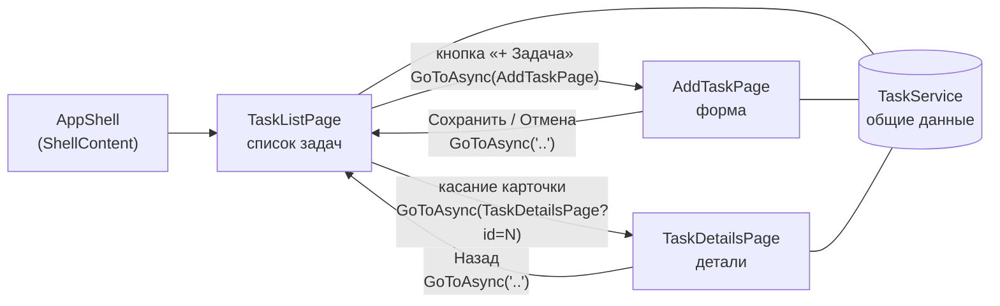
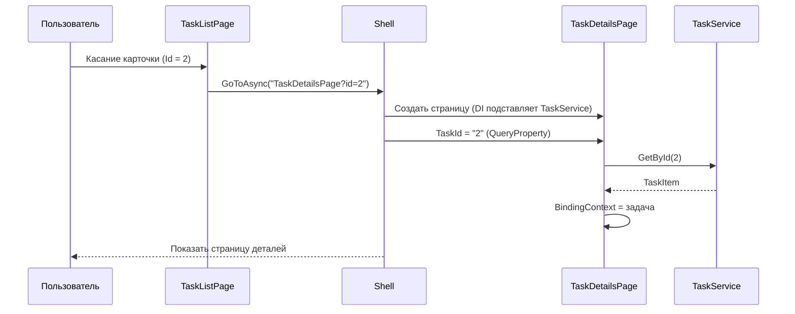
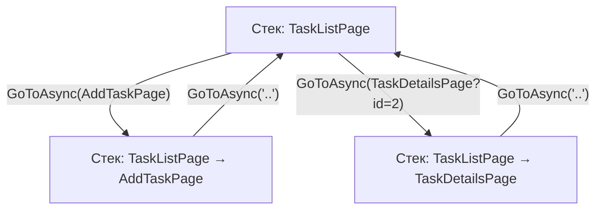

|                      |                                                       |
| -------------------- | ----------------------------------------------------- |
| **Дисциплина**       | Разработка мобильных приложений на .NET MAUI          |
| **Тема**             | Навигация между страницами с помощью Shell            |
| **Среда разработки** | JetBrains Rider                                       |
| **Платформа / язык** | .NET MAUI / C# и XAML                                 |
| **Проект**           | Task Manager (продолжение практических работ №2 и №3) |
| **Время выполнения** | 4 академических часа (2 занятия по 2 часа)            |

---

## 1. Цель работы

Научиться строить многостраничное приложение: настраивать `AppShell`, регистрировать маршруты, переходить между страницами, передавать данные (идентификатор задачи) и возвращаться назад.

## 2. Задание

Создать три страницы приложения Task Manager:

1. **Список задач** (`TaskListPage`);
2. **Добавление задачи** (`AddTaskPage`);
3. **Подробная информация о задаче** (`TaskDetailsPage`).

**Последовательность выполнения**

| № | Действие |
|---|---|
| 1 | Создать три `ContentPage` |
| 2 | Настроить `AppShell` |
| 3 | Создать маршруты |
| 4 | Реализовать переход со списка на детали |
| 5 | Передать идентификатор задачи |
| 6 | Реализовать возврат назад |
| 7 | Проверить навигацию на эмуляторе |

## 3. Исходное состояние проекта

Работа продолжает практические работы №2 и №3. Предполагается, что:

- в проекте есть модель `TaskItem` с полями `Id`, `Title`, `IsCompleted`, `CreatedAt`, `Priority`, а также свойства `PriorityColor` и `PriorityText`;
- созданы словари ресурсов `AppColors.xaml`, `AppSizes.xaml`, `AppStyles.xaml` и подключены в `App.xaml`;
- существует `MainPage` со списком задач, формой ввода и стилями.

Если практическая работа №3 выполнена с тёмной темой, новые стили из шага 1.3 можно доработать так же через `AppThemeBinding`.

## 4. Краткая теория

| Понятие | Суть |
|---|---|
| **Shell** | Контейнер приложения, который задаёт структуру навигации (вкладки, меню) и обеспечивает переходы по URI-маршрутам |
| **`ShellContent`** | Элемент Shell, ссылающийся на страницу; создаёт корневую страницу приложения |
| **Маршрут (route)** | Строковое имя страницы, по которому на неё переходят |
| **`Routing.RegisterRoute`** | Регистрация маршрута для страниц, не входящих в структуру Shell (детали, форма добавления) |
| **`Shell.Current.GoToAsync`** | Переход по маршруту |
| **`..`** | Возврат на предыдущую страницу |
| **Query-параметры** | Данные в строке маршрута: `TaskDetailsPage?id=3` |
| **`[QueryProperty]`** | Атрибут, который записывает параметр маршрута в свойство страницы |
| **Внедрение зависимостей (DI)** | Страницы и сервисы регистрируются в `MauiProgram` и создаются автоматически |

**Схема приложения после выполнения работы**



---

## 5. Ход работы

### Подготовка

1. Откройте решение `TaskManager` в Rider.
2. Создайте ветку: **Git → New Branch…**, имя `lab6-navigation`.
3. Запустите приложение и убедитесь, что оно работает по результатам практической работы №3.

---

### Шаг 0. Подготовка данных: модель и сервис

Раньше список задач хранился в `MainPage`. Для нескольких страниц нужен **общий источник данных**. Создадим сервис `TaskService`, который будет существовать в единственном экземпляре на всё приложение.

#### 0.1. Модель: поле описания

Откройте `Models/TaskItem.cs` и добавьте свойство `Description` (остальной код не меняется):

```csharp
using System.ComponentModel;
using System.Runtime.CompilerServices;
using Microsoft.Maui.Graphics;

namespace TaskManager.Models;

public class TaskItem : INotifyPropertyChanged
{
    private bool _isCompleted;

    public int Id { get; set; }
    public string Title { get; set; } = string.Empty;
    public string Description { get; set; } = string.Empty;
    public DateTime CreatedAt { get; set; } = DateTime.Now;
    public TaskPriority Priority { get; set; } = TaskPriority.Medium;

    public bool IsCompleted
    {
        get => _isCompleted;
        set
        {
            if (_isCompleted == value) return;
            _isCompleted = value;
            OnPropertyChanged();
        }
    }

    public Color PriorityColor => Priority switch
    {
        TaskPriority.High => Colors.Crimson,
        TaskPriority.Medium => Colors.Orange,
        _ => Colors.SeaGreen
    };

    public string PriorityText => Priority switch
    {
        TaskPriority.High => "Высокий",
        TaskPriority.Medium => "Средний",
        _ => "Низкий"
    };

    public event PropertyChangedEventHandler? PropertyChanged;

    protected void OnPropertyChanged([CallerMemberName] string? name = null)
        => PropertyChanged?.Invoke(this, new PropertyChangedEventArgs(name));
}
```

#### 0.2. Сервис данных

1. Создайте папку `Services` (**Add → New Folder**).
2. В ней создайте класс `TaskService`:

```csharp
using TaskManager.Models;

namespace TaskManager.Services;

public class TaskService
{
    private readonly List<TaskItem> _tasks = new();
    private int _nextId = 1;

    public TaskService()
    {
        // Тестовые данные
        Add("Изучить XAML",
            "Разобрать контейнеры, элементы управления и привязки данных.",
            TaskPriority.Low, isCompleted: true);
        Add("Выполнить практическую работу",
            "Создать три страницы и настроить навигацию через Shell.",
            TaskPriority.High);
        Add("Повторить C#",
            "Повторить классы, коллекции и работу с событиями.",
            TaskPriority.Medium);
        Add("Подготовить проект",
            "Оформить репозиторий и описание проекта.",
            TaskPriority.Low);
    }

    public IReadOnlyList<TaskItem> GetAll() => _tasks;

    public TaskItem? GetById(int id) => _tasks.FirstOrDefault(t => t.Id == id);

    public TaskItem Add(string title, string description, TaskPriority priority,
                        bool isCompleted = false)
    {
        var task = new TaskItem
        {
            Id = _nextId++,
            Title = title,
            Description = description,
            Priority = priority,
            IsCompleted = isCompleted,
            CreatedAt = DateTime.Now
        };
        _tasks.Add(task);
        return task;
    }

    public bool Remove(int id)
    {
        var task = GetById(id);
        return task is not null && _tasks.Remove(task);
    }
}
```


---

### Шаг 1. Создание трёх страниц ContentPage

#### 1.1. Создание файлов

1. В **Solution Explorer** щёлкните правой кнопкой по проекту `TaskManager` → **Add → New from template…** (в Rider шаблон называется **.NET MAUI ContentPage (XAML)**; если шаблона нет, создайте файлы `.xaml` и `.xaml.cs` вручную).
2. Создайте три страницы с именами:
   - `TaskListPage`
   - `AddTaskPage`
   - `TaskDetailsPage`
3. Убедитесь, что в проекте появились файлы `TaskListPage.xaml`, `AddTaskPage.xaml`, `TaskDetailsPage.xaml` и соответствующие `.xaml.cs`.


#### 1.2. Заготовки

Проверьте, что в каждом `.xaml.cs` имя класса совпадает с `x:Class` в `.xaml`. Например:

```csharp
namespace TaskManager;

public partial class TaskListPage : ContentPage
{
    public TaskListPage()
    {
        InitializeComponent();
    }
}
```

Содержимое страниц мы заменим в шагах 4–6, поэтому пока можно оставить шаблонное.

#### 1.3. Дополнительные стили

Откройте `Resources/Styles/AppStyles.xaml` и **добавьте перед закрывающим тегом** `</ResourceDictionary>`:

```xml
    <!-- ===== Страницы формы и деталей ===== -->
    <Style x:Key="SecondaryButtonStyle" TargetType="Button"
           BasedOn="{StaticResource PrimaryButtonStyle}">
        <Setter Property="BackgroundColor" Value="Transparent" />
        <Setter Property="TextColor" Value="{StaticResource AppPrimaryColor}" />
        <Setter Property="BorderColor" Value="{StaticResource AppPrimaryColor}" />
        <Setter Property="BorderWidth" Value="1" />
    </Style>

    <Style x:Key="EditorStyle" TargetType="Editor">
        <Setter Property="TextColor" Value="{StaticResource AppTextColor}" />
        <Setter Property="PlaceholderColor" Value="{StaticResource AppMutedTextColor}" />
        <Setter Property="FontSize" Value="{StaticResource BodyFontSize}" />
    </Style>

    <Style x:Key="ErrorLabelStyle" TargetType="Label"
           BasedOn="{StaticResource SecondaryLabelStyle}">
        <Setter Property="TextColor" Value="Crimson" />
        <Setter Property="FontAttributes" Value="Bold" />
    </Style>
```

> Если в практической работе №3 вы делали тёмную тему, замените цвета в этих стилях на `AppThemeBinding` по тому же образцу, что и в других стилях.

---

### Шаг 2. Настройка AppShell

Откройте `AppShell.xaml` и **замените содержимое**:

```xml
<?xml version="1.0" encoding="UTF-8" ?>
<Shell x:Class="TaskManager.AppShell"
       xmlns="http://schemas.microsoft.com/dotnet/2021/maui"
       xmlns:x="http://schemas.microsoft.com/winfx/2009/xaml"
       xmlns:local="clr-namespace:TaskManager"
       Shell.FlyoutBehavior="Disabled"
       Shell.BackgroundColor="{StaticResource AppPrimaryColor}"
       Shell.ForegroundColor="White"
       Shell.TitleColor="White"
       Title="Task Manager">

    <ShellContent Title="Задачи"
                  Route="TaskListPage"
                  ContentTemplate="{DataTemplate local:TaskListPage}" />

</Shell>
```

**Что здесь настроено**

| Атрибут | Назначение |
|---|---|
| `Shell.FlyoutBehavior="Disabled"` | Боковое меню отключено: оно нам не нужно |
| `Shell.BackgroundColor`, `ForegroundColor`, `TitleColor` | Единый цвет верхней панели (из ресурсов, как в практической работе №3) |
| `ShellContent` | Корневая страница — список задач |
| `Route="TaskListPage"` | Маршрут корневой страницы |
| `ContentTemplate="{DataTemplate local:TaskListPage}"` | Страница создаётся при первом обращении и получает зависимости из DI |

Теперь **удалите** старую страницу `MainPage.xaml` (вместе с `MainPage.xaml.cs`): правый клик → **Delete**. Её содержимое переходит на `TaskListPage` в шаге 4.

---

### Шаг 3. Создание маршрутов и регистрация зависимостей

#### 3.1. Регистрация маршрутов

Страницы `AddTaskPage` и `TaskDetailsPage` не входят в структуру Shell (в нём нет вкладок и пунктов меню для них). Для них нужно **зарегистрировать маршруты**. Откройте `AppShell.xaml.cs`:

```csharp
namespace TaskManager;

public partial class AppShell : Shell
{
    public AppShell()
    {
        InitializeComponent();

        // Маршруты страниц, на которые переходим из кода
        Routing.RegisterRoute(nameof(AddTaskPage), typeof(AddTaskPage));
        Routing.RegisterRoute(nameof(TaskDetailsPage), typeof(TaskDetailsPage));
    }
}
```

**Почему `nameof`.** Строка маршрута совпадает с именем класса: нет опечаток, при переименовании страницы маршрут изменится автоматически.

**Таблица маршрутов приложения**

| Маршрут | Страница | Как задан | Пример перехода |
|---|---|---|---|
| `TaskListPage` | Список | `Route` в `AppShell.xaml` | Стартовая страница |
| `AddTaskPage` | Добавление | `Routing.RegisterRoute` | `GoToAsync(nameof(AddTaskPage))` |
| `TaskDetailsPage` | Детали | `Routing.RegisterRoute` | `GoToAsync("TaskDetailsPage?id=2")` |
| `..` | Предыдущая страница | Служебный | `GoToAsync("..")` |

#### 3.2. Регистрация в MauiProgram

Откройте `MauiProgram.cs` и добавьте регистрации (подсвечено комментариями):

```csharp
using Microsoft.Extensions.Logging;
using TaskManager.Services;

namespace TaskManager;

public static class MauiProgram
{
    public static MauiApp CreateMauiApp()
    {
        var builder = MauiApp.CreateBuilder();
        builder
            .UseMauiApp<App>()
            .ConfigureFonts(fonts =>
            {
                fonts.AddFont("OpenSans-Regular.ttf", "OpenSansRegular");
                fonts.AddFont("OpenSans-Semibold.ttf", "OpenSansSemibold");
            });

        // --- Сервис данных: один экземпляр на всё приложение ---
        builder.Services.AddSingleton<TaskService>();

        // --- Страницы: новый экземпляр при каждом переходе ---
        builder.Services.AddTransient<TaskListPage>();
        builder.Services.AddTransient<AddTaskPage>();
        builder.Services.AddTransient<TaskDetailsPage>();

#if DEBUG
        builder.Logging.AddDebug();
#endif

        return builder.Build();
    }
}
```

| Время жизни | Что означает | Используем для |
|---|---|---|
| `AddSingleton` | Один экземпляр на всё приложение | `TaskService`: все страницы видят одни и те же данные |
| `AddTransient` | Новый экземпляр при каждом запросе | Страницы: при каждом переходе создаётся свежая страница |

> Если оставить в проекте обращение к `MainPage` (например, в `App.xaml.cs`), сборка завершится ошибкой. В новых шаблонах окно создаётся как `new Window(new AppShell())`, правок не требуется.

Соберите проект: **Build → Build Solution**. Если ошибок нет, переходите к шагу 4.

---

### Шаг 4. Переход со списка на детали

#### 4.1. Разметка списка: `TaskListPage.xaml`

Замените содержимое файла:

```xml
<?xml version="1.0" encoding="utf-8" ?>
<ContentPage xmlns="http://schemas.microsoft.com/dotnet/2021/maui"
             xmlns:x="http://schemas.microsoft.com/winfx/2009/xaml"
             xmlns:models="clr-namespace:TaskManager.Models"
             x:Class="TaskManager.TaskListPage"
             Title="Задачи"
             Style="{StaticResource PageStyle}"
             Shell.NavBarIsVisible="False">

    <Grid RowDefinitions="Auto,Auto,*"
          RowSpacing="12"
          Padding="{StaticResource PagePadding}">

        <!-- Строка 0: заголовок и кнопка добавления -->
        <Grid Grid.Row="0" ColumnDefinitions="*,Auto" ColumnSpacing="8">
            <VerticalStackLayout Grid.Column="0" Spacing="2">
                <Label Text="Task Manager"
                       Style="{StaticResource TitleLabelStyle}"
                       SemanticProperties.HeadingLevel="Level1" />
                <Label Text="Список задач"
                       Style="{StaticResource SecondaryLabelStyle}" />
            </VerticalStackLayout>

            <Button Grid.Column="1"
                    Text="+ Задача"
                    Style="{StaticResource PrimaryButtonStyle}"
                    VerticalOptions="Start"
                    SemanticProperties.Hint="Открывает форму новой задачи"
                    Clicked="OnAddClicked" />
        </Grid>

        <!-- Строка 1: переключатель -->
        <HorizontalStackLayout Grid.Row="1" Spacing="8">
            <Switch x:Name="HideCompletedSwitch"
                    Style="{StaticResource SwitchStyle}"
                    Toggled="OnHideCompletedToggled" />
            <Label Text="Скрыть выполненные"
                   Style="{StaticResource BodyLabelStyle}"
                   VerticalOptions="Center" />
        </HorizontalStackLayout>

        <!-- Строка 2: список -->
        <CollectionView x:Name="TasksView"
                        Grid.Row="2"
                        SelectionMode="None">

            <!-- Пустой список: понятное сообщение вместо пустого экрана -->
            <CollectionView.EmptyView>
                <Label Text="Задач пока нет. Нажмите «+ Задача»."
                       Style="{StaticResource SecondaryLabelStyle}"
                       HorizontalTextAlignment="Center"
                       Margin="0,32" />
            </CollectionView.EmptyView>

            <CollectionView.ItemTemplate>
                <DataTemplate x:DataType="models:TaskItem">

                    <Border Style="{StaticResource TaskCardStyle}">

                        <!-- Касание карточки открывает детали -->
                        <Border.GestureRecognizers>
                            <TapGestureRecognizer Tapped="OnCardTapped" />
                        </Border.GestureRecognizers>

                        <Border.Shadow>
                            <Shadow Brush="Black" Opacity="0.12" Radius="8" Offset="0,2" />
                        </Border.Shadow>

                        <Border.Triggers>
                            <DataTrigger TargetType="Border"
                                         Binding="{Binding IsCompleted}" Value="True">
                                <Setter Property="Opacity" Value="0.6" />
                            </DataTrigger>
                        </Border.Triggers>

                        <Grid ColumnDefinitions="6,Auto,*" ColumnSpacing="10">

                            <BoxView Grid.Column="0"
                                     Color="{Binding PriorityColor}"
                                     CornerRadius="3" />

                            <CheckBox Grid.Column="1"
                                      IsChecked="{Binding IsCompleted}"
                                      Style="{StaticResource TaskCheckBoxStyle}"
                                      VerticalOptions="Center" />

                            <VerticalStackLayout Grid.Column="2" Spacing="2">
                                <Label Text="{Binding Title}"
                                       Style="{StaticResource TaskTitleLabelStyle}">
                                    <Label.Triggers>
                                        <DataTrigger TargetType="Label"
                                                     Binding="{Binding IsCompleted}" Value="True">
                                            <Setter Property="TextDecorations" Value="Strikethrough" />
                                            <Setter Property="TextColor"
                                                    Value="{StaticResource AppMutedTextColor}" />
                                        </DataTrigger>
                                    </Label.Triggers>
                                </Label>

                                <HorizontalStackLayout Spacing="8">
                                    <Label Text="{Binding PriorityText, StringFormat='Приоритет: {0}'}"
                                           Style="{StaticResource SecondaryLabelStyle}"
                                           TextColor="{Binding PriorityColor}" />
                                    <Label Text="{Binding CreatedAt, StringFormat='{0:dd.MM.yyyy HH:mm}'}"
                                           Style="{StaticResource SecondaryLabelStyle}" />
                                </HorizontalStackLayout>
                            </VerticalStackLayout>
                        </Grid>
                    </Border>

                </DataTemplate>
            </CollectionView.ItemTemplate>
        </CollectionView>

    </Grid>
</ContentPage>
```

**Что изменилось по сравнению с практической работой №3**

- форма ввода убрана: добавление задачи теперь на отдельной странице;
- кнопка **+ Задача** открывает форму;
- карточка реагирует на касание (`TapGestureRecognizer`);
- для пустого списка добавлен `EmptyView`;
- навигационная панель скрыта (`Shell.NavBarIsVisible="False"`): у списка собственный заголовок.

#### 4.2. Код страницы: `TaskListPage.xaml.cs`

```csharp
using TaskManager.Models;
using TaskManager.Services;

namespace TaskManager;

public partial class TaskListPage : ContentPage
{
    private readonly TaskService _service;
    private bool _isNavigating;

    // Сервис передаётся через конструктор (внедрение зависимостей)
    public TaskListPage(TaskService service)
    {
        InitializeComponent();
        _service = service;
    }

    // Вызывается при каждом показе страницы, в том числе при возврате назад
    protected override void OnAppearing()
    {
        base.OnAppearing();
        RefreshList();
    }

    private void RefreshList()
    {
        var tasks = _service.GetAll();

        TasksView.ItemsSource = HideCompletedSwitch.IsToggled
            ? tasks.Where(t => !t.IsCompleted).ToList()
            : tasks.ToList();
    }

    private void OnHideCompletedToggled(object? sender, ToggledEventArgs e)
    {
        RefreshList();
    }

    // Переход на страницу добавления
    private async void OnAddClicked(object? sender, EventArgs e)
    {
        await NavigateAsync(nameof(AddTaskPage));
    }

    // Переход на страницу деталей с передачей идентификатора
    private async void OnCardTapped(object? sender, TappedEventArgs e)
    {
        if (sender is not Border { BindingContext: TaskItem task })
            return;

        await NavigateAsync($"{nameof(TaskDetailsPage)}?id={task.Id}");
    }

    // Защита от двойного нажатия: без неё страница может открыться дважды
    private async Task NavigateAsync(string route)
    {
        if (_isNavigating)
            return;

        _isNavigating = true;
        try
        {
            await Shell.Current.GoToAsync(route);
        }
        finally
        {
            _isNavigating = false;
        }
    }
}
```

**Разбор ключевых строк**

| Код | Значение |
|---|---|
| `OnAppearing()` | После возврата с `AddTaskPage` список обновится и покажет новую задачу |
| `sender is Border { BindingContext: TaskItem task }` | Из карточки, которой коснулись, получаем её задачу (`BindingContext` равен элементу списка) |
| `$"{nameof(TaskDetailsPage)}?id={task.Id}"` | Маршрут вида `TaskDetailsPage?id=2` — идентификатор передаётся как query-параметр |
| `await Shell.Current.GoToAsync(route)` | Асинхронный переход; `await` обязателен |
| `_isNavigating` | Блокирует повторный переход при быстром двойном касании |

Запустите приложение: список отображается, кнопка и касание карточки пока приводят к ошибке «маршрут не найден» либо открывают пустые страницы. Это нормально: содержимое страниц создаётся в шагах 5–6.

---

### Шаг 5. Передача идентификатора задачи

Страница деталей должна получить `id`, найти задачу в сервисе и показать её данные.

#### 5.1. Разметка: `TaskDetailsPage.xaml`

```xml
<?xml version="1.0" encoding="utf-8" ?>
<ContentPage xmlns="http://schemas.microsoft.com/dotnet/2021/maui"
             xmlns:x="http://schemas.microsoft.com/winfx/2009/xaml"
             xmlns:models="clr-namespace:TaskManager.Models"
             x:Class="TaskManager.TaskDetailsPage"
             x:DataType="models:TaskItem"
             Title="Детали задачи"
             Style="{StaticResource PageStyle}">

    <ScrollView>
        <VerticalStackLayout Padding="{StaticResource PagePadding}" Spacing="16">

            <!-- Сообщение, если задача не найдена -->
            <Label x:Name="NotFoundLabel"
                   Text="Задача не найдена"
                   Style="{StaticResource ErrorLabelStyle}"
                   IsVisible="False" />

            <!-- Карточка с основной информацией -->
            <Border x:Name="InfoCard" Style="{StaticResource TaskCardStyle}">
                <Grid ColumnDefinitions="6,*" ColumnSpacing="12">

                    <BoxView Grid.Column="0"
                             Color="{Binding PriorityColor}"
                             CornerRadius="3" />

                    <VerticalStackLayout Grid.Column="1" Spacing="8">
                        <Label Text="{Binding Title}"
                               Style="{StaticResource TaskTitleLabelStyle}"
                               FontSize="22"
                               SemanticProperties.HeadingLevel="Level1" />

                        <HorizontalStackLayout Spacing="8">
                            <CheckBox IsChecked="{Binding IsCompleted}"
                                      Style="{StaticResource TaskCheckBoxStyle}"
                                      VerticalOptions="Center" />
                            <Label Text="Выполнена"
                                   Style="{StaticResource BodyLabelStyle}"
                                   VerticalOptions="Center" />
                        </HorizontalStackLayout>
                    </VerticalStackLayout>
                </Grid>
            </Border>

            <!-- Описание -->
            <VerticalStackLayout Spacing="4">
                <Label Text="Описание" Style="{StaticResource SecondaryLabelStyle}" />
                <Label Text="{Binding Description}" Style="{StaticResource BodyLabelStyle}" />
            </VerticalStackLayout>

            <!-- Приоритет -->
            <VerticalStackLayout Spacing="4">
                <Label Text="Приоритет" Style="{StaticResource SecondaryLabelStyle}" />
                <Label Text="{Binding PriorityText}"
                       Style="{StaticResource BodyLabelStyle}"
                       TextColor="{Binding PriorityColor}"
                       FontAttributes="Bold" />
            </VerticalStackLayout>

            <!-- Дата создания -->
            <VerticalStackLayout Spacing="4">
                <Label Text="Создана" Style="{StaticResource SecondaryLabelStyle}" />
                <Label Text="{Binding CreatedAt, StringFormat='{0:dd.MM.yyyy HH:mm}'}"
                       Style="{StaticResource BodyLabelStyle}" />
            </VerticalStackLayout>

            <!-- Идентификатор: подтверждает, что параметр передан верно -->
            <Label Text="{Binding Id, StringFormat='ID задачи: {0}'}"
                   Style="{StaticResource SecondaryLabelStyle}" />

            <!-- Кнопка возврата -->
            <Button Text="Назад к списку"
                    Style="{StaticResource SecondaryButtonStyle}"
                    Clicked="OnBackClicked" />

        </VerticalStackLayout>
    </ScrollView>
</ContentPage>
```

> Здесь `ScrollView` уместен: на странице нет списка, а текст описания может быть длинным. Эксплуатация `CollectionView` внутри `ScrollView` по-прежнему недопустима.

#### 5.2. Код страницы: `TaskDetailsPage.xaml.cs`

```csharp
using TaskManager.Services;

namespace TaskManager;

// Параметр маршрута "id" будет записан в свойство TaskId
[QueryProperty(nameof(TaskId), "id")]
public partial class TaskDetailsPage : ContentPage
{
    private readonly TaskService _service;
    private string _taskId = string.Empty;

    public TaskDetailsPage(TaskService service)
    {
        InitializeComponent();
        _service = service;
    }

    // Shell вызывает set после создания страницы, когда разбирает query-строку
    public string TaskId
    {
        get => _taskId;
        set
        {
            _taskId = value;
            LoadTask();
        }
    }

    private void LoadTask()
    {
        // Параметры маршрута всегда приходят строками
        if (!int.TryParse(_taskId, out var id))
        {
            ShowNotFound();
            return;
        }

        var task = _service.GetById(id);
        if (task is null)
        {
            ShowNotFound();
            return;
        }

        BindingContext = task;
        NotFoundLabel.IsVisible = false;
        InfoCard.IsVisible = true;
    }

    private void ShowNotFound()
    {
        NotFoundLabel.IsVisible = true;
        InfoCard.IsVisible = false;
    }

    // Возврат на предыдущую страницу (реализация шага 6)
    private async void OnBackClicked(object? sender, EventArgs e)
    {
        await Shell.Current.GoToAsync("..");
    }
}
```

**Как идёт передача данных**



**Запустите приложение и коснитесь разных карточек.** На странице деталей должны отображаться данные именно той задачи, которую вы выбрали, а строка «ID задачи» должна совпадать с номером.

---

### Шаг 6. Возврат назад

Вернуться на предыдущую страницу можно несколькими способами: системная кнопка «Назад», стрелка в навигационной панели, а также программный вызов `GoToAsync("..")`. Мы реализуем форму добавления с возвратом и проверим все способы.

#### 6.1. Разметка: `AddTaskPage.xaml`

```xml
<?xml version="1.0" encoding="utf-8" ?>
<ContentPage xmlns="http://schemas.microsoft.com/dotnet/2021/maui"
             xmlns:x="http://schemas.microsoft.com/winfx/2009/xaml"
             x:Class="TaskManager.AddTaskPage"
             Title="Новая задача"
             Style="{StaticResource PageStyle}">

    <ScrollView>
        <VerticalStackLayout Padding="{StaticResource PagePadding}" Spacing="12">

            <Label Text="Название" Style="{StaticResource SecondaryLabelStyle}" />
            <Entry x:Name="TitleEntry"
                   Placeholder="Например, подготовить отчёт"
                   ReturnType="Next"
                   Style="{StaticResource EntryStyle}" />

            <Label Text="Описание" Style="{StaticResource SecondaryLabelStyle}" />
            <Editor x:Name="DescriptionEditor"
                    Placeholder="Подробности задачи"
                    HeightRequest="120"
                    Style="{StaticResource EditorStyle}" />

            <Label Text="Приоритет" Style="{StaticResource SecondaryLabelStyle}" />
            <Picker x:Name="PriorityPicker"
                    Title="Выберите приоритет"
                    Style="{StaticResource PickerStyle}" />

            <!-- Сообщение об ошибке ввода -->
            <Label x:Name="ErrorLabel"
                   Style="{StaticResource ErrorLabelStyle}"
                   IsVisible="False" />

            <Grid ColumnDefinitions="*,*" ColumnSpacing="8" Margin="0,8,0,0">
                <Button Grid.Column="0"
                        Text="Отмена"
                        Style="{StaticResource SecondaryButtonStyle}"
                        Clicked="OnCancelClicked" />
                <Button Grid.Column="1"
                        Text="Сохранить"
                        Style="{StaticResource PrimaryButtonStyle}"
                        Clicked="OnSaveClicked" />
            </Grid>

        </VerticalStackLayout>
    </ScrollView>
</ContentPage>
```

#### 6.2. Код страницы: `AddTaskPage.xaml.cs`

```csharp
using TaskManager.Models;
using TaskManager.Services;

namespace TaskManager;

public partial class AddTaskPage : ContentPage
{
    private readonly TaskService _service;

    public AddTaskPage(TaskService service)
    {
        InitializeComponent();
        _service = service;

        PriorityPicker.ItemsSource = new List<string> { "Низкий", "Средний", "Высокий" };
        PriorityPicker.SelectedIndex = 1;   // по умолчанию «Средний»
    }

    private async void OnSaveClicked(object? sender, EventArgs e)
    {
        var title = TitleEntry.Text?.Trim();

        // Проверка ввода: сообщение рядом с полем, без всплывающих окон
        if (string.IsNullOrEmpty(title))
        {
            ErrorLabel.Text = "Введите название задачи";
            ErrorLabel.IsVisible = true;
            TitleEntry.Focus();
            return;
        }

        _service.Add(
            title,
            DescriptionEditor.Text?.Trim() ?? string.Empty,
            (TaskPriority)PriorityPicker.SelectedIndex);

        // Возврат на список
        await Shell.Current.GoToAsync("..");
    }

    private async void OnCancelClicked(object? sender, EventArgs e)
    {
        await Shell.Current.GoToAsync("..");
    }
}
```

#### 6.3. Способы возврата

| Способ | Где реализован | Что проверить |
|---|---|---|
| Стрелка «Назад» в навигационной панели | Автоматически (Shell) | Есть на `AddTaskPage` и `TaskDetailsPage` |
| Системная кнопка / жест «Назад» (Android) | Автоматически | Возвращает на предыдущую страницу |
| Кнопки **Отмена** / **Сохранить** | `GoToAsync("..")` | Возвращает на список |
| Кнопка **Назад к списку** на деталях | `GoToAsync("..")` | Возвращает на список |

#### 6.4. Как работает возврат



После возврата вызывается `OnAppearing()` списка, поэтому добавленная задача и изменения (например, отметка `IsCompleted` на странице деталей) сразу видны.

---

### Шаг 7. Проверка навигации на эмуляторе

#### 7.1. Запуск

1. В панели запуска выберите эмулятор Android (**Device Manager**) и нажмите **Run**.
2. Для наблюдения за порядком вызовов поставьте **точки останова** (breakpoints) в `TaskDetailsPage.TaskId (set)`, `TaskListPage.OnAppearing()` и запустите режим **Debug**.

#### 7.2. Проверочные сценарии

| № | Сценарий | Ожидаемый результат | Факт |
|---|---|---|---|
| 1 | Запуск приложения | Открывается список, 4 задачи | |
| 2 | Нажать **+ Задача** | Открывается форма с заголовком «Новая задача» и стрелкой «Назад» | |
| 3 | Нажать **Сохранить** при пустом названии | Появляется сообщение об ошибке, возврата нет | |
| 4 | Ввести название, нажать **Сохранить** | Возврат на список, новая задача в конце списка | |
| 5 | Открыть форму и нажать **Отмена** | Возврат на список, задач столько же | |
| 6 | Коснуться первой карточки | Открываются детали с ID = 1 | |
| 7 | Вернуться и коснуться другой карточки | Детали другой задачи, ID соответствует | |
| 8 | На деталях нажать **Назад к списку** | Возврат на список | |
| 9 | На деталях нажать системную кнопку «Назад» | Возврат на список | |
| 10 | Отметить флажок на деталях и вернуться | В списке задача отмечена выполненной | |
| 11 | Быстро дважды коснуться карточки | Открывается **одна** страница деталей | |
| 12 | Повернуть эмулятор на деталях | Данные задачи сохраняются | |
| 13 | Включить **Скрыть выполненные**, добавить задачу | Выполненные скрыты, новая видна | |
| 14 | Открыть форму, развернуть клавиатуру | Поля не перекрыты клавиатурой, форма прокручивается | |

#### 7.3. Проверка порядка вызовов (отладка)

При переходе на страницу деталей в отладчике вы увидите порядок:

1. конструктор `TaskDetailsPage(TaskService service)`;
2. `TaskId (set)`: значение `"2"`;
3. `OnAppearing()` страницы.

Это подтверждает, что параметр приходит **после** создания страницы, но **до** её показа.

---

## 6. Дополнительное задание

### 6.1. Удаление задачи с подтверждением и возвратом

**Сервис** уже содержит метод `Remove`. На странице деталей добавьте кнопку в `TaskDetailsPage.xaml` (перед кнопкой «Назад к списку»):

```xml
<Button Text="Удалить задачу"
        Style="{StaticResource SecondaryButtonStyle}"
        TextColor="Crimson"
        BorderColor="Crimson"
        Clicked="OnDeleteClicked" />
```

В `TaskDetailsPage.xaml.cs` добавьте обработчик (и `using TaskManager.Models;`):

```csharp
private async void OnDeleteClicked(object? sender, EventArgs e)
{
    if (BindingContext is not TaskItem task)
        return;

    bool confirmed = await DisplayAlert(
        "Удаление",
        $"Удалить задачу «{task.Title}»?",
        "Удалить",
        "Отмена");

    if (!confirmed)
        return;

    _service.Remove(task.Id);
    await Shell.Current.GoToAsync("..");
}
```

> В новых версиях .NET MAUI (начиная с .NET 10) метод `DisplayAlert` помечен устаревшим: используйте `DisplayAlertAsync` с теми же параметрами. Если компилятор выдаёт предупреждение, замените название метода.

### 6.2. Передача объекта вместо идентификатора

Сравните два подхода к передаче данных.

**В списке** замените переход:

```csharp
await Shell.Current.GoToAsync(
    nameof(TaskDetailsPage),
    new ShellNavigationQueryParameters { { "task", task } });
```

**На странице деталей** замените атрибут и свойство:

```csharp
[QueryProperty(nameof(SelectedTask), "task")]
public partial class TaskDetailsPage : ContentPage
{
    public TaskItem? SelectedTask
    {
        set
        {
            if (value is null) { ShowNotFound(); return; }
            BindingContext = value;
            NotFoundLabel.IsVisible = false;
            InfoCard.IsVisible = true;
        }
    }
    // ...
}
```

Заполните сравнительную таблицу в отчёте:

| Критерий | Идентификатор (`?id=2`) | Объект (`ShellNavigationQueryParameters`) |
|---|---|---|
| Удобство | | |
| Что будет при «глубокой ссылке» | | |
| Риск рассинхронизации данных | | |
| Что рекомендуется для простых данных | | |

### 6.3. Нижние вкладки (TabBar)

Добавьте вторую вкладку «О приложении»:

1. создайте страницу `AboutPage` (`ContentPage`) с кратким описанием приложения;
2. в `AppShell.xaml` замените `ShellContent` на `TabBar`:

```xml
<TabBar>
    <ShellContent Title="Задачи"
                  Route="TaskListPage"
                  ContentTemplate="{DataTemplate local:TaskListPage}" />
    <ShellContent Title="О приложении"
                  Route="AboutPage"
                  ContentTemplate="{DataTemplate local:AboutPage}" />
</TabBar>
```

3. зарегистрируйте `AboutPage` в DI (`AddTransient<AboutPage>()`);
4. проверьте, что при открытии деталей нижняя панель вкладок не мешает (при необходимости скройте её на странице: `Shell.TabBarIsVisible="False"`).

### 6.4. Подтверждение ухода со страницы добавления

Запретите случайный выход с `AddTaskPage`, если поле названия заполнено, но задача не сохранена. Подсказка: используйте `Shell.BackButtonBehavior` (команда кнопки «Назад») либо переопределите метод `OnNavigating` в `AppShell`. Опишите выбранное решение в отчёте.

---

## 7. Типичные ошибки

| Симптом | Причина и решение |
|---|---|
| `Unable to figure out route for: ...` | Маршрут не зарегистрирован. Проверьте `Routing.RegisterRoute` и точное совпадение имени |
| `Global routes currently cannot be the same as other routes` | Одинаковые маршруты в `Route` и `RegisterRoute`. Сделайте имена уникальными |
| `Relative routing to shell elements is currently not supported` | Переход на страницу из `ShellContent` по относительному маршруту. Используйте абсолютный (`//TaskListPage`) |
| `Unable to resolve service for type TaskService` | Сервис не зарегистрирован в `MauiProgram.cs` |
| Страница открывается с ошибкой «нет конструктора без параметров» | Страница не добавлена через `AddTransient<...>()` в DI, а ctor принимает параметры |
| `TaskId` приходит пустым | Не совпадает имя параметра в `[QueryProperty(nameof(TaskId), "id")]` и в строке маршрута (`?id=`). Регистр важен |
| `TaskId` не вызывается | У свойства нет публичного `set`, либо атрибут стоит не на классе страницы |
| Новая задача не появляется в списке | Не обновляется список после возврата. Проверьте `OnAppearing()` |
| Страница деталей открывается дважды | Двойное касание. Используйте защиту `_isNavigating` |
| На странице нет стрелки «Назад» | Страница показана как корневая (`ShellContent`) или навигационная панель скрыта `Shell.NavBarIsVisible="False"` |
| После `GoToAsync("..")` приложение закрывается | Навигационный стек пуст: переход вызван на корневой странице |
| Сбой при `await` в `async void` | Исключение внутри обработчика событий. Оберните вызовы в `try/catch` и логируйте |

## 9. Контрольные вопросы

1. Для чего нужен `Shell` и какие структурные элементы он содержит?
2. Чем отличаются маршруты, заданные в `AppShell.xaml`, от маршрутов, зарегистрированных через `Routing.RegisterRoute`?
3. Что означают относительный и абсолютный маршруты? Что делает `".."`?
4. Как передать идентификатор на другую страницу? Почему параметры приходят строками?
5. Для чего нужен атрибут `[QueryProperty]` и когда вызывается свойство, на которое он указывает?
6. Почему страницы и сервис регистрируются в DI с разным временем жизни (`AddTransient` и `AddSingleton`)?
7. Почему список обновляется в `OnAppearing()`, а не в конструкторе?
8. Какие способы возврата на предыдущую страницу вы использовали?
9. Что произойдёт при двойном касании карточки и как этого избежать?
10. В чём преимущества и недостатки передачи объекта вместо идентификатора?

## 10. Список источников

1. Документация .NET MAUI — Microsoft Learn: <https://learn.microsoft.com/dotnet/maui/>
   - разделы «Shell», «Shell navigation», «Dependency injection».
2. Лекция 6. Навигация в .NET MAUI: Shell, маршруты, передача данных (файл `Lekciya_6_Navigaciya_Shell.md`).
3. Документация JetBrains Rider — .NET MAUI: <https://www.jetbrains.com/help/rider/>
