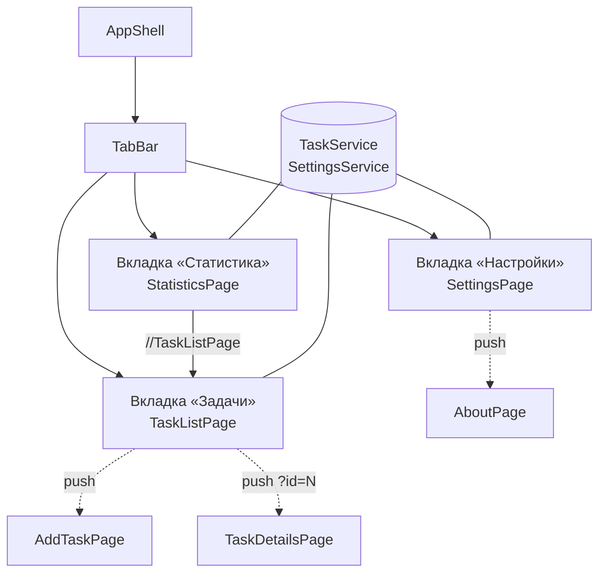

# Практическая работа №7. Переработка интерфейса с использованием Shell: TabBar

|                          |                                                                                        |
| ------------------------ | -------------------------------------------------------------------------------------- |
| **Дисциплина**           | Разработка мобильных приложений на .NET MAUI                                           |
| **Тема**                 | Многовкладочная навигация: `TabBar`, маршруты, переходы между вкладками                |
| **Среда разработки**     | JetBrains Rider                                                                        |
| **Платформа / язык**     | .NET MAUI / C# и XAML                                                                  |
| **Проект**               | Task Manager (продолжение практических работ №2, №3 и №6)                              |
| **Время выполнения**     | 4 академических часа (2 занятия по 2 часа)                                             |


---

## 1. Цель работы

Научиться строить интерфейс приложения из нескольких равноправных разделов с помощью `TabBar`: создавать вкладки, регистрировать маршруты, настраивать переходы между вкладками и вложенными страницами и проверять корректность навигации.

## 2. Задание

Переработать интерфейс Task Manager с использованием `Shell`: вместо одной корневой страницы создать нижнюю панель вкладок.

**Последовательность выполнения**

| № | Действие |
|---|---|
| 1 | Создать `TabBar` |
| 2 | Добавить вкладку «Задачи» |
| 3 | Добавить вкладку «Статистика» |
| 4 | Добавить вкладку «Настройки» |
| 5 | Зарегистрировать маршруты |
| 6 | Настроить переходы |
| 7 | Проверить корректность навигации |

## 3. Исходное состояние проекта

Работа продолжает практические работы №3 и №6. Предполагается, что:

- выполнена практическая работа №3 **вместе с дополнительным заданием** (тёмная тема): в `AppColors.xaml` есть цвета с суффиксом `Dark`, в `AppStyles.xaml` используется `AppThemeBinding`;
- выполнена практическая работа №6: есть страницы `TaskListPage`, `AddTaskPage`, `TaskDetailsPage`, сервис `TaskService`, маршруты `AddTaskPage` и `TaskDetailsPage`;
- в `AppShell.xaml` одна страница `TaskListPage` в элементе `ShellContent`;
- в `MauiProgram.cs` зарегистрированы `TaskService` (`Singleton`) и три страницы (`Transient`).

Если какая-либо из работ не выполнена, сначала доведите её до конца: без неё код этой работы не соберётся.

## 4. Краткая теория

| Понятие | Суть |
|---|---|
| **`TabBar`** | Элемент Shell, который создаёт нижнюю панель вкладок. Боковое меню при этом не используется |
| **`ShellContent`** | Страница внутри вкладки. Каждый `ShellContent` в `TabBar` становится отдельной вкладкой |
| **`Tab`** | Явная вкладка. Позволяет вложить в неё несколько `ShellContent` (верхние вкладки) |
| **Маршрут вкладки** | Задаётся атрибутом `Route`; переход на вкладку выполняется **абсолютным** маршрутом `//Имя` |
| **Регистрируемый маршрут** | `Routing.RegisterRoute`: для страниц вне панели вкладок (форма, детали). Страница кладётся в стек **текущей** вкладки |
| **Стек вкладки** | У каждой вкладки свой навигационный стек: переход на другую вкладку не сбрасывает вложенные страницы |
| **`Shell.TabBarIsVisible`** | Скрывает панель вкладок на конкретной странице |
| **`OnNavigated` / `OnNavigating`** | Переопределяемые методы `Shell`: позволяют журналировать и перехватывать переходы |
| **`Preferences`** | Хранилище настроек «ключ — значение»; сохраняется между запусками |

**Схема приложения после выполнения работы**



Сплошные линии из панели — вкладки. Пунктир — страницы, которые открываются поверх вкладки по зарегистрированным маршрутам.

---

## 5. Ход работы

### Подготовка

1. Откройте решение `TaskManager` в Rider.
2. Создайте ветку: **Git → New Branch…**, имя `lab7-tabbar`.
3. Запустите приложение и убедитесь, что оно работает по результатам практической работы №6 (список, форма, детали).

---

### Шаг 0. Подготовка: статистика, настройки и зависимости

Новым вкладкам нужны данные и настройки. Подготовим их заранее, чтобы дальше собирать проект после каждого шага.

#### 0.1. Модель статистики

Создайте файл `Models/TaskStatistics.cs`:

```csharp
namespace TaskManager.Models;

// Неизменяемый «снимок» статистики на момент запроса
public record TaskStatistics(
    int Total,
    int Completed,
    int HighActive,
    int MediumActive,
    int LowActive)
{
    public int Active => Total - Completed;

    // Доля выполненных задач от 0 до 1
    public double CompletionRatio => Total == 0 ? 0 : (double)Completed / Total;
}
```

#### 0.2. Дополнение сервиса задач

Откройте `Services/TaskService.cs` и **добавьте два метода** (остальной код не меняется):

```csharp
    // Подсчёт статистики по текущему списку
    public TaskStatistics GetStatistics()
    {
        var active = _tasks.Where(t => !t.IsCompleted).ToList();

        return new TaskStatistics(
            Total: _tasks.Count,
            Completed: _tasks.Count - active.Count,
            HighActive: active.Count(t => t.Priority == TaskPriority.High),
            MediumActive: active.Count(t => t.Priority == TaskPriority.Medium),
            LowActive: active.Count(t => t.Priority == TaskPriority.Low));
    }

    // Удаляет выполненные задачи, возвращает их количество
    public int ClearCompleted() => _tasks.RemoveAll(t => t.IsCompleted);
```

#### 0.3. Сервис настроек

Создайте файл `Services/SettingsService.cs`:

```csharp
namespace TaskManager.Services;

public class SettingsService
{
    private const string ThemeKey = "theme_mode";
    private const string HideCompletedKey = "hide_completed";

    // Режим темы: Unspecified (как в системе), Light или Dark.
    // Хранится числом, чтобы пережить перезапуск приложения.
    public AppTheme Theme
    {
        get => (AppTheme)Preferences.Default.Get(ThemeKey, (int)AppTheme.Unspecified);
        set
        {
            Preferences.Default.Set(ThemeKey, (int)value);
            ApplyTheme();
        }
    }

    // Какая тема действует сейчас (с учётом системной)
    public bool IsDark => Application.Current?.RequestedTheme == AppTheme.Dark;

    // Скрывать ли выполненные задачи в списке
    public bool HideCompleted
    {
        get => Preferences.Default.Get(HideCompletedKey, false);
        set => Preferences.Default.Set(HideCompletedKey, value);
    }

    // Применяет сохранённую тему к приложению
    public void ApplyTheme()
    {
        if (Application.Current is { } app)
            app.UserAppTheme = Theme;
    }
}
```

> Если Rider подсвечивает `Preferences`, добавьте `using Microsoft.Maui.Storage;`.

**Почему так.** До первого выбора пользователя тема следует системной (`Unspecified`). Состояние настроек хранится в одном месте (`Preferences`), поэтому переключатели на разных вкладках не расходятся (см. шаг 4).

#### 0.4. Применение темы при запуске

Откройте `App.xaml.cs`. **Замените** конструктор: сервис настроек передаётся через DI.

```csharp
using TaskManager.Services;

namespace TaskManager;

public partial class App : Application
{
    public App(SettingsService settings)
    {
        InitializeComponent();
        settings.ApplyTheme();   // восстанавливаем выбранную тему
    }

    protected override Window CreateWindow(IActivationState? activationState)
        => new Window(new AppShell());
}
```

> Метод `CreateWindow` оставьте так, как он записан в вашем шаблоне проекта. В старых шаблонах вместо него в конструкторе стоит `MainPage = new AppShell();`.

Если в `App.xaml.cs` остался код восстановления темы из практической работы №3 (`UserAppTheme = Preferences...`), удалите его: теперь это делает `SettingsService`.

#### 0.5. Регистрация в MauiProgram

В `MauiProgram.cs` **добавьте** строку с `SettingsService` (остальные регистрации остаются):

```csharp
        builder.Services.AddSingleton<TaskService>();
        builder.Services.AddSingleton<SettingsService>();   // новая строка

        builder.Services.AddTransient<TaskListPage>();
        builder.Services.AddTransient<AddTaskPage>();
        builder.Services.AddTransient<TaskDetailsPage>();
```

Остальные страницы (`StatisticsPage`, `SettingsPage`, `AboutPage`) добавим к регистрации по мере создания.

Соберите проект: **Build → Build Solution**. Ошибок быть не должно.


---

### Шаг 1. Создание TabBar

#### 1.1. Иконки вкладок

Вкладкам нужны иконки. Создайте три SVG-файла в папке `Resources/Images` (правый клик → **Add → File**). Rider сам назначит им действие сборки `MauiImage`.

`Resources/Images/tab_tasks.svg`:

```xml
<svg xmlns="http://www.w3.org/2000/svg" width="24" height="24" viewBox="0 0 24 24"
     fill="none" stroke="#000000" stroke-width="2"
     stroke-linecap="round" stroke-linejoin="round">
  <path d="M9 6h11M9 12h11M9 18h11"/>
  <path d="M3.5 6l1.5 1.5L7 5M3.5 12l1.5 1.5L7 11M3.5 18l1.5 1.5L7 17"/>
</svg>
```

`Resources/Images/tab_stats.svg`:

```xml
<svg xmlns="http://www.w3.org/2000/svg" width="24" height="24" viewBox="0 0 24 24"
     fill="none" stroke="#000000" stroke-width="2"
     stroke-linecap="round" stroke-linejoin="round">
  <path d="M5 20V10M12 20V4M19 20v-7"/>
</svg>
```

`Resources/Images/tab_settings.svg`:

```xml
<svg xmlns="http://www.w3.org/2000/svg" width="24" height="24" viewBox="0 0 24 24"
     fill="none" stroke="#000000" stroke-width="2"
     stroke-linecap="round" stroke-linejoin="round">
  <path d="M4 6h9M17 6h3M4 12h3M11 12h9M4 18h11M19 18h1"/>
  <circle cx="15" cy="6" r="2"/>
  <circle cx="9" cy="12" r="2"/>
  <circle cx="17" cy="18" r="2"/>
</svg>
```

**Правила имён файлов изображений в MAUI**

| Правило | Пример |
|---|---|
| Только строчные буквы, цифры и подчёркивание | `tab_tasks.svg` |
| Имя начинается и заканчивается буквой | не `1tab.svg` и не `tab_.svg` |
| В разметке указывается расширение `.png`, даже если файл `.svg` | `Icon="tab_tasks.png"` |

> Иконки однотонные, чёрные: цвет им задаёт сам Shell (выбранная и невыбранная вкладка). Если иконка отображается чёрной на тёмном фоне, проверьте настройки цветов в шаге 1.2 и поведение на конкретной платформе.


#### 1.2. Каркас TabBar в AppShell.xaml

Откройте `AppShell.xaml` и **замените содержимое**. Пока в панели одна вкладка (страница из практической работы №6).

```xml
<?xml version="1.0" encoding="UTF-8" ?>
<Shell x:Class="TaskManager.AppShell"
       xmlns="http://schemas.microsoft.com/dotnet/2021/maui"
       xmlns:x="http://schemas.microsoft.com/winfx/2009/xaml"
       xmlns:local="clr-namespace:TaskManager"
       Shell.FlyoutBehavior="Disabled"
       Title="Task Manager"

       Shell.BackgroundColor="{AppThemeBinding Light={StaticResource AppPrimaryColor},
                                               Dark={StaticResource AppCardColorDark}}"
       Shell.ForegroundColor="White"
       Shell.TitleColor="White"

       Shell.TabBarBackgroundColor="{AppThemeBinding Light={StaticResource AppCardColor},
                                                     Dark={StaticResource AppCardColorDark}}"
       Shell.TabBarForegroundColor="{AppThemeBinding Light={StaticResource AppPrimaryColor},
                                                     Dark={StaticResource AppPrimaryColorDark}}"
       Shell.TabBarTitleColor="{AppThemeBinding Light={StaticResource AppPrimaryColor},
                                                Dark={StaticResource AppPrimaryColorDark}}"
       Shell.TabBarUnselectedColor="{AppThemeBinding Light={StaticResource AppMutedTextColor},
                                                     Dark={StaticResource AppMutedTextColorDark}}">

    <TabBar>

        <ShellContent Title="Задачи"
                      Icon="tab_tasks.png"
                      Route="TaskListPage"
                      ContentTemplate="{DataTemplate local:TaskListPage}" />

    </TabBar>

</Shell>
```

**Что настроено**

| Группа свойств | Назначение |
|---|---|
| `Shell.BackgroundColor`, `ForegroundColor`, `TitleColor` | Верхняя панель с заголовком: в светлой теме основной цвет, в тёмной цвет карточки |
| `Shell.TabBarBackgroundColor` | Фон нижней панели вкладок |
| `Shell.TabBarForegroundColor`, `TabBarTitleColor` | Цвет значка и подписи **выбранной** вкладки |
| `Shell.TabBarUnselectedColor` | Цвет **невыбранных** вкладок |
| `AppThemeBinding` | Цвета меняются вместе с темой (практическая работа №3) |

> **Важно.** Если в панели всего **одна** вкладка, платформа не показывает панель вкладок. Это нормально: на шаге 3 вкладок станет три, и панель появится.

Запустите приложение. Внешне изменилась только верхняя панель.


---

### Шаг 2. Вкладка «Задачи»

Вкладка «Задачи» уже создана на шаге 1. Теперь адаптируем страницу списка к работе во вкладке:

- верхняя панель Shell показывает заголовок «Задачи» (свой заголовок на странице больше не нужен);
- кнопка добавления переезжает в верхнюю панель (`ToolbarItem`);
- состояние переключателя «Скрыть выполненные» связано с настройкой, общей для всего приложения.

#### 2.1. Разметка: `TaskListPage.xaml`

**Замените содержимое файла:**

```xml
<?xml version="1.0" encoding="utf-8" ?>
<ContentPage xmlns="http://schemas.microsoft.com/dotnet/2021/maui"
             xmlns:x="http://schemas.microsoft.com/winfx/2009/xaml"
             xmlns:models="clr-namespace:TaskManager.Models"
             x:Class="TaskManager.TaskListPage"
             Title="Задачи"
             Style="{StaticResource PageStyle}">

    <!-- Кнопка добавления в верхней панели -->
    <ContentPage.ToolbarItems>
        <ToolbarItem Text="+ Задача" Clicked="OnAddClicked" />
    </ContentPage.ToolbarItems>

    <Grid RowDefinitions="Auto,*"
          RowSpacing="12"
          Padding="{StaticResource PagePadding}">

        <!-- Строка 0: переключатель -->
        <HorizontalStackLayout Grid.Row="0" Spacing="8">
            <Switch x:Name="HideCompletedSwitch"
                    Style="{StaticResource SwitchStyle}"
                    SemanticProperties.Description="Скрыть выполненные задачи"
                    Toggled="OnHideCompletedToggled" />
            <Label Text="Скрыть выполненные"
                   Style="{StaticResource BodyLabelStyle}"
                   VerticalOptions="Center" />
        </HorizontalStackLayout>

        <!-- Строка 1: список -->
        <CollectionView x:Name="TasksView"
                        Grid.Row="1"
                        SelectionMode="None">

            <CollectionView.EmptyView>
                <Label Text="Задач пока нет. Нажмите «+ Задача»."
                       Style="{StaticResource SecondaryLabelStyle}"
                       HorizontalTextAlignment="Center"
                       Margin="0,32" />
            </CollectionView.EmptyView>

            <CollectionView.ItemTemplate>
                <DataTemplate x:DataType="models:TaskItem">

                    <Border Style="{StaticResource TaskCardStyle}">

                        <Border.GestureRecognizers>
                            <TapGestureRecognizer Tapped="OnCardTapped" />
                        </Border.GestureRecognizers>

                        <Border.Shadow>
                            <Shadow Brush="Black" Opacity="0.12" Radius="8" Offset="0,2" />
                        </Border.Shadow>

                        <Border.Triggers>
                            <DataTrigger TargetType="Border"
                                         Binding="{Binding IsCompleted}" Value="True">
                                <Setter Property="Opacity" Value="0.6" />
                            </DataTrigger>
                        </Border.Triggers>

                        <Grid ColumnDefinitions="6,Auto,*" ColumnSpacing="10">

                            <BoxView Grid.Column="0"
                                     Color="{Binding PriorityColor}"
                                     CornerRadius="3" />

                            <CheckBox Grid.Column="1"
                                      IsChecked="{Binding IsCompleted}"
                                      Style="{StaticResource TaskCheckBoxStyle}"
                                      VerticalOptions="Center" />

                            <VerticalStackLayout Grid.Column="2" Spacing="2">
                                <Label Text="{Binding Title}"
                                       Style="{StaticResource TaskTitleLabelStyle}">
                                    <Label.Triggers>
                                        <DataTrigger TargetType="Label"
                                                     Binding="{Binding IsCompleted}" Value="True">
                                            <Setter Property="TextDecorations" Value="Strikethrough" />
                                            <Setter Property="TextColor"
                                                    Value="{AppThemeBinding Light={StaticResource AppMutedTextColor},
                                                                            Dark={StaticResource AppMutedTextColorDark}}" />
                                        </DataTrigger>
                                    </Label.Triggers>
                                </Label>

                                <HorizontalStackLayout Spacing="8">
                                    <Label Text="{Binding PriorityText, StringFormat='Приоритет: {0}'}"
                                           Style="{StaticResource SecondaryLabelStyle}"
                                           TextColor="{Binding PriorityColor}" />
                                    <Label Text="{Binding CreatedAt, StringFormat='{0:dd.MM.yyyy HH:mm}'}"
                                           Style="{StaticResource SecondaryLabelStyle}" />
                                </HorizontalStackLayout>
                            </VerticalStackLayout>
                        </Grid>
                    </Border>

                </DataTemplate>
            </CollectionView.ItemTemplate>
        </CollectionView>

    </Grid>
</ContentPage>
```

**Что изменилось по сравнению с практической работой №6**

- удалены `Shell.NavBarIsVisible="False"` и собственный заголовок: теперь заголовок показывает панель Shell;
- кнопка добавления стала `ToolbarItem`;
- в `CollectionView` номер строки изменился с 2 на 1 (строк теперь две).

#### 2.2. Код страницы: `TaskListPage.xaml.cs`

**Замените содержимое файла:**

```csharp
using TaskManager.Models;
using TaskManager.Services;

namespace TaskManager;

public partial class TaskListPage : ContentPage
{
    private readonly TaskService _service;
    private readonly SettingsService _settings;
    private bool _isNavigating;

    public TaskListPage(TaskService service, SettingsService settings)
    {
        InitializeComponent();
        _service = service;
        _settings = settings;
    }

    // Страница вкладки создаётся один раз и потом переиспользуется,
    // поэтому данные обновляем при КАЖДОМ показе
    protected override void OnAppearing()
    {
        base.OnAppearing();

        // Настройка могла измениться на вкладке «Настройки»
        HideCompletedSwitch.IsToggled = _settings.HideCompleted;
        RefreshList();
    }

    private void RefreshList()
    {
        var tasks = _service.GetAll();

        TasksView.ItemsSource = HideCompletedSwitch.IsToggled
            ? tasks.Where(t => !t.IsCompleted).ToList()
            : tasks.ToList();
    }

    private void OnHideCompletedToggled(object? sender, ToggledEventArgs e)
    {
        _settings.HideCompleted = e.Value;   // единый источник состояния
        RefreshList();
    }

    private async void OnAddClicked(object? sender, EventArgs e)
    {
        await NavigateAsync(nameof(AddTaskPage));
    }

    private async void OnCardTapped(object? sender, TappedEventArgs e)
    {
        if (sender is not Border { BindingContext: TaskItem task })
            return;

        await NavigateAsync($"{nameof(TaskDetailsPage)}?id={task.Id}");
    }

    private async Task NavigateAsync(string route)
    {
        if (_isNavigating)
            return;

        _isNavigating = true;
        try
        {
            await Shell.Current.GoToAsync(route);
        }
        finally
        {
            _isNavigating = false;
        }
    }
}
```

**Почему страница обновляется в `OnAppearing`.** Shell создаёт страницу вкладки при первом открытии и дальше **переиспользует** её. Конструктор второй раз не вызывается, поэтому всё, что могло измениться на других вкладках, нужно перечитывать при показе.

Запустите приложение: заголовок «Задачи» в верхней панели, кнопка **+ Задача** справа, список работает, как раньше.


---

### Шаг 3. Вкладка «Статистика»

#### 3.1. Дополнительные стили

В `Resources/Styles/AppStyles.xaml` **добавьте перед закрывающим тегом** `</ResourceDictionary>`:

```xml
    <!-- ===== Статистика и настройки ===== -->
    <Style x:Key="StatValueLabelStyle" TargetType="Label">
        <Setter Property="TextColor"
                Value="{AppThemeBinding Light={StaticResource AppPrimaryColor},
                                        Dark={StaticResource AppPrimaryColorDark}}" />
        <Setter Property="FontSize" Value="32" />
        <Setter Property="FontAttributes" Value="Bold" />
        <Setter Property="HorizontalTextAlignment" Value="Center" />
    </Style>

    <Style x:Key="SectionLabelStyle" TargetType="Label"
           BasedOn="{StaticResource SecondaryLabelStyle}">
        <Setter Property="FontAttributes" Value="Bold" />
        <Setter Property="Margin" Value="0,8,0,0" />
    </Style>

    <Style x:Key="ProgressBarStyle" TargetType="ProgressBar">
        <Setter Property="ProgressColor" Value="{StaticResource AppSecondaryColor}" />
    </Style>
```

#### 3.2. Страница `StatisticsPage`

Создайте страницу `StatisticsPage` (**Add → .NET MAUI ContentPage (XAML)**).

`StatisticsPage.xaml`:

```xml
<?xml version="1.0" encoding="utf-8" ?>
<ContentPage xmlns="http://schemas.microsoft.com/dotnet/2021/maui"
             xmlns:x="http://schemas.microsoft.com/winfx/2009/xaml"
             x:Class="TaskManager.StatisticsPage"
             Title="Статистика"
             Style="{StaticResource PageStyle}">

    <ScrollView>
        <VerticalStackLayout Padding="{StaticResource PagePadding}" Spacing="16">

            <!-- Сообщение, если задач нет -->
            <Label x:Name="EmptyLabel"
                   Text="Пока нет данных для статистики."
                   Style="{StaticResource SecondaryLabelStyle}"
                   HorizontalTextAlignment="Center"
                   IsVisible="False" />

            <!-- Три счётчика -->
            <Grid ColumnDefinitions="*,*,*" ColumnSpacing="8">

                <Border Grid.Column="0" Style="{StaticResource TaskCardStyle}"
                        Padding="8" Margin="0">
                    <VerticalStackLayout Spacing="2">
                        <Label x:Name="TotalLabel" Text="0"
                               Style="{StaticResource StatValueLabelStyle}" />
                        <Label Text="Всего"
                               Style="{StaticResource SecondaryLabelStyle}"
                               HorizontalTextAlignment="Center" />
                    </VerticalStackLayout>
                </Border>

                <Border Grid.Column="1" Style="{StaticResource TaskCardStyle}"
                        Padding="8" Margin="0">
                    <VerticalStackLayout Spacing="2">
                        <Label x:Name="CompletedLabel" Text="0"
                               Style="{StaticResource StatValueLabelStyle}" />
                        <Label Text="Выполнено"
                               Style="{StaticResource SecondaryLabelStyle}"
                               HorizontalTextAlignment="Center" />
                    </VerticalStackLayout>
                </Border>

                <Border Grid.Column="2" Style="{StaticResource TaskCardStyle}"
                        Padding="8" Margin="0">
                    <VerticalStackLayout Spacing="2">
                        <Label x:Name="ActiveLabel" Text="0"
                               Style="{StaticResource StatValueLabelStyle}" />
                        <Label Text="В работе"
                               Style="{StaticResource SecondaryLabelStyle}"
                               HorizontalTextAlignment="Center" />
                    </VerticalStackLayout>
                </Border>

            </Grid>

            <!-- Прогресс -->
            <Border Style="{StaticResource TaskCardStyle}">
                <VerticalStackLayout Spacing="8">
                    <Grid ColumnDefinitions="*,Auto">
                        <Label Text="Доля выполненных"
                               Style="{StaticResource BodyLabelStyle}" />
                        <Label x:Name="PercentLabel" Grid.Column="1" Text="0 %"
                               Style="{StaticResource TaskTitleLabelStyle}" />
                    </Grid>
                    <ProgressBar x:Name="CompletionBar"
                                 Style="{StaticResource ProgressBarStyle}" />
                </VerticalStackLayout>
            </Border>

            <!-- Невыполненные задачи по приоритетам -->
            <Label Text="Невыполненные задачи по приоритетам"
                   Style="{StaticResource SectionLabelStyle}" />

            <Border Style="{StaticResource TaskCardStyle}">
                <VerticalStackLayout Spacing="12">

                    <Grid ColumnDefinitions="Auto,*,Auto" ColumnSpacing="10">
                        <BoxView Color="Crimson" WidthRequest="12" HeightRequest="12"
                                 CornerRadius="6" VerticalOptions="Center" />
                        <Label Grid.Column="1" Text="Высокий"
                               Style="{StaticResource BodyLabelStyle}" />
                        <Label x:Name="HighLabel" Grid.Column="2" Text="0"
                               Style="{StaticResource TaskTitleLabelStyle}" />
                    </Grid>

                    <Grid ColumnDefinitions="Auto,*,Auto" ColumnSpacing="10">
                        <BoxView Color="Orange" WidthRequest="12" HeightRequest="12"
                                 CornerRadius="6" VerticalOptions="Center" />
                        <Label Grid.Column="1" Text="Средний"
                               Style="{StaticResource BodyLabelStyle}" />
                        <Label x:Name="MediumLabel" Grid.Column="2" Text="0"
                               Style="{StaticResource TaskTitleLabelStyle}" />
                    </Grid>

                    <Grid ColumnDefinitions="Auto,*,Auto" ColumnSpacing="10">
                        <BoxView Color="SeaGreen" WidthRequest="12" HeightRequest="12"
                                 CornerRadius="6" VerticalOptions="Center" />
                        <Label Grid.Column="1" Text="Низкий"
                               Style="{StaticResource BodyLabelStyle}" />
                        <Label x:Name="LowLabel" Grid.Column="2" Text="0"
                               Style="{StaticResource TaskTitleLabelStyle}" />
                    </Grid>

                </VerticalStackLayout>
            </Border>

        </VerticalStackLayout>
    </ScrollView>
</ContentPage>
```

> Цвет приоритета передаётся ещё и **текстом** («Высокий», «Средний», «Низкий»): смысл не должен зависеть только от цвета (лекция 5).

`StatisticsPage.xaml.cs`:

```csharp
using TaskManager.Services;

namespace TaskManager;

public partial class StatisticsPage : ContentPage
{
    private readonly TaskService _service;

    public StatisticsPage(TaskService service)
    {
        InitializeComponent();
        _service = service;
    }

    // Статистика пересчитывается при каждом открытии вкладки
    protected override void OnAppearing()
    {
        base.OnAppearing();
        Refresh();
    }

    private void Refresh()
    {
        var s = _service.GetStatistics();

        TotalLabel.Text = s.Total.ToString();
        CompletedLabel.Text = s.Completed.ToString();
        ActiveLabel.Text = s.Active.ToString();

        PercentLabel.Text = $"{Math.Round(s.CompletionRatio * 100)} %";
        CompletionBar.Progress = s.CompletionRatio;

        HighLabel.Text = s.HighActive.ToString();
        MediumLabel.Text = s.MediumActive.ToString();
        LowLabel.Text = s.LowActive.ToString();

        EmptyLabel.IsVisible = s.Total == 0;
    }
}
```

#### 3.3. Регистрация страницы и добавление вкладки

В `MauiProgram.cs` добавьте:

```csharp
        builder.Services.AddTransient<StatisticsPage>();
```

В `AppShell.xaml` добавьте вторую вкладку **после** вкладки «Задачи» (внутри `TabBar`):

```xml
        <ShellContent Title="Статистика"
                      Icon="tab_stats.png"
                      Route="StatisticsPage"
                      ContentTemplate="{DataTemplate local:StatisticsPage}" />
```

Запустите приложение. Теперь вкладок две, внизу появилась панель. Переключайтесь между ними, затем отметьте задачу выполненной на вкладке «Задачи» и вернитесь на «Статистику»: значения должны обновиться.


---

### Шаг 4. Вкладка «Настройки»

#### 4.1. Страница `SettingsPage`

Создайте страницу `SettingsPage`.

`SettingsPage.xaml`:

```xml
<?xml version="1.0" encoding="utf-8" ?>
<ContentPage xmlns="http://schemas.microsoft.com/dotnet/2021/maui"
             xmlns:x="http://schemas.microsoft.com/winfx/2009/xaml"
             x:Class="TaskManager.SettingsPage"
             Title="Настройки"
             Style="{StaticResource PageStyle}">

    <ScrollView>
        <VerticalStackLayout Padding="{StaticResource PagePadding}" Spacing="12">

            <!-- Оформление -->
            <Label Text="Оформление" Style="{StaticResource SectionLabelStyle}" />
            <Border Style="{StaticResource TaskCardStyle}">
                <VerticalStackLayout Spacing="12">

                    <Grid ColumnDefinitions="*,Auto">
                        <VerticalStackLayout Spacing="2">
                            <Label Text="Тёмная тема"
                                   Style="{StaticResource BodyLabelStyle}" />
                            <Label Text="Переопределяет системную настройку"
                                   Style="{StaticResource SecondaryLabelStyle}" />
                        </VerticalStackLayout>
                        <Switch x:Name="DarkThemeSwitch" Grid.Column="1"
                                Style="{StaticResource SwitchStyle}"
                                SemanticProperties.Description="Тёмная тема"
                                Toggled="OnDarkThemeToggled" />
                    </Grid>

                    <Button Text="Как в системе"
                            Style="{StaticResource SecondaryButtonStyle}"
                            Clicked="OnSystemThemeClicked" />
                </VerticalStackLayout>
            </Border>

            <!-- Список задач -->
            <Label Text="Список задач" Style="{StaticResource SectionLabelStyle}" />
            <Border Style="{StaticResource TaskCardStyle}">
                <Grid ColumnDefinitions="*,Auto">
                    <Label Text="Скрывать выполненные"
                           Style="{StaticResource BodyLabelStyle}"
                           VerticalOptions="Center" />
                    <Switch x:Name="HideCompletedSwitch" Grid.Column="1"
                            Style="{StaticResource SwitchStyle}"
                            SemanticProperties.Description="Скрывать выполненные задачи"
                            Toggled="OnHideCompletedToggled" />
                </Grid>
            </Border>

            <!-- Данные -->
            <Label Text="Данные" Style="{StaticResource SectionLabelStyle}" />
            <Border Style="{StaticResource TaskCardStyle}">
                <VerticalStackLayout Spacing="8">
                    <Button Text="Удалить выполненные задачи"
                            Style="{StaticResource SecondaryButtonStyle}"
                            Clicked="OnClearCompletedClicked" />
                    <Label x:Name="ResultLabel"
                           Style="{StaticResource SecondaryLabelStyle}"
                           IsVisible="False" />
                </VerticalStackLayout>
            </Border>

            <!-- Приложение (кнопка «О приложении» появится на шаге 5) -->
            <Label Text="Приложение" Style="{StaticResource SectionLabelStyle}" />
            <Border Style="{StaticResource TaskCardStyle}">
                <VerticalStackLayout Spacing="8" x:Name="AppSection">
                    <Label x:Name="VersionLabel"
                           Style="{StaticResource SecondaryLabelStyle}" />
                </VerticalStackLayout>
            </Border>

        </VerticalStackLayout>
    </ScrollView>
</ContentPage>
```

`SettingsPage.xaml.cs`:

```csharp
using TaskManager.Services;

namespace TaskManager;

public partial class SettingsPage : ContentPage
{
    private readonly TaskService _service;
    private readonly SettingsService _settings;

    // Защита: при программной установке IsToggled событие не должно
    // перезаписывать настройки
    private bool _isLoading;

    public SettingsPage(TaskService service, SettingsService settings)
    {
        InitializeComponent();
        _service = service;
        _settings = settings;
    }

    protected override void OnAppearing()
    {
        base.OnAppearing();
        LoadValues();
        VersionLabel.Text = $"Версия {AppInfo.Current.VersionString}";
        ResultLabel.IsVisible = false;
    }

    // Показываем текущие значения настроек
    private void LoadValues()
    {
        _isLoading = true;
        DarkThemeSwitch.IsToggled = _settings.IsDark;
        HideCompletedSwitch.IsToggled = _settings.HideCompleted;
        _isLoading = false;
    }

    private void OnDarkThemeToggled(object? sender, ToggledEventArgs e)
    {
        if (_isLoading) return;
        _settings.Theme = e.Value ? AppTheme.Dark : AppTheme.Light;
    }

    private void OnSystemThemeClicked(object? sender, EventArgs e)
    {
        _settings.Theme = AppTheme.Unspecified;   // следуем системе
        LoadValues();                             // обновляем переключатель
    }

    private void OnHideCompletedToggled(object? sender, ToggledEventArgs e)
    {
        if (_isLoading) return;
        _settings.HideCompleted = e.Value;
    }

    private async void OnClearCompletedClicked(object? sender, EventArgs e)
    {
        int count = _service.GetStatistics().Completed;

        if (count == 0)
        {
            ResultLabel.Text = "Выполненных задач нет";
            ResultLabel.IsVisible = true;
            return;
        }

        bool confirmed = await DisplayAlert(
            "Удаление",
            $"Удалить выполненные задачи ({count})?",
            "Удалить",
            "Отмена");

        if (!confirmed)
            return;

        int removed = _service.ClearCompleted();
        ResultLabel.Text = $"Удалено задач: {removed}";
        ResultLabel.IsVisible = true;
    }
}
```

> В новых версиях .NET MAUI метод `DisplayAlert` помечен устаревшим: замените на `DisplayAlertAsync` с теми же параметрами.

#### 4.2. Регистрация страницы и добавление вкладки

В `MauiProgram.cs`:

```csharp
        builder.Services.AddTransient<SettingsPage>();
```

В `AppShell.xaml` добавьте третью вкладку **после** «Статистики»:

```xml
        <ShellContent Title="Настройки"
                      Icon="tab_settings.png"
                      Route="SettingsPage"
                      ContentTemplate="{DataTemplate local:SettingsPage}" />
```

Итоговый `TabBar` выглядит так:

```xml
    <TabBar>

        <ShellContent Title="Задачи"
                      Icon="tab_tasks.png"
                      Route="TaskListPage"
                      ContentTemplate="{DataTemplate local:TaskListPage}" />

        <ShellContent Title="Статистика"
                      Icon="tab_stats.png"
                      Route="StatisticsPage"
                      ContentTemplate="{DataTemplate local:StatisticsPage}" />

        <ShellContent Title="Настройки"
                      Icon="tab_settings.png"
                      Route="SettingsPage"
                      ContentTemplate="{DataTemplate local:SettingsPage}" />

    </TabBar>
```

Запустите приложение и проверьте:

- вкладок три, у каждой иконка и подпись;
- переключатель темы перекрашивает приложение, включая обе панели;
- **Скрывать выполненные** на вкладке «Настройки» изменяет состояние переключателя на вкладке «Задачи»;
- выбор темы сохраняется после перезапуска.

---

### Шаг 5. Регистрация маршрутов

#### 5.1. Классификация страниц

| Страница | Место в приложении | Как задаётся маршрут |
|---|---|---|
| `TaskListPage` | Вкладка | `Route` в `AppShell.xaml` |
| `StatisticsPage` | Вкладка | `Route` в `AppShell.xaml` |
| `SettingsPage` | Вкладка | `Route` в `AppShell.xaml` |
| `AddTaskPage` | Открывается поверх вкладки «Задачи» | `Routing.RegisterRoute` |
| `TaskDetailsPage` | Открывается поверх вкладки «Задачи» | `Routing.RegisterRoute` |
| `AboutPage` | Открывается поверх вкладки «Настройки» | `Routing.RegisterRoute` |

**Правило.** Всё, что имеет собственную вкладку, объявляется в `AppShell.xaml`. Всё, что «навешивается» поверх вкладки, регистрируется в коде.

#### 5.2. Страница `AboutPage`

Создайте страницу `AboutPage`.

`AboutPage.xaml`:

```xml
<?xml version="1.0" encoding="utf-8" ?>
<ContentPage xmlns="http://schemas.microsoft.com/dotnet/2021/maui"
             xmlns:x="http://schemas.microsoft.com/winfx/2009/xaml"
             x:Class="TaskManager.AboutPage"
             Title="О приложении"
             Style="{StaticResource PageStyle}">

    <VerticalStackLayout Padding="{StaticResource PagePadding}" Spacing="12">

        <Label Text="Task Manager"
               Style="{StaticResource TitleLabelStyle}"
               SemanticProperties.HeadingLevel="Level1" />

        <Label x:Name="VersionLabel"
               Style="{StaticResource SecondaryLabelStyle}" />

        <Label Text="Учебное приложение для практики по .NET MAUI: список задач, статистика и настройки."
               Style="{StaticResource BodyLabelStyle}" />

        <Button Text="Назад"
                Style="{StaticResource SecondaryButtonStyle}"
                Clicked="OnBackClicked" />

    </VerticalStackLayout>
</ContentPage>
```

`AboutPage.xaml.cs`:

```csharp
namespace TaskManager;

public partial class AboutPage : ContentPage
{
    public AboutPage()
    {
        InitializeComponent();
        VersionLabel.Text = $"Версия {AppInfo.Current.VersionString}";
    }

    private async void OnBackClicked(object? sender, EventArgs e)
    {
        await Shell.Current.GoToAsync("..");
    }
}
```

#### 5.3. Регистрация в DI

В `MauiProgram.cs`:

```csharp
        builder.Services.AddTransient<AboutPage>();
```

#### 5.4. Регистрация маршрутов в коде

Откройте `AppShell.xaml.cs`:

```csharp
namespace TaskManager;

public partial class AppShell : Shell
{
    public AppShell()
    {
        InitializeComponent();

        // Страницы поверх вкладок (маршруты вкладок заданы в AppShell.xaml)
        Routing.RegisterRoute(nameof(AddTaskPage), typeof(AddTaskPage));
        Routing.RegisterRoute(nameof(TaskDetailsPage), typeof(TaskDetailsPage));
        Routing.RegisterRoute(nameof(AboutPage), typeof(AboutPage));
    }

    // Журнал переходов (используется в шаге 6.4)
    protected override void OnNavigated(ShellNavigatedEventArgs args)
    {
        base.OnNavigated(args);

        System.Diagnostics.Debug.WriteLine(
            $"[NAV] {args.Source}: {args.Previous?.Location} -> {args.Current?.Location}");
    }
}
```

#### 5.5. Таблица маршрутов приложения

Занесите её в отчёт:

| Маршрут | Страница | Тип | Параметры | Полный адрес |
|---|---|---|---|---|
| `TaskListPage` | Список задач | Вкладка | — | `//TaskListPage` |
| `StatisticsPage` | Статистика | Вкладка | — | `//StatisticsPage` |
| `SettingsPage` | Настройки | Вкладка | — | `//SettingsPage` |
| `AddTaskPage` | Добавление | Поверх вкладки | — | `AddTaskPage` (относительный) |
| `TaskDetailsPage` | Детали | Поверх вкладки | `id` | `TaskDetailsPage?id=2` (относительный) |
| `AboutPage` | О приложении | Поверх вкладки | — | `AboutPage` (относительный) |

Соберите проект. Кнопки перехода к `AboutPage` пока нет, она появится на следующем шаге.

---

### Шаг 6. Настройка переходов

В приложении теперь три вида переходов.

| Вид | Пример | Запись |
|---|---|---|
| Переключение вкладки пользователем | Касание значка внизу | Автоматически (Shell) |
| Переход на вкладку из кода | Статистика → Задачи | Абсолютный: `//TaskListPage` |
| Открытие страницы поверх вкладки | Настройки → О приложении | Относительный: `AboutPage` |
| Возврат | Форма → список | `..` |

#### 6.1. Переход из «Статистики» на вкладку «Задачи»

В `StatisticsPage.xaml` добавьте кнопку в конец `VerticalStackLayout` (после карточки с приоритетами):

```xml
            <Button Text="Перейти к списку задач"
                    Style="{StaticResource PrimaryButtonStyle}"
                    Clicked="OnOpenTasksClicked" />
```

В `StatisticsPage.xaml.cs` добавьте обработчик:

```csharp
    // Абсолютный маршрут: переключает вкладку, а не кладёт страницу в стек
    private async void OnOpenTasksClicked(object? sender, EventArgs e)
    {
        await Shell.Current.GoToAsync("//TaskListPage");
    }
```

#### 6.2. Переход «Настройки» → «О приложении»

В `SettingsPage.xaml` найдите блок `<VerticalStackLayout Spacing="8" x:Name="AppSection">` и **добавьте кнопку после `VersionLabel`**:

```xml
                    <Button Text="О приложении"
                            Style="{StaticResource SecondaryButtonStyle}"
                            Clicked="OnAboutClicked" />
```

В `SettingsPage.xaml.cs` добавьте обработчик:

```csharp
    // Относительный маршрут: страница кладётся в стек вкладки «Настройки»
    private async void OnAboutClicked(object? sender, EventArgs e)
    {
        await Shell.Current.GoToAsync(nameof(AboutPage));
    }
```

#### 6.3. Скрытие панели вкладок на форме

Форма добавления задачи использует клавиатуру, и панель вкладок под ней только мешает. Скройте панель **на этой странице**. В `AddTaskPage.xaml` добавьте атрибут в корневой элемент:

```xml
<ContentPage ...
             x:Class="TaskManager.AddTaskPage"
             Shell.TabBarIsVisible="False"
             Title="Новая задача"
             Style="{StaticResource PageStyle}">
```

На других вложенных страницах (`TaskDetailsPage`, `AboutPage`) панель остаётся видимой: пользователь может в любой момент переключиться на другую вкладку.

#### 6.4. Журнал переходов

Метод `OnNavigated`, добавленный в `AppShell.xaml.cs` на шаге 5, записывает каждый переход. Чтобы увидеть записи, запустите приложение в режиме **Debug** и откройте окно вывода отладчика в Rider (**View → Tool Windows → Debug**, вкладка **Console** либо **Logcat** для Android).

Примерный вид журнала при работе с приложением:

```text
[NAV] ShellSectionChanged: //TaskListPage -> //StatisticsPage
[NAV] ShellSectionChanged: //StatisticsPage -> //TaskListPage
[NAV] Push: //TaskListPage -> //TaskListPage/AddTaskPage
[NAV] Pop: //TaskListPage/AddTaskPage -> //TaskListPage
[NAV] Push: //TaskListPage -> //TaskListPage/TaskDetailsPage?id=2
```

> Точные значения `Source` для переключения вкладок зависят от версии MAUI (`ShellSectionChanged`, `ShellContentChanged`). Сверяйтесь с тем, что выводит ваш проект.

Журнал нужен для проверки в шаге 7: по нему видно, какой переход выполнен и куда.

---

### Шаг 7. Проверка корректности навигации

#### 7.1. Запуск

1. Выберите эмулятор Android и запустите проект в режиме **Debug**.
2. Откройте окно вывода, чтобы видеть журнал `[NAV]`.

#### 7.2. Проверочные сценарии

| № | Сценарий | Ожидаемый результат | Факт |
|---|---|---|---|
| 1 | Запуск приложения | Открыта вкладка «Задачи», внизу три вкладки с иконками и подписями | |
| 2 | Нажать «Статистика» | Показаны счётчики, значения совпадают с реальным списком (проверьте вручную) | |
| 3 | Нажать «Настройки» | Страница открыта, переключатели в правильном исходном состоянии | |
| 4 | На «Задачах» отметить задачу выполненной, открыть «Статистику» | Счётчики обновились без перезапуска | |
| 5 | «Задачи» → **+ Задача** | Открыта форма, **панель вкладок скрыта**, есть стрелка «Назад» | |
| 6 | Ввести название, нажать **Сохранить** | Возврат на список, панель вкладок снова видна, задача добавлена; в «Статистике» «Всего» увеличилось | |
| 7 | Открыть детали задачи, не возвращаясь нажать «Статистика», затем «Задачи» | Страница деталей по-прежнему открыта (стеки вкладок независимы) | |
| 8 | На деталях нажать значок активной вкладки «Задачи» | Возврат к корню вкладки (список) | |
| 9 | «Статистика» → **Перейти к списку задач** | Активна вкладка «Задачи», подсветка вкладки соответствует | |
| 10 | «Настройки» → **О приложении** | Открыта страница, панель вкладок видна, есть «Назад» | |
| 11 | На «О приложении» нажать **Назад** | Возврат на «Настройки» | |
| 12 | Включить «Тёмная тема» | Перекрашены страница, карточки, верхняя панель и панель вкладок | |
| 13 | Нажать «Как в системе» | Тема соответствует настройке эмулятора, переключатель обновился | |
| 14 | Включить «Скрывать выполненные» в настройках, открыть «Задачи» | Переключатель в списке включён, выполненные задачи скрыты | |
| 15 | Изменить переключатель в списке, открыть «Настройки» | Значение синхронизировано | |
| 16 | «Удалить выполненные задачи» → подтвердить | Показано количество удалённых; список и статистика обновлены | |
| 17 | Системная кнопка «Назад» на корне вкладки | Приложение сворачивается, ошибок нет | |
| 18 | Системная кнопка «Назад» на деталях | Возврат на список | |
| 19 | Повернуть эмулятор на каждой вкладке | Данные не потеряны, панель вкладок видна | |
| 20 | Быстро дважды коснуться карточки | Открывается одна страница деталей | |
| 21 | Закрыть и снова запустить приложение | Тема и настройка «Скрывать выполненные» сохранены | |
| 22 | Просмотреть журнал `[NAV]` | Каждый переход записан с корректными `Source` и адресами | |

#### 7.3. Проверка на маленьком экране и в тёмной теме

1. Запустите эмулятор с маленьким экраном (Pixel 2 или аналогичный).
2. Включите тёмную тему и пройдите сценарии 1–11 ещё раз.
3. Убедитесь, что подписи вкладок читаются, иконки видны и в светлой, и в тёмной теме.


---

## 6. Дополнительное задание

### 6.1. Фильтр по приоритету из статистики

Сделайте строки приоритетов на вкладке «Статистика» нажимаемыми: касание «Высокий» открывает вкладку «Задачи» только с задачами высокого приоритета.

Подсказки:

- маршрут: `//TaskListPage?priority=High`;
- на `TaskListPage` примите параметр через `[QueryProperty]` или `IQueryAttributable`;
- страница вкладки **переиспользуется**, поэтому фильтр нужно **сбрасывать**: при обычном переключении вкладки параметра нет;
- покажите на странице подпись об активном фильтре и кнопку «Сбросить».

Опишите в отчёте, как вы решили проблему сброса фильтра.

### 6.2. Верхние вкладки внутри «Статистики»

Замените `ShellContent` вкладки «Статистика» на `Tab` с двумя страницами (`Сводка` и `По приоритетам`):

```xml
        <Tab Title="Статистика" Icon="tab_stats.png" Route="Statistics">
            <ShellContent Title="Сводка"
                          Route="StatisticsSummaryPage"
                          ContentTemplate="{DataTemplate local:StatisticsPage}" />
            <ShellContent Title="Приоритеты"
                          Route="StatisticsPriorityPage"
                          ContentTemplate="{DataTemplate local:PriorityStatisticsPage}" />
        </Tab>
```

Вынесите блок приоритетов на новую страницу `PriorityStatisticsPage`. Проверьте, как изменились адреса (`//Statistics/StatisticsSummaryPage`) и как ведёт себя переход `//TaskListPage`.

### 6.3. Запоминание последней вкладки

Сохраните маршрут активной вкладки в `Preferences` (в `OnNavigated`) и при следующем запуске открывайте именно её. Опишите, на каком этапе запуска безопасно вызывать `GoToAsync` (подсказка: событие `Loaded` у `AppShell`).

### 6.4. Боковое меню вместо вкладок

Сделайте копию ветки и замените `TabBar` на `FlyoutItem` (меню слева). Заполните таблицу сравнения в отчёте:

| Критерий | TabBar | Flyout |
|---|---|---|
| Число разделов | | |
| Скорость переключения | | |
| Занимаемое место | | |
| Подходит для | | |

### 6.5. Подтверждение ухода с формы

Реализуйте подтверждение при выходе со страницы добавления с заполненным названием (подсказка: `Shell.BackButtonBehavior` или `OnNavigating` с отложенной отменой, лекция 6).

---

## 7. Типичные ошибки

| Симптом | Причина и решение |
|---|---|
| Панели вкладок не видно | В `TabBar` всего одна вкладка, либо на странице `Shell.TabBarIsVisible="False"` |
| Иконки вкладок пустые или не находятся | Неверное имя файла (прописные буквы, дефис). Используйте `tab_tasks.svg` и `Icon="tab_tasks.png"` |
| Иконки чёрные на тёмном фоне | Не заданы `Shell.TabBarForegroundColor` и `Shell.TabBarUnselectedColor`, либо платформа не окрашивает иконку: сделайте иконку светлее или проверьте версию MAUI |
| `Unable to figure out route for: ...` | Маршрут не зарегистрирован. Проверьте `RegisterRoute` и совпадение написания |
| `Relative routing to shell elements is currently not supported` | Переход на вкладку относительным маршрутом. Используйте абсолютный: `//TaskListPage` |
| `Global routes currently cannot be the same as other routes` | Одно и то же имя использовано для вкладки и для зарегистрированной страницы |
| Статистика не обновляется | Расчёт выполняется в конструкторе. Страница вкладки не пересоздаётся, обновляйте данные в `OnAppearing` |
| Список не реагирует на настройку | Не перечитывается значение в `OnAppearing`, либо переключатель не записывает значение в `SettingsService` |
| Переключатели настроек «прыгают» при открытии | Не стоит защита `_isLoading` в `SettingsPage` |
| После `//TaskListPage` пропали вложенные страницы | Это ожидаемо: абсолютный маршрут сбрасывает стек вкладки |
| `Unable to resolve service for type SettingsService` | Сервис не зарегистрирован в `MauiProgram.cs` |
| Приложение падает при запуске: `App` без параметров | В конструкторе `App` появился параметр, а сервис не зарегистрирован, либо в `App` остались старые вызовы из практической работы №3 |
| Тема не восстанавливается после перезапуска | Не вызывается `settings.ApplyTheme()` в `App` |
| Верхняя панель плохо читается в тёмной теме | `Shell.BackgroundColor` задан без `AppThemeBinding` |

## 8. Контрольные вопросы

1. Чем `TabBar` отличается от `FlyoutItem` и когда применяется каждый?
2. Какие элементы входят в иерархию Shell и как `ShellContent` превращается во вкладку?
3. Почему при одной вкладке панель не отображается?
4. Чем отличаются маршруты вкладок от зарегистрированных маршрутов? Какой записью переходят на вкладку?
5. Что произойдёт при вызове `GoToAsync("AboutPage")` с вкладки «Задачи»? В каком стеке окажется страница?
6. Почему при переключении вкладок вложенная страница не закрывается?
7. Почему данные во вкладках нужно обновлять в `OnAppearing`, а не в конструкторе?
8. Зачем нужен единый сервис настроек и как он синхронизирует переключатели на разных вкладках?
9. Для чего служит `Shell.TabBarIsVisible`? Где его стоит применять?
10. Что показывает журнал `OnNavigated` и как он помогает проверять навигацию?
11. Чем `Preferences` отличается от `SecureStorage`? Что нельзя хранить в `Preferences`?
12. Сколько вкладок рекомендуется в нижней панели и что происходит при превышении?

## 9. Список источников

1. Документация .NET MAUI — Microsoft Learn: <https://learn.microsoft.com/dotnet/maui/>
   - разделы «Shell tabs», «Shell navigation», «Shell pages», «Preferences».
2. Лекция 7. Многовкладочная навигация на базе Shell (файл `Lekciya_7_TabBar_Shell_vkladki.md`).
3. Лекция 6 и практическая работа №6 (файлы `Lekciya_6_Navigaciya_Shell.md`, `PR6_metodicheskie_rekomendacii_Navigaciya.md`).
4. Material Design 3 — Navigation bar: <https://m3.material.io/>
5. Apple Human Interface Guidelines — Tab bars: <https://developer.apple.com/design/human-interface-guidelines/>
6. Документация JetBrains Rider — .NET MAUI: <https://www.jetbrains.com/help/rider/>
