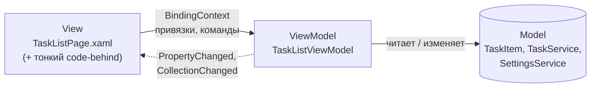

Первый MVVM-проект: перенос приложения из code-behind в MVVM

|                          |                                                                          |
| ------------------------ | ------------------------------------------------------------------------ |
| **Дисциплина**           | Разработка мобильных приложений на .NET MAUI                             |
| **Тема**                 | Паттерн MVVM: `ViewModel`, `BindingContext`, привязка коллекции, команды |
| **Среда разработки**     | JetBrains Rider                                                          |
| **Платформа / язык**     | .NET MAUI / C# и XAML                                                    |
| **Проект**               | Task Manager (продолжение практических работ №2, №3, №6 и №7)            |
| **Время выполнения**     | 4 академических часа (2 занятия по 2 часа)                               |

---

## 1. Цель работы

Научиться отделять логику приложения от интерфейса: создать `ViewModel`, перенести в неё данные и поведение страницы, связать разметку с `ViewModel` через `BindingContext` и привязки, убрать лишний код из code-behind.

## 2. Задание

Перенести приложение Task Manager из code-behind в MVVM (на примере страницы «Задачи»).

**Последовательность выполнения**

| № | Действие |
|---|---|
| 1 | Создать `TaskListViewModel` |
| 2 | Перенести коллекцию задач из `Page` |
| 3 | Установить `BindingContext` |
| 4 | Связать `CollectionView` с `ViewModel` |
| 5 | Проверить отображение данных |
| 6 | Удалить лишнюю логику из code-behind |

## 3. Исходное состояние проекта

Работа продолжает практическую работу №7. Предполагается, что:

- в `AppShell.xaml` настроен `TabBar` с вкладками «Задачи», «Статистика», «Настройки»;
- страница `TaskListPage` работает через code-behind: сама читает данные из `TaskService`, сама присваивает `ItemsSource`, сама обрабатывает нажатия;
- зарегистрированы `TaskService` и `SettingsService` (`Singleton`), страницы (`Transient`);
- маршруты `AddTaskPage`, `TaskDetailsPage`, `AboutPage` зарегистрированы в `AppShell.xaml.cs`.

Если работа №7 не выполнена, сначала доведите её до конца: без неё код этой работы не соберётся.

### 3.1. Карта миграции: что куда переезжает

Перед началом изучите, как устроен code-behind страницы «Задачи» (`TaskListPage.xaml.cs`), и куда уйдёт каждая его часть.

| В code-behind сейчас | Что это | Куда переедет в MVVM |
|---|---|---|
| Поля `_service`, `_settings` | Зависимости | Поля `ViewModel`, получаемые через DI |
| `TasksView.ItemsSource = ...` | Прямое присваивание данных элементу | Свойство `Tasks` + привязка `ItemsSource="{Binding Tasks}"` |
| `HideCompletedSwitch.IsToggled = _settings.HideCompleted` | Ручное обновление элемента | Свойство `HideCompleted` + привязка |
| `OnHideCompletedToggled` | Обработчик события | Сеттер свойства `HideCompleted` |
| `RefreshList()` | Загрузка и фильтрация | Метод `LoadTasks()` во `ViewModel` |
| `OnAddClicked` | Обработчик нажатия | Команда `AddTaskCommand` |
| `OnCardTapped` | Обработчик касания карточки | Команда `OpenTaskCommand` с параметром |
| `NavigateAsync` и `_isNavigating` | Переход и защита от повторов | `NavigateAsync` и `IsBusy` во `ViewModel` |
| `OnAppearing` | Событие жизненного цикла страницы | Остаётся на странице, но только вызывает `ViewModel.Refresh()` |

### 3.2. Структура после работы



Правило зависимостей: `View` знает о `ViewModel` (через привязки), `ViewModel` знает о `Model`, но **не знает о `View`**. Обратная связь идёт только через уведомления об изменениях.

---

## 4. Краткая теория

| Понятие | Суть |
|---|---|
| **MVVM** | Паттерн разделения: `Model` (данные и бизнес-логика), `View` (разметка), `ViewModel` (состояние и поведение экрана) |
| **`BindingContext`** | Объект, относительно которого вычисляются все привязки элемента и его потомков |
| **`INotifyPropertyChanged`** | Интерфейс, через который объект сообщает интерфейсу «свойство изменилось» |
| **`ObservableCollection<T>`** | Коллекция, сообщающая о добавлении и удалении элементов (`INotifyCollectionChanged`) |
| **`ICommand` / `Command`** | Действие, к которому привязывается кнопка, пункт меню или жест |
| **`CommandParameter`** | Значение, передаваемое в команду (например, нажатая задача) |
| **`x:DataType`** | Включает компилируемые привязки: ошибки в именах свойств находятся при сборке |
| **`RelativeSource AncestorType`** | Позволяет из шаблона элемента обратиться к `BindingContext` страницы |

---

## 5. Ход работы

### Подготовка

1. Откройте решение `TaskManager` в Rider.
2. Создайте ветку: **Git → New Branch…**, имя `lab8-mvvm`.
3. Запустите приложение и убедитесь, что вкладка «Задачи» работает по результатам практической работы №7.
4. Откройте `TaskListPage.xaml.cs` и **сохраните копию кода** в файл отчёта: в конце работы вы сравните «до» и «после».

---

### Шаг 1. Создание TaskListViewModel

#### 1.1. Базовый класс `BaseViewModel`

Любой `ViewModel` должен уметь сообщать интерфейсу об изменениях. Чтобы не повторять этот код в каждом классе, вынесем его в базовый.

Создайте папку `ViewModels` в корне проекта (правый клик по проекту → **Add → Directory**), затем файл `ViewModels/BaseViewModel.cs`:

```csharp
using System.ComponentModel;
using System.Runtime.CompilerServices;

namespace TaskManager.ViewModels;

public abstract class BaseViewModel : INotifyPropertyChanged
{
    public event PropertyChangedEventHandler? PropertyChanged;

    // Сообщает интерфейсу, что свойство изменилось.
    // [CallerMemberName] подставляет имя вызывающего свойства автоматически.
    protected void OnPropertyChanged([CallerMemberName] string? propertyName = null)
        => PropertyChanged?.Invoke(this, new PropertyChangedEventArgs(propertyName));

    // Записывает значение в поле и уведомляет интерфейс, только если значение изменилось.
    // Возвращает true, если изменение произошло.
    protected bool SetProperty<T>(ref T field, T value,
        [CallerMemberName] string? propertyName = null)
    {
        if (EqualityComparer<T>.Default.Equals(field, value))
            return false;

        field = value;
        OnPropertyChanged(propertyName);
        return true;
    }
}
```

**Зачем проверка на равенство.** Без неё запись того же значения вызывала бы лишние уведомления и перерисовку, а при двусторонних привязках могла бы привести к зацикливанию.

#### 1.2. Каркас `TaskListViewModel`

Создайте файл `ViewModels/TaskListViewModel.cs`. Пока это только каркас с зависимостями; содержимое добавим на следующих шагах.

```csharp
using TaskManager.Services;

namespace TaskManager.ViewModels;

public class TaskListViewModel : BaseViewModel
{
    private readonly TaskService _service;
    private readonly SettingsService _settings;

    // Зависимости передаёт контейнер внедрения (DI)
    public TaskListViewModel(TaskService service, SettingsService settings)
    {
        _service = service;
        _settings = settings;
    }
}
```

#### 1.3. Регистрация в DI

Откройте `MauiProgram.cs`. Добавьте `using TaskManager.ViewModels;` и зарегистрируйте `ViewModel` рядом со страницами:

```csharp
        builder.Services.AddSingleton<TaskService>();
        builder.Services.AddSingleton<SettingsService>();

        builder.Services.AddTransient<TaskListViewModel>();   // новая строка

        builder.Services.AddTransient<TaskListPage>();
        builder.Services.AddTransient<StatisticsPage>();
        builder.Services.AddTransient<SettingsPage>();
        // ... остальные регистрации без изменений
```

**Почему `Transient`.** `ViewModel` хранит состояние экрана и должна создаваться вместе со страницей. Сервисы с общими данными (`TaskService`, `SettingsService`) остаются `Singleton`.

Соберите проект: **Build → Build Solution**. Ошибок быть не должно.

---

### Шаг 2. Перенос коллекции задач из Page

Теперь во `ViewModel` переезжают данные и логика их подготовки.

#### 2.1. Коллекция и загрузка

Замените содержимое `TaskListViewModel.cs`:

```csharp
using System.Collections.ObjectModel;
using TaskManager.Models;
using TaskManager.Services;

namespace TaskManager.ViewModels;

public class TaskListViewModel : BaseViewModel
{
    private readonly TaskService _service;
    private readonly SettingsService _settings;

    private bool _hideCompleted;

    public TaskListViewModel(TaskService service, SettingsService settings)
    {
        _service = service;
        _settings = settings;
    }

    // ===== Данные для интерфейса =====

    // ObservableCollection сообщает CollectionView о добавлении и удалении элементов.
    // Саму коллекцию не пересоздаём: свойство только для чтения.
    public ObservableCollection<TaskItem> Tasks { get; } = new();

    // Скрывать ли выполненные задачи. Значение хранится в настройках приложения.
    public bool HideCompleted
    {
        get => _hideCompleted;
        set
        {
            if (!SetProperty(ref _hideCompleted, value))
                return;

            _settings.HideCompleted = value;   // запоминаем выбор
            LoadTasks();                       // пересобираем список
        }
    }

    // ===== Поведение =====

    // Вызывается страницей при каждом показе вкладки:
    // данные и настройки могли измениться на других вкладках
    public void Refresh()
    {
        // Поле меняем напрямую, а не через свойство,
        // чтобы не запускать LoadTasks() дважды
        _hideCompleted = _settings.HideCompleted;
        OnPropertyChanged(nameof(HideCompleted));

        LoadTasks();
    }

    // Загружает задачи из сервиса с учётом фильтра
    private void LoadTasks()
    {
        IEnumerable<TaskItem> source = _service.GetAll();

        if (_hideCompleted)
            source = source.Where(t => !t.IsCompleted);

        Tasks.Clear();
        foreach (var task in source)
            Tasks.Add(task);
    }
}
```

**Что здесь важно**

| Фрагмент | Пояснение |
|---|---|
| `Tasks { get; } = new()` | Коллекция создаётся один раз; изменяется её содержимое, а не ссылка |
| `SetProperty(ref ...)` | Уведомляет интерфейс и сообщает, изменилось ли значение |
| `Refresh()` | Заменяет прежнюю связку `OnAppearing` + `RefreshList` + чтение настройки |
| `OnPropertyChanged(nameof(HideCompleted))` | Просит `Switch` обновиться после того, как мы изменили поле напрямую |
| `Tasks.Clear()` + `Add` | Для небольших списков достаточно; для больших применяют пакетные обновления |

> Сборка на этом шаге проходит, но поведение приложения **не меняется**: страница пока не знает о `ViewModel`.

---

### Шаг 3. Установка BindingContext

`BindingContext` — это указатель «откуда брать данные для привязок». Пока он не установлен, привязкам не к чему обращаться.

#### 3.1. Способы связать страницу и ViewModel

| Способ | Запись | Когда применять |
|---|---|---|
| В конструкторе страницы (через DI) | `BindingContext = viewModel;` | **Наш выбор**: `ViewModel` получает зависимости от контейнера |
| В XAML | `<ContentPage.BindingContext><vm:TaskListViewModel/></ContentPage.BindingContext>` | Только для `ViewModel` без параметров конструктора |
| Через локатор / `Shell` | Внешний класс подбирает `ViewModel` | Крупные приложения |

В нашем случае `ViewModel` требует сервисы, поэтому подходит первый способ.

#### 3.2. Изменение страницы

Откройте `TaskListPage.xaml.cs`. Добавьте `ViewModel` в конструктор и установите `BindingContext`. Старый код пока **не удаляем**: переход должен идти поэтапно.

```csharp
using TaskManager.Models;
using TaskManager.Services;
using TaskManager.ViewModels;

namespace TaskManager;

public partial class TaskListPage : ContentPage
{
    private readonly TaskService _service;
    private readonly SettingsService _settings;
    private readonly TaskListViewModel _viewModel;     // новое поле
    private bool _isNavigating;

    public TaskListPage(TaskService service,
                        SettingsService settings,
                        TaskListViewModel viewModel)   // новый параметр
    {
        InitializeComponent();
        _service = service;
        _settings = settings;
        _viewModel = viewModel;

        BindingContext = _viewModel;                   // строка, ради которой всё затеяно
    }

    // ... остальной код остаётся без изменений до шага 4
```

> Обратите внимание: порядок `InitializeComponent()` → `BindingContext = ...` не принципиален для работы привязок, но принято сначала создавать интерфейс, затем задавать контекст.

#### 3.3. Проверка

1. Поставьте точку останова (клик слева от номера строки) на строке `BindingContext = _viewModel;`.
2. Запустите приложение в режиме **Debug**.
3. Убедитесь, что остановка произошла, а в окне **Variables** у `_viewModel` видны поля `_service` и `_settings` (то есть контейнер внедрил зависимости).
4. Снимите точку останова и продолжите выполнение (**F9**).

Приложение работает как раньше: привязок к `ViewModel` в разметке пока нет.

---

### Шаг 4. Связывание CollectionView с ViewModel

#### 4.1. Команды во ViewModel

Прежде чем привязывать кнопку и карточки, нужно создать команды.

Откройте `TaskListViewModel.cs` и внесите изменения.

**Добавьте `using`:**

```csharp
using System.Windows.Input;
```

**Добавьте поля и свойство `IsBusy`** (в раздел полей и свойств):

```csharp
    private bool _isBusy;
    private readonly Command _addTaskCommand;
    private readonly Command<TaskItem> _openTaskCommand;

    // Признак «идёт переход»: защищает от двойных нажатий
    public bool IsBusy
    {
        get => _isBusy;
        private set
        {
            if (!SetProperty(ref _isBusy, value))
                return;

            // Состояние изменилось, значит, нужно пересчитать доступность команд
            _addTaskCommand.ChangeCanExecute();
            _openTaskCommand.ChangeCanExecute();
        }
    }

    public ICommand AddTaskCommand => _addTaskCommand;
    public ICommand OpenTaskCommand => _openTaskCommand;
```

**Замените конструктор:**

```csharp
    public TaskListViewModel(TaskService service, SettingsService settings)
    {
        _service = service;
        _settings = settings;

        // Второй аргумент — условие доступности: пока идёт переход, команда недоступна
        _addTaskCommand = new Command(
            execute: async () => await NavigateAsync(nameof(AddTaskPage)),
            canExecute: () => !IsBusy);

        _openTaskCommand = new Command<TaskItem>(
            execute: async task => await OpenTaskAsync(task),
            canExecute: _ => !IsBusy);
    }
```

**Добавьте методы** (в раздел поведения):

```csharp
    private async Task OpenTaskAsync(TaskItem? task)
    {
        if (task is null)
            return;

        await NavigateAsync($"{nameof(TaskDetailsPage)}?id={task.Id}");
    }

    private async Task NavigateAsync(string route)
    {
        if (IsBusy)
            return;

        IsBusy = true;
        try
        {
            await Shell.Current.GoToAsync(route);
        }
        finally
        {
            IsBusy = false;
        }
    }
```

> **Замечание о чистоте архитектуры.** Обращение к `Shell.Current` из `ViewModel` — компромисс для первой работы: так проще. В строгом MVVM навигацию прячут за интерфейсом (`INavigationService`). Это вынесено в дополнительное задание 6.4.

#### 4.2. Разметка: привязки в `TaskListPage.xaml`

Замените содержимое файла. Изменения помечены комментариями `<!-- MVVM -->`.

```xml
<?xml version="1.0" encoding="utf-8" ?>
<ContentPage xmlns="http://schemas.microsoft.com/dotnet/2021/maui"
             xmlns:x="http://schemas.microsoft.com/winfx/2009/xaml"
             xmlns:models="clr-namespace:TaskManager.Models"
             xmlns:vm="clr-namespace:TaskManager.ViewModels"
             x:Class="TaskManager.TaskListPage"
             x:DataType="vm:TaskListViewModel"
             Title="Задачи"
             Style="{StaticResource PageStyle}">
    <!-- MVVM: x:DataType включает компилируемые привязки -->

    <ContentPage.ToolbarItems>
        <!-- MVVM: вместо Clicked="OnAddClicked" -->
        <ToolbarItem Text="+ Задача" Command="{Binding AddTaskCommand}" />
    </ContentPage.ToolbarItems>

    <Grid RowDefinitions="Auto,*"
          RowSpacing="12"
          Padding="{StaticResource PagePadding}">

        <HorizontalStackLayout Grid.Row="0" Spacing="8">
            <!-- MVVM: вместо Toggled="OnHideCompletedToggled".
                 x:Name временно оставлен, чтобы старый код-behind собирался (удалим в шаге 6) -->
            <Switch x:Name="HideCompletedSwitch"
                    IsToggled="{Binding HideCompleted}"
                    Style="{StaticResource SwitchStyle}"
                    SemanticProperties.Description="Скрыть выполненные задачи" />
            <Label Text="Скрыть выполненные"
                   Style="{StaticResource BodyLabelStyle}"
                   VerticalOptions="Center" />
        </HorizontalStackLayout>

        <!-- MVVM: ItemsSource берётся из ViewModel.
             x:Name временно оставлен (удалим в шаге 6) -->
        <CollectionView x:Name="TasksView"
                        Grid.Row="1"
                        ItemsSource="{Binding Tasks}"
                        SelectionMode="None">

            <CollectionView.EmptyView>
                <Label Text="Задач пока нет. Нажмите «+ Задача»."
                       Style="{StaticResource SecondaryLabelStyle}"
                       HorizontalTextAlignment="Center"
                       Margin="0,32" />
            </CollectionView.EmptyView>

            <CollectionView.ItemTemplate>
                <!-- Внутри шаблона BindingContext — это одна задача (TaskItem) -->
                <DataTemplate x:DataType="models:TaskItem">

                    <Border Style="{StaticResource TaskCardStyle}">

                        <Border.GestureRecognizers>
                            <!-- MVVM: команда лежит в ViewModel страницы, а не в задаче,
                                 поэтому поднимаемся к предку нужного типа.
                                 В параметр передаём саму задачу -->
                            <TapGestureRecognizer
                                Command="{Binding OpenTaskCommand,
                                          Source={RelativeSource AncestorType={x:Type vm:TaskListViewModel}}}"
                                CommandParameter="{Binding .}" />
                        </Border.GestureRecognizers>

                        <Border.Shadow>
                            <Shadow Brush="Black" Opacity="0.12" Radius="8" Offset="0,2" />
                        </Border.Shadow>

                        <Border.Triggers>
                            <DataTrigger TargetType="Border"
                                         Binding="{Binding IsCompleted}" Value="True">
                                <Setter Property="Opacity" Value="0.6" />
                            </DataTrigger>
                        </Border.Triggers>

                        <Grid ColumnDefinitions="6,Auto,*" ColumnSpacing="10">

                            <BoxView Grid.Column="0"
                                     Color="{Binding PriorityColor}"
                                     CornerRadius="3" />

                            <CheckBox Grid.Column="1"
                                      IsChecked="{Binding IsCompleted}"
                                      Style="{StaticResource TaskCheckBoxStyle}"
                                      VerticalOptions="Center" />

                            <VerticalStackLayout Grid.Column="2" Spacing="2">
                                <Label Text="{Binding Title}"
                                       Style="{StaticResource TaskTitleLabelStyle}">
                                    <Label.Triggers>
                                        <DataTrigger TargetType="Label"
                                                     Binding="{Binding IsCompleted}" Value="True">
                                            <Setter Property="TextDecorations" Value="Strikethrough" />
                                            <Setter Property="TextColor"
                                                    Value="{AppThemeBinding Light={StaticResource AppMutedTextColor},
                                                                            Dark={StaticResource AppMutedTextColorDark}}" />
                                        </DataTrigger>
                                    </Label.Triggers>
                                </Label>

                                <HorizontalStackLayout Spacing="8">
                                    <Label Text="{Binding PriorityText, StringFormat='Приоритет: {0}'}"
                                           Style="{StaticResource SecondaryLabelStyle}"
                                           TextColor="{Binding PriorityColor}" />
                                    <Label Text="{Binding CreatedAt, StringFormat='{0:dd.MM.yyyy HH:mm}'}"
                                           Style="{StaticResource SecondaryLabelStyle}" />
                                </HorizontalStackLayout>
                            </VerticalStackLayout>
                        </Grid>
                    </Border>

                </DataTemplate>
            </CollectionView.ItemTemplate>
        </CollectionView>

    </Grid>
</ContentPage>
```

**Что изменилось в разметке**

| Было | Стало |
|---|---|
| `Clicked="OnAddClicked"` | `Command="{Binding AddTaskCommand}"` |
| `Toggled="OnHideCompletedToggled"` | `IsToggled="{Binding HideCompleted}"` |
| `ItemsSource` присваивался в коде | `ItemsSource="{Binding Tasks}"` |
| `Tapped="OnCardTapped"` | `Command` + `CommandParameter` |
| Привязки без `x:DataType` | Страница и шаблон объявляют типы данных |

**Как читать привязку команды в шаблоне**

```xml
Command="{Binding OpenTaskCommand,
          Source={RelativeSource AncestorType={x:Type vm:TaskListViewModel}}}"
```

Внутри `DataTemplate` контекстом является `TaskItem`, а у `TaskItem` нет команды `OpenTaskCommand`. Поэтому `Source` перенаправляет привязку к ближайшему предку, у которого `BindingContext` имеет тип `TaskListViewModel`.

#### 4.3. Минимальное изменение code-behind

Чтобы старый код не конфликтовал с привязками (иначе `ItemsSource` из кода «перебьёт» привязку), в `TaskListPage.xaml.cs` **замените только метод `OnAppearing`**:

```csharp
    protected override void OnAppearing()
    {
        base.OnAppearing();
        _viewModel.Refresh();     // всю работу выполняет ViewModel
    }
```

Остальные методы (`RefreshList`, `OnAddClicked`, `OnCardTapped`, `OnHideCompletedToggled`, `NavigateAsync`) теперь **не вызываются** и подлежат удалению в шаге 6. Они пока компилируются, потому что `x:Name` в разметке сохранены.

Соберите проект.

---

### Шаг 5. Проверка отображения данных

#### 5.1. Запуск

1. Выберите эмулятор Android и запустите проект в режиме **Debug**.
2. Проследите за окном вывода: сообщения вида `Binding: ... property not found` означают ошибку привязки (при включённых `x:DataType` такие ошибки обычно находятся уже при сборке).

#### 5.2. Проверочные сценарии

| № | Сценарий | Ожидаемый результат | Факт |
|---|---|---|---|
| 1 | Запуск приложения | Открыта вкладка «Задачи», тестовые задачи видны | |
| 2 | Сравнить с внешним видом до миграции | Карточки, цвета, шрифты, тени идентичны | |
| 3 | Включить «Скрыть выполненные» | Выполненные задачи исчезают | |
| 4 | Выключить переключатель | Задачи возвращаются | |
| 5 | Включить переключатель, перейти на «Настройки», выключить «Скрывать выполненные» там, вернуться на «Задачи» | Переключатель в списке выключен, задачи видны (`Refresh()` в `OnAppearing`) | |
| 6 | Нажать **+ Задача** | Открывается форма | |
| 7 | Добавить задачу, сохранить | Возврат к списку, новая задача отображается | |
| 8 | Нажать на карточку | Открываются детали именно этой задачи | |
| 9 | Быстро дважды нажать на карточку | Открывается одна страница деталей | |
| 10 | Быстро дважды нажать **+ Задача** | Открывается одна форма | |
| 11 | Отметить задачу выполненной флажком, открыть «Статистику» | Счётчики обновились | |
| 12 | Перезапустить приложение | Состояние переключателя сохранено | |
| 13 | Повернуть эмулятор | Список и переключатель на месте | |
| 14 | Переключить тёмную тему | Оформление корректно | |
| 15 | Пустой список (удалить все задачи через «Настройки» или временно очистить данные) | Показывается сообщение «Задач пока нет» | |

#### 5.3. Эксперимент: как выглядит ошибка привязки

Этот эксперимент показывает, зачем нужен `x:DataType`.

1. В `TaskListPage.xaml` временно замените `{Binding Tasks}` на `{Binding Tasks2}`.
2. Соберите проект. При включённых компилируемых привязках сборка завершится ошибкой вида «свойство `Tasks2` не найдено в `TaskListViewModel`» (точная формулировка зависит от версии).
3. Временно уберите `x:DataType="vm:TaskListViewModel"` со страницы и снова запустите. Сборка пройдёт, но список окажется **пустым** без ошибки; в окне вывода появится предупреждение о привязке.
4. Верните исходные значения. Запишите в отчёт вывод: какой вариант удобнее при разработке и почему.

#### 5.4. Эксперимент: наблюдение за `ObservableCollection`

1. Поставьте точку останова в `LoadTasks()` на строке `Tasks.Clear();`.
2. Переключите «Скрыть выполненные» и убедитесь, что метод вызывается **один раз** на одно нажатие.
3. Перейдите на другую вкладку и вернитесь: метод вызывается при каждом возврате (это `Refresh()` из `OnAppearing`).
4. Сделайте вывод, где в цепочке «касание → привязка → сеттер → `LoadTasks` → коллекция → экран» выполняется каждое действие.

---

### Шаг 6. Удаление лишней логики из code-behind

Теперь, когда работа подтверждена, убираем всё, что стало мёртвым кодом.

#### 6.1. Что удалить

| Элемент | Решение |
|---|---|
| Поля `_service`, `_settings`, `_isNavigating` | Удалить |
| Методы `RefreshList`, `OnAddClicked`, `OnCardTapped`, `OnHideCompletedToggled`, `NavigateAsync` | Удалить |
| Параметры конструктора `TaskService`, `SettingsService` | Удалить |
| `using TaskManager.Models;`, `using TaskManager.Services;` | Удалить (Rider подсветит серым) |
| `x:Name="HideCompletedSwitch"` и `x:Name="TasksView"` в разметке | Удалить |

#### 6.2. Итоговый `TaskListPage.xaml.cs`

```csharp
using TaskManager.ViewModels;

namespace TaskManager;

public partial class TaskListPage : ContentPage
{
    private readonly TaskListViewModel _viewModel;

    public TaskListPage(TaskListViewModel viewModel)
    {
        InitializeComponent();

        _viewModel = viewModel;
        BindingContext = viewModel;
    }

    // Страница вкладки создаётся один раз, поэтому данные обновляем при каждом показе.
    // Само обновление выполняет ViewModel.
    protected override void OnAppearing()
    {
        base.OnAppearing();
        _viewModel.Refresh();
    }
}
```

#### 6.3. Итоговые изменения в разметке

Удалите атрибуты `x:Name` у `Switch` и `CollectionView`:

```xml
            <Switch IsToggled="{Binding HideCompleted}"
                    Style="{StaticResource SwitchStyle}"
                    SemanticProperties.Description="Скрыть выполненные задачи" />
```

```xml
        <CollectionView Grid.Row="1"
                        ItemsSource="{Binding Tasks}"
                        SelectionMode="None">
```

Также можно удалить комментарии `<!-- MVVM ... -->`.

#### 6.4. Что допустимо оставить в code-behind

| Допустимо | Недопустимо |
|---|---|
| Конструктор: `InitializeComponent`, `BindingContext` | Доступ к данным (`TaskService`) |
| Проброс жизненного цикла во `ViewModel` | Бизнес-правила и фильтрация |
| Чисто визуальная логика: анимация, фокус, прокрутка | Навигация и переходы |
| | Обработчики нажатий с логикой |

#### 6.5. Повторная проверка

1. Соберите проект и пройдите сценарии 1–15 из шага 5.2 ещё раз.
2. Сравните размеры: заполните таблицу.

| Показатель | До | После |
|---|---|---|
| Строк в `TaskListPage.xaml.cs` | | |
| Обработчиков событий в code-behind | | |
| Обращений к `TaskService` из страницы | | |
| Элементов с `x:Name` в разметке | | |

3. Выполните **Build → Rebuild Solution**: предупреждений об устаревших или неиспользуемых элементах быть не должно.
4. Зафиксируйте результат: **Git → Commit**, сообщение `lab8: TaskListPage переведена на MVVM`.


---

## 6. Дополнительные задания

### 6.1. Обновление «потянуть вниз» (RefreshView)

Добавьте обновление списка жестом. Идея: интерфейс привязан к состоянию `ViewModel` (`IsRefreshing`) и команде.

Во `ViewModel`:

```csharp
    private bool _isRefreshing;
    public bool IsRefreshing
    {
        get => _isRefreshing;
        set => SetProperty(ref _isRefreshing, value);
    }

    public ICommand RefreshCommand { get; }

    // В конструкторе:
    RefreshCommand = new Command(() =>
    {
        Refresh();
        IsRefreshing = false;    // сообщаем, что обновление завершено
    });
```

В разметке оберните `CollectionView`:

```xml
        <RefreshView Grid.Row="1"
                     IsRefreshing="{Binding IsRefreshing}"
                     Command="{Binding RefreshCommand}">
            <CollectionView ItemsSource="{Binding Tasks}" ... />
        </RefreshView>
```

Опишите в отчёте, почему `IsRefreshing` необходимо сбрасывать вручную.

### 6.2. `StatisticsViewModel`

Перенесите вкладку «Статистика» в MVVM по образцу основной работы.

```csharp
using TaskManager.Models;
using TaskManager.Services;

namespace TaskManager.ViewModels;

public class StatisticsViewModel : BaseViewModel
{
    private readonly TaskService _service;
    private TaskStatistics _stats = new(0, 0, 0, 0, 0);

    public StatisticsViewModel(TaskService service) => _service = service;

    public int Total => _stats.Total;
    public int Completed => _stats.Completed;
    public int Active => _stats.Active;
    public int HighActive => _stats.HighActive;
    public int MediumActive => _stats.MediumActive;
    public int LowActive => _stats.LowActive;

    public double CompletionRatio => _stats.CompletionRatio;
    public string PercentText => $"{Math.Round(_stats.CompletionRatio * 100)} %";
    public bool IsEmpty => _stats.Total == 0;

    public void Refresh()
    {
        _stats = _service.GetStatistics();

        // Пустая строка означает «изменились все свойства»
        OnPropertyChanged(string.Empty);
    }
}
```

Требуется:

- заменить `x:Name`-метки в `StatisticsPage.xaml` на привязки (`Text="{Binding Total}"`, `Progress="{Binding CompletionRatio}"`, `IsVisible="{Binding IsEmpty}"`);
- заменить обработчик кнопки на команду `OpenTasksCommand` (`GoToAsync("//TaskListPage")`);
- зарегистрировать `StatisticsViewModel` в DI;
- оставить в code-behind только конструктор и `OnAppearing`.

### 6.3. Использование MVVM Toolkit

Подключите пакет **CommunityToolkit.Mvvm** (в Rider: **Tools → NuGet → Manage NuGet Packages for Solution**) и перепишите `TaskListViewModel` с генерацией кода.

```csharp
using System.Collections.ObjectModel;
using CommunityToolkit.Mvvm.ComponentModel;
using CommunityToolkit.Mvvm.Input;
using TaskManager.Models;
using TaskManager.Services;

namespace TaskManager.ViewModels;

public partial class TaskListViewModel : ObservableObject
{
    private readonly TaskService _service;
    private readonly SettingsService _settings;

    public TaskListViewModel(TaskService service, SettingsService settings)
    {
        _service = service;
        _settings = settings;
    }

    public ObservableCollection<TaskItem> Tasks { get; } = new();

    [ObservableProperty]
    private bool _hideCompleted;          // генерируется свойство HideCompleted

    [ObservableProperty]
    [NotifyCanExecuteChangedFor(nameof(AddTaskCommand))]
    [NotifyCanExecuteChangedFor(nameof(OpenTaskCommand))]
    private bool _isBusy;                 // генерируется свойство IsBusy

    // Вызывается автоматически после изменения HideCompleted
    partial void OnHideCompletedChanged(bool value)
    {
        _settings.HideCompleted = value;
        LoadTasks();
    }

    [RelayCommand(CanExecute = nameof(CanNavigate))]
    private Task AddTaskAsync() => NavigateAsync(nameof(AddTaskPage));

    [RelayCommand(CanExecute = nameof(CanNavigate))]
    private Task OpenTaskAsync(TaskItem? task)
        => task is null
            ? Task.CompletedTask
            : NavigateAsync($"{nameof(TaskDetailsPage)}?id={task.Id}");

    private bool CanNavigate() => !IsBusy;

    public void Refresh()
    {
        // Меняем поле напрямую, чтобы сгенерированный OnHideCompletedChanged
        // не запустил LoadTasks() второй раз
        _hideCompleted = _settings.HideCompleted;
        OnPropertyChanged(nameof(HideCompleted));
        LoadTasks();
    }

    private void LoadTasks()
    {
        IEnumerable<TaskItem> source = _service.GetAll();
        if (HideCompleted)
            source = source.Where(t => !t.IsCompleted);

        Tasks.Clear();
        foreach (var task in source)
            Tasks.Add(task);
    }

    private async Task NavigateAsync(string route)
    {
        if (IsBusy) return;
        IsBusy = true;
        try { await Shell.Current.GoToAsync(route); }
        finally { IsBusy = false; }
    }
}
```

В разметке имена команд те же (`AddTaskCommand`, `OpenTaskCommand`): генератор отбрасывает суффикс `Async` и добавляет `Command`. Сравните объём кода, заполните таблицу в отчёте:

| Показатель | Ручная версия | С MVVM Toolkit |
|---|---|---|
| Строк во `ViewModel` | | |
| Наличие `BaseViewModel` | | |
| Читаемость | | |
| Что «скрыто» от разработчика | | |

> Класс должен быть объявлен как `partial`, иначе генератор не сможет добавить код. Некоторые версии компилятора и пакета могут выдавать замечания по атрибутам на полях; ориентируйтесь на документацию установленной версии.

### 6.4. Навигация через интерфейс

Уберите зависимость `ViewModel` от `Shell`:

```csharp
namespace TaskManager.Services;

public interface INavigationService
{
    Task GoToAsync(string route);
}

public class ShellNavigationService : INavigationService
{
    public Task GoToAsync(string route) => Shell.Current.GoToAsync(route);
}
```

Зарегистрируйте `AddSingleton<INavigationService, ShellNavigationService>()`, передайте интерфейс в конструктор `TaskListViewModel` и замените вызов `Shell.Current.GoToAsync` на `_navigation.GoToAsync`. Объясните в отчёте, что это даёт для тестирования.

### 6.5. Мгновенная реакция на флажок

Сейчас флажок «Выполнено» меняет `TaskItem.IsCompleted`, но при включённом фильтре карточка исчезает только при следующем `Refresh()`. Сделайте так, чтобы она исчезала сразу:

- реализуйте `INotifyPropertyChanged` в `TaskItem`;
- подпишите `ViewModel` на изменения `IsCompleted` каждой задачи;
- при изменении вызывайте `LoadTasks()` (или удаляйте элемент из `Tasks`).

Опишите, какие риски несёт подписка на события (утечки памяти) и как их избежать.

### 6.6. `SettingsViewModel`

Перенесите вкладку «Настройки» в MVVM: свойства `IsDarkTheme`, `HideCompleted`, `ResultText`, команды `SetSystemThemeCommand`, `ClearCompletedCommand`, `OpenAboutCommand`. Для подтверждения удаления определите, какой интерфейс нужен (`IDialogService`) и почему вызов `DisplayAlert` из `ViewModel` нежелателен.

---

## 7. Типичные ошибки

| Симптом | Причина и решение |
|---|---|
| Список пуст, ошибок нет | Не установлен `BindingContext`; либо `Tasks` не заполняется (не вызван `Refresh()`); либо опечатка в имени свойства при отсутствии `x:DataType` |
| Ошибка сборки: «свойство не найдено» в привязке | Неверное имя свойства или неверный `x:DataType`; проверьте регистр |
| `Unable to resolve service for type TaskListViewModel` | `ViewModel` не зарегистрирована в `MauiProgram.cs` |
| Падение при запуске: конструктор страницы | Страница объявлена с параметрами, но не зарегистрирована в DI, либо использован `Content` вместо `ContentTemplate` в `AppShell.xaml` |
| Данные добавляются, экран не обновляется | Использован `List<T>` вместо `ObservableCollection<T>` либо коллекция пересоздаётся без `OnPropertyChanged` |
| Свойство меняется, интерфейс нет | В сеттере не вызван `OnPropertyChanged` / `SetProperty` |
| Нажатие по карточке ничего не делает | Привязка команды ищет её в `TaskItem`: не указан `Source={RelativeSource AncestorType=...}` |
| В команду приходит `null` | Не задан `CommandParameter="{Binding .}"` |
| Переключатель «дребезжит» или вызывает двойную загрузку | В `Refresh()` изменяется свойство, а не поле, и запускается `LoadTasks()` дважды |
| Кнопка остаётся неактивной после перехода | Не вызван `ChangeCanExecute()` после изменения `IsBusy` или `IsBusy` не сброшен в `finally` |
| `ItemsSource` «перебивается» старым кодом | Остался присваивающий код в code-behind (`RefreshList`) |
| После очистки ошибка «имя не существует в текущем контексте» | В code-behind осталась ссылка на удалённый `x:Name` |
| После смены тёмной темы список выглядит старым | Это не связано с MVVM: проверьте `AppThemeBinding` в стилях (работа №3) |

## 8. Контрольные вопросы

1. Из каких частей состоит паттерн MVVM? За что отвечает каждая?
2. Какие недостатки code-behind проявились в исходной версии страницы «Задачи»?
3. Что такое `BindingContext`? Как он наследуется от родителя к потомку?
4. Чем контекст привязки внутри `DataTemplate` отличается от контекста страницы?
5. Зачем нужен интерфейс `INotifyPropertyChanged`? Что произойдёт, если не вызывать `OnPropertyChanged`?
6. Чем `ObservableCollection<T>` отличается от `List<T>`? Почему свойство коллекции объявлено без `set`?
7. Почему в `SetProperty` проверяется равенство старого и нового значения?
8. Что такое `ICommand`? Как работает `CanExecute` и зачем нужен `ChangeCanExecute`?
9. Как передать нажатый элемент списка в команду? Зачем нужен `RelativeSource`?
10. Что дают компилируемые привязки (`x:DataType`)? Какие у них ограничения?
11. Почему `ViewModel` не должна ссылаться на элементы управления и страницы? Какие допущения сделаны в этой работе и как их устранить?
12. Почему `OnAppearing` остался в code-behind и что в нём остаётся?
13. Как `Transient` и `Singleton` регистрации влияют на `ViewModel` и сервисы?
14. Какие преимущества MVVM для тестирования приложения?

## 9. Список источников

1. Документация .NET MAUI — Data binding: <https://learn.microsoft.com/dotnet/maui/fundamentals/data-binding/>
   - разделы «Binding mode», «Compiled bindings», «Relative bindings», «Commanding».
2. Документация .NET MAUI — Model-View-ViewModel (MVVM): <https://learn.microsoft.com/dotnet/maui/xaml/fundamentals/mvvm>
3. Документация — MVVM Toolkit: <https://learn.microsoft.com/dotnet/communitytoolkit/mvvm/>
4. Документация JetBrains Rider — .NET MAUI: <https://www.jetbrains.com/help/rider/>
