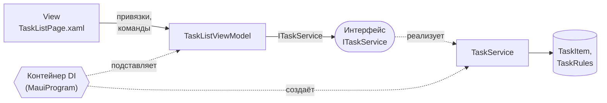

#  Binding и команды. Dependency Injection

|                          |                                                                                                              |
| ------------------------ | ------------------------------------------------------------------------------------------------------------ |
| **Дисциплина**           | Разработка мобильных приложений на .NET MAUI                                                                 |
| **Тема**                 | Часть A: привязки данных и команды вместо обработчиков. Часть B: внедрение зависимостей и слабая связанность |
| **Среда разработки**     | JetBrains Rider                                                                                              |
| **Платформа / язык**     | .NET MAUI / C# и XAML                                                                                        |
| **Проект**               | Task Manager (продолжение практических работ №2, №3, №6, №7, №8)                                             |

---

## 1. Цель работы

**Часть A.** Научиться управлять приложением только через привязки и команды: добавлять, удалять и отмечать задачи без обработчиков нажатий на кнопки, использовать двустороннюю привязку для поля ввода и следить за обновлением списка.

**Часть B.** Научиться отделять работу с данными от `ViewModel` через интерфейс сервиса, регистрировать зависимости в контейнере и получать их через конструктор; оценить преимущества слабой связанности.

## 2. Задание

### Часть A. Binding и команды

Полностью отказаться от кнопочных обработчиков для основных операций (добавление, удаление, выполнение задачи).

| № | Действие |
|---|---|
| 1 | Создать свойства `ViewModel` |
| 2 | Реализовать `AddTaskCommand` |
| 3 | Реализовать `DeleteTaskCommand` |
| 4 | Реализовать `CompleteTaskCommand` |
| 5 | Связать команды с XAML |
| 6 | Реализовать `TwoWay Binding` для `Entry` |
| 7 | Проверить обновление списка |

### Часть B. Dependency Injection

Вынести работу с задачами в сервис.

| № | Действие |
|---|---|
| 1 | Создать `ITaskService` |
| 2 | Создать `TaskService` |
| 3 | Перенести операции работы со списком в сервис |
| 4 | Зарегистрировать сервис в `MauiProgram` |
| 5 | Получить сервис через конструктор `ViewModel` |
| 6 | Проверить приложение |
| 7 | Обсудить преимущества слабой связанности |

## 3. Исходное состояние проекта

Работа продолжает практическую работу №8. Предполагается, что:

- `TaskListPage` переведена на MVVM: есть `BaseViewModel` и `TaskListViewModel` (коллекция `Tasks`, свойство `HideCompleted`, метод `Refresh()`, команды перехода на форму и на детали);
- в code-behind страницы остались только конструктор с `BindingContext` и `OnAppearing`;
- в `MauiProgram.cs` зарегистрированы `TaskService`, `SettingsService` (оба `Singleton`), страницы и `TaskListViewModel` (`Transient`);
- работают вкладки «Задачи», «Статистика», «Настройки», страницы `AddTaskPage` и `TaskDetailsPage` (практические работы №6–№7).

Если практическая работа №8 не выполнена, сначала доведите её до конца.

### 3.1. Что меняется в этой работе

| Элемент | Было (работа №8) | Станет |
|---|---|---|
| Команда `AddTaskCommand` | Открывала страницу формы | Команда **быстрого добавления** задачи из поля ввода. Прежняя команда получит имя `OpenAddPageCommand` |
| Добавление, удаление, выполнение | Форма с кнопкой, флажок с двусторонней привязкой | Команды `AddTaskCommand`, `DeleteTaskCommand`, `CompleteTaskCommand` |
| `TaskItem` | Обычный класс | Класс, уведомляющий об изменениях (нужен для мгновенного обновления карточки) |
| `TaskService` | Конкретный класс, внедряется напрямую | Реализует интерфейс `ITaskService` (часть B) |
| Правила (длина названия, фильтрация) | В `ViewModel` | В сервисе и модели (часть B) |

### 3.2. Схема приложения по итогам работы



`ViewModel` обращается к интерфейсу и ничего не знает о конкретном классе. Какой класс подставить, решает контейнер зависимостей.

---

## 4. Краткая теория

### 4.1. Часть A

| Понятие | Суть |
|---|---|
| **Режим `TwoWay`** | Изменения идут в обе стороны: пользователь меняет `Entry`, значение попадает в свойство; программа меняет свойство, текст в `Entry` обновляется |
| **`ICommand`** | Действие с проверкой доступности. Кнопка, жест и пункт меню вызывают команду, не зная, что она делает |
| **`CanExecute` / `ChangeCanExecute`** | Определяет, доступна ли команда; кнопка блокируется автоматически, если вернулось `false` |
| **`CommandParameter`** | Значение, передаваемое в команду; в списке — сама задача (`{Binding .}`) |
| **`Entry.ReturnCommand`** | Команда, срабатывающая по клавише «Ввод» на клавиатуре |
| **Зависимые свойства** | Вычисляемые свойства (`ErrorText`, `HasError`) нужно оповещать при изменении исходного (`NewTaskTitle`) |
| **Операции над `ObservableCollection`** | `Add`, `Remove`, `Insert` обновляют экран точечно; `Clear` + перезаполнение пересобирает список целиком |
| **Модель с уведомлениями** | Если свойство элемента меняется программно (`IsCompleted`), элемент реализует `INotifyPropertyChanged`, иначе карточка не перерисуется |

### 4.2. Часть B

| Понятие | Суть |
|---|---|
| **Зависимость** | Объект, который нужен классу для работы (сервис задач для `ViewModel`) |
| **Принцип инверсии зависимостей (DIP)** | Верхние уровни зависят от абстракций (интерфейсов), а не от конкретных классов |
| **Внедрение зависимостей (DI)** | Класс не создаёт зависимости сам (`new`), а получает их извне, чаще всего через конструктор |
| **Контейнер зависимостей** | Объект, знающий, какую реализацию подставить вместо интерфейса, и создающий цепочки объектов |
| **Регистрация** | Соответствие «интерфейс → реализация» и время жизни (`Singleton`, `Transient`, `Scoped`) |
| **Слабая связанность** | Классы знают друг о друге как можно меньше; реализацию можно заменить без правок потребителя |
| **Service Locator** | Антипаттерн: класс сам запрашивает зависимости у контейнера. Скрывает зависимости, усложняет тестирование |

---

# ЧАСТЬ A. BINDING И КОМАНДЫ

## 5. Ход работы (часть A)

### Подготовка

1. Откройте решение `TaskManager` в Rider.
2. Создайте ветку: **Git → New Branch…**, имя `lab9-binding-commands`.
3. Запустите приложение, убедитесь, что вкладка «Задачи» работает по результатам работы №8.
4. Откройте окно **Find in Files** (**Ctrl+Shift+F**) и найдите в `TaskListPage.xaml` строки `Clicked=`, `Tapped=`, `Toggled=`, `CheckedChanged=`. Запишите результат: после выполнения работы обработчиков быть не должно.

---

### Шаг 0. Подготовка модели и сервиса

Новые команды изменяют задачи «на месте» и должны мгновенно отражаться на карточках. Для этого нужны два изменения вне `ViewModel`.

#### 0.1. `TaskItem` с уведомлениями об изменениях

Откройте `Models/TaskItem.cs` и **замените содержимое** (если у вашего класса есть дополнительные поля, сохраните их и добавьте только механизм уведомлений):

```csharp
using System.ComponentModel;
using System.Runtime.CompilerServices;
using Microsoft.Maui.Graphics;

namespace TaskManager.Models;

public class TaskItem : INotifyPropertyChanged
{
    private string _title = string.Empty;
    private string _description = string.Empty;
    private bool _isCompleted;
    private TaskPriority _priority = TaskPriority.Medium;

    public event PropertyChangedEventHandler? PropertyChanged;

    public int Id { get; set; }

    public string Title
    {
        get => _title;
        set => Set(ref _title, value);
    }

    public string Description
    {
        get => _description;
        set => Set(ref _description, value);
    }

    public bool IsCompleted
    {
        get => _isCompleted;
        set => Set(ref _isCompleted, value);
    }

    public TaskPriority Priority
    {
        get => _priority;
        set
        {
            if (!Set(ref _priority, value))
                return;

            // Зависимые свойства меняются вместе с приоритетом
            OnPropertyChanged(nameof(PriorityColor));
            OnPropertyChanged(nameof(PriorityText));
        }
    }

    public DateTime CreatedAt { get; set; } = DateTime.Now;

    // Вычисляемые свойства для отображения
    public Color PriorityColor => Priority switch
    {
        TaskPriority.High => Colors.Crimson,
        TaskPriority.Medium => Colors.Orange,
        _ => Colors.SeaGreen
    };

    public string PriorityText => Priority switch
    {
        TaskPriority.High => "Высокий",
        TaskPriority.Medium => "Средний",
        _ => "Низкий"
    };

    private bool Set<T>(ref T field, T value, [CallerMemberName] string? name = null)
    {
        if (EqualityComparer<T>.Default.Equals(field, value))
            return false;

        field = value;
        OnPropertyChanged(name);
        return true;
    }

    private void OnPropertyChanged([CallerMemberName] string? name = null)
        => PropertyChanged?.Invoke(this, new PropertyChangedEventArgs(name));
}
```

> Перечисление `TaskPriority` (Low, Medium, High) остаётся таким, как в практической работе №2. Если названия значений у вас другие, измените их в `switch`.

**Зачем это нужно.** `CompleteTaskCommand` изменит `IsCompleted` в коде. Без `INotifyPropertyChanged` карточка не узнает об изменении: зачёркивание и прозрачность не включатся.

#### 0.2. Сервис: операции удаления и выполнения

Откройте `Services/TaskService.cs`. Для надёжности **замените содержимое файла полностью**, перенеся свои тестовые данные в конструктор:

```csharp
using TaskManager.Models;

namespace TaskManager.Services;

public class TaskService
{
    private readonly List<TaskItem> _tasks = new();
    private int _nextId = 1;

    public TaskService()
    {
        // Тестовые данные
        Add(new TaskItem { Title = "Подготовить отчёт", Priority = TaskPriority.High });
        Add(new TaskItem { Title = "Купить продукты", Priority = TaskPriority.Low });
        Add(new TaskItem { Title = "Позвонить заказчику", Priority = TaskPriority.Medium, IsCompleted = true });
        Add(new TaskItem { Title = "Сдать практическую работу", Priority = TaskPriority.High });
    }

    // Возвращает копию списка, чтобы внешний код не менял внутреннюю коллекцию
    public IReadOnlyList<TaskItem> GetAll() => _tasks.ToList();

    public TaskItem? GetById(int id) => _tasks.FirstOrDefault(t => t.Id == id);

    // Назначает идентификатор и сохраняет задачу
    public TaskItem Add(TaskItem task)
    {
        task.Id = _nextId++;
        _tasks.Add(task);
        return task;
    }

    // Возвращает true, если задача найдена и удалена
    public bool Remove(int id) => _tasks.RemoveAll(t => t.Id == id) > 0;

    // Возвращает true, если задача найдена
    public bool SetCompleted(int id, bool isCompleted)
    {
        var task = GetById(id);
        if (task is null)
            return false;

        task.IsCompleted = isCompleted;
        return true;
    }

    public TaskStatistics GetStatistics()
    {
        var active = _tasks.Where(t => !t.IsCompleted).ToList();

        return new TaskStatistics(
            Total: _tasks.Count,
            Completed: _tasks.Count - active.Count,
            HighActive: active.Count(t => t.Priority == TaskPriority.High),
            MediumActive: active.Count(t => t.Priority == TaskPriority.Medium),
            LowActive: active.Count(t => t.Priority == TaskPriority.Low));
    }

    // Удаляет выполненные задачи, возвращает их количество
    public int ClearCompleted() => _tasks.RemoveAll(t => t.IsCompleted);
}
```

**Возможные расхождения с вашим проектом**

| Если в вашем коде | Сделайте |
|---|---|
| Страницы вызывают `Remove(task)` с объектом | Замените на `Remove(task.Id)` |
| Форма добавления вызывает `Add(...)` и не использует результат | Менять не нужно: метод по-прежнему принимает `TaskItem` |
| Метод получения списка называется иначе | Приведите к `GetAll()` либо переименуйте вызовы (Rider: **Shift+F6**) |

Соберите проект: **Build → Build Solution**. Ошибок быть не должно.

---

### Шаг 1. Создание свойств ViewModel

Команды опираются на состояние. Прежде чем писать команды, опишем свойства, которыми будет управлять интерфейс.

#### 1.1. Перечень свойств

| Свойство | Тип | Назначение | Привязка |
|---|---|---|---|
| `NewTaskTitle` | `string` | Текст в поле быстрого добавления | `Entry.Text`, **TwoWay** |
| `SelectedPriorityIndex` | `int` | Выбранный приоритет новой задачи | `Picker.SelectedIndex`, TwoWay |
| `PriorityNames` | `IReadOnlyList<string>` | Подписи приоритетов | `Picker.ItemsSource` |
| `ErrorText` | `string` (вычисляемое) | Сообщение об ошибке ввода | `Label.Text` |
| `HasError` | `bool` (вычисляемое) | Есть ли ошибка | `Label.IsVisible` |
| `SummaryText` | `string` | Строка «Выполнено 1 из 4» | `Label.Text` |

#### 1.2. Код

Откройте `ViewModels/TaskListViewModel.cs`. Внесите изменения.

**Добавьте константу и поля** (в начало класса):

```csharp
    private const int MaxTitleLength = 100;

    private string _newTaskTitle = string.Empty;
    private int _selectedPriorityIndex = 1;        // «Средний» по умолчанию
    private string _summaryText = string.Empty;
```

**Добавьте свойства** (после свойства `HideCompleted`):

```csharp
    // ===== Поле быстрого добавления =====

    public IReadOnlyList<string> PriorityNames { get; } = new[] { "Низкий", "Средний", "Высокий" };

    public int SelectedPriorityIndex
    {
        get => _selectedPriorityIndex;
        set => SetProperty(ref _selectedPriorityIndex, value);
    }

    // Преобразование индекса в приоритет; недопустимый индекс (-1) считаем «Средним»
    private TaskPriority SelectedPriority => SelectedPriorityIndex switch
    {
        0 => TaskPriority.Low,
        2 => TaskPriority.High,
        _ => TaskPriority.Medium
    };

    public string NewTaskTitle
    {
        get => _newTaskTitle;
        set
        {
            // Entry может прислать null, приводим к пустой строке
            var text = value ?? string.Empty;

            if (!SetProperty(ref _newTaskTitle, text))
                return;

            // Зависимые свойства: их значение вычисляется из NewTaskTitle,
            // поэтому интерфейсу нужно сообщить об их изменении отдельно
            OnPropertyChanged(nameof(ErrorText));
            OnPropertyChanged(nameof(HasError));
        }
    }

    public string ErrorText =>
        NewTaskTitle.Trim().Length > MaxTitleLength
            ? $"Не более {MaxTitleLength} символов"
            : string.Empty;

    public bool HasError => ErrorText.Length > 0;

    // Можно ли сейчас добавить задачу: название не пустое и не слишком длинное
    private bool CanAdd => !string.IsNullOrWhiteSpace(NewTaskTitle) && !HasError;

    // ===== Итоговая строка =====

    public string SummaryText
    {
        get => _summaryText;
        private set => SetProperty(ref _summaryText, value);
    }
```

**Добавьте метод обновления сводки** (в раздел «Поведение»):

```csharp
    // Пересчитывает строку «Выполнено N из M» по данным сервиса
    private void UpdateSummary()
    {
        var stats = _service.GetStatistics();
        SummaryText = $"Выполнено {stats.Completed} из {stats.Total}";
    }
```

**Дополните `Refresh()`** вызовом сводки (последней строкой метода):

```csharp
    public void Refresh()
    {
        _hideCompleted = _settings.HideCompleted;
        OnPropertyChanged(nameof(HideCompleted));

        LoadTasks();
        UpdateSummary();      // новая строка
    }
```

Соберите проект.

> **Замечание.** Свойства `ErrorText` и `HasError` не имеют своих полей: они вычисляются при каждом обращении. Интерфейс узнаёт об их изменении только потому, что мы вызываем `OnPropertyChanged` из сеттера `NewTaskTitle`.

---

### Шаг 2. Реализация AddTaskCommand

#### 2.1. Переименование прежней команды

Прежняя команда открывала форму. Переименуем её, чтобы освободить имя `AddTaskCommand`.

1. В `TaskListViewModel.cs` выделите `_addTaskCommand` и нажмите **Shift+F6** (Rename): новое имя `_openAddPageCommand`.
2. Так же переименуйте свойство `AddTaskCommand` в `OpenAddPageCommand`. Rider обновит и разметку `TaskListPage.xaml` (в `ToolbarItem`); проверьте это.

После переименования в классе должны быть:

```csharp
    private readonly Command _openAddPageCommand;
    public ICommand OpenAddPageCommand => _openAddPageCommand;
```

#### 2.2. Новая команда

**Добавьте поле** (рядом с остальными командами):

```csharp
    private readonly Command _addTaskCommand;
```

**Добавьте свойство:**

```csharp
    public ICommand AddTaskCommand => _addTaskCommand;
```

**В конструкторе** создайте команду (после остальных):

```csharp
        // Команда доступна только когда ввод корректен
        _addTaskCommand = new Command(AddTask, () => CanAdd);
```

**Добавьте метод:**

```csharp
    private void AddTask()
    {
        if (!CanAdd)
            return;

        // Сервис назначает идентификатор и возвращает созданную задачу
        var task = _service.Add(new TaskItem
        {
            Title = NewTaskTitle.Trim(),
            Priority = SelectedPriority
        });

        Tasks.Add(task);          // точечное обновление списка
        NewTaskTitle = string.Empty;   // очищаем поле через привязку
        UpdateSummary();
    }
```

**В сеттере `NewTaskTitle`** допишите последней строкой пересчёт доступности команды:

```csharp
            OnPropertyChanged(nameof(ErrorText));
            OnPropertyChanged(nameof(HasError));
            _addTaskCommand.ChangeCanExecute();      // новая строка
```

**Разбор**

| Фрагмент | Пояснение |
|---|---|
| `new Command(AddTask, () => CanAdd)` | Первый аргумент — действие, второй — условие доступности |
| `ChangeCanExecute()` | Сообщает кнопке, что условие нужно проверить заново; без него кнопка не разблокируется |
| `Tasks.Add(task)` | `CollectionView` добавит одну карточку, не перерисовывая весь список |
| `NewTaskTitle = string.Empty` | Присваивание свойству через `SetProperty` обновит `Entry` (TwoWay) |
| `UpdateSummary()` | Строка «Выполнено N из M» остаётся актуальной |

Соберите проект.

---

### Шаг 3. Реализация DeleteTaskCommand

**Добавьте поле, свойство, создание в конструкторе:**

```csharp
    private readonly Command<TaskItem> _deleteTaskCommand;

    public ICommand DeleteTaskCommand => _deleteTaskCommand;
```

```csharp
        // В конструкторе
        _deleteTaskCommand = new Command<TaskItem>(DeleteTask);
```

**Добавьте метод:**

```csharp
    private void DeleteTask(TaskItem? task)
    {
        if (task is null)
            return;

        // Сначала удаляем из хранилища, затем из списка на экране
        if (_service.Remove(task.Id))
        {
            Tasks.Remove(task);
            UpdateSummary();
        }
    }
```

**Почему сначала сервис.** Источник истины — сервис. Если удаление в нём не удалось (задача уже удалена), список на экране менять не нужно.

Соберите проект.

---

### Шаг 4. Реализация CompleteTaskCommand

Команда **переключает** состояние: невыполненная становится выполненной и наоборот.

**Добавьте поле, свойство, создание в конструкторе:**

```csharp
    private readonly Command<TaskItem> _completeTaskCommand;

    public ICommand CompleteTaskCommand => _completeTaskCommand;
```

```csharp
        // В конструкторе
        _completeTaskCommand = new Command<TaskItem>(CompleteTask);
```

**Добавьте метод:**

```csharp
    private void CompleteTask(TaskItem? task)
    {
        if (task is null)
            return;

        // Сервис меняет IsCompleted у задачи. Так как TaskItem уведомляет об изменениях,
        // карточка сама перерисуется (зачёркивание, прозрачность)
        _service.SetCompleted(task.Id, !task.IsCompleted);

        // При включённом фильтре выполненная задача должна исчезнуть из списка
        if (HideCompleted && task.IsCompleted)
            Tasks.Remove(task);

        UpdateSummary();
    }
```

**Итоговый вид `TaskListViewModel.cs` после шагов 1–4**

```csharp
using System.Collections.ObjectModel;
using System.Windows.Input;
using TaskManager.Models;
using TaskManager.Services;

namespace TaskManager.ViewModels;

public class TaskListViewModel : BaseViewModel
{
    private const int MaxTitleLength = 100;

    private readonly TaskService _service;
    private readonly SettingsService _settings;

    private readonly Command _openAddPageCommand;
    private readonly Command<TaskItem> _openTaskCommand;
    private readonly Command _addTaskCommand;
    private readonly Command<TaskItem> _deleteTaskCommand;
    private readonly Command<TaskItem> _completeTaskCommand;

    private bool _hideCompleted;
    private bool _isBusy;
    private string _newTaskTitle = string.Empty;
    private int _selectedPriorityIndex = 1;
    private string _summaryText = string.Empty;

    public TaskListViewModel(TaskService service, SettingsService settings)
    {
        _service = service;
        _settings = settings;

        _openAddPageCommand = new Command(
            execute: async () => await NavigateAsync(nameof(AddTaskPage)),
            canExecute: () => !IsBusy);

        _openTaskCommand = new Command<TaskItem>(
            execute: async task => await OpenTaskAsync(task),
            canExecute: _ => !IsBusy);

        _addTaskCommand = new Command(AddTask, () => CanAdd);
        _deleteTaskCommand = new Command<TaskItem>(DeleteTask);
        _completeTaskCommand = new Command<TaskItem>(CompleteTask);
    }

    // ===== Данные для интерфейса =====

    public ObservableCollection<TaskItem> Tasks { get; } = new();

    public bool HideCompleted
    {
        get => _hideCompleted;
        set
        {
            if (!SetProperty(ref _hideCompleted, value))
                return;

            _settings.HideCompleted = value;
            LoadTasks();
        }
    }

    // ----- Поле быстрого добавления -----

    public IReadOnlyList<string> PriorityNames { get; } = new[] { "Низкий", "Средний", "Высокий" };

    public int SelectedPriorityIndex
    {
        get => _selectedPriorityIndex;
        set => SetProperty(ref _selectedPriorityIndex, value);
    }

    private TaskPriority SelectedPriority => SelectedPriorityIndex switch
    {
        0 => TaskPriority.Low,
        2 => TaskPriority.High,
        _ => TaskPriority.Medium
    };

    public string NewTaskTitle
    {
        get => _newTaskTitle;
        set
        {
            var text = value ?? string.Empty;

            if (!SetProperty(ref _newTaskTitle, text))
                return;

            OnPropertyChanged(nameof(ErrorText));
            OnPropertyChanged(nameof(HasError));
            _addTaskCommand.ChangeCanExecute();
        }
    }

    public string ErrorText =>
        NewTaskTitle.Trim().Length > MaxTitleLength
            ? $"Не более {MaxTitleLength} символов"
            : string.Empty;

    public bool HasError => ErrorText.Length > 0;

    private bool CanAdd => !string.IsNullOrWhiteSpace(NewTaskTitle) && !HasError;

    public string SummaryText
    {
        get => _summaryText;
        private set => SetProperty(ref _summaryText, value);
    }

    // ----- Состояние занятости (переходы) -----

    public bool IsBusy
    {
        get => _isBusy;
        private set
        {
            if (!SetProperty(ref _isBusy, value))
                return;

            _openAddPageCommand.ChangeCanExecute();
            _openTaskCommand.ChangeCanExecute();
        }
    }

    // ===== Команды =====

    public ICommand OpenAddPageCommand => _openAddPageCommand;
    public ICommand OpenTaskCommand => _openTaskCommand;
    public ICommand AddTaskCommand => _addTaskCommand;
    public ICommand DeleteTaskCommand => _deleteTaskCommand;
    public ICommand CompleteTaskCommand => _completeTaskCommand;

    // ===== Поведение =====

    public void Refresh()
    {
        _hideCompleted = _settings.HideCompleted;
        OnPropertyChanged(nameof(HideCompleted));

        LoadTasks();
        UpdateSummary();
    }

    private void LoadTasks()
    {
        IEnumerable<TaskItem> source = _service.GetAll();

        if (_hideCompleted)
            source = source.Where(t => !t.IsCompleted);

        Tasks.Clear();
        foreach (var task in source)
            Tasks.Add(task);
    }

    private void UpdateSummary()
    {
        var stats = _service.GetStatistics();
        SummaryText = $"Выполнено {stats.Completed} из {stats.Total}";
    }

    private void AddTask()
    {
        if (!CanAdd)
            return;

        var task = _service.Add(new TaskItem
        {
            Title = NewTaskTitle.Trim(),
            Priority = SelectedPriority
        });

        Tasks.Add(task);
        NewTaskTitle = string.Empty;
        UpdateSummary();
    }

    private void DeleteTask(TaskItem? task)
    {
        if (task is null)
            return;

        if (_service.Remove(task.Id))
        {
            Tasks.Remove(task);
            UpdateSummary();
        }
    }

    private void CompleteTask(TaskItem? task)
    {
        if (task is null)
            return;

        _service.SetCompleted(task.Id, !task.IsCompleted);

        if (HideCompleted && task.IsCompleted)
            Tasks.Remove(task);

        UpdateSummary();
    }

    private async Task OpenTaskAsync(TaskItem? task)
    {
        if (task is null)
            return;

        await NavigateAsync($"{nameof(TaskDetailsPage)}?id={task.Id}");
    }

    private async Task NavigateAsync(string route)
    {
        if (IsBusy)
            return;

        IsBusy = true;
        try
        {
            await Shell.Current.GoToAsync(route);
        }
        finally
        {
            IsBusy = false;
        }
    }
}
```

Соберите проект. Приложение пока выглядит как прежде: новые команды ещё не связаны с разметкой.

---

### Шаг 5. Связывание команд с XAML

Заменим разметку страницы. Что изменено:

- панель быстрого добавления (поле, приоритет, кнопка);
- строка сводки;
- вместо флажка в карточке — кнопки «Выполнить» и «Удалить» с командами;
- касание текстовой части карточки открывает детали (жест перенесён с рамки на текст, чтобы нажатия по кнопкам не открывали детали);
- ни одного обработчика события.

Откройте `TaskListPage.xaml` и **замените содержимое**:

```xml
<?xml version="1.0" encoding="utf-8" ?>
<ContentPage xmlns="http://schemas.microsoft.com/dotnet/2021/maui"
             xmlns:x="http://schemas.microsoft.com/winfx/2009/xaml"
             xmlns:models="clr-namespace:TaskManager.Models"
             xmlns:vm="clr-namespace:TaskManager.ViewModels"
             x:Class="TaskManager.TaskListPage"
             x:DataType="vm:TaskListViewModel"
             Title="Задачи"
             Style="{StaticResource PageStyle}">

    <ContentPage.ToolbarItems>
        <!-- Открывает полную форму добавления -->
        <ToolbarItem Text="Форма" Command="{Binding OpenAddPageCommand}" />
    </ContentPage.ToolbarItems>

    <Grid RowDefinitions="Auto,Auto,*"
          RowSpacing="12"
          Padding="{StaticResource PagePadding}">

        <!-- Строка 0: быстрое добавление -->
        <Border Grid.Row="0" Style="{StaticResource TaskCardStyle}">
            <VerticalStackLayout Spacing="8">

                <Grid ColumnDefinitions="*,Auto" ColumnSpacing="8">
                    <Entry Grid.Column="0"
                           Placeholder="Новая задача"
                           Text="{Binding NewTaskTitle}"
                           SemanticProperties.Description="Название новой задачи" />

                    <Button Grid.Column="1"
                            Text="Добавить"
                            Style="{StaticResource PrimaryButtonStyle}"
                            Command="{Binding AddTaskCommand}" />
                </Grid>

                <Picker Title="Приоритет"
                        ItemsSource="{Binding PriorityNames}"
                        SelectedIndex="{Binding SelectedPriorityIndex}" />

            </VerticalStackLayout>
        </Border>

        <!-- Строка 1: сводка и фильтр -->
        <Grid Grid.Row="1" ColumnDefinitions="*,Auto" ColumnSpacing="8">
            <Label Grid.Column="0"
                   Text="{Binding SummaryText}"
                   Style="{StaticResource SecondaryLabelStyle}"
                   VerticalOptions="Center" />

            <HorizontalStackLayout Grid.Column="1" Spacing="8">
                <Label Text="Скрыть выполненные"
                       Style="{StaticResource BodyLabelStyle}"
                       VerticalOptions="Center" />
                <Switch IsToggled="{Binding HideCompleted}"
                        Style="{StaticResource SwitchStyle}"
                        SemanticProperties.Description="Скрыть выполненные задачи" />
            </HorizontalStackLayout>
        </Grid>

        <!-- Строка 2: список -->
        <CollectionView Grid.Row="2"
                        ItemsSource="{Binding Tasks}"
                        SelectionMode="None">

            <CollectionView.EmptyView>
                <Label Text="Задач пока нет. Введите название и нажмите «Добавить»."
                       Style="{StaticResource SecondaryLabelStyle}"
                       HorizontalTextAlignment="Center"
                       Margin="0,32" />
            </CollectionView.EmptyView>

            <CollectionView.ItemTemplate>
                <DataTemplate x:DataType="models:TaskItem">

                    <Border Style="{StaticResource TaskCardStyle}">

                        <Border.Shadow>
                            <Shadow Brush="Black" Opacity="0.12" Radius="8" Offset="0,2" />
                        </Border.Shadow>

                        <Border.Triggers>
                            <DataTrigger TargetType="Border"
                                         Binding="{Binding IsCompleted}" Value="True">
                                <Setter Property="Opacity" Value="0.6" />
                            </DataTrigger>
                        </Border.Triggers>

                        <Grid ColumnDefinitions="6,*,Auto,Auto" ColumnSpacing="10">

                            <!-- Полоска приоритета -->
                            <BoxView Grid.Column="0"
                                     Color="{Binding PriorityColor}"
                                     CornerRadius="3" />

                            <!-- Текстовая часть: касание открывает детали -->
                            <VerticalStackLayout Grid.Column="1" Spacing="2">

                                <VerticalStackLayout.GestureRecognizers>
                                    <TapGestureRecognizer
                                        Command="{Binding OpenTaskCommand,
                                                  Source={RelativeSource AncestorType={x:Type vm:TaskListViewModel}}}"
                                        CommandParameter="{Binding .}" />
                                </VerticalStackLayout.GestureRecognizers>

                                <Label Text="{Binding Title}"
                                       Style="{StaticResource TaskTitleLabelStyle}">
                                    <Label.Triggers>
                                        <DataTrigger TargetType="Label"
                                                     Binding="{Binding IsCompleted}" Value="True">
                                            <Setter Property="TextDecorations" Value="Strikethrough" />
                                            <Setter Property="TextColor"
                                                    Value="{AppThemeBinding Light={StaticResource AppMutedTextColor},
                                                                            Dark={StaticResource AppMutedTextColorDark}}" />
                                        </DataTrigger>
                                    </Label.Triggers>
                                </Label>

                                <HorizontalStackLayout Spacing="8">
                                    <Label Text="{Binding PriorityText, StringFormat='Приоритет: {0}'}"
                                           Style="{StaticResource SecondaryLabelStyle}"
                                           TextColor="{Binding PriorityColor}" />
                                    <Label Text="{Binding CreatedAt, StringFormat='{0:dd.MM.yyyy HH:mm}'}"
                                           Style="{StaticResource SecondaryLabelStyle}" />
                                </HorizontalStackLayout>
                            </VerticalStackLayout>

                            <!-- Выполнить / вернуть -->
                            <Button Grid.Column="2"
                                    Text="✓"
                                    Style="{StaticResource SecondaryButtonStyle}"
                                    WidthRequest="44" HeightRequest="44" Padding="0"
                                    VerticalOptions="Center"
                                    SemanticProperties.Description="Отметить выполненной или вернуть в работу"
                                    Command="{Binding CompleteTaskCommand,
                                              Source={RelativeSource AncestorType={x:Type vm:TaskListViewModel}}}"
                                    CommandParameter="{Binding .}">
                                <Button.Triggers>
                                    <DataTrigger TargetType="Button"
                                                 Binding="{Binding IsCompleted}" Value="True">
                                        <Setter Property="Text" Value="↺" />
                                    </DataTrigger>
                                </Button.Triggers>
                            </Button>

                            <!-- Удалить -->
                            <Button Grid.Column="3"
                                    Text="✕"
                                    Style="{StaticResource SecondaryButtonStyle}"
                                    WidthRequest="44" HeightRequest="44" Padding="0"
                                    VerticalOptions="Center"
                                    SemanticProperties.Description="Удалить задачу"
                                    Command="{Binding DeleteTaskCommand,
                                              Source={RelativeSource AncestorType={x:Type vm:TaskListViewModel}}}"
                                    CommandParameter="{Binding .}" />
                        </Grid>
                    </Border>

                </DataTemplate>
            </CollectionView.ItemTemplate>
        </CollectionView>

    </Grid>
</ContentPage>
```

**Что изменилось**

| Было | Стало |
|---|---|
| Флажок с двусторонней привязкой `IsCompleted` | Кнопка `✓` с `CompleteTaskCommand` (при выполненной задаче показывает `↺`) |
| Нет удаления | Кнопка `✕` с `DeleteTaskCommand` |
| Жест на всей рамке | Жест только на тексте карточки |
| Кнопка «+ Задача» в тулбаре открывала форму | Тулбар: «Форма» → `OpenAddPageCommand`; быстрое добавление — поле с кнопкой |

> **Если стили не найдены.** Стили `PrimaryButtonStyle`, `SecondaryButtonStyle`, `SecondaryLabelStyle`, `BodyLabelStyle`, `TaskTitleLabelStyle`, `TaskCardStyle`, `SwitchStyle` созданы в работах №3–№7. Если какого-то нет, найдите ближайший по смыслу в `AppStyles.xaml` или временно уберите атрибут `Style`.

**Что должно остаться в `TaskListPage.xaml.cs`** — без изменений, только конструктор и `OnAppearing` (работа №8).

Запустите приложение и выполните:

1. Нажмите `✓` на любой задаче: задача зачёркивается, кнопка меняет значок, сводка обновляется.
2. Нажмите `✕`: карточка исчезает.
3. Введите название, нажмите «Добавить»: задача появилась в конце списка, поле очистилось.

---

### Шаг 6. TwoWay Binding для Entry

На шаге 5 привязка `Text="{Binding NewTaskTitle}"` уже работала, потому что для `Entry.Text` режим по умолчанию — `TwoWay`. Теперь разберёмся, как это устроено, и закрепим.

#### 6.1. Явное указание режима и клавиша «Ввод»

Измените `Entry` в `TaskListPage.xaml`:

```xml
                    <Entry Grid.Column="0"
                           Placeholder="Новая задача"
                           Text="{Binding NewTaskTitle, Mode=TwoWay}"
                           ReturnType="Done"
                           ReturnCommand="{Binding AddTaskCommand}"
                           SemanticProperties.Description="Название новой задачи" />
```

| Атрибут | Назначение |
|---|---|
| `Mode=TwoWay` | Явно показывает направление: ввод → свойство, свойство → ввод |
| `ReturnType="Done"` | Меняет подпись клавиши «Ввод» на клавиатуре |
| `ReturnCommand` | Вызывает ту же `AddTaskCommand` по клавише «Ввод» |

Добавьте **под полем ввода** сообщение об ошибке. Внутри `VerticalStackLayout` после `Picker`:

```xml
                <Label Text="{Binding ErrorText}"
                       IsVisible="{Binding HasError}"
                       Style="{StaticResource ErrorLabelStyle}" />
```

(стиль `ErrorLabelStyle` создан в практической работе №6; если его нет, задайте `TextColor="Crimson"`.)

#### 6.2. Эксперимент 1: направления привязки

Цель — увидеть, что даёт каждое направление.

1. **Из свойства в поле.** Запустите приложение, добавьте задачу. После нажатия «Добавить» поле очищается: `ViewModel` присвоил `NewTaskTitle = ""`, а привязка передала значение в `Entry`. Это направление *источник → элемент*.
2. **Из поля в свойство.** Начните вводить текст. Кнопка «Добавить» из неактивной становится активной, как только появился первый символ. Это направление *элемент → источник*, после которого сработал `ChangeCanExecute`.
3. **Отключаем обратное направление.** Временно замените режим на `Mode=OneWay`, запустите и введите текст. Что происходит с кнопкой «Добавить»? Почему? Верните `Mode=TwoWay`.
4. **Поставьте точку останова** в сеттере `NewTaskTitle` и введите три символа. Сколько раз сработал сеттер? Что это говорит о том, когда `Entry` передаёт значение в источник?

Запишите выводы в отчёт.

#### 6.3. Эксперимент 2: зависимые свойства

1. Введите строку длиннее 100 символов (вставьте из буфера обмена). Должно появиться сообщение «Не более 100 символов», кнопка «Добавить» — заблокироваться.
2. Закомментируйте в сеттере `NewTaskTitle` строки `OnPropertyChanged(nameof(ErrorText))` и `OnPropertyChanged(nameof(HasError))`. Повторите ввод. Что изменилось? Какое правило из этого следует для вычисляемых свойств? Верните строки.
3. Закомментируйте `_addTaskCommand.ChangeCanExecute();`. Что будет с кнопкой при вводе текста? Верните строку.

#### 6.4. Проверка граничных значений

| Ввод | Ожидание |
|---|---|
| Пустое поле | Кнопка неактивна |
| Только пробелы | Кнопка неактивна |
| Один символ | Кнопка активна |
| Ровно 100 символов | Кнопка активна |
| 101 символ | Ошибка, кнопка неактивна |
| Название с пробелами по краям | В списке название без лишних пробелов |
| Клавиша «Ввод» при корректном тексте | Задача добавлена |
| Клавиша «Ввод» при пустом тексте | Ничего не происходит |

---

### Шаг 7. Проверка обновления списка

#### 7.1. Проверочные сценарии

| № | Сценарий | Ожидаемый результат | Факт |
|---|---|---|---|
| 1 | Запуск приложения | Четыре тестовые задачи, сводка «Выполнено 1 из 4» | |
| 2 | Добавить задачу «Тест» с приоритетом «Высокий» | Задача внизу списка, красная полоска, «Выполнено 1 из 5», поле очищено | |
| 3 | Добавить задачу кнопкой «Ввод» на клавиатуре | Задача добавлена | |
| 4 | Нажать `✓` на невыполненной задаче | Зачёркивание, прозрачность, значок `↺`, сводка +1 | |
| 5 | Нажать `↺` | Состояние снято, сводка −1 | |
| 6 | Нажать `✕` | Карточка исчезла, в сводке уменьшилось «из N» | |
| 7 | Включить «Скрыть выполненные» | Выполненные задачи скрыты | |
| 8 | При включённом фильтре нажать `✓` на задаче | Задача исчезает сразу | |
| 9 | Выключить фильтр | Скрытые задачи вернулись | |
| 10 | Удалить все задачи | Показано сообщение пустого списка | |
| 11 | Перейти на «Статистику» | Значения совпадают со сводкой | |
| 12 | Перейти на «Настройки», нажать «Удалить выполненные», вернуться на «Задачи» | Список обновлён | |
| 13 | Нажать на текст карточки | Открылись детали именно этой задачи | |
| 14 | Нажать `✓` на карточке | Детали **не** открываются | |
| 15 | Кнопка «Форма» в тулбаре | Открывается форма; после сохранения новая задача видна в списке | |
| 16 | Быстро дважды нажать «Форма» | Открывается одна страница | |
| 17 | Повернуть эмулятор | Состояние списка и введённый текст сохранены | |

#### 7.2. Наблюдение за обновлением

1. Поставьте точку останова в `AddTask()` на строке `Tasks.Add(task);`. Добавьте задачу и убедитесь, что новая карточка появляется **без** вызова `LoadTasks()`.
2. Поставьте точку останова в `LoadTasks()`. Добавьте, удалите, отметьте задачу: метод не должен вызываться ни разу. Он вызывается только при переключении фильтра и возврате на вкладку.
3. Сделайте вывод: чем отличается точечное изменение коллекции (`Add`/`Remove`) от полной перезагрузки (`Clear` + заполнение)? Когда уместен каждый вариант?

#### 7.3. Проверка отсутствия обработчиков

Выполните **Ctrl+Shift+F** и найдите в `TaskListPage.xaml` строки `Clicked=`, `Tapped=`, `Toggled=`, `CheckedChanged=`. Результат — «ничего не найдено». В `TaskListPage.xaml.cs` должны остаться конструктор и `OnAppearing`.

Зафиксируйте результат: **Git → Commit**, сообщение `lab9a: binding и команды вместо обработчиков`.

---

## 6. Дополнительные задания (часть A)

### A.1. Форма добавления на MVVM

Форма `AddTaskPage` (работа №6) тоже содержит кнопочный обработчик. Создайте `AddTaskViewModel`:

```csharp
using System.Windows.Input;
using TaskManager.Models;
using TaskManager.Services;

namespace TaskManager.ViewModels;

public class AddTaskViewModel : BaseViewModel
{
    private readonly TaskService _service;
    private readonly Command _saveCommand;

    private string _title = string.Empty;
    private string _description = string.Empty;
    private int _priorityIndex = 1;

    public AddTaskViewModel(TaskService service)
    {
        _service = service;
        _saveCommand = new Command(async () => await SaveAsync(), () => !string.IsNullOrWhiteSpace(Title));
        CancelCommand = new Command(async () => await Shell.Current.GoToAsync(".."));
    }

    public IReadOnlyList<string> PriorityNames { get; } = new[] { "Низкий", "Средний", "Высокий" };

    public string Title
    {
        get => _title;
        set
        {
            if (SetProperty(ref _title, value ?? string.Empty))
                _saveCommand.ChangeCanExecute();
        }
    }

    public string Description
    {
        get => _description;
        set => SetProperty(ref _description, value ?? string.Empty);
    }

    public int PriorityIndex
    {
        get => _priorityIndex;
        set => SetProperty(ref _priorityIndex, value);
    }

    public ICommand SaveCommand => _saveCommand;
    public ICommand CancelCommand { get; }

    private async Task SaveAsync()
    {
        var priority = PriorityIndex switch
        {
            0 => TaskPriority.Low,
            2 => TaskPriority.High,
            _ => TaskPriority.Medium
        };

        _service.Add(new TaskItem
        {
            Title = Title.Trim(),
            Description = Description.Trim(),
            Priority = priority
        });

        await Shell.Current.GoToAsync("..");
    }
}
```

Привяжите поля формы: `Entry.Text="{Binding Title}"`, `Editor.Text="{Binding Description}"`, `Picker.SelectedIndex="{Binding PriorityIndex}"`, кнопки — `SaveCommand` и `CancelCommand`. Зарегистрируйте `AddTransient<AddTaskViewModel>()`, передайте `ViewModel` в конструктор страницы, оставьте в code-behind только конструктор. Имена элементов и стилей согласуйте со своей формой.

### A.2. Отмена удаления

Реализуйте `UndoDeleteCommand`: `ViewModel` запоминает последнюю удалённую задачу и позволяет вернуть её. Нужно решить, как восстановить задачу в сервисе без потери идентификатора. Отобразите кнопку «Отменить» (привязка `IsVisible` к `CanUndo`) и опишите, как обеспечена актуальность `CanUndo`.

### A.3. Очистка поля

Добавьте в `Entry` кнопку-крестик с командой `ClearTitleCommand`. Условие доступности — поле не пустое.

### A.4. Команды MVVM Toolkit

Перепишите команды с помощью `[RelayCommand]` и свойства с помощью `[ObservableProperty]` (см. дополнительное задание 6.3 работы №8). Сравните объём кода.

### A.5. Конвертер значений

Вместо двух `DataTrigger` для текста кнопки `✓` / `↺` реализуйте `IValueConverter` (`BoolToCompleteSymbolConverter`) и подключите его через `StaticResource`. Опишите, когда триггер удобнее конвертера, а когда наоборот.

---

# ЧАСТЬ B. DEPENDENCY INJECTION

## 7. Ход работы (часть B)

### Подготовка

1. Убедитесь, что часть A завершена и зафиксирована в Git.
2. Создайте ветку: **Git → New Branch…**, имя `lab9-di`.
3. Найдите все использования `TaskService` в решении: **Ctrl+Shift+F**, строка `TaskService`, режим «Words». Запишите результат в таблицу:

| Файл | Как используется `TaskService` |
|---|---|
| `MauiProgram.cs` | Регистрация |
| `TaskListViewModel.cs` | Параметр конструктора, поле |
| `StatisticsPage.xaml.cs` (или `StatisticsViewModel`) | Параметр конструктора |
| `SettingsPage.xaml.cs` | Параметр конструктора |
| `AddTaskPage.xaml.cs` (или `AddTaskViewModel`) | Параметр конструктора |
| `TaskDetailsPage.xaml.cs` | Параметр конструктора |

Это карта **зависимостей от конкретного класса**: к концу работы в ней останутся только `TaskService.cs` и `MauiProgram.cs`.

---

### Шаг 1. Создание ITaskService

#### 1.1. Проектирование интерфейса

Интерфейс — это контракт: перечень того, что потребителю нужно от сервиса. Он описывает **что** делается, а не **как**.

| Операция | Сигнатура | Заметка |
|---|---|---|
| Получить задачи | `GetTasks(bool hideCompleted = false)` | Фильтрация переходит в сервис (шаг 3) |
| Получить по идентификатору | `GetById(int id)` | Возвращает `null`, если задачи нет |
| Добавить готовую задачу | `Add(TaskItem task)` | Используется формой |
| Создать по названию | `Create(string title, TaskPriority priority)` | Правила проверки в сервисе (шаг 3) |
| Удалить | `Remove(int id)` | |
| Изменить состояние | `SetCompleted(int id, bool isCompleted)` | |
| Удалить выполненные | `ClearCompleted()` | |
| Статистика | `GetStatistics()` | |

#### 1.2. Файл интерфейса

Создайте `Services/ITaskService.cs` (**Add → Interface**):

```csharp
using TaskManager.Models;

namespace TaskManager.Services;

public interface ITaskService
{
    // Список задач; при hideCompleted = true выполненные не возвращаются
    IReadOnlyList<TaskItem> GetTasks(bool hideCompleted = false);

    TaskItem? GetById(int id);

    // Сохраняет готовую задачу и назначает ей идентификатор
    TaskItem Add(TaskItem task);

    // Создаёт задачу по названию и приоритету с проверкой правил
    TaskItem Create(string title, TaskPriority priority);

    bool Remove(int id);

    bool SetCompleted(int id, bool isCompleted);

    int ClearCompleted();

    TaskStatistics GetStatistics();
}
```

> **Совет Rider.** Интерфейс можно получить автоматически: установите курсор на имя класса `TaskService`, нажмите **Ctrl+Shift+R** (Refactor This) и выберите **Extract Interface**. Здесь интерфейс составлен вручную, чтобы осознанно выбрать состав методов.

#### 1.3. Общие правила в модели

Правила проверки названия нужны и сервису, и `ViewModel` (чтобы блокировать кнопку). Чтобы не дублировать, вынесем их в модель. Создайте `Models/TaskRules.cs`:

```csharp
namespace TaskManager.Models;

public static class TaskRules
{
    public const int MaxTitleLength = 100;

    // Название допустимо, если не пустое и не длиннее максимума (после обрезки пробелов)
    public static bool IsValidTitle(string? title)
    {
        var text = title?.Trim();
        return !string.IsNullOrEmpty(text) && text.Length <= MaxTitleLength;
    }
}
```

Соберите проект: пока он собирается, потому что `TaskService` ещё не реализует интерфейс, но интерфейс никем не используется.

---

### Шаг 2. Создание TaskService

Сервис уже существует. Приведём его к контракту: класс должен **реализовать** интерфейс.

#### 2.1. Реализация интерфейса

В `Services/TaskService.cs` измените объявление класса:

```csharp
public class TaskService : ITaskService
```

Rider подсветит отсутствующие члены: `GetTasks` и `Create`. Реализации добавим на следующем шаге; остальные методы уже совпадают по сигнатурам.

#### 2.2. Что должно остаться в сервисе

| Обязанность | Где |
|---|---|
| Хранение списка | `TaskService` |
| Нумерация задач | `TaskService` |
| Правила допустимости | `TaskRules`, используются в `TaskService.Create` |
| Статистика | `TaskService` |

`ViewModel` не должна знать, как хранятся данные: в списке в памяти, в файле или на сервере.

---

### Шаг 3. Перенос операций работы со списком в сервис

В части A часть операций находилась во `ViewModel`. Переносим их в сервис.

| Что было во `ViewModel` | Куда переносим |
|---|---|
| Фильтрация выполненных (`Where(t => !t.IsCompleted)`) | `ITaskService.GetTasks(hideCompleted)` |
| Обрезка пробелов и создание `TaskItem` | `ITaskService.Create(title, priority)` |
| Константа `MaxTitleLength` | `TaskRules.MaxTitleLength` |

#### 3.1. `TaskService.cs`

Замените метод `GetAll` на `GetTasks` и добавьте `Create`:

```csharp
    // Возвращает копию списка; при hideCompleted = true — только невыполненные
    public IReadOnlyList<TaskItem> GetTasks(bool hideCompleted = false)
        => _tasks
            .Where(t => !hideCompleted || !t.IsCompleted)
            .ToList();

    // Создаёт задачу по названию и приоритету; нарушение правил — исключение
    public TaskItem Create(string title, TaskPriority priority)
    {
        if (!TaskRules.IsValidTitle(title))
            throw new ArgumentException("Недопустимое название задачи", nameof(title));

        return Add(new TaskItem
        {
            Title = title.Trim(),
            Priority = priority
        });
    }
```

Итоговый `TaskService.cs`:

```csharp
using TaskManager.Models;

namespace TaskManager.Services;

public class TaskService : ITaskService
{
    private readonly List<TaskItem> _tasks = new();
    private int _nextId = 1;

    public TaskService()
    {
        Add(new TaskItem { Title = "Подготовить отчёт", Priority = TaskPriority.High });
        Add(new TaskItem { Title = "Купить продукты", Priority = TaskPriority.Low });
        Add(new TaskItem { Title = "Позвонить заказчику", Priority = TaskPriority.Medium, IsCompleted = true });
        Add(new TaskItem { Title = "Сдать практическую работу", Priority = TaskPriority.High });
    }

    public IReadOnlyList<TaskItem> GetTasks(bool hideCompleted = false)
        => _tasks
            .Where(t => !hideCompleted || !t.IsCompleted)
            .ToList();

    public TaskItem? GetById(int id) => _tasks.FirstOrDefault(t => t.Id == id);

    public TaskItem Add(TaskItem task)
    {
        task.Id = _nextId++;
        _tasks.Add(task);
        return task;
    }

    public TaskItem Create(string title, TaskPriority priority)
    {
        if (!TaskRules.IsValidTitle(title))
            throw new ArgumentException("Недопустимое название задачи", nameof(title));

        return Add(new TaskItem
        {
            Title = title.Trim(),
            Priority = priority
        });
    }

    public bool Remove(int id) => _tasks.RemoveAll(t => t.Id == id) > 0;

    public bool SetCompleted(int id, bool isCompleted)
    {
        var task = GetById(id);
        if (task is null)
            return false;

        task.IsCompleted = isCompleted;
        return true;
    }

    public int ClearCompleted() => _tasks.RemoveAll(t => t.IsCompleted);

    public TaskStatistics GetStatistics()
    {
        var active = _tasks.Where(t => !t.IsCompleted).ToList();

        return new TaskStatistics(
            Total: _tasks.Count,
            Completed: _tasks.Count - active.Count,
            HighActive: active.Count(t => t.Priority == TaskPriority.High),
            MediumActive: active.Count(t => t.Priority == TaskPriority.Medium),
            LowActive: active.Count(t => t.Priority == TaskPriority.Low));
    }
}
```

Теперь проект не собирается в местах, где вызывался `GetAll()`: это ожидаемо. Найдите их через **Alt+F7** (Find Usages) по методу `GetAll` и замените на `GetTasks()` в остальных страницах, а в `ViewModel` — по инструкции шага 5.

#### 3.2. Принцип разделения

Проверьте себя: в сервисе нет ни одного `using Microsoft.Maui.Controls`, `Shell`, `Command`. Сервис ничего не знает про интерфейс и платформу. Исключение — цвета в `TaskItem`: это упрощение, которое можно устранить, вынеся цвет в слой представления.

---

### Шаг 4. Регистрация сервиса в MauiProgram

Откройте `MauiProgram.cs`. **Замените** регистрацию конкретного класса регистрацией «интерфейс → реализация»:

```csharp
        // Было:
        // builder.Services.AddSingleton<TaskService>();

        // Стало: потребители запрашивают интерфейс, контейнер выдаёт TaskService
        builder.Services.AddSingleton<ITaskService, TaskService>();
        builder.Services.AddSingleton<SettingsService>();
```

**Разбор**

| Часть | Значение |
|---|---|
| `AddSingleton` | Один экземпляр на всё приложение: общий список задач для всех вкладок |
| `<ITaskService, TaskService>` | Когда кто-то запрашивает `ITaskService`, создавать `TaskService` |
| Нет строки `AddSingleton<TaskService>()` | Конкретный класс напрямую запросить больше нельзя |

Если оставить обе регистрации, окажется два разных экземпляра: «интерфейсный» и «конкретный», и вкладки будут видеть разные списки. Поэтому конкретный класс не регистрируют, если его запрашивают только через интерфейс.

Остальные регистрации (`AddTransient<...Page>`, `AddTransient<TaskListViewModel>` и т. д.) не меняются.

---

### Шаг 5. Получение сервиса через конструктор ViewModel

#### 5.1. Изменение `TaskListViewModel`

Внесите четыре изменения.

**1. Тип поля и параметра конструктора:**

```csharp
    private readonly ITaskService _service;
```

```csharp
    public TaskListViewModel(ITaskService service, SettingsService settings)
```

**2. Загрузка списка** (фильтрация теперь в сервисе):

```csharp
    private void LoadTasks()
    {
        Tasks.Clear();
        foreach (var task in _service.GetTasks(_hideCompleted))
            Tasks.Add(task);
    }
```

**3. Правила названия — из `TaskRules`.** Удалите константу `MaxTitleLength` во `ViewModel` и измените:

```csharp
    public string ErrorText =>
        NewTaskTitle.Trim().Length > TaskRules.MaxTitleLength
            ? $"Не более {TaskRules.MaxTitleLength} символов"
            : string.Empty;

    public bool HasError => ErrorText.Length > 0;

    private bool CanAdd => TaskRules.IsValidTitle(NewTaskTitle);
```

**4. Добавление задачи:**

```csharp
    private void AddTask()
    {
        if (!CanAdd)
            return;

        // Создание, обрезка пробелов и проверка — в сервисе
        var task = _service.Create(NewTaskTitle, SelectedPriority);

        Tasks.Add(task);
        NewTaskTitle = string.Empty;
        UpdateSummary();
    }
```

Остальные методы (`DeleteTask`, `CompleteTask`, `UpdateSummary`) не меняются: они вызывали только методы интерфейса (`Remove`, `SetCompleted`, `GetStatistics`).

#### 5.2. Остальные потребители

Во всех файлах из таблицы подготовки замените тип `TaskService` на `ITaskService`:

| Файл | Изменение |
|---|---|
| `StatisticsPage.xaml.cs` / `StatisticsViewModel.cs` | `ITaskService` в конструкторе и поле |
| `SettingsPage.xaml.cs` | то же; `GetStatistics()` и `ClearCompleted()` есть в интерфейсе |
| `AddTaskPage.xaml.cs` / `AddTaskViewModel.cs` | то же; метод `Add(TaskItem)` есть в интерфейсе |
| `TaskDetailsPage.xaml.cs` | то же; метод `GetById` есть в интерфейсе |

Подсказка: **Ctrl+Shift+F**, поиск `TaskService` по целым словам, и точечная замена.

Соберите проект. Предупреждения о неиспользуемых `using` удалите.

---

### Шаг 6. Проверка приложения

#### 6.1. Регрессионная проверка

Пройдите сценарии 1–17 из шага 7.1 части A. Все результаты должны остаться прежними. Добавьте дополнительные сценарии:

| № | Сценарий | Ожидаемый результат | Факт |
|---|---|---|---|
| 18 | Добавить задачу в списке, перейти на «Статистику» | Счётчики включают новую задачу (общий экземпляр сервиса) | |
| 19 | Добавить задачу через форму («Форма»), вернуться | Задача видна в списке | |
| 20 | Удалить выполненные в «Настройках», вернуться на «Задачи» | Список обновлён | |
| 21 | Включить фильтр, добавить задачу | Новая задача видна | |
| 22 | Ввести название из 101 символа | Кнопка заблокирована; ошибка из `TaskRules` | |

#### 6.2. Поиск оставшихся зависимостей

Выполните **Ctrl+Shift+F** с поиском `TaskService` (целое слово). Разрешены только:

- `TaskService.cs` (определение класса);
- `MauiProgram.cs` (регистрация).

Любой другой файл — остаточная зависимость от конкретного класса. Заполните таблицу:

| Показатель | Часть A | Часть B |
|---|---|---|
| Файлов, знающих о классе `TaskService` | | |
| Файлов, знающих об интерфейсе `ITaskService` | | |
| Мест с `new TaskService()` | | |

#### 6.3. Эксперимент: подмена реализации без изменений ViewModel

Создайте файл `Services/LoggingTaskService.cs` — обёртку (паттерн «Декоратор»), которая пишет в журнал отладки каждую операцию и передаёт работу настоящему сервису:

```csharp
using System.Diagnostics;
using TaskManager.Models;

namespace TaskManager.Services;

public class LoggingTaskService : ITaskService
{
    private readonly ITaskService _inner;

    public LoggingTaskService(ITaskService inner) => _inner = inner;

    public IReadOnlyList<TaskItem> GetTasks(bool hideCompleted = false)
    {
        var result = _inner.GetTasks(hideCompleted);
        Debug.WriteLine($"[SVC] GetTasks(hideCompleted={hideCompleted}) -> {result.Count}");
        return result;
    }

    public TaskItem? GetById(int id)
    {
        Debug.WriteLine($"[SVC] GetById({id})");
        return _inner.GetById(id);
    }

    public TaskItem Add(TaskItem task)
    {
        var result = _inner.Add(task);
        Debug.WriteLine($"[SVC] Add -> id={result.Id}");
        return result;
    }

    public TaskItem Create(string title, TaskPriority priority)
    {
        var result = _inner.Create(title, priority);
        Debug.WriteLine($"[SVC] Create('{title}', {priority}) -> id={result.Id}");
        return result;
    }

    public bool Remove(int id)
    {
        var result = _inner.Remove(id);
        Debug.WriteLine($"[SVC] Remove({id}) -> {result}");
        return result;
    }

    public bool SetCompleted(int id, bool isCompleted)
    {
        var result = _inner.SetCompleted(id, isCompleted);
        Debug.WriteLine($"[SVC] SetCompleted({id}, {isCompleted}) -> {result}");
        return result;
    }

    public int ClearCompleted()
    {
        var result = _inner.ClearCompleted();
        Debug.WriteLine($"[SVC] ClearCompleted -> {result}");
        return result;
    }

    public TaskStatistics GetStatistics() => _inner.GetStatistics();
}
```

Измените **только** регистрацию в `MauiProgram.cs`:

```csharp
        builder.Services.AddSingleton<TaskService>();
        builder.Services.AddSingleton<ITaskService>(sp =>
            new LoggingTaskService(sp.GetRequiredService<TaskService>()));
```

Запустите приложение в режиме Debug, выполните несколько операций и откройте окно вывода. Должны появиться записи `[SVC] ...`. Обратите внимание: **ни одна страница и ни одна `ViewModel` не изменились.**

Верните исходную регистрацию (`AddSingleton<ITaskService, TaskService>()`), а `LoggingTaskService` можно оставить в проекте как пример.

#### 6.4. Эксперимент: что будет, если регистрации нет

1. Закомментируйте строку регистрации `ITaskService`.
2. Запустите приложение. Прочитайте текст исключения: в нём указан тип, который не удалось найти, и класс, которому он требовался (формулировка зависит от версии).
3. Верните строку.

Запишите в отчёт: на каком этапе жизни приложения обнаруживается эта ошибка и почему это удобнее, чем падение в середине операции.

---

### Шаг 7. Обсуждение преимуществ слабой связанности

Шаг выполняется в паре (10–15 минут обсуждения), результаты записываются в отчёт.

#### 7.1. Сравнение «до» и «после»

Заполните таблицу своими словами с примерами из проекта.

| Критерий | Без интерфейса и DI | С интерфейсом и DI |
|---|---|---|
| Кто создаёт зависимость | | |
| От чего зависит `ViewModel` | | |
| Что нужно менять при замене способа хранения | | |
| Как проверить `ViewModel` отдельно | | |
| Где видны все зависимости класса | | |
| Что произойдёт, если сервис потребует других сервисов | | |

#### 7.2. Сценарии изменений

Для каждого сценария укажите, какие файлы придётся изменить в проекте **с интерфейсом** и **без него**.

| Сценарий | С интерфейсом | Без интерфейса |
|---|---|---|
| Хранить задачи в JSON-файле | | |
| Загружать задачи с сервера | | |
| Добавить журналирование операций | | |
| Подставить тестовые данные при проверке `ViewModel` | | |
| Использовать разные реализации для разных платформ | | |

#### 7.3. Вопросы для обсуждения

1. Почему `ViewModel` не должна вызывать `new TaskService()`? Что тогда пришлось бы делать при тестировании?
2. Зачем интерфейс, если реализация одна? Приведите довод «за» и довод «против» (избыточность абстракций).
3. Чем внедрение через конструктор лучше запроса сервиса из любого места программы (Service Locator)?
4. Почему `TaskService` зарегистрирован как `Singleton`, а страницы и `ViewModel` — как `Transient`? Что будет, если сделать сервис `Transient`?
5. Что произойдёт, если `Singleton` будет получать в конструкторе `Transient` зависимость? К чему это приведёт?
6. Какие недостатки есть у DI (сложность отладки, «магия» контейнера, обилие регистраций)?
7. Какие ещё части приложения стоит вынести за интерфейсы (`SettingsService`, диалоги, навигация)? Какие зависимости от `Shell` и `DisplayAlert` остались во `ViewModel`?

#### 7.4. Итоговая схема

Дополните схему из раздела 3.2: нарисуйте, кто от кого зависит, и отметьте стрелки, которые направлены к интерфейсам. Объясните, почему стрелка от `TaskService` к `ITaskService` направлена «вверх» (реализация зависит от абстракции).

Зафиксируйте результат: **Git → Commit**, сообщение `lab9b: ITaskService и внедрение зависимостей`.

---

## 8. Дополнительные задания (часть B)

### B.1. Интерфейс диалогов

Вызов `DisplayAlert` из `ViewModel` требует страницы. Спрячьте его за интерфейсом:

```csharp
namespace TaskManager.Services;

public interface IDialogService
{
    Task<bool> ConfirmAsync(string title, string message, string accept, string cancel);
}

public class ShellDialogService : IDialogService
{
    public Task<bool> ConfirmAsync(string title, string message, string accept, string cancel)
    {
        var page = Shell.Current.CurrentPage;
        return page.DisplayAlert(title, message, accept, cancel);
    }
}
```

Зарегистрируйте `AddSingleton<IDialogService, ShellDialogService>()`, внедрите в `TaskListViewModel` и добавьте подтверждение в `DeleteTask` (команда станет асинхронной). В новых версиях MAUI `DisplayAlert` заменён на `DisplayAlertAsync`: ориентируйтесь на сообщения компилятора.

### B.2. Интерфейс навигации

Создайте `INavigationService` с методом `GoToAsync(string route)` и реализацию `ShellNavigationService`, замените вызовы `Shell.Current.GoToAsync` во `ViewModel`. Объясните, как это поможет в тестировании.

### B.3. Хранение в файле

Реализуйте `FileTaskService : ITaskService`, сохраняющий задачи в JSON-файл (`FileSystem.AppDataDirectory`, `System.Text.Json`). Перенесите регистрацию на новый класс. Проверьте, что после перезапуска приложения задачи сохраняются и что при этом **изменена одна строка** в `MauiProgram.cs`. Опишите, какие трудности вы встретили (идентификаторы, уведомления об изменениях, потоки).

### B.4. Интерфейс настроек

Выделите `ISettingsService` из `SettingsService` и повторите шаги части B для настроек. Какие места проекта придётся изменить?

### B.5. Модульный тест ViewModel

Создайте тестовый проект xUnit. Напишите `FakeTaskService : ITaskService` и проверьте, что при `HideCompleted = true` в `Tasks` попадают только невыполненные задачи. Учтите: `TaskListViewModel` использует `Command` из библиотеки MAUI, а `TaskItem` — `Color`; опишите, что нужно изменить в проекте (замена команд на MVVM Toolkit, подключение пакета графики), чтобы тесты можно было запускать вне платформы.

### B.6. Время жизни

Временно зарегистрируйте `ITaskService` как `Transient`. Что произойдёт с данными при переходе между вкладками? Объясните результат и верните `Singleton`.

---

## 9. Типичные ошибки

| Симптом | Причина и решение |
|---|---|
| Кнопка «Добавить» всегда неактивна | Не вызван `ChangeCanExecute()` в сеттере `NewTaskTitle`, либо привязка `Text` работает в режиме `OneWay` |
| Поле не очищается после добавления | `NewTaskTitle` не присвоено пустое значение либо привязка `OneWayToSource`/`OneTime` |
| Зависимые свойства (ошибка) не обновляются | Нет `OnPropertyChanged(nameof(ErrorText))` в сеттере исходного свойства |
| Нажатие кнопки не вызывает команду | Команда ищется в `TaskItem`: нет `Source={RelativeSource AncestorType=...}` |
| В команду приходит `null` | Не задан `CommandParameter="{Binding .}"` |
| Карточка не зачёркивается после `✓` | `TaskItem` не реализует `INotifyPropertyChanged` или нет вызова уведомления в сеттере `IsCompleted` |
| Кнопки `✓`/`✕` открывают детали | Жест `Tapped` оставлен на всей карточке; перенесите его на текстовую часть |
| Список не уменьшается после удаления | Удалён объект из сервиса, но не из `Tasks` |
| В списке задача исчезла, а в статистике осталась | Удалён объект из `Tasks`, но не из сервиса |
| Двойные записи после добавления | После `Tasks.Add` вызван ещё и `LoadTasks()` с пополнением списка |
| `Unable to resolve service for type ... TaskService` | Конкретный класс не зарегистрирован, а какой-то потребитель по-прежнему запрашивает его (часть B). Замените тип на `ITaskService` |
| Вкладки видят разные списки | Сервис зарегистрирован дважды или как `Transient` |
| `Unable to resolve service for type ITaskService` | Нет регистрации в `MauiProgram.cs` |
| Падение при запуске: страница с параметрами | Страница или `ViewModel` не зарегистрированы в контейнере |
| Ошибка сборки после переименования `GetAll` | Остались вызовы старого метода: **Alt+F7** |
| `ArgumentException` из `Create` | Вызов с недопустимым названием; проверка `CanAdd` обходится (например, вызов команды из кода) |

## 10. Контрольные вопросы

**Часть A**

1. Чем команда лучше обработчика события при работе с `ViewModel`?
2. Что делают `CanExecute` и `ChangeCanExecute`? Что будет, если не вызвать второй метод?
3. Как передать в команду элемент списка? Зачем нужен `RelativeSource`?
4. Что значит режим `TwoWay` и для каких свойств он включён по умолчанию?
5. Когда `Entry` передаёт новое значение в источник?
6. Почему вычисляемые свойства (`ErrorText`, `HasError`) требуют отдельного оповещения?
7. Почему `TaskItem` должен реализовать `INotifyPropertyChanged`?
8. Чем точечные операции `ObservableCollection` отличаются от перезагрузки списка?
9. Зачем жест перенесён с карточки на текстовую часть?
10. Что делает `Entry.ReturnCommand`?

**Часть B**

11. Что такое зависимость и что такое внедрение зависимостей?
12. Что формулирует принцип инверсии зависимостей?
13. Зачем нужен интерфейс сервиса, если реализация одна?
14. Чем отличается `AddSingleton<ITaskService, TaskService>()` от `AddSingleton<TaskService>()`?
15. Почему сервис задач регистрируют как `Singleton`, а страницы — как `Transient`?
16. Чем внедрение через конструктор лучше Service Locator?
17. Что такое слабая связанность? Как её измерить на примере проекта?
18. Какие задачи (хранение, логирование, тестирование) упрощаются при использовании интерфейса?
19. Какие недостатки и риски есть у внедрения зависимостей?

## 11. Список источников

1. Документация .NET MAUI — Data binding: <https://learn.microsoft.com/dotnet/maui/fundamentals/data-binding/>
   - разделы «Binding mode», «Commanding», «Relative bindings».
2. Документация .NET MAUI — Dependency injection: <https://learn.microsoft.com/dotnet/maui/fundamentals/dependency-injection>
3. Документация .NET — Dependency injection: <https://learn.microsoft.com/dotnet/core/extensions/dependency-injection>
4. Документация — MVVM Toolkit: <https://learn.microsoft.com/dotnet/communitytoolkit/mvvm/>
5. Лекция 9. Binding, команды, Dependency Injection (файл `Lekciya_9_Binding_Komandy_DI.md`).
6. Лекция 8 и практическая работа №8 (файлы `Lekciya_8_MVVM_pervyj_proekt.md`, `PR8_metodicheskie_rekomendacii_MVVM.md`).
7. Документация JetBrains Rider — .NET MAUI и рефакторинги: <https://www.jetbrains.com/help/rider/>
