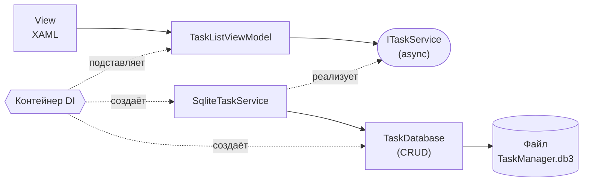

#  SQLite: делаем задачи постоянными

|                          |                                                                                         |
| ------------------------ | --------------------------------------------------------------------------------------- |
| **Дисциплина**           | Разработка мобильных приложений на .NET MAUI                                            |
| **Тема**                 | Локальная база данных SQLite: пакет, модель, класс доступа, CRUD, подключение к сервису |
| **Среда разработки**     | JetBrains Rider                                                                         |
| **Платформа / язык**     | .NET MAUI / C# и XAML                                                                   |
| **Проект**               | Task Manager (продолжение практических работ №2, №3, №6–№9)                             |
| **Время выполнения**     | 4 академических часа (2 занятия по 2 часа)                                              |
| **Теоретическая основа** | Лекция 10. Локальное хранение данных: SQLite в .NET MAUI                                |

---

## 1. Цель работы

Сделать задачи **постоянными**: научиться подключать SQLite, описывать модель для хранения, создавать класс доступа к базе данных, реализовывать операции создания, чтения, изменения и удаления (CRUD) и подключать базу данных к приложению через сервис, не переписывая интерфейс.

## 2. Задание

Сделать задачи постоянными (сохраняющимися между запусками приложения).

| № | Действие |
|---|---|
| 1 | Подключить SQLite-пакет |
| 2 | Создать модель `TaskItem` |
| 3 | Создать `TaskDatabase` |
| 4 | Создать таблицу |
| 5 | Реализовать `Insert` |
| 6 | Реализовать `Get` |
| 7 | Реализовать `Update` |
| 8 | Реализовать `Delete` |
| 9 | Подключить БД к сервису |

Подход соответствует официальной схеме документации .NET MAUI: установка SQLite-пакета, модель, класс доступа к базе данных и CRUD-операции.

## 3. Исходное состояние проекта

Работа продолжает практическую работу №9. Предполагается, что:

- задачи хранятся **в памяти**: `TaskService : ITaskService` держит `List<TaskItem>` и теряет данные при каждом перезапуске;
- интерфейс `ITaskService` **синхронный** (`GetTasks`, `Create`, `Remove`, `SetCompleted`, …), зарегистрирован как `Singleton`;
- `TaskListViewModel` работает с командами `AddTaskCommand`, `DeleteTaskCommand`, `CompleteTaskCommand`, `OpenTaskCommand`, `OpenAddPageCommand`;
- `TaskItem` реализует `INotifyPropertyChanged`; есть `TaskRules`, `TaskStatistics`.

Если работа №9 не выполнена, сначала доведите её до конца.

### 3.1. Что меняется в этой работе

| Элемент | Было | Станет |
|---|---|---|
| Хранилище | `List<TaskItem>` в памяти | Файл SQLite на устройстве |
| `TaskItem` | Обычная модель | Модель с атрибутами хранения (`[PrimaryKey]`, `[Table]`, `[Ignore]`) |
| Доступ к данным | Внутри `TaskService` | Класс `TaskDatabase` (CRUD) |
| `ITaskService` | Синхронный | **Асинхронный** (`Task<…>`) |
| Реализация сервиса | `TaskService` | `SqliteTaskService`, использующий `TaskDatabase` |
| `TaskListViewModel` и страницы | Синхронные вызовы | `await` + индикатор загрузки + обработка ошибок |

### 3.2. Схема по итогам работы



Благодаря интерфейсу из работы №9 интерфейс пользователя «не заметит» смены хранилища; изменения в `ViewModel` связаны только с тем, что вызовы стали асинхронными.

---

## 4. Краткая теория

| Понятие | Суть |
|---|---|
| **SQLite** | Встраиваемая реляционная СУБД: вся база — один файл, сервер не нужен |
| **`sqlite-net-pcl`** | NuGet-пакет с простой ORM для SQLite (рекомендуется документацией .NET MAUI) |
| **ORM** | Отображение классов на таблицы: объект ↔ строка, свойство ↔ столбец |
| **`SQLiteAsyncConnection`** | Асинхронное соединение: операции выполняются вне потока интерфейса |
| **Первичный ключ** | Уникальный идентификатор строки; `[PrimaryKey, AutoIncrement]` — присваивается базой |
| **CRUD** | Create (`Insert`), Read (`Get`), Update, Delete |
| **`FileSystem.AppDataDirectory`** | Каталог данных приложения, доступный для записи на любой платформе |
| **Ленивая инициализация** | Соединение открывается и таблица создаётся при первом обращении |
| **Миграция схемы** | Изменение структуры таблицы при обновлении приложения |

Типы данных: `int`, `string`, `bool` хранятся напрямую (`bool` — как 0/1), перечисления — как целые числа, `DateTime` по умолчанию — как число (количество тиков).

---

## 5. Ход работы

### Подготовка

1. Откройте решение `TaskManager` в Rider.
2. Создайте ветку: **Git → New Branch…**, имя `lab10-sqlite`.
3. Запустите приложение, добавьте задачу, остановите приложение (**Stop**) и запустите снова. Убедитесь, что добавленная задача **пропала**: именно эту проблему мы решаем.

---

### Шаг 1. Подключение SQLite-пакета

#### 1.1. Установка

В документации .NET MAUI используется пакет **sqlite-net-pcl**. Существует много пакетов с похожими названиями, поэтому проверяйте реквизиты:

| Поле | Значение |
|---|---|
| ID | `sqlite-net-pcl` |
| Authors | SQLite-net |
| Owners | praeclarum |

**Способ 1 (Rider).**

1. Откройте окно **NuGet**: **View → Tool Windows → NuGet** (или значок NuGet на боковой панели).
2. На вкладке **Packages** введите `sqlite-net-pcl`.
3. Выберите пакет с указанными реквизитами, укажите проект `TaskManager`, нажмите **+** (Install), подтвердите установку последней стабильной версии.

**Способ 2 (терминал).**

```bash
dotnet add package sqlite-net-pcl
```

После установки в `TaskManager.csproj` появится строка вида:

```xml
<PackageReference Include="sqlite-net-pcl" Version="..." />
```

Номер версии у вас может отличаться — это нормально.

#### 1.2. Проверка

Соберите проект. Добавьте в любой файл `using SQLite;` — Rider не должен подчёркивать пространство имён. Если подчёркивает, дождитесь восстановления пакетов (**Restore NuGet Packages**).

> **Примечание.** Библиотека SQLite.NET — сторонняя (репозиторий praeclarum/sqlite-net). Альтернатива, упомянутая в документации, — пакет `Microsoft.Data.Sqlite` (низкоуровневый ADO.NET-провайдер). В этой работе используется `sqlite-net-pcl`, так как она позволяет не писать SQL вручную.


---

### Шаг 2. Создание модели TaskItem

Чтобы библиотека могла хранить объект, нужно описать, какое свойство является ключом и какие свойства хранить не нужно.

#### 2.1. Что хранить, а что нет

| Свойство | Хранится? | Тип в базе | Пояснение |
|---|---|---|---|
| `Id` | Да | Целое, первичный ключ, автонумерация | Присваивается базой при вставке |
| `Title` | Да | Строка | Ограничение длины — метаданные |
| `Description` | Да | Строка | |
| `IsCompleted` | Да | Целое 0/1 | |
| `Priority` | Да | Целое | Перечисление хранится числом |
| `CreatedAt` | Да | Число (тики) | |
| `PriorityColor` | **Нет** | — | Вычисляемое, тип `Color` не хранится |
| `PriorityText` | **Нет** | — | Вычисляемое |

#### 2.2. Код

Откройте `Models/TaskItem.cs` и внесите изменения: добавьте `using SQLite;`, атрибуты и `[Ignore]`. Остальное (уведомления об изменениях) остаётся.

```csharp
using System.ComponentModel;
using System.Runtime.CompilerServices;
using Microsoft.Maui.Graphics;
using SQLite;

namespace TaskManager.Models;

[Table("Tasks")]                              // имя таблицы в базе
public class TaskItem : INotifyPropertyChanged
{
    private string _title = string.Empty;
    private string _description = string.Empty;
    private bool _isCompleted;
    private TaskPriority _priority = TaskPriority.Medium;

    public event PropertyChangedEventHandler? PropertyChanged;

    [PrimaryKey, AutoIncrement]               // ключ назначает база данных
    public int Id { get; set; }

    [MaxLength(100)]
    public string Title
    {
        get => _title;
        set => Set(ref _title, value);
    }

    public string Description
    {
        get => _description;
        set => Set(ref _description, value);
    }

    public bool IsCompleted
    {
        get => _isCompleted;
        set => Set(ref _isCompleted, value);
    }

    public TaskPriority Priority
    {
        get => _priority;
        set
        {
            if (!Set(ref _priority, value))
                return;

            OnPropertyChanged(nameof(PriorityColor));
            OnPropertyChanged(nameof(PriorityText));
        }
    }

    public DateTime CreatedAt { get; set; } = DateTime.Now;

    // Вычисляемые свойства только для показа: в базу не попадают
    [Ignore]
    public Color PriorityColor => Priority switch
    {
        TaskPriority.High => Colors.Crimson,
        TaskPriority.Medium => Colors.Orange,
        _ => Colors.SeaGreen
    };

    [Ignore]
    public string PriorityText => Priority switch
    {
        TaskPriority.High => "Высокий",
        TaskPriority.Medium => "Средний",
        _ => "Низкий"
    };

    private bool Set<T>(ref T field, T value, [CallerMemberName] string? name = null)
    {
        if (EqualityComparer<T>.Default.Equals(field, value))
            return false;

        field = value;
        OnPropertyChanged(name);
        return true;
    }

    private void OnPropertyChanged([CallerMemberName] string? name = null)
        => PropertyChanged?.Invoke(this, new PropertyChangedEventArgs(name));
}
```

**Требования библиотеки к модели**

| Требование | Почему |
|---|---|
| Публичный конструктор без параметров | Библиотека создаёт объекты сама при чтении |
| Публичные свойства с `get` и `set` | Через `set` заполняются значения из базы |
| Один первичный ключ | Нужен для `Update` и `Delete` |
| Типы, которые умеет хранить SQLite | `Color`, коллекции, сложные объекты хранить нельзя — помечайте `[Ignore]` |

**Замечания**

- Атрибут `[MaxLength(100)]` — это метаданные библиотеки, SQLite сам длину **не проверяет**. Проверку длины делает `TaskRules` (работа №9).
- Если в вашей модели есть другие свойства, определите для каждого, хранить ли его.
- Атрибуты хранения в модели — удобный, но не единственный вариант. Строгий вариант — отдельный класс-сущность для базы и отображение на модель интерфейса (см. дополнительное задание 7.5).

Соберите проект. Приложение работает как раньше: атрибуты ни на что не влияют, пока база не используется.


---

### Шаг 3. Создание TaskDatabase

#### 3.1. Константы

Создайте папку `Data` и файл `Data/DatabaseConstants.cs`:

```csharp
namespace TaskManager.Data;

public static class DatabaseConstants
{
    public const string DatabaseFilename = "TaskManager.db3";

    public const SQLite.SQLiteOpenFlags Flags =
        // открыть базу для чтения и записи
        SQLite.SQLiteOpenFlags.ReadWrite |
        // создать файл, если его нет
        SQLite.SQLiteOpenFlags.Create |
        // разрешить доступ из нескольких потоков
        SQLite.SQLiteOpenFlags.SharedCache;

    // Каталог данных приложения: доступен для записи на всех платформах
    public static string DatabasePath =>
        Path.Combine(FileSystem.AppDataDirectory, DatabaseFilename);
}
```

| Элемент | Назначение |
|---|---|
| `DatabaseFilename` | Имя файла (расширение `.db3` — общепринятое, но не обязательное) |
| `SQLiteOpenFlags` | Режим открытия: чтение/запись, создание файла, общий кэш |
| `FileSystem.AppDataDirectory` | Папка приложения; на каждой платформе путь свой, поэтому его не записывают вручную |

#### 3.2. Каркас класса доступа

Создайте файл `Data/TaskDatabase.cs`. Класс скрывает от остального приложения, как устроено хранилище.

```csharp
using SQLite;
using TaskManager.Models;

namespace TaskManager.Data;

public class TaskDatabase
{
    private SQLiteAsyncConnection? _database;

    // Защита от одновременной инициализации из нескольких мест
    private readonly SemaphoreSlim _initLock = new(1, 1);

    // Возвращает готовое соединение; при первом вызове создаёт его
    private async Task<SQLiteAsyncConnection> GetConnectionAsync()
    {
        if (_database is not null)
            return _database;

        await _initLock.WaitAsync();
        try
        {
            if (_database is not null)       // повторная проверка внутри блокировки
                return _database;

            var connection = new SQLiteAsyncConnection(
                DatabaseConstants.DatabasePath,
                DatabaseConstants.Flags);

            // Шаг 4: таблица создаётся здесь

            _database = connection;          // публикуем соединение только когда оно готово
            return _database;
        }
        finally
        {
            _initLock.Release();
        }
    }

    // Методы CRUD будут добавлены в шагах 5–8
}
```

**Почему именно так**

| Решение | Причина |
|---|---|
| Асинхронное соединение | Операции с файлом не должны блокировать интерфейс |
| Ленивая инициализация | Файл открывается при первом обращении, а не при запуске приложения |
| `SemaphoreSlim` | Если два экрана одновременно обратятся к базе, инициализация выполнится один раз |
| `_database` присваивается последним | Другие потоки не увидят соединение, пока таблица не создана |

#### 3.3. Регистрация в DI

В `MauiProgram.cs` добавьте `using TaskManager.Data;` и строку:

```csharp
        builder.Services.AddSingleton<TaskDatabase>();
```

`Singleton`: соединение с файлом должно быть общим для всего приложения.

Соберите проект.

---

### Шаг 4. Создание таблицы

#### 4.1. Код

В методе `GetConnectionAsync` на месте комментария `// Шаг 4` добавьте:

```csharp
            // Создаёт таблицу Tasks по описанию класса TaskItem, если её ещё нет.
            // Если таблица есть, но в модели появились новые поля, недостающие столбцы добавляются.
            await connection.CreateTableAsync<TaskItem>();

            // Демонстрационные данные при первом запуске
            await SeedAsync(connection);
```

Добавьте метод начального заполнения (после `GetConnectionAsync`):

```csharp
    // Заполняет пустую таблицу тестовыми задачами
    private static async Task SeedAsync(SQLiteAsyncConnection connection)
    {
        if (await connection.Table<TaskItem>().CountAsync() > 0)
            return;

        await connection.InsertAllAsync(new[]
        {
            new TaskItem { Title = "Подготовить отчёт", Priority = TaskPriority.High },
            new TaskItem { Title = "Купить продукты", Priority = TaskPriority.Low },
            new TaskItem { Title = "Позвонить заказчику", Priority = TaskPriority.Medium, IsCompleted = true },
            new TaskItem { Title = "Сдать практическую работу", Priority = TaskPriority.High }
        });
    }
```

**Разбор**

| Вызов | Что делает |
|---|---|
| `CreateTableAsync<TaskItem>()` | Читает атрибуты класса и создаёт таблицу `Tasks` (если не существует) |
| `Table<TaskItem>().CountAsync()` | Считает строки (аналог `SELECT COUNT(*)`) |
| `InsertAllAsync(...)` | Вставляет набор строк в одной транзакции |

#### 4.2. Временная проверка: «дымовой тест»

Пока класс не подключён к интерфейсу, проверяем его отладочным выводом. Создайте файл `Data/DbSmokeTest.cs` (**временный**, удалим после шага 9):

```csharp
using System.Diagnostics;
using TaskManager.Models;

namespace TaskManager.Data;

public static class DbSmokeTest
{
    public static async Task RunAsync(TaskDatabase db)
    {
        try
        {
            Debug.WriteLine($"[DB] Файл: {DatabaseConstants.DatabasePath}");

            // Шаг 4: таблица создана при первом обращении, запись из SeedAsync на месте

            // Шаги 5–8: сюда будем добавлять проверки
        }
        catch (Exception ex)
        {
            Debug.WriteLine($"[DB] ОШИБКА: {ex}");
        }
    }
}
```

В `App.xaml.cs` временно получите базу и запустите тест (добавьте `using TaskManager.Data;`):

```csharp
    public App(SettingsService settings, TaskDatabase database)
    {
        InitializeComponent();
        settings.ApplyTheme();

        _ = DbSmokeTest.RunAsync(database);      // ВРЕМЕННО, удалить после шага 9
    }
```

Методов чтения в `TaskDatabase` пока нет, поэтому на этом шаге проверяем только то, что соединение открывается и таблица создаётся без ошибок. Для этого добавьте в `TaskDatabase` временный метод (в шаге 6 он будет заменён настоящим `GetAllAsync`):

```csharp
    // ВРЕМЕННО: только чтобы вызвать инициализацию и создать таблицу
    public Task EnsureCreatedAsync() => GetConnectionAsync();
```

и вызовите его в `DbSmokeTest.RunAsync` после комментария «Шаг 4»:

```csharp
            await db.EnsureCreatedAsync();
            Debug.WriteLine("[DB] Таблица создана");
```

Ожидание: в окне вывода появляются строки `[DB] Файл: ...` и `[DB] Таблица создана`, строки `[DB] ОШИБКА` нет. Запись начального набора подтвердит шаг 6.

---

### Шаг 5. Реализация Insert

#### 5.1. Код

В `TaskDatabase` добавьте метод (в раздел CRUD):

```csharp
    // CREATE. Вставляет задачу. После вставки у объекта заполняется Id.
    public async Task<TaskItem> InsertAsync(TaskItem item)
    {
        var db = await GetConnectionAsync();

        await db.InsertAsync(item);      // Id назначается автоматически (AutoIncrement)
        return item;
    }
```

**Разбор**

| Особенность | Пояснение |
|---|---|
| `InsertAsync(item)` возвращает число добавленных строк | Нам оно не нужно; важнее, что `item.Id` обновился |
| Идентификатор не задаётся вручную | Его выдаёт база |
| Возвращаем тот же объект | Вызывающий код получает задачу с готовым `Id` |

#### 5.2. Проверка

В `DbSmokeTest.RunAsync` добавьте:

```csharp
            // Шаг 5: Insert
            var created = await db.InsertAsync(new TaskItem
            {
                Title = "Тест вставки",
                Priority = TaskPriority.Medium
            });
            Debug.WriteLine($"[DB] Insert -> Id={created.Id}");
```

Запустите приложение. Ожидаемый вывод: `[DB] Insert -> Id=5` (число зависит от количества строк; при каждом запуске теста оно будет расти — это нормально, пока тест не удалён).

---

### Шаг 6. Реализация Get

Чтение бывает двух видов: «получить список» и «получить одну запись».

#### 6.1. Код

Добавьте в `TaskDatabase`:

```csharp
    // READ (список). При hideCompleted = true выполненные задачи не возвращаются.
    public async Task<List<TaskItem>> GetAllAsync(bool hideCompleted = false)
    {
        var db = await GetConnectionAsync();

        var query = db.Table<TaskItem>();

        if (hideCompleted)
            query = query.Where(t => t.IsCompleted == false);

        return await query
            .OrderBy(t => t.Id)
            .ToListAsync();
    }

    // READ (одна запись). Возвращает null, если задачи с таким Id нет.
    public async Task<TaskItem?> FindAsync(int id)
    {
        var db = await GetConnectionAsync();
        return await db.FindAsync<TaskItem>(id);
    }
```

**Разбор**

| Фрагмент | Пояснение |
|---|---|
| `Table<TaskItem>()` | Начало запроса к таблице |
| `.Where(t => t.IsCompleted == false)` | Условие записывается выражением C#, библиотека переводит его в SQL. Запись `== false` предпочтительна: она однозначно переводится |
| `.OrderBy(t => t.Id)` | Стабильный порядок: по возрастанию идентификатора |
| `FindAsync<T>(id)` | Поиск по первичному ключу; при отсутствии возвращает `null`. Аналог `GetAsync` выбросил бы исключение |

> **Сравнение с SQL.** `SELECT * FROM Tasks WHERE IsCompleted = 0 ORDER BY Id`. Библиотека умеет и прямые запросы: `db.QueryAsync<TaskItem>("SELECT * FROM Tasks WHERE IsCompleted = 0")`.

#### 6.2. Проверка

Добавьте в `DbSmokeTest.RunAsync`:

```csharp
            // Шаг 6: Get
            var all = await db.GetAllAsync();
            Debug.WriteLine($"[DB] GetAll -> {all.Count} шт.");
            foreach (var t in all)
                Debug.WriteLine($"      #{t.Id} '{t.Title}' готово={t.IsCompleted} приоритет={t.Priority}");

            var active = await db.GetAllAsync(hideCompleted: true);
            Debug.WriteLine($"[DB] GetAll(hideCompleted) -> {active.Count} шт.");

            var one = await db.FindAsync(created.Id);
            Debug.WriteLine($"[DB] Find({created.Id}) -> {one?.Title ?? "не найдено"}");

            var none = await db.FindAsync(99999);
            Debug.WriteLine($"[DB] Find(99999) -> {(none is null ? "null (верно)" : "ошибка")}");
```

Ожидание: в списке есть 4 начальные задачи и тестовая; число невыполненных на единицу меньше общего (одна начальная выполнена); поиск несуществующего `Id` возвращает `null`.


---

### Шаг 7. Реализация Update

#### 7.1. Код

```csharp
    // UPDATE. Записывает изменения существующей задачи (поиск по Id).
    // Возвращает true, если строка найдена и обновлена.
    public async Task<bool> UpdateAsync(TaskItem item)
    {
        var db = await GetConnectionAsync();

        int rows = await db.UpdateAsync(item);
        return rows > 0;
    }
```

**Разбор**

| Особенность | Пояснение |
|---|---|
| Ключ берётся из `item.Id` | У объекта должен быть корректный `Id`, полученный из базы |
| Обновляются **все** столбцы | Даже если изменилось одно поле |
| Результат — число обновлённых строк | 0 означает «такой записи нет» |

> **Типичная ошибка:** создать новый объект `new TaskItem { Title = "..." }` и вызвать `UpdateAsync`. Без `Id` (равного 0) обновляться нечего — вернётся 0.

#### 7.2. Проверка

```csharp
            // Шаг 7: Update
            created.Title = "Тест изменён";
            created.IsCompleted = true;
            bool updated = await db.UpdateAsync(created);
            Debug.WriteLine($"[DB] Update -> {updated}");

            var reloaded = await db.FindAsync(created.Id);
            Debug.WriteLine($"[DB] После Update: '{reloaded?.Title}' готово={reloaded?.IsCompleted}");

            var ghost = new TaskItem { Id = 99999, Title = "Призрак" };
            Debug.WriteLine($"[DB] Update несуществующей -> {await db.UpdateAsync(ghost)}");
```

Ожидание: `Update -> True`; повторное чтение показывает новое название и `готово=True`; обновление несуществующей записи возвращает `False`.

---

### Шаг 8. Реализация Delete

#### 8.1. Код

```csharp
    // DELETE. Удаляет задачу по идентификатору. Возвращает true, если строка была удалена.
    public async Task<bool> DeleteAsync(int id)
    {
        var db = await GetConnectionAsync();

        int rows = await db.DeleteAsync<TaskItem>(id);
        return rows > 0;
    }

    // Удаляет все выполненные задачи, возвращает их количество
    public async Task<int> DeleteCompletedAsync()
    {
        var db = await GetConnectionAsync();

        return await db.ExecuteAsync("DELETE FROM Tasks WHERE IsCompleted = 1");
    }
```

**Разбор**

| Метод | Пояснение |
|---|---|
| `DeleteAsync<TaskItem>(id)` | Удаляет строку по первичному ключу |
| `ExecuteAsync("DELETE ...")` | Прямой SQL для массовой операции; имя таблицы `Tasks` взято из `[Table("Tasks")]` |
| Результат | Число затронутых строк |

> Прямой SQL с пользовательскими значениями нужно составлять только с **параметрами** (`?`), а не склеиванием строк: иначе возможна SQL-инъекция. В нашем запросе констант достаточно.

#### 8.2. Проверка

```csharp
            // Шаг 8: Delete
            Debug.WriteLine($"[DB] Delete({created.Id}) -> {await db.DeleteAsync(created.Id)}");
            Debug.WriteLine($"[DB] Delete повторно -> {await db.DeleteAsync(created.Id)}");
            Debug.WriteLine($"[DB] После Delete: {(await db.FindAsync(created.Id) is null ? "запись отсутствует" : "ошибка")}");

            var finalCount = (await db.GetAllAsync()).Count;
            Debug.WriteLine($"[DB] Итого записей: {finalCount}");
```

Ожидание: первое удаление `True`, повторное `False`, запись больше не находится, итоговое число записей равно количеству начальных (4) после первого прогона.

> `DeleteCompletedAsync` в тесте не вызываем, чтобы не потерять начальные данные; его проверим через интерфейс на шаге 9.

---

### Шаг 9. Подключение БД к сервису

Теперь база данных будет подключена к приложению через сервис. Это самый объёмный шаг; он состоит из пяти частей.

#### 9.1. Почему интерфейс сервиса придётся изменить

Операции с файлом могут занимать время, поэтому `SQLiteAsyncConnection` предоставляет **только асинхронные** методы. Нельзя «спрятать» асинхронность внутри синхронного метода:

- блокирующее ожидание (`.Result`, `.Wait()`) в потоке интерфейса может привести к зависанию;
- реальные операции с диском не должны задерживать отрисовку.

Поэтому методы `ITaskService` становятся асинхронными. Это показывает важный урок проектирования: если реализация *может* выполнять ввод-вывод, контракт должен быть асинхронным с самого начала.

#### 9.2. Новый `ITaskService`

Замените содержимое `Services/ITaskService.cs`:

```csharp
using TaskManager.Models;

namespace TaskManager.Services;

public interface ITaskService
{
    // Список задач; при hideCompleted = true выполненные не возвращаются
    Task<IReadOnlyList<TaskItem>> GetTasksAsync(bool hideCompleted = false);

    Task<TaskItem?> GetByIdAsync(int id);

    // Сохраняет готовую задачу и назначает ей идентификатор
    Task<TaskItem> AddAsync(TaskItem task);

    // Создаёт задачу по названию и приоритету с проверкой правил
    Task<TaskItem> CreateAsync(string title, TaskPriority priority);

    // Сохраняет изменения существующей задачи (заменяет SetCompleted)
    Task<bool> UpdateAsync(TaskItem task);

    Task<bool> RemoveAsync(int id);

    Task<int> ClearCompletedAsync();

    Task<TaskStatistics> GetStatisticsAsync();
}
```

**Что изменилось по смыслу.** Метод `SetCompleted(id, flag)` заменён на `UpdateAsync(task)`. Причина: база возвращает **новые объекты** при каждом чтении. `ViewModel` меняет тот объект, который показан на экране (`task.IsCompleted = ...`), и передаёт его сервису на сохранение. Раньше (в памяти) сервис менял тот же самый объект, теперь так нельзя.

#### 9.3. Новая реализация `SqliteTaskService`

Создайте файл `Services/SqliteTaskService.cs`:

```csharp
using TaskManager.Data;
using TaskManager.Models;

namespace TaskManager.Services;

public class SqliteTaskService : ITaskService
{
    private readonly TaskDatabase _database;

    // База данных внедряется через конструктор
    public SqliteTaskService(TaskDatabase database)
    {
        _database = database;
    }

    public async Task<IReadOnlyList<TaskItem>> GetTasksAsync(bool hideCompleted = false)
        => await _database.GetAllAsync(hideCompleted);

    public Task<TaskItem?> GetByIdAsync(int id)
        => _database.FindAsync(id);

    public Task<TaskItem> AddAsync(TaskItem task)
        => _database.InsertAsync(task);

    public async Task<TaskItem> CreateAsync(string title, TaskPriority priority)
    {
        // Правила предметной области проверяются в сервисе, а не в базе
        if (!TaskRules.IsValidTitle(title))
            throw new ArgumentException("Недопустимое название задачи", nameof(title));

        return await _database.InsertAsync(new TaskItem
        {
            Title = title.Trim(),
            Priority = priority
        });
    }

    public Task<bool> UpdateAsync(TaskItem task)
    {
        if (!TaskRules.IsValidTitle(task.Title))
            throw new ArgumentException("Недопустимое название задачи", nameof(task));

        return _database.UpdateAsync(task);
    }

    public Task<bool> RemoveAsync(int id)
        => _database.DeleteAsync(id);

    public Task<int> ClearCompletedAsync()
        => _database.DeleteCompletedAsync();

    public async Task<TaskStatistics> GetStatisticsAsync()
    {
        // Для небольшой базы проще загрузить список и посчитать в памяти.
        // Для больших объёмов считают запросами в самой базе.
        var all = await _database.GetAllAsync();
        var active = all.Where(t => !t.IsCompleted).ToList();

        return new TaskStatistics(
            Total: all.Count,
            Completed: all.Count - active.Count,
            HighActive: active.Count(t => t.Priority == TaskPriority.High),
            MediumActive: active.Count(t => t.Priority == TaskPriority.Medium),
            LowActive: active.Count(t => t.Priority == TaskPriority.Low));
    }
}
```

**Разграничение обязанностей**

| Слой | Отвечает за |
|---|---|
| `TaskDatabase` | Как хранить и читать (таблица, запросы) |
| `SqliteTaskService` | Что можно делать (правила, статистика, контракт приложения) |
| `TaskListViewModel` | Состояние экрана и команды |

#### 9.4. Регистрация и очистка

В `MauiProgram.cs` замените регистрацию сервиса:

```csharp
        builder.Services.AddSingleton<TaskDatabase>();
        builder.Services.AddSingleton<ITaskService, SqliteTaskService>();   // было: TaskService
```

Затем:

1. Удалите файл `Services/TaskService.cs` (код сохранится в истории Git). При желании оставьте его для дополнительного задания 7.1, переработав под новый интерфейс.
2. Удалите `Services/LoggingTaskService.cs`, если он остался от работы №9 (или приведите его к новому интерфейсу).
3. Удалите из `App.xaml.cs` временный вызов `DbSmokeTest` и параметр `TaskDatabase`:

```csharp
    public App(SettingsService settings)
    {
        InitializeComponent();
        settings.ApplyTheme();
    }
```

4. Удалите файл `Data/DbSmokeTest.cs` и временный метод `EnsureCreatedAsync` из `TaskDatabase`.

После этого сборка выдаст ошибки в каждом месте, где использовался старый синхронный интерфейс. Это ожидаемо: **компилятор показывает, что нужно переделать**. Откройте окно ошибок (**View → Tool Windows → Problems**).

#### 9.5. Обновление потребителей сервиса

##### `TaskListViewModel`

Это основной класс. Привожу его полностью.

```csharp
using System.Collections.ObjectModel;
using System.Diagnostics;
using System.Windows.Input;
using TaskManager.Models;
using TaskManager.Services;

namespace TaskManager.ViewModels;

public class TaskListViewModel : BaseViewModel
{
    private readonly ITaskService _service;
    private readonly SettingsService _settings;

    private readonly Command _openAddPageCommand;
    private readonly Command<TaskItem> _openTaskCommand;
    private readonly Command _addTaskCommand;
    private readonly Command<TaskItem> _deleteTaskCommand;
    private readonly Command<TaskItem> _completeTaskCommand;

    private bool _hideCompleted;
    private bool _isBusy;
    private bool _isLoading;
    private int _loadVersion;
    private string _newTaskTitle = string.Empty;
    private int _selectedPriorityIndex = 1;
    private string _summaryText = string.Empty;
    private string _statusMessage = string.Empty;

    public TaskListViewModel(ITaskService service, SettingsService settings)
    {
        _service = service;
        _settings = settings;

        _openAddPageCommand = new Command(
            execute: async () => await NavigateAsync(nameof(AddTaskPage)),
            canExecute: () => !IsBusy);

        _openTaskCommand = new Command<TaskItem>(
            execute: async task => await OpenTaskAsync(task),
            canExecute: _ => !IsBusy);

        _addTaskCommand = new Command(
            execute: async () => await RunSafeAsync(AddTaskAsync),
            canExecute: () => CanAdd);

        _deleteTaskCommand = new Command<TaskItem>(
            async task => await RunSafeAsync(() => DeleteTaskAsync(task)));

        _completeTaskCommand = new Command<TaskItem>(
            async task => await RunSafeAsync(() => CompleteTaskAsync(task)));
    }

    // ===== Данные для интерфейса =====

    public ObservableCollection<TaskItem> Tasks { get; } = new();

    public bool HideCompleted
    {
        get => _hideCompleted;
        set
        {
            if (!SetProperty(ref _hideCompleted, value))
                return;

            _settings.HideCompleted = value;
            _ = RunSafeAsync(LoadTasksAsync);     // перечитываем список с новым фильтром
        }
    }

    // ----- Поле быстрого добавления -----

    public IReadOnlyList<string> PriorityNames { get; } = new[] { "Низкий", "Средний", "Высокий" };

    public int SelectedPriorityIndex
    {
        get => _selectedPriorityIndex;
        set => SetProperty(ref _selectedPriorityIndex, value);
    }

    private TaskPriority SelectedPriority => SelectedPriorityIndex switch
    {
        0 => TaskPriority.Low,
        2 => TaskPriority.High,
        _ => TaskPriority.Medium
    };

    public string NewTaskTitle
    {
        get => _newTaskTitle;
        set
        {
            var text = value ?? string.Empty;

            if (!SetProperty(ref _newTaskTitle, text))
                return;

            OnPropertyChanged(nameof(ErrorText));
            OnPropertyChanged(nameof(HasError));
            _addTaskCommand.ChangeCanExecute();
        }
    }

    public string ErrorText =>
        NewTaskTitle.Trim().Length > TaskRules.MaxTitleLength
            ? $"Не более {TaskRules.MaxTitleLength} символов"
            : string.Empty;

    public bool HasError => ErrorText.Length > 0;

    private bool CanAdd => TaskRules.IsValidTitle(NewTaskTitle);

    // ----- Сводка, загрузка, сообщения -----

    public string SummaryText
    {
        get => _summaryText;
        private set => SetProperty(ref _summaryText, value);
    }

    // Идёт загрузка списка из базы
    public bool IsLoading
    {
        get => _isLoading;
        private set => SetProperty(ref _isLoading, value);
    }

    // Сообщение об ошибке операции
    public string StatusMessage
    {
        get => _statusMessage;
        private set
        {
            if (SetProperty(ref _statusMessage, value))
                OnPropertyChanged(nameof(HasStatusMessage));
        }
    }

    public bool HasStatusMessage => StatusMessage.Length > 0;

    // ----- Состояние занятости (переходы) -----

    public bool IsBusy
    {
        get => _isBusy;
        private set
        {
            if (!SetProperty(ref _isBusy, value))
                return;

            _openAddPageCommand.ChangeCanExecute();
            _openTaskCommand.ChangeCanExecute();
        }
    }

    // ===== Команды =====

    public ICommand OpenAddPageCommand => _openAddPageCommand;
    public ICommand OpenTaskCommand => _openTaskCommand;
    public ICommand AddTaskCommand => _addTaskCommand;
    public ICommand DeleteTaskCommand => _deleteTaskCommand;
    public ICommand CompleteTaskCommand => _completeTaskCommand;

    // ===== Поведение =====

    // Вызывается страницей при каждом показе вкладки
    public async Task RefreshAsync()
    {
        _hideCompleted = _settings.HideCompleted;
        OnPropertyChanged(nameof(HideCompleted));

        await RunSafeAsync(async () =>
        {
            await LoadTasksAsync();
            await UpdateSummaryAsync();
        });
    }

    private async Task LoadTasksAsync()
    {
        // Номер запроса: если пока шла загрузка, начался новый запрос, старый результат отбрасываем
        int version = ++_loadVersion;

        IsLoading = true;
        try
        {
            var items = await _service.GetTasksAsync(_hideCompleted);

            if (version != _loadVersion)
                return;

            Tasks.Clear();
            foreach (var task in items)
                Tasks.Add(task);
        }
        finally
        {
            if (version == _loadVersion)
                IsLoading = false;
        }
    }

    private async Task UpdateSummaryAsync()
    {
        var stats = await _service.GetStatisticsAsync();
        SummaryText = $"Выполнено {stats.Completed} из {stats.Total}";
    }

    private async Task AddTaskAsync()
    {
        if (!CanAdd)
            return;

        var title = NewTaskTitle;
        var priority = SelectedPriority;

        // Очищаем поле сразу: повторное нажатие во время записи не создаст дубликат
        NewTaskTitle = string.Empty;

        try
        {
            var task = await _service.CreateAsync(title, priority);
            Tasks.Add(task);
        }
        catch
        {
            NewTaskTitle = title;      // возвращаем введённый текст, чтобы не потерять
            throw;
        }

        await UpdateSummaryAsync();
    }

    private async Task DeleteTaskAsync(TaskItem? task)
    {
        if (task is null)
            return;

        // Сначала хранилище (источник истины), затем экран
        if (await _service.RemoveAsync(task.Id))
        {
            Tasks.Remove(task);
            await UpdateSummaryAsync();
        }
    }

    private async Task CompleteTaskAsync(TaskItem? task)
    {
        if (task is null)
            return;

        task.IsCompleted = !task.IsCompleted;      // экран реагирует сразу

        try
        {
            if (!await _service.UpdateAsync(task))
                throw new InvalidOperationException("Задача не найдена в базе данных");
        }
        catch
        {
            task.IsCompleted = !task.IsCompleted;  // откат изменения при ошибке
            throw;
        }

        if (HideCompleted && task.IsCompleted)
            Tasks.Remove(task);

        await UpdateSummaryAsync();
    }

    private async Task OpenTaskAsync(TaskItem? task)
    {
        if (task is null)
            return;

        await NavigateAsync($"{nameof(TaskDetailsPage)}?id={task.Id}");
    }

    private async Task NavigateAsync(string route)
    {
        if (IsBusy)
            return;

        IsBusy = true;
        try
        {
            await Shell.Current.GoToAsync(route);
        }
        finally
        {
            IsBusy = false;
        }
    }

    // Выполняет действие; ошибка не приводит к падению приложения, а показывается сообщением
    private async Task RunSafeAsync(Func<Task> action)
    {
        try
        {
            StatusMessage = string.Empty;
            await action();
        }
        catch (Exception ex)
        {
            Debug.WriteLine($"[VM] Ошибка операции: {ex}");
            StatusMessage = "Не удалось выполнить операцию. Повторите попытку.";
        }
    }
}
```

**Что изменилось по сравнению с работой №9**

| Изменение | Причина |
|---|---|
| Все обращения к сервису с `await` | Интерфейс стал асинхронным |
| `RefreshAsync()` вместо `Refresh()` | Загрузка идёт асинхронно |
| `IsLoading` | Показать индикатор на время чтения |
| `RunSafeAsync` и `StatusMessage` | Исключение в `async void`-лямбде команды «роняет» приложение; перехватываем и показываем сообщение |
| `_loadVersion` | Защита от устаревших результатов при быстром переключении фильтра |
| В `AddTaskAsync` поле очищается до записи | Защита от дублей при повторном нажатии |
| В `CompleteTaskAsync` откат при ошибке | Экран не должен расходиться с базой |

Не используйте `ConfigureAwait(false)` во `ViewModel`: после `await` нужно вернуться в поток интерфейса, чтобы изменять `ObservableCollection`.

##### `TaskListPage.xaml.cs`

```csharp
using TaskManager.ViewModels;

namespace TaskManager;

public partial class TaskListPage : ContentPage
{
    private readonly TaskListViewModel _viewModel;

    public TaskListPage(TaskListViewModel viewModel)
    {
        InitializeComponent();
        _viewModel = viewModel;
        BindingContext = viewModel;
    }

    // async void допустим только для переопределения событий жизненного цикла;
    // все исключения обрабатываются внутри RefreshAsync
    protected override async void OnAppearing()
    {
        base.OnAppearing();
        await _viewModel.RefreshAsync();
    }
}
```

##### `TaskListPage.xaml`: индикатор и сообщение

В строке со сводкой (строка 1 основной `Grid`) замените первый `Label` на блок:

```xml
            <VerticalStackLayout Grid.Column="0" Spacing="4" VerticalOptions="Center">
                <HorizontalStackLayout Spacing="8">
                    <Label Text="{Binding SummaryText}"
                           Style="{StaticResource SecondaryLabelStyle}"
                           VerticalOptions="Center" />
                    <ActivityIndicator IsRunning="{Binding IsLoading}"
                                       IsVisible="{Binding IsLoading}"
                                       HeightRequest="16" WidthRequest="16" />
                </HorizontalStackLayout>

                <Label Text="{Binding StatusMessage}"
                       IsVisible="{Binding HasStatusMessage}"
                       Style="{StaticResource ErrorLabelStyle}" />
            </VerticalStackLayout>
```

##### Остальные страницы

Общее правило: каждое обращение к сервису получает `await`, метод, содержащий `await`, становится `async`.

| Файл | Было | Станет |
|---|---|---|
| `StatisticsPage.xaml.cs` (или `StatisticsViewModel`) | `var s = _service.GetStatistics();` | `var s = await _service.GetStatisticsAsync();` в `async`-методе; `OnAppearing` — `protected override async void OnAppearing()` |
| `SettingsPage.xaml.cs` | `_service.GetStatistics().Completed`, `_service.ClearCompleted()` | `(await _service.GetStatisticsAsync()).Completed`, `await _service.ClearCompletedAsync()` |
| `AddTaskPage.xaml.cs` (или `AddTaskViewModel`) | `_service.Add(new TaskItem {...})` | `await _service.AddAsync(new TaskItem {...})` до `GoToAsync("..")` |
| `TaskDetailsPage.xaml.cs` | `_service.GetById(id)` в сеттере `TaskId` | см. шаблон ниже |

Шаблон для страницы деталей: сеттер параметра запроса не может быть асинхронным, поэтому запускает асинхронный метод загрузки:

```csharp
    public string TaskId
    {
        set
        {
            if (int.TryParse(value, out var id))
                _ = LoadAsync(id);
        }
    }

    private async Task LoadAsync(int id)
    {
        var task = await _service.GetByIdAsync(id);

        if (task is null)
        {
            await Shell.Current.GoToAsync("..");     // задачи нет: возвращаемся
            return;
        }

        _task = task;
        // Заполните элементы страницы так же, как это делалось раньше
    }
```

Если вызов изменяет интерфейс не из потока интерфейса, используйте `MainThread.BeginInvokeOnMainThread(...)`. После `await` из потока интерфейса возврат происходит автоматически.

Соберите проект: **Build → Rebuild Solution**. Ошибок быть не должно.

---

## 6. Итоговая проверка

### 6.1. Проверочные сценарии

| № | Сценарий | Ожидаемый результат | Факт |
|---|---|---|---|
| 1 | Первый запуск после установки | Четыре начальные задачи, сводка «Выполнено 1 из 4» | |
| 2 | Добавить задачу «Тест SQLite» | Появилась внизу, поле очищено | |
| 3 | **Остановить приложение (Stop) и запустить снова** | Задача «Тест SQLite» **на месте** | |
| 4 | Отметить задачу выполненной, перезапустить | Состояние сохранено | |
| 5 | Вернуть задачу в работу (`↺`), перезапустить | Состояние сохранено | |
| 6 | Удалить задачу, перезапустить | Задача не вернулась | |
| 7 | Включить «Скрыть выполненные», перезапустить | Фильтр сохранён, список соответствует | |
| 8 | Переключить фильтр несколько раз подряд | Итоговый список соответствует последнему состоянию | |
| 9 | Добавить задачу через форму («Форма»), вернуться | Задача видна; после перезапуска сохранена | |
| 10 | Открыть детали задачи | Показаны данные именно этой задачи | |
| 11 | «Статистика» | Значения соответствуют списку | |
| 12 | «Настройки» → «Удалить выполненные» → «Задачи» | Выполненные удалены из списка и из базы (проверить перезапуском) | |
| 13 | Дважды быстро нажать «Добавить» | Создана одна задача | |
| 14 | Ввести 101 символ | Кнопка заблокирована, ошибка из `TaskRules` | |
| 15 | Удалить все задачи (список пуст, показано сообщение «Задач пока нет»), затем перезапустить | Запишите наблюдение: начальные задачи появляются снова (так работает `SeedAsync` для пустой таблицы); объяснение — в эксперименте 1 | |
| 16 | Повернуть эмулятор | Данные на месте | |
| 17 | Тёмная тема | Оформление корректно | |

### 6.2. Просмотр файла базы данных

Чтобы убедиться, что данные лежат в файле, откройте его.

1. Путь к файлу вы видели в выводе на шаге 4 (`[DB] Файл: ...`). Запишите его.
2. **Android (эмулятор, сборка Debug).** В терминале:

```bash
adb exec-out run-as <имя_пакета> cat files/TaskManager.db3 > TaskManager.db3
```

   Имя пакета указано в свойствах проекта (**Application ID**). Если путь в выводе отличается от `files/…`, используйте его.
3. **Windows.** Файл лежит в локальных данных приложения (путь выводился в журнал на шаге 4).
4. Откройте полученный файл:
   - в Rider: **View → Tool Windows → Database**, **+ → Data Source → SQLite**, выберите файл (при необходимости разрешите загрузку драйвера);
   - либо в программе «DB Browser for SQLite».
5. Выполните запрос и сделайте скриншот:

```sql
SELECT Id, Title, IsCompleted, Priority, CreatedAt FROM Tasks;
```

6. Сопоставьте столбцы и свойства `TaskItem`. Обратите внимание, во что превратились `bool`, перечисление и дата.

### 6.3. Эксперименты

**Эксперимент 1. Когда создаётся начальный набор.** Удалите все задачи, перезапустите приложение. Появились ли начальные задачи снова? Объясните результат, исходя из условия в `SeedAsync` (`CountAsync() > 0`). Какая проблема возникнет, если пользователь сам удалил все задачи, а при каждом запуске они возвращаются? Предложите решение (флаг «данные уже созданы» в `Preferences`).

**Эксперимент 2. Сброс базы.** Удалите приложение с эмулятора (или очистите его данные) и установите заново. Что произошло с задачами? Сделайте вывод о том, что такое локальная база данных и почему нужны резервные копии и синхронизация.

**Эксперимент 3. Изменение схемы.** Добавьте в `TaskItem` свойство `public DateTime? DueDate { get; set; }`, не удаляя базу. Запустите приложение.

1. Остались ли старые задачи?
2. Появился ли новый столбец в таблице (проверьте запросом из п. 6.2)?
3. Удалите свойство `DueDate` из модели. Исчез ли столбец из базы?

Запишите вывод: какие изменения схемы `CreateTableAsync` выполняет сам, а какие потребуют ручной миграции.

**Эксперимент 4. Ошибка на ровном месте.** В `DatabaseConstants.DatabasePath` временно укажите недоступную папку (например, `Path.Combine("/", DatabaseFilename)`). Запустите приложение. Что показывает интерфейс? Попал ли в журнал текст исключения? Верните исходное значение. Какую роль сыграли `RunSafeAsync` и `StatusMessage`?

**Эксперимент 5. Блокирующее ожидание.** Замените в любом месте вызов `await _service.GetTasksAsync()` на `_service.GetTasksAsync().Result` и запустите приложение. Опишите, что произошло, и объясните, почему этого делать нельзя. Верните исходный код.

---

## 7. Дополнительные задания

### 7.1. Сервис в памяти для тестов

Переведите прежний `TaskService` на асинхронный интерфейс (результаты оборачивайте в `Task.FromResult`), переименуйте в `InMemoryTaskService`. Зарегистрируйте его вместо `SqliteTaskService` и убедитесь, что приложение работает (без сохранения). Опишите, какие сценарии использования у такой реализации (тесты, демонстрационный режим).

### 7.2. Режим журнала WAL

Включите журнал упреждающей записи (Write-Ahead Logging): `await connection.EnableWriteAheadLoggingAsync();` после открытия соединения. Найдите в каталоге данных дополнительные файлы (`-wal`, `-shm`). Опишите, что изменилось, и когда это полезно.

### 7.3. Индекс и поиск

Добавьте атрибут `[Indexed]` на `Title`, реализуйте поиск `SearchAsync(string text)` (запрос `LIKE`) и поле поиска на вкладке «Задачи». Используйте параметризованный запрос:

```csharp
var pattern = $"%{text}%";
return await db.QueryAsync<TaskItem>("SELECT * FROM Tasks WHERE Title LIKE ?", pattern);
```

Объясните, чем параметр `?` лучше склеивания строки в запросе.

### 7.4. Транзакция

Реализуйте операцию «Завершить все задачи» одной транзакцией (`RunInTransactionAsync`) и покажите, что при ошибке посередине не остаётся «половины» изменений.

### 7.5. Отдельная сущность для базы

Вынесите хранимые поля в класс `TaskEntity` (с атрибутами), а `TaskItem` оставьте «чистой» моделью интерфейса. Реализуйте преобразование в `SqliteTaskService`. Сравните: что стало лучше (границы слоёв), что хуже (объём кода).

### 7.6. Резервная копия

Реализуйте команду «Экспорт»: закрыть соединение и скопировать файл базы в каталог кэша для передачи через системное меню «Поделиться». Опишите, почему перед копированием соединения нужно закрыть.

### 7.7. Асинхронность и потоки

Выведите в журнал идентификатор потока (`Environment.CurrentManagedThreadId`) перед `await _service.GetTasksAsync()` и после него. Объясните результат.

---

## 8. Типичные ошибки

| Симптом | Причина и решение |
|---|---|
| Сборка: `SQLite` не найдено | Не установлен пакет `sqlite-net-pcl` либо не завершилось восстановление пакетов; проверьте `using SQLite;` |
| Исключение: «нет провайдера»/не найдена нативная библиотека SQLite (`e_sqlite3`) | Не восстановились зависимости пакета; выполните **Restore**, пересоберите; при необходимости добавьте пакет `SQLitePCLRaw.bundle_green` (проверьте по документации установленной версии) |
| `SQLiteException: no such table: Tasks` | Не вызван `CreateTableAsync<TaskItem>()` либо вызван на другом соединении; обращайтесь к базе только через `GetConnectionAsync()` |
| `Update`/`Delete` возвращают 0 | У объекта нет корректного `Id` (создан заново вместо загруженного) |
| Новые задачи получают `Id = 0` | Не указан `[PrimaryKey, AutoIncrement]` либо проверяется не тот объект |
| Ошибка при чтении: тип свойства не поддерживается | Свойство сложного типа (`Color`) не помечено `[Ignore]` |
| Список не обновляется после операции | Изменена база, но не коллекция `Tasks` (или наоборот) |
| Приложение «зависает» при загрузке | Блокирующее ожидание `.Result`/`.Wait()` на потоке интерфейса |
| Исключение при изменении `ObservableCollection` из фонового потока | Использован `ConfigureAwait(false)`; вернитесь в поток интерфейса |
| Дубликаты при двойном нажатии «Добавить» | Поле ввода очищается после записи, а не до неё |
| Старые данные «воскресают» | `SeedAsync` вставляет начальные данные в пустую таблицу при каждом запуске |
| После изменения модели падает приложение | Изменение схемы, не поддерживаемое автоматикой (удаление/переименование столбца); удалите базу или выполните миграцию |
| `Unable to resolve service for type ITaskService` | Нет регистрации `AddSingleton<ITaskService, SqliteTaskService>()` |
| `Unable to resolve service for type TaskDatabase` | Нет регистрации `AddSingleton<TaskDatabase>()` |
| Ошибки в Release-сборке для iOS | Библиотека использует отражение; проверьте настройки обрезки (trimming) по документации |
| Данные пропали после переустановки | Это ожидаемо: локальная база удаляется вместе с приложением |


## 9. Контрольные вопросы

1. Какие способы хранения данных доступны в .NET MAUI? Чем SQLite отличается от `Preferences` и от файла JSON?
2. Что такое SQLite? Чем она отличается от серверных СУБД?
3. Для чего нужен пакет `sqlite-net-pcl`? Что такое ORM?
4. Какие атрибуты использованы в модели и что они означают?
5. Почему вычисляемые свойства и свойство типа `Color` помечены `[Ignore]`?
6. Где хранится файл базы данных? Зачем используется `FileSystem.AppDataDirectory`?
7. Что делает `CreateTableAsync<T>()`? Что произойдёт, если вызвать его повторно?
8. Зачем нужна ленивая инициализация и блокировка `SemaphoreSlim`?
9. Как получить идентификатор вставленной записи?
10. Чем `FindAsync` отличается от `GetAsync`?
11. Что вернёт `UpdateAsync` для несуществующей записи? Почему это важно проверять?
12. Почему методы сервиса пришлось сделать асинхронными?
13. Почему вместо `SetCompleted(id, flag)` появился `UpdateAsync(task)`?
14. Зачем в `RunSafeAsync` перехватываются исключения?
15. Что такое SQL-инъекция и как параметры запроса защищают от неё?
16. Что произойдёт с данными при удалении приложения?
17. Какие изменения схемы выполняет `CreateTableAsync` автоматически, а какие нет?
18. Как смена реализации сервиса показала преимущество слабой связанности?

## 10. Список источников

1. Документация .NET MAUI — Local databases: <https://learn.microsoft.com/dotnet/maui/data-cloud/database-sqlite>
2. Репозиторий SQLite-net: <https://github.com/praeclarum/sqlite-net>
3. Документация SQLite: <https://www.sqlite.org/docs.html>
4. Документация .NET MAUI — File system helpers (`FileSystem.AppDataDirectory`): <https://learn.microsoft.com/dotnet/maui/platform-integration/storage/file-system-helpers>
5. Документация — Microsoft.Data.Sqlite (альтернативный провайдер): <https://learn.microsoft.com/dotnet/standard/data/sqlite/>
6. Документация JetBrains Rider — NuGet и Database tool: <https://www.jetbrains.com/help/rider/>
