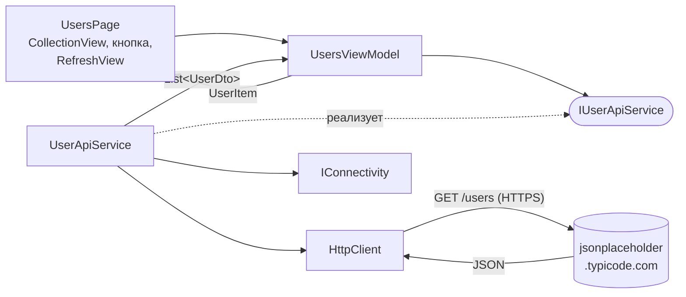

Работа с REST API: экран пользователей из публичного API

|                          |                                                                                                   |
| ------------------------ | ------------------------------------------------------------------------------------------------- |
| **Дисциплина**           | Разработка мобильных приложений на .NET MAUI                                                      |
| **Тема**                 | REST API: DTO, `HttpClient`, GET-запрос, JSON, десериализация, обновление данных, отсутствие сети |
| **Среда разработки**     | JetBrains Rider                                                                                   |
| **Платформа / язык**     | .NET MAUI / C# и XAML                                                                             |
| **Проект**               | Task Manager (продолжение практических работ №2, №3, №6–№10)                                      |
| **Время выполнения**     | 4 академических часа (2 занятия по 2 часа)                                                        |
| **Публичный API**        | JSONPlaceholder: <https://jsonplaceholder.typicode.com>                                           |


---

## 1. Цель работы

Научиться получать данные из внешнего веб-сервиса: описывать структуру ответа классами DTO, отправлять GET-запрос через `HttpClient`, разбирать JSON, показывать данные в `CollectionView`, обновлять их по команде и корректно вести себя при отсутствии сети и других сбоях.

## 2. Задание

Добавить в Task Manager экран **«Пользователи»**, данные которого загружаются из публичного REST API.

| № | Действие |
|---|---|
| 1 | Создать DTO |
| 2 | Создать `HttpClient` |
| 3 | Реализовать GET-запрос |
| 4 | Получить JSON |
| 5 | Десериализовать данные |
| 6 | Отобразить данные в `CollectionView` |
| 7 | Добавить кнопку обновления |
| 8 | Обработать отсутствие сети |

> Вариант «лента новостей» (посты вместо пользователей) вынесен в дополнительное задание 8.1. Принцип работы идентичен, различается только структура ответа.

## 3. Исходное состояние проекта

Работа продолжает практическую работу №10. Предполагается, что:

- приложение построено на MVVM с внедрением зависимостей (`BaseViewModel`, `ITaskService`, `SqliteTaskService`, `TaskDatabase`);
- в `AppShell.xaml` настроен `TabBar` с вкладками «Задачи», «Статистика», «Настройки»;
- стили `PageStyle`, `PagePadding`, `TaskCardStyle`, `TaskTitleLabelStyle`, `SecondaryLabelStyle`, `BodyLabelStyle`, `ErrorLabelStyle`, `PrimaryButtonStyle`, `SecondaryButtonStyle` определены (работы №3–№7);
- проект запускается на эмуляторе Android с доступом в интернет.

Если практическая работа №10 не выполнена полностью, достаточно наличия `BaseViewModel`, `AppShell` с `TabBar` и стилей: код этой работы не зависит от базы данных.

### 3.1. Что добавляется

| Элемент | Назначение |
|---|---|
| `Api/UserDto.cs` и вложенные DTO | Точная копия структуры JSON из ответа сервера |
| `Api/ApiConstants.cs` | Адрес сервиса и таймаут |
| `Api/IUserApiService`, `Api/UserApiService` | Единственное место, где выполняются HTTP-запросы |
| `Api/ApiException.cs` | Типизированные ошибки обращения к сервису |
| `Models/UserItem.cs` | Модель для показа на экране (не совпадает с DTO) |
| `ViewModels/UsersViewModel.cs` | Состояние экрана: список, загрузка, ошибка |
| `UsersPage.xaml` | Экран и вкладка «Пользователи» |

### 3.2. Схема



Правило: `ViewModel` ничего не знает о `HttpClient` и JSON, а сервис ничего не знает об экране. Между ними передаются DTO.

---

## 4. Краткая теория

| Понятие | Суть |
|---|---|
| **REST** | Стиль построения веб-сервисов: ресурсы с адресами (URI), операции — HTTP-методы (GET, POST, PUT, PATCH, DELETE) |
| **GET** | Получение данных; не изменяет состояние сервера |
| **Код состояния** | Число в ответе: `200` успех, `404` не найдено, `500` ошибка сервера |
| **JSON** | Текстовый формат обмена данными: объекты `{}`, массивы `[]`, строки, числа, `true`/`false`, `null` |
| **DTO** (Data Transfer Object) | Класс, описывающий структуру передаваемых данных; соответствует формату сервиса, а не потребностям экрана |
| **Десериализация** | Преобразование JSON-текста в объекты C# (`System.Text.Json`) |
| **`HttpClient`** | Класс .NET для отправки HTTP-запросов и получения ответов; создаётся один раз и живёт долго |
| **`IConnectivity`** | Интерфейс MAUI для проверки наличия сети (`NetworkAccess`) |
| **`CancellationToken`** | Механизм отмены асинхронной операции |
| **`RefreshView`** | Контейнер, добавляющий жест «потянуть для обновления» |

---

## 5. Ход работы

### Подготовка

1. Откройте решение `TaskManager` в Rider.
2. Создайте ветку: **Git → New Branch…**, имя `lab11-rest`.
3. **Изучите сервис в браузере.** Откройте <https://jsonplaceholder.typicode.com/users>. Это бесплатный тестовый REST API с вымышленными данными: ключ не нужен, доступ по HTTPS. Найдите на странице: массив из 10 объектов, у каждого поля `id`, `name`, `username`, `email`, вложенные объекты `address` и `company`.
4. **(По желанию) Rider HTTP Client.** Создайте вне проекта (например, в каталоге заметок) файл `users.http` с содержимым:

```http
GET https://jsonplaceholder.typicode.com/users
Accept: application/json
```

   Нажмите значок запуска слева от запроса. В современных версиях Rider откроется ответ с кодом состояния, заголовками и телом. Зафиксируйте код (200) и заголовок `Content-Type`.
5. Запустите приложение и убедитесь, что оно работает по результатам работы №10.


---

### Шаг 0. Проверка разрешений и общие константы

#### 0.1. Разрешения Android

Для HTTPS-запросов нужно разрешение `INTERNET`. Для проверки состояния сети через `Connectivity` — `ACCESS_NETWORK_STATE`. Без него на Android обращение к `NetworkAccess` может завершиться исключением `PermissionException`.

Откройте `Platforms/Android/AndroidManifest.xml` и проверьте, что внутри элемента `manifest` есть обе строки (в стандартном шаблоне MAUI они обычно присутствуют):

```xml
<uses-permission android:name="android.permission.ACCESS_NETWORK_STATE" />
<uses-permission android:name="android.permission.INTERNET" />
```

Если какой-то строки нет, добавьте её. Для iOS, Mac Catalyst и Windows дополнительная настройка для проверки сети не нужна.

#### 0.2. Константы

Создайте папку `Api` и файл `Api/ApiConstants.cs`:

```csharp
namespace TaskManager.Api;

public static class ApiConstants
{
    // Базовый адрес сервиса. Завершающая косая черта обязательна:
    // относительные адреса ("users") присоединяются к нему
    public const string BaseUrl = "https://jsonplaceholder.typicode.com/";

    // Максимальное время ожидания ответа
    public const int TimeoutSeconds = 15;

    // Имя клиента для заголовка User-Agent
    public const string UserAgent = "TaskManagerStudyApp/1.0";
}
```

**Почему константы.** Адрес сервиса меняется между окружениями (тестовое, рабочее), его удобно держать в одном месте.


---

### Шаг 1. Создание DTO

#### 1.1. Что такое DTO и зачем он нужен

**DTO** описывает данные **так, как их присылает сервер**. Это не модель приложения: если сервис изменит формат, правится только DTO и преобразование, а экран остаётся прежним.

Фрагмент ответа сервиса (первый пользователь):

```json
{
  "id": 1,
  "name": "Leanne Graham",
  "username": "Bret",
  "email": "Sincere@april.biz",
  "address": {
    "street": "Kulas Light",
    "suite": "Apt. 556",
    "city": "Gwenborough",
    "zipcode": "92998-3874",
    "geo": { "lat": "-37.3159", "lng": "81.1496" }
  },
  "phone": "1-770-736-8031 x56442",
  "website": "hildegard.org",
  "company": {
    "name": "Romaguera-Crona",
    "catchPhrase": "Multi-layered client-server neural-net",
    "bs": "harness real-time e-markets"
  }
}
```

#### 1.2. Правила построения DTO

| JSON | Класс C# |
|---|---|
| Объект `{ … }` | Класс |
| Массив `[ … ]` | `List<T>` |
| Вложенный объект (`address`, `company`) | Отдельный класс-свойство |
| Строка / число / `true` | `string` / `int`, `double` / `bool` |
| Значение может отсутствовать или быть `null` | Тип с `?` |
| Тип в JSON — строка (`"lat": "-37.3159"`) | `string`, даже если по смыслу число |

Для первого проекта достаточно описать только **нужные** поля: лишние поля JSON игнорируются.

#### 1.3. Код

Создайте файл `Api/UserDto.cs` (все классы в одном файле, пока их мало):

```csharp
namespace TaskManager.Api;

// Пользователь так, как его присылает сервис
public class UserDto
{
    public int Id { get; set; }
    public string Name { get; set; } = string.Empty;
    public string Username { get; set; } = string.Empty;
    public string Email { get; set; } = string.Empty;
    public string Phone { get; set; } = string.Empty;
    public string Website { get; set; } = string.Empty;

    // Вложенные объекты; могут отсутствовать
    public AddressDto? Address { get; set; }
    public CompanyDto? Company { get; set; }
}

public class AddressDto
{
    public string Street { get; set; } = string.Empty;
    public string Suite { get; set; } = string.Empty;
    public string City { get; set; } = string.Empty;
    public string Zipcode { get; set; } = string.Empty;
    public GeoDto? Geo { get; set; }
}

public class GeoDto
{
    // В JSON это строки, поэтому и здесь строки
    public string Lat { get; set; } = string.Empty;
    public string Lng { get; set; } = string.Empty;
}

public class CompanyDto
{
    public string Name { get; set; } = string.Empty;
    public string CatchPhrase { get; set; } = string.Empty;
    public string Bs { get; set; } = string.Empty;
}
```

**Разбор**

| Фрагмент | Пояснение |
|---|---|
| Имена свойств в PascalCase | В JSON они в camelCase (`catchPhrase`); соответствие обеспечат настройки сериализатора (шаг 5) |
| `= string.Empty` | Значение по умолчанию, если поле отсутствует в JSON. Если в JSON явно написано `null`, свойство получит `null` |
| `AddressDto?` | Допускаем, что блок адреса не придёт |
| Только `get; set;` | Простые контейнеры данных без логики |

#### 1.4. Модель для экрана

DTO не подходит для показа напрямую: инициалы, строка «город, компания» — это забота экрана. Создайте `Models/UserItem.cs`:

```csharp
namespace TaskManager.Models;

// Модель для показа на экране
public record UserItem(
    int Id,
    string Name,
    string Username,
    string Email,
    string Phone,
    string Website,
    string City,
    string Company)
{
    // Инициалы для «аватара»: первые буквы двух слов имени, без обращений вроде "Mrs."
    public string Initials
    {
        get
        {
            var letters = Name
                .Split(' ', StringSplitOptions.RemoveEmptyEntries)
                .Where(word => !word.EndsWith('.'))
                .Take(2)
                .Select(word => char.ToUpperInvariant(word[0]));

            var result = string.Concat(letters);
            return result.Length > 0 ? result : "?";
        }
    }

    public string Subtitle => string.IsNullOrWhiteSpace(Company) ? City : $"{City} · {Company}";
}
```

Преобразование DTO → модель. Создайте `Api/UserMapper.cs`:

```csharp
using TaskManager.Models;

namespace TaskManager.Api;

public static class UserMapper
{
    public static UserItem ToItem(this UserDto dto) => new(
        Id: dto.Id,
        Name: dto.Name,
        Username: dto.Username,
        Email: dto.Email,
        Phone: dto.Phone,
        Website: dto.Website,
        City: dto.Address?.City ?? string.Empty,
        Company: dto.Company?.Name ?? string.Empty);
}
```

Операция `?.` и `??` защищают от отсутствующих вложенных объектов.

Соберите проект: **Build → Build Solution**.

---

### Шаг 2. Создание HttpClient

#### 2.1. Правила работы с `HttpClient`

| Правило | Причина |
|---|---|
| Один экземпляр на приложение | Каждый новый клиент открывает свои сетевые соединения; при частом создании возможна нехватка сокетов |
| Хранить как зависимость (`Singleton`), а не создавать `new HttpClient()` на каждый запрос | Повторное использование соединений |
| `BaseAddress` с завершающей `/` | Относительные пути присоединяются корректно |
| `Timeout` | Чтобы запрос не висел бесконечно |
| Заголовки по умолчанию (`Accept`, `User-Agent`) | Часть сервисов отклоняет запросы без `User-Agent` |

#### 2.2. Регистрация в `MauiProgram.cs`

Добавьте `using TaskManager.Api;` и `using System.Net.Http.Headers;`, затем в `CreateMauiApp()` после остальных регистраций:

```csharp
        // ===== Сеть =====
        builder.Services.AddSingleton(_ =>
        {
            var client = new HttpClient
            {
                BaseAddress = new Uri(ApiConstants.BaseUrl),
                Timeout = TimeSpan.FromSeconds(ApiConstants.TimeoutSeconds)
            };

            client.DefaultRequestHeaders.Accept.Add(
                new MediaTypeWithQualityHeaderValue("application/json"));
            client.DefaultRequestHeaders.UserAgent.ParseAdd(ApiConstants.UserAgent);

            return client;
        });
```

**Разбор**

| Фрагмент | Пояснение |
|---|---|
| `AddSingleton(_ => …)` | Фабрика создаёт клиент при первом запросе, дальше возвращается тот же экземпляр |
| `Accept: application/json` | Сообщаем серверу, что ждём JSON |
| `User-Agent` | Идентифицирует приложение (по умолчанию .NET его не добавляет). Не включайте в него личные данные |

> **Для сведения.** В больших проектах вместо ручной регистрации используют `IHttpClientFactory` (пакет `Microsoft.Extensions.Http`, метод `AddHttpClient`): он управляет временем жизни соединений и позволяет подключать повторные попытки. См. дополнительное задание 8.5.

Соберите проект.

---

### Шаг 3. Реализация GET-запроса

#### 3.1. Интерфейс и класс сервиса

Всё обращение к сети будет сосредоточено в одном классе. Создайте `Api/IUserApiService.cs`:

```csharp
using System.Net;

namespace TaskManager.Api;

public interface IUserApiService
{
    // TEMP (шаг 3): проверка GET-запроса, будет удалён
    Task<HttpStatusCode> CheckUsersAsync();
}
```

Создайте `Api/UserApiService.cs`:

```csharp
using System.Net;

namespace TaskManager.Api;

public class UserApiService : IUserApiService
{
    private readonly HttpClient _client;

    // HttpClient внедряется через конструктор
    public UserApiService(HttpClient client)
    {
        _client = client;
    }

    // TEMP (шаг 3)
    public async Task<HttpStatusCode> CheckUsersAsync()
    {
        // Относительный адрес "users" присоединяется к BaseAddress:
        // https://jsonplaceholder.typicode.com/users
        using var response = await _client.GetAsync("users");

        return response.StatusCode;
    }
}
```

Зарегистрируйте сервис в `MauiProgram.cs` рядом с `HttpClient`:

```csharp
        builder.Services.AddSingleton<IUserApiService, UserApiService>();
```

#### 3.2. Дымовой тест

Как и в работе №10, пока нет экрана, проверяем отладочным выводом. Создайте **временный** файл `Api/ApiSmokeTest.cs`:

```csharp
using System.Diagnostics;

namespace TaskManager.Api;

public static class ApiSmokeTest
{
    public static async Task RunAsync(IUserApiService api)
    {
        try
        {
            // ===== Шаг 3 =====
            var status = await api.CheckUsersAsync();
            Debug.WriteLine($"[API] GET /users -> {(int)status} {status}");

            // Шаг 4 и шаг 5: сюда будут добавлены проверки
        }
        catch (Exception ex)
        {
            Debug.WriteLine($"[API] ОШИБКА: {ex.GetType().Name}: {ex.Message}");
        }
    }
}
```

В `App.xaml.cs` временно запустите тест (добавьте `using TaskManager.Api;`):

```csharp
    public App(SettingsService settings, IUserApiService api)
    {
        InitializeComponent();
        settings.ApplyTheme();

        _ = ApiSmokeTest.RunAsync(api);      // ВРЕМЕННО, удалить после шага 5
    }
```

Запустите приложение в режиме **Debug**. Ожидаемый вывод:

```text
[API] GET /users -> 200 OK
```

#### 3.3. Эксперименты с адресом и кодами состояния

Меняйте адрес запроса и фиксируйте результат:

| Адрес | Ожидаемый код | Что показывает |
|---|---|---|
| `users` | 200 OK | Успех |
| `users/1` | 200 OK | Один ресурс |
| `users/9999` | 404 NotFound | Ресурса нет; **исключения не будет**, ответ получен |
| `userz` | 404 NotFound | Опечатка в адресе |

Запишите в отчёт вывод: получение кода 404 — это **успешная доставка ответа**, а не ошибка соединения. `GetAsync` бросает исключение только при сбоях сети, а коды состояния нужно проверять самостоятельно (`IsSuccessStatusCode`).

Верните адрес `users`.

---

### Шаг 4. Получение JSON

#### 4.1. Чтение тела ответа

Ответ состоит из кода состояния, заголовков и тела. Тело — текст JSON.

Добавьте во временный интерфейс `IUserApiService`:

```csharp
    // TEMP (шаг 4)
    Task<string> GetUsersJsonAsync();
```

и в `UserApiService`:

```csharp
    // TEMP (шаг 4)
    public async Task<string> GetUsersJsonAsync()
    {
        using var response = await _client.GetAsync("users");

        // Бросает HttpRequestException, если код состояния не из диапазона 2xx
        response.EnsureSuccessStatusCode();

        return await response.Content.ReadAsStringAsync();
    }
```

| Метод | Назначение |
|---|---|
| `EnsureSuccessStatusCode()` | Превращает «плохой» код (4xx, 5xx) в исключение `HttpRequestException` |
| `Content.ReadAsStringAsync()` | Читает тело ответа как строку |

#### 4.2. Просмотр JSON

В `ApiSmokeTest.RunAsync` после проверки шага 3 добавьте:

```csharp
            // ===== Шаг 4 =====
            var json = await api.GetUsersJsonAsync();
            Debug.WriteLine($"[API] Получено символов: {json.Length}");
            Debug.WriteLine($"[API] Начало ответа: {json[..Math.Min(200, json.Length)]}");
```

Ожидание: ответ — одна строка текста, начинающаяся символом `[` (массив) и содержащая 10 объектов.

> **Для чтения структуры** удобно форматировать JSON: `using System.Text.Json;` и `JsonSerializer.Serialize(JsonDocument.Parse(json), new JsonSerializerOptions { WriteIndented = true })`. Выведите результат в журнал один раз, чтобы увидеть вложенность.

---

### Шаг 5. Десериализация данных

#### 5.1. Настройки сериализатора

JSON использует имена в стиле camelCase (`catchPhrase`), в C# принят PascalCase (`CatchPhrase`). По умолчанию `System.Text.Json` **различает регистр** имён, поэтому без настройки свойства останутся пустыми.

Готовый набор настроек для веб-API: `new JsonSerializerOptions(JsonSerializerDefaults.Web)`. Он включает:

- camelCase для имён свойств;
- сравнение имён без учёта регистра при чтении;
- разрешение читать числа из строк.

#### 5.2. Окончательный интерфейс и сервис

Замените `Api/IUserApiService.cs` (временные члены удаляются):

```csharp
namespace TaskManager.Api;

public interface IUserApiService
{
    // Загружает список пользователей
    Task<IReadOnlyList<UserDto>> GetUsersAsync(CancellationToken cancellationToken = default);
}
```

Замените `Api/UserApiService.cs`:

```csharp
using System.Text.Json;

namespace TaskManager.Api;

public class UserApiService : IUserApiService
{
    // Настройки создаются один раз: создание сериализатора обходится дорого
    private static readonly JsonSerializerOptions JsonOptions = new(JsonSerializerDefaults.Web);

    private readonly HttpClient _client;

    public UserApiService(HttpClient client)
    {
        _client = client;
    }

    public async Task<IReadOnlyList<UserDto>> GetUsersAsync(CancellationToken cancellationToken = default)
    {
        using var response = await _client.GetAsync("users", cancellationToken);

        response.EnsureSuccessStatusCode();

        // Читаем прямо из потока, без промежуточной строки: экономит память на больших ответах
        await using var stream = await response.Content.ReadAsStreamAsync(cancellationToken);

        var users = await JsonSerializer.DeserializeAsync<List<UserDto>>(
            stream, JsonOptions, cancellationToken);

        return users ?? new List<UserDto>();
    }
}
```

**Разбор**

| Фрагмент | Пояснение |
|---|---|
| `static readonly JsonOptions` | Одни настройки на всё приложение |
| `ReadAsStreamAsync` + `DeserializeAsync` | Чтение потока вместо `ReadAsStringAsync`; для больших ответов эффективнее |
| `CancellationToken` | Позволяет прервать запрос (шаг 7) |
| `users ?? new List<UserDto>()` | Сервис мог вернуть `null`; приложение получает пустой список |
| `using var response`, `await using var stream` | Освобождение ресурсов по выходе из метода |

#### 5.3. Проверка

В `ApiSmokeTest.RunAsync` **замените** содержимое блоков шагов 3 и 4 (методов `CheckUsersAsync` и `GetUsersJsonAsync` больше нет) на:

```csharp
            // ===== Шаг 5 =====
            var users = await api.GetUsersAsync();
            Debug.WriteLine($"[API] Пользователей получено: {users.Count}");

            var first = users[0];
            Debug.WriteLine($"[API] #{first.Id} {first.Name} ({first.Username}) <{first.Email}>");
            Debug.WriteLine($"[API] Город: {first.Address?.City}, улица: {first.Address?.Street}");
            Debug.WriteLine($"[API] Координаты: {first.Address?.Geo?.Lat}; {first.Address?.Geo?.Lng}");
            Debug.WriteLine($"[API] Компания: {first.Company?.Name} — {first.Company?.CatchPhrase}");
```

Ожидание:

```text
[API] Пользователей получено: 10
[API] #1 Leanne Graham (Bret) <Sincere@april.biz>
[API] Город: Gwenborough, улица: Kulas Light
[API] Координаты: -37.3159; 81.1496
[API] Компания: Romaguera-Crona — Multi-layered client-server neural-net
```

#### 5.4. Эксперименты

**Эксперимент 1. Роль настроек.** Замените `JsonOptions` на `new JsonSerializerOptions()` (без `Web`). Запустите. Почему поля пустые или нулевые? Верните настройки.

**Эксперимент 2. Неверный тип.** Измените в `UserDto` тип `Id` с `int` на `bool`. Что произошло? Какое исключение и с каким сообщением? (Подсказка: `JsonException`, в сообщении указан путь к проблемному полю.) Верните `int`.

**Эксперимент 3. Лишние и недостающие поля.** Добавьте в `UserDto` свойство `public string Avatar { get; set; } = "нет";` — такого поля в JSON нет. Какое значение у `users[0].Avatar`? Удалите из `UserDto` свойство `Website`: возникнет ли ошибка? Верните как было. Сделайте вывод о том, как сериализатор относится к лишним и недостающим полям.

**Эксперимент 4. Переименование.** Добавьте атрибут `[JsonPropertyName("catchPhrase")]` к свойству `CatchPhrase` и переименуйте свойство в `Slogan`. Убедитесь, что данные загружаются. Для чего это нужно? (Подсказка: имена в JSON навязаны сервисом, а в программе хочется своё.) Верните как было.

---

### Шаг 6. Отображение данных в CollectionView

Теперь создаём экран. Временный дымовой тест после этого шага удаляется.

#### 6.1. Минимальная ViewModel

Создайте `ViewModels/UsersViewModel.cs`:

```csharp
using System.Collections.ObjectModel;
using TaskManager.Api;
using TaskManager.Models;

namespace TaskManager.ViewModels;

public class UsersViewModel : BaseViewModel
{
    private readonly IUserApiService _api;

    public UsersViewModel(IUserApiService api)
    {
        _api = api;
    }

    public ObservableCollection<UserItem> Users { get; } = new();

    // Загружает пользователей и заменяет содержимое списка
    public async Task LoadAsync()
    {
        var dtos = await _api.GetUsersAsync();

        Users.Clear();
        foreach (var dto in dtos)
            Users.Add(dto.ToItem());
    }
}
```

#### 6.2. Страница

Создайте страницу `UsersPage` (**Add → .NET MAUI ContentPage (XAML)**).

`UsersPage.xaml`:

```xml
<?xml version="1.0" encoding="utf-8" ?>
<ContentPage xmlns="http://schemas.microsoft.com/dotnet/2021/maui"
             xmlns:x="http://schemas.microsoft.com/winfx/2009/xaml"
             xmlns:models="clr-namespace:TaskManager.Models"
             xmlns:vm="clr-namespace:TaskManager.ViewModels"
             x:Class="TaskManager.UsersPage"
             x:DataType="vm:UsersViewModel"
             Title="Пользователи"
             Style="{StaticResource PageStyle}">

    <Grid Padding="{StaticResource PagePadding}">

        <CollectionView ItemsSource="{Binding Users}"
                        SelectionMode="None">

            <CollectionView.ItemTemplate>
                <DataTemplate x:DataType="models:UserItem">

                    <Border Style="{StaticResource TaskCardStyle}">
                        <Grid ColumnDefinitions="Auto,*" ColumnSpacing="12">

                            <!-- «Аватар» с инициалами -->
                            <Border Grid.Column="0"
                                    WidthRequest="44" HeightRequest="44"
                                    StrokeThickness="0"
                                    StrokeShape="RoundRectangle 22"
                                    BackgroundColor="{AppThemeBinding Light={StaticResource AppPrimaryColor},
                                                                      Dark={StaticResource AppPrimaryColorDark}}"
                                    VerticalOptions="Center">
                                <Label Text="{Binding Initials}"
                                       TextColor="White"
                                       FontAttributes="Bold"
                                       HorizontalOptions="Center"
                                       VerticalOptions="Center" />
                            </Border>

                            <VerticalStackLayout Grid.Column="1" Spacing="2">
                                <Label Text="{Binding Name}"
                                       Style="{StaticResource TaskTitleLabelStyle}" />
                                <Label Text="{Binding Email}"
                                       Style="{StaticResource SecondaryLabelStyle}" />
                                <Label Text="{Binding Subtitle}"
                                       Style="{StaticResource SecondaryLabelStyle}" />
                            </VerticalStackLayout>

                        </Grid>
                    </Border>

                </DataTemplate>
            </CollectionView.ItemTemplate>
        </CollectionView>

    </Grid>
</ContentPage>
```

`UsersPage.xaml.cs`:

```csharp
using System.Diagnostics;
using TaskManager.ViewModels;

namespace TaskManager;

public partial class UsersPage : ContentPage
{
    private readonly UsersViewModel _viewModel;

    public UsersPage(UsersViewModel viewModel)
    {
        InitializeComponent();
        _viewModel = viewModel;
        BindingContext = viewModel;
    }

    protected override async void OnAppearing()
    {
        base.OnAppearing();

        // Загружаем один раз; страница вкладки переиспользуется
        if (_viewModel.Users.Count > 0)
            return;

        try
        {
            await _viewModel.LoadAsync();
        }
        catch (Exception ex)
        {
            // Пока без пользовательского сообщения: оно появится в шаге 8
            Debug.WriteLine($"[UI] Не удалось загрузить: {ex.Message}");
        }
    }
}
```

#### 6.3. Иконка, регистрация, вкладка

Создайте `Resources/Images/tab_users.svg` (правило имён — как для остальных иконок вкладок):

```xml
<svg xmlns="http://www.w3.org/2000/svg" width="24" height="24" viewBox="0 0 24 24"
     fill="none" stroke="#000000" stroke-width="2"
     stroke-linecap="round" stroke-linejoin="round">
  <circle cx="9" cy="8" r="3"/>
  <path d="M3 20c0-3.3 2.7-6 6-6s6 2.7 6 6"/>
  <circle cx="17" cy="9" r="2.5"/>
  <path d="M17 14.5c2.5 0 4 1.8 4 4.5"/>
</svg>
```

В `MauiProgram.cs`:

```csharp
        builder.Services.AddTransient<UsersViewModel>();
        builder.Services.AddTransient<UsersPage>();
```

В `AppShell.xaml` добавьте вкладку **между «Статистикой» и «Настройками»**:

```xml
        <ShellContent Title="Пользователи"
                      Icon="tab_users.png"
                      Route="UsersPage"
                      ContentTemplate="{DataTemplate local:UsersPage}" />
```

Теперь в панели четыре вкладки. Для нижней панели рекомендуется не более пяти.

#### 6.4. Очистка

1. Удалите из `App.xaml.cs` параметр `IUserApiService` и вызов `ApiSmokeTest` (вернув конструктор `App(SettingsService settings)`).
2. Удалите файл `Api/ApiSmokeTest.cs`.

#### 6.5. Проверка

Запустите приложение, откройте вкладку «Пользователи». Должен появиться список из 10 карточек с инициалами, именем, адресом электронной почты и строкой «город · компания».

Если список пуст: смотрите окно вывода (`[UI] Не удалось загрузить: …`) и раздел «Типичные ошибки».

---

### Шаг 7. Кнопка обновления

Что нужно: ручное обновление кнопкой, обновление жестом «потянуть вниз», индикация загрузки, защита от повторных нажатий, отмена загрузки при уходе с экрана, время последнего обновления.

#### 7.1. ViewModel с командой

Замените `ViewModels/UsersViewModel.cs`:

```csharp
using System.Collections.ObjectModel;
using System.Diagnostics;
using System.Windows.Input;
using TaskManager.Api;
using TaskManager.Models;

namespace TaskManager.ViewModels;

public class UsersViewModel : BaseViewModel
{
    private readonly IUserApiService _api;
    private readonly Command _loadCommand;

    private CancellationTokenSource? _cts;
    private bool _isLoading;           // защита от повторных запусков
    private bool _isRefreshing;        // состояние индикатора на экране
    private string _lastUpdatedText = "Данные ещё не загружены";
    private string _emptyText = "Нажмите «Обновить»";

    public UsersViewModel(IUserApiService api)
    {
        _api = api;

        // Команда недоступна, пока идёт загрузка: кнопка блокируется автоматически
        _loadCommand = new Command(async () => await LoadAsync(), () => !_isLoading);
    }

    public ObservableCollection<UserItem> Users { get; } = new();

    public ICommand LoadCommand => _loadCommand;

    // Привязывается к RefreshView (TwoWay): жест «потянуть» выставляет true,
    // а мы сбрасываем в false по окончании загрузки
    public bool IsRefreshing
    {
        get => _isRefreshing;
        set => SetProperty(ref _isRefreshing, value);
    }

    public string LastUpdatedText
    {
        get => _lastUpdatedText;
        private set => SetProperty(ref _lastUpdatedText, value);
    }

    // Текст, который показывается, когда список пуст
    public string EmptyText
    {
        get => _emptyText;
        private set => SetProperty(ref _emptyText, value);
    }

    // Автозагрузка при первом показе экрана
    public async Task LoadIfEmptyAsync()
    {
        if (Users.Count == 0)
            await LoadAsync();
    }

    // Отменяет текущий запрос (например, при уходе с экрана)
    public void Cancel() => _cts?.Cancel();

    private async Task LoadAsync()
    {
        if (_isLoading)
            return;

        SetLoading(true);
        _cts = new CancellationTokenSource();
        var token = _cts.Token;

        try
        {
            var dtos = await _api.GetUsersAsync(token);

            Users.Clear();
            foreach (var dto in dtos)
                Users.Add(dto.ToItem());

            LastUpdatedText = $"Обновлено в {DateTime.Now:HH:mm:ss}";
            EmptyText = "Пользователей нет";
        }
        catch (OperationCanceledException)
        {
            // Запрос отменён (пользователь ушёл с экрана): это не ошибка
        }
        catch (Exception ex)
        {
            // Полноценная обработка ошибок — в шаге 8
            Debug.WriteLine($"[VM] Ошибка загрузки: {ex.Message}");
            EmptyText = "Не удалось загрузить данные";
        }
        finally
        {
            _cts?.Dispose();
            _cts = null;
            SetLoading(false);
        }
    }

    private void SetLoading(bool value)
    {
        _isLoading = value;
        IsRefreshing = value;
        _loadCommand.ChangeCanExecute();
    }
}
```

**Разбор**

| Решение | Причина |
|---|---|
| Два признака: `_isLoading` и `IsRefreshing` | `RefreshView` при жесте сам устанавливает `IsRefreshing = true` до запуска команды. Если бы условие команды зависело от `IsRefreshing`, жест блокировал бы сам себя |
| `ChangeCanExecute()` в `SetLoading` | Кнопка «Обновить» блокируется на время запроса |
| `CancellationTokenSource` | Позволяет отменить запрос при уходе со страницы |
| `catch (OperationCanceledException)` | Отмена — штатная ситуация, пользователю ошибка не показывается |
| `finally` | Состояние загрузки сбрасывается при любом исходе |
| Список не очищается при ошибке | Ранее загруженные данные остаются на экране (шаг 8) |

#### 7.2. Разметка

Замените `UsersPage.xaml`:

```xml
<?xml version="1.0" encoding="utf-8" ?>
<ContentPage xmlns="http://schemas.microsoft.com/dotnet/2021/maui"
             xmlns:x="http://schemas.microsoft.com/winfx/2009/xaml"
             xmlns:models="clr-namespace:TaskManager.Models"
             xmlns:vm="clr-namespace:TaskManager.ViewModels"
             x:Class="TaskManager.UsersPage"
             x:DataType="vm:UsersViewModel"
             Title="Пользователи"
             Style="{StaticResource PageStyle}">

    <Grid RowDefinitions="Auto,*"
          RowSpacing="12"
          Padding="{StaticResource PagePadding}">

        <!-- Строка 0: время обновления и кнопка -->
        <Grid Grid.Row="0" ColumnDefinitions="*,Auto" ColumnSpacing="8">
            <Label Grid.Column="0"
                   Text="{Binding LastUpdatedText}"
                   Style="{StaticResource SecondaryLabelStyle}"
                   VerticalOptions="Center" />

            <Button Grid.Column="1"
                    Text="Обновить"
                    Style="{StaticResource PrimaryButtonStyle}"
                    Command="{Binding LoadCommand}"
                    SemanticProperties.Description="Обновить список пользователей" />
        </Grid>

        <!-- Строка 1: список с жестом «потянуть для обновления» -->
        <RefreshView Grid.Row="1"
                     IsRefreshing="{Binding IsRefreshing}"
                     Command="{Binding LoadCommand}">

            <CollectionView ItemsSource="{Binding Users}"
                            SelectionMode="None">

                <CollectionView.EmptyView>
                    <Label Text="{Binding EmptyText}"
                           Style="{StaticResource SecondaryLabelStyle}"
                           HorizontalTextAlignment="Center"
                           Margin="0,32" />
                </CollectionView.EmptyView>

                <CollectionView.ItemTemplate>
                    <DataTemplate x:DataType="models:UserItem">

                        <Border Style="{StaticResource TaskCardStyle}">
                            <Grid ColumnDefinitions="Auto,*" ColumnSpacing="12">

                                <Border Grid.Column="0"
                                        WidthRequest="44" HeightRequest="44"
                                        StrokeThickness="0"
                                        StrokeShape="RoundRectangle 22"
                                        BackgroundColor="{AppThemeBinding Light={StaticResource AppPrimaryColor},
                                                                          Dark={StaticResource AppPrimaryColorDark}}"
                                        VerticalOptions="Center">
                                    <Label Text="{Binding Initials}"
                                           TextColor="White"
                                           FontAttributes="Bold"
                                           HorizontalOptions="Center"
                                           VerticalOptions="Center" />
                                </Border>

                                <VerticalStackLayout Grid.Column="1" Spacing="2">
                                    <Label Text="{Binding Name}"
                                           Style="{StaticResource TaskTitleLabelStyle}" />
                                    <Label Text="{Binding Email}"
                                           Style="{StaticResource SecondaryLabelStyle}" />
                                    <Label Text="{Binding Subtitle}"
                                           Style="{StaticResource SecondaryLabelStyle}" />
                                </VerticalStackLayout>

                            </Grid>
                        </Border>

                    </DataTemplate>
                </CollectionView.ItemTemplate>
            </CollectionView>
        </RefreshView>

    </Grid>
</ContentPage>
```

`EmptyView` находится внутри шаблона страницы, поэтому его привязка `EmptyText` работает относительно контекста страницы (`UsersViewModel`).

#### 7.3. Код страницы

Замените `UsersPage.xaml.cs`:

```csharp
using TaskManager.ViewModels;

namespace TaskManager;

public partial class UsersPage : ContentPage
{
    private readonly UsersViewModel _viewModel;

    public UsersPage(UsersViewModel viewModel)
    {
        InitializeComponent();
        _viewModel = viewModel;
        BindingContext = viewModel;
    }

    protected override async void OnAppearing()
    {
        base.OnAppearing();
        await _viewModel.LoadIfEmptyAsync();
    }

    protected override void OnDisappearing()
    {
        base.OnDisappearing();
        _viewModel.Cancel();            // не тратим трафик на невидимый экран
    }
}
```

#### 7.4. Проверка

| № | Сценарий | Ожидаемый результат |
|---|---|---|
| 1 | Открыть вкладку | Индикатор загрузки, затем список; «Обновлено в ЧЧ:ММ:СС» |
| 2 | Нажать «Обновить» | Индикатор, кнопка заблокирована на время запроса, время обновилось |
| 3 | Дважды быстро нажать «Обновить» | Выполняется один запрос |
| 4 | Потянуть список вниз | Индикатор, обновление |
| 5 | Переключиться на другую вкладку и вернуться | Данные на месте, запрос заново не выполняется |
| 6 | Уйти с вкладки в момент загрузки | Запрос отменяется, ошибки нет |


---

### Шаг 8. Обработка отсутствия сети

#### 8.1. Какие бывают сбои

| Ситуация | Что происходит в коде | Как обрабатываем |
|---|---|---|
| Устройство вне сети | `Connectivity.NetworkAccess` — `None` | Не отправляем запрос, сообщаем пользователю |
| Сеть есть, сервер недоступен / DNS не разрешён | `HttpRequestException` | «Не удалось связаться с сервером» |
| Сервер отвечает слишком долго | `TaskCanceledException` (по таймауту `HttpClient`) | «Превышено время ожидания» |
| Сервер ответил ошибкой | Код 4xx/5xx | «Ошибка сервера (код)» |
| Ответ не соответствует ожидаемой структуре | `JsonException` | «Получены некорректные данные» |
| Пользователь ушёл с экрана | `OperationCanceledException` по нашему токену | Не ошибка |

> Даже если `NetworkAccess` равен `Internet`, полного доступа в интернет это не гарантирует (например, сеть без выхода наружу). Поэтому проверка сети **не заменяет** обработку исключений.

#### 8.2. Типизированная ошибка

Создайте `Api/ApiException.cs`:

```csharp
namespace TaskManager.Api;

public enum ApiErrorKind
{
    NoNetwork,      // устройство вне сети
    Connection,     // не удалось соединиться с сервером
    Timeout,        // истекло время ожидания
    Server,         // сервер вернул код ошибки
    BadData,        // ответ нельзя разобрать
}

// Исключение с понятным для пользователя сообщением
public class ApiException : Exception
{
    public ApiErrorKind Kind { get; }
    public int? StatusCode { get; }

    public ApiException(ApiErrorKind kind, string message,
                        Exception? inner = null, int? statusCode = null)
        : base(message, inner)
    {
        Kind = kind;
        StatusCode = statusCode;
    }
}
```

#### 8.3. Сервис с проверкой сети и обработкой ошибок

Замените `Api/UserApiService.cs`:

```csharp
using System.Diagnostics;
using System.Text.Json;

namespace TaskManager.Api;

public class UserApiService : IUserApiService
{
    private static readonly JsonSerializerOptions JsonOptions = new(JsonSerializerDefaults.Web);

    private readonly HttpClient _client;
    private readonly IConnectivity _connectivity;

    public UserApiService(HttpClient client, IConnectivity connectivity)
    {
        _client = client;
        _connectivity = connectivity;
    }

    public async Task<IReadOnlyList<UserDto>> GetUsersAsync(CancellationToken cancellationToken = default)
    {
        // 1. Быстрая проверка: если сети точно нет, запрос не отправляем
        if (_connectivity.NetworkAccess is NetworkAccess.None or NetworkAccess.Local)
        {
            throw new ApiException(ApiErrorKind.NoNetwork,
                "Нет подключения к интернету. Проверьте сеть и повторите попытку.");
        }

        try
        {
            using var response = await _client.GetAsync("users", cancellationToken);

            // 2. Сервер ответил, но с кодом ошибки
            if (!response.IsSuccessStatusCode)
            {
                int code = (int)response.StatusCode;
                throw new ApiException(ApiErrorKind.Server,
                    $"Сервер вернул ошибку (код {code}). Повторите попытку позже.",
                    statusCode: code);
            }

            await using var stream = await response.Content.ReadAsStreamAsync(cancellationToken);

            var users = await JsonSerializer.DeserializeAsync<List<UserDto>>(
                stream, JsonOptions, cancellationToken);

            return users ?? new List<UserDto>();
        }
        // Отмена по нашему токену передаётся вызывающему без изменений
        catch (OperationCanceledException) when (cancellationToken.IsCancellationRequested)
        {
            throw;
        }
        // Отмена не по нашему токену — сработал таймаут HttpClient
        catch (OperationCanceledException ex)
        {
            throw new ApiException(ApiErrorKind.Timeout,
                "Сервер слишком долго не отвечает. Повторите попытку.", ex);
        }
        // Сбой соединения: нет маршрута, DNS, разрыв
        catch (HttpRequestException ex)
        {
            Debug.WriteLine($"[API] HttpRequestException: {ex.Message}");
            throw new ApiException(ApiErrorKind.Connection,
                "Не удалось связаться с сервером. Проверьте подключение.", ex);
        }
        // Ответ не соответствует ожидаемому формату
        catch (JsonException ex)
        {
            Debug.WriteLine($"[API] JsonException: {ex.Message}");
            throw new ApiException(ApiErrorKind.BadData,
                "Получены некорректные данные от сервера.", ex);
        }
    }
}
```

**Почему именно такой порядок `catch`**

1. Сначала — отмена по нашему токену: её нужно пропустить без преобразования.
2. Затем — любая другая отмена: это таймаут.
3. Затем сетевые и форматные сбои.

`ApiException`, выброшенное в блоке `try` (код ответа), не попадает в перечисленные `catch`, потому что не является их типом.

Зарегистрируйте `IConnectivity` в `MauiProgram.cs`:

```csharp
        builder.Services.AddSingleton<IConnectivity>(Connectivity.Current);
```

Вынос в интерфейс даёт возможность подменять проверку сети заглушкой в тестах.

#### 8.4. ViewModel: сообщение об ошибке и автоповтор при появлении сети

Замените `ViewModels/UsersViewModel.cs` (изменения относительно шага 7: `IConnectivity`, `ErrorMessage`, `HasError`, `Start`/`Stop`, разбор `ApiException`):

```csharp
using System.Collections.ObjectModel;
using System.Diagnostics;
using System.Windows.Input;
using TaskManager.Api;
using TaskManager.Models;

namespace TaskManager.ViewModels;

public class UsersViewModel : BaseViewModel
{
    private readonly IUserApiService _api;
    private readonly IConnectivity _connectivity;
    private readonly Command _loadCommand;

    private CancellationTokenSource? _cts;
    private bool _isLoading;
    private bool _isRefreshing;
    private string _lastUpdatedText = "Данные ещё не загружены";
    private string _emptyText = "Нажмите «Обновить»";
    private string _errorMessage = string.Empty;

    public UsersViewModel(IUserApiService api, IConnectivity connectivity)
    {
        _api = api;
        _connectivity = connectivity;

        _loadCommand = new Command(async () => await LoadAsync(), () => !_isLoading);
    }

    public ObservableCollection<UserItem> Users { get; } = new();

    public ICommand LoadCommand => _loadCommand;

    public bool IsRefreshing
    {
        get => _isRefreshing;
        set => SetProperty(ref _isRefreshing, value);
    }

    public string LastUpdatedText
    {
        get => _lastUpdatedText;
        private set => SetProperty(ref _lastUpdatedText, value);
    }

    public string EmptyText
    {
        get => _emptyText;
        private set => SetProperty(ref _emptyText, value);
    }

    // Сообщение об ошибке; пустая строка означает «ошибки нет»
    public string ErrorMessage
    {
        get => _errorMessage;
        private set
        {
            if (SetProperty(ref _errorMessage, value))
                OnPropertyChanged(nameof(HasError));
        }
    }

    public bool HasError => ErrorMessage.Length > 0;

    // ===== Жизненный цикл экрана =====

    // Вызывается при показе страницы
    public async Task StartAsync()
    {
        _connectivity.ConnectivityChanged += OnConnectivityChanged;

        if (Users.Count == 0)
            await LoadAsync();
    }

    // Вызывается при скрытии страницы
    public void Stop()
    {
        // Обязательно отписываемся: иначе событие удерживает ViewModel в памяти
        _connectivity.ConnectivityChanged -= OnConnectivityChanged;
        _cts?.Cancel();
    }

    // Когда сеть вернулась и на экране ошибка — повторяем загрузку сами
    private void OnConnectivityChanged(object? sender, ConnectivityChangedEventArgs e)
    {
        if (e.NetworkAccess != NetworkAccess.Internet || !HasError)
            return;

        // Событие приходит не из потока интерфейса
        MainThread.BeginInvokeOnMainThread(() =>
        {
            if (_loadCommand.CanExecute(null))
                _loadCommand.Execute(null);
        });
    }

    private async Task LoadAsync()
    {
        if (_isLoading)
            return;

        SetLoading(true);
        ErrorMessage = string.Empty;
        _cts = new CancellationTokenSource();
        var token = _cts.Token;

        try
        {
            var dtos = await _api.GetUsersAsync(token);

            Users.Clear();
            foreach (var dto in dtos)
                Users.Add(dto.ToItem());

            LastUpdatedText = $"Обновлено в {DateTime.Now:HH:mm:ss}";
            EmptyText = "Пользователей нет";
        }
        catch (OperationCanceledException)
        {
            // Уход с экрана: не ошибка
        }
        catch (ApiException ex)
        {
            ErrorMessage = ex.Message;
            EmptyText = ex.Kind == ApiErrorKind.NoNetwork
                ? "Нет подключения к сети"
                : "Не удалось загрузить данные";
            // Users не очищаем: ранее загруженные данные остаются на экране
        }
        catch (Exception ex)
        {
            Debug.WriteLine($"[VM] Непредвиденная ошибка: {ex}");
            ErrorMessage = "Произошла непредвиденная ошибка. Повторите попытку.";
            EmptyText = "Не удалось загрузить данные";
        }
        finally
        {
            _cts?.Dispose();
            _cts = null;
            SetLoading(false);
        }
    }

    private void SetLoading(bool value)
    {
        _isLoading = value;
        IsRefreshing = value;
        _loadCommand.ChangeCanExecute();
    }
}
```

#### 8.5. Разметка: баннер ошибки

В `UsersPage.xaml` замените определение строк основной `Grid` и добавьте баннер. Строка 0 — баннер ошибки, строка 1 — панель, строка 2 — список:

```xml
    <Grid RowDefinitions="Auto,Auto,*"
          RowSpacing="12"
          Padding="{StaticResource PagePadding}">

        <!-- Строка 0: баннер ошибки -->
        <Border Grid.Row="0"
                IsVisible="{Binding HasError}"
                Style="{StaticResource TaskCardStyle}">
            <Grid ColumnDefinitions="*,Auto" ColumnSpacing="8">
                <Label Grid.Column="0"
                       Text="{Binding ErrorMessage}"
                       Style="{StaticResource ErrorLabelStyle}"
                       VerticalOptions="Center" />
                <Button Grid.Column="1"
                        Text="Повторить"
                        Style="{StaticResource SecondaryButtonStyle}"
                        Command="{Binding LoadCommand}" />
            </Grid>
        </Border>

        <!-- Строка 1: время обновления и кнопка (прежняя строка 0) -->
        <Grid Grid.Row="1" ColumnDefinitions="*,Auto" ColumnSpacing="8">
            <!-- содержимое без изменений -->
        </Grid>

        <!-- Строка 2: RefreshView (прежняя строка 1) -->
        <RefreshView Grid.Row="2" ...>
            <!-- содержимое без изменений -->
        </RefreshView>

    </Grid>
```

Номера строк у уже существующих элементов **увеличьте на 1** (`Grid.Row="1"` и `Grid.Row="2"`), содержимое остаётся прежним.

#### 8.6. Код страницы

Замените `OnAppearing`/`OnDisappearing` в `UsersPage.xaml.cs`:

```csharp
    protected override async void OnAppearing()
    {
        base.OnAppearing();
        await _viewModel.StartAsync();
    }

    protected override void OnDisappearing()
    {
        base.OnDisappearing();
        _viewModel.Stop();
    }
```

Соберите проект.

#### 8.7. Проверка сетевых сбоев

Проведите каждый сценарий и зафиксируйте поведение экрана.

| № | Как вызвать | Ожидаемый результат |
|---|---|---|
| 1 | Нормальная сеть | Список загружен, баннера нет |
| 2 | **Выключить сеть** до открытия вкладки: на эмуляторе Android включите режим полёта (быстрые настройки эмулятора) либо отключите Wi-Fi и мобильные данные; для Windows — режим «в самолёте» или отключение адаптера | Баннер «Нет подключения к интернету…», надпись «Нет подключения к сети», приложение не падает |
| 3 | Включить сеть, пока открыт экран с ошибкой | Загрузка выполняется автоматически, баннер исчезает |
| 4 | Загрузить список, затем отключить сеть и нажать «Обновить» | Баннер с ошибкой, **прежний список остаётся** на экране |
| 5 | Нажать «Повторить» без сети | Ошибка сохраняется, приложение не падает |
| 6 | Нажать «Повторить» с сетью | Данные загружены, баннер исчез |
| 7 | В `ApiConstants.BaseUrl` указать несуществующий хост (`https://jsonplaceholder.invalid/`) | Баннер «Не удалось связаться с сервером…» |
| 8 | В `UserApiService` изменить путь на `userz` | Баннер «Сервер вернул ошибку (код 404)…» |
| 9 | В регистрации клиента временно задать `Timeout = TimeSpan.FromMilliseconds(1)` | Баннер «Сервер слишком долго не отвечает…» |
| 10 | В `UserDto` изменить тип `Id` на `bool` | Баннер «Получены некорректные данные от сервера» |
| 11 | Нажать «Обновить» и сразу перейти на другую вкладку | Ошибок нет, запрос отменён |
| 12 | Повернуть эмулятор во время загрузки | Приложение не падает |
| 13 | Тёмная тема | Баннер, карточки и инициалы читаемы |

После каждого эксперимента с кодом (сценарии 7–10) **возвращайте** исходные значения.

> **Примечание к сценарию 9.** В .NET значение `Timeout` не может быть нулевым или отрицательным (кроме специального значения «бесконечно»); для эксперимента используйте очень малый положительный интервал.

#### 8.8. Выводы

Заполните таблицу в отчёте:

| Ситуация | Тип исключения | `ApiErrorKind` | Сообщение пользователю |
|---|---|---|---|
| Нет сети | | | |
| Неверный хост | | | |
| Код 404 | | | |
| Таймаут | | | |
| Некорректный JSON | | | |

---

## 6. Итоговая проверка

Выполните **Build → Rebuild Solution**, затем:

1. Пройдите сценарии 1–6 шага 7.4 и 1–6, 11–13 шага 8.7.
2. Убедитесь, что в проекте не осталось временных элементов: `ApiSmokeTest`, методов `CheckUsersAsync` и `GetUsersJsonAsync`, лишних параметров в `App`.
3. Проверьте, что `ViewModel` не содержит слов `HttpClient`, `Json`, `HttpResponseMessage` (поиск **Ctrl+Shift+F**): сеть и JSON полностью скрыты в сервисе.
4. Зафиксируйте результат: **Git → Commit**, сообщение `lab11: экран пользователей из REST API`.

---

## 7. Типичные ошибки

| Симптом | Причина и решение |
|---|---|
| Список пуст, ошибки нет | Свойства DTO не совпали с именами JSON (нет настроек `JsonSerializerDefaults.Web`) либо `Users` не заполняется |
| `JsonException` при разборе | Тип свойства не соответствует JSON (число/строка), либо сервис вернул не тот формат (например, объект вместо массива) |
| `HttpRequestException` в эмуляторе | В эмуляторе нет интернета, неверный адрес, проблема DNS или сертификата |
| `UriFormatException` / запрос уходит не туда | `BaseAddress` без завершающей `/` или относительный адрес начинается с `/` (тогда путь заменяет часть базового адреса) |
| `PermissionException` на Android при проверке сети | Нет разрешения `ACCESS_NETWORK_STATE` в манифесте |
| Запросы к HTTP-адресам блокируются | Платформы по умолчанию запрещают небезопасный трафик HTTP; для публичных сервисов используйте HTTPS |
| Приложение «зависает» при загрузке | Блокирующее ожидание `.Result`/`.Wait()` вместо `await` |
| Приложение падает при отсутствии сети | Исключения не перехвачены (особенно в `async void`) |
| Нельзя обновить список: кнопка заблокирована навсегда | `SetLoading(false)` не вызывается при исключении (нужен `finally`) |
| Жест «потянуть» не работает | Условие команды зависит от `IsRefreshing`, либо `CollectionView` не вложен в `RefreshView` |
| Список «дёргается» или дублируется | Данные добавляются без предварительной очистки или загрузка запущена дважды |
| После ухода со вкладки утечка / повторные срабатывания события сети | Не выполнена отписка от `ConnectivityChanged` в `Stop()` |
| Изменение интерфейса из фонового потока приводит к исключению | Обработчик `ConnectivityChanged` вызывает команду не через `MainThread` |
| `Unable to resolve service for type HttpClient` / `IConnectivity` / `IUserApiService` | Не выполнена регистрация в `MauiProgram.cs` |
| Старый `App(SettingsService, IUserApiService)` не компилируется | Остались временные изменения шага 3; удалите их после шага 6 |
| В Release-сборке на iOS данные не десериализуются | Обрезка кода (trimming) удаляет информацию о типах DTO; используйте генератор исходного кода сериализации (см. 8.6) или проверьте настройки обрезки |
| Сервис недоступен, но код верный | Публичный тестовый сервис временно не отвечает; воспользуйтесь запасным вариантом (8.7) |

## 8. Дополнительные задания

### 8.1. Лента новостей

Добавьте вкладку или экран **«Новости»** на основе ресурса `/posts` того же сервиса (поля `userId`, `id`, `title`, `body`).

- Создайте `PostDto` и `PostItem` (заголовок, краткий текст — первые 80 символов).
- Ограничьте выборку: адрес `posts?_limit=20`.
- Реализуйте `IPostApiService` по образцу `IUserApiService`.
- Вынесите общую логику загрузки (баннер, обновление, отмена) в базовый класс `ApiListViewModel<T>`. Что удалось обобщить, а что осталось специфичным?

### 8.2. Детали пользователя

Нажатие на карточку открывает страницу деталей с запросом `GET users/{id}`: адрес, телефон, сайт, координаты, фраза компании. Маршрут зарегистрируйте в `AppShell.xaml.cs`, `id` передайте как параметр запроса. Опишите, чем загрузка одного ресурса отличается от списка.

### 8.3. Поиск

Добавьте `SearchBar` и фильтрацию списка по имени и электронной почте на стороне клиента. Исходный список (`_all`) храните отдельно от отображаемого. Реализуйте задержку ввода (debounce, 300 мс), чтобы не фильтровать при каждом символе.

### 8.4. Кэширование в SQLite (офлайн-режим)

Используя базу данных из работы №10, сохраняйте последний успешный ответ в таблицу `UserCache` и показывайте его при отсутствии сети с пометкой «Показаны сохранённые данные (дата)». Определите:

- где разместить логику «сеть, затем кэш»: в `ViewModel` или в сервисе (подсказка: в отдельном классе-репозитории `UserRepository`);
- как хранить дату получения;
- когда кэш считается устаревшим.

### 8.5. `IHttpClientFactory` и повторные попытки

Подключите пакет `Microsoft.Extensions.Http`, зарегистрируйте типизированный клиент `AddHttpClient<IUserApiService, UserApiService>(…)`. Реализуйте до трёх повторных попыток с нарастающей задержкой (1 с, 2 с, 4 с) при ошибках `Connection` и `Timeout` (вручную либо с помощью библиотеки Polly). Объясните, почему повторять нужно не все ошибки (например, код 404).

### 8.6. Сериализация без отражения

Для надёжной работы в Release-сборках с обрезкой кода создайте контекст `JsonSerializerContext`:

```csharp
[JsonSerializable(typeof(List<UserDto>))]
[JsonSourceGenerationOptions(JsonSerializerDefaults.Web)]
internal partial class ApiJsonContext : JsonSerializerContext { }
```

и вызовите `DeserializeAsync(stream, ApiJsonContext.Default.ListUserDto, token)`. Опишите, что изменилось по сравнению с настройкой через `JsonSerializerOptions`.

### 8.7. Запасные сервисы

Подключите вместо JSONPlaceholder другой открытый API и сравните структуру ответа (доступность и условия использования проверьте самостоятельно):

| Сервис | Адрес | Особенность ответа |
|---|---|---|
| DummyJSON | `https://dummyjson.com/users` | Список обёрнут в объект с полем `users` |
| Random User | `https://randomuser.me/api/?results=20` | Список в поле `results`, вложенные имя и фото |

Выясните, как меняются DTO. Какую роль сыграло то, что `ViewModel` не знает о формате JSON?

### 8.8. Отправка данных

Реализуйте `POST` на `https://jsonplaceholder.typicode.com/posts`: форма отправляет заголовок и текст, сервис возвращает созданный объект с `id`. Используйте `PostAsJsonAsync` (пространство имён `System.Net.Http.Json`). Учтите: сервис имитирует запись, но данные не сохраняет.

## 9. Контрольные вопросы

1. Что такое REST? Какие HTTP-методы используются и для чего?
2. Что означают коды состояния 200, 201, 204, 400, 401, 403, 404, 500?
3. Что такое JSON? Как он соотносится с классами C#?
4. Что такое DTO? Чем DTO отличается от модели предметной области и от модели для экрана?
5. Почему `HttpClient` следует создавать один раз и хранить как зависимость?
6. Зачем нужны `BaseAddress` и завершающая косая черта?
7. Что делают `GetAsync`, `EnsureSuccessStatusCode`, `ReadAsStringAsync`, `ReadAsStreamAsync`? Когда выгоднее читать поток?
8. Почему получение ответа с кодом 404 не вызывает исключения при `GetAsync`?
9. Что делает `JsonSerializerDefaults.Web`? Что произойдёт без этих настроек?
10. Как сериализатор относится к лишним и недостающим полям в JSON?
11. Для чего нужен `CancellationToken`? Где в работе он используется?
12. Какие исключения возможны при обращении к сети? Как отличить таймаут от отмены пользователем?
13. Что показывает `Connectivity.NetworkAccess`? Почему `Internet` не гарантирует доступ к серверу?
14. Зачем нужны разрешения `INTERNET` и `ACCESS_NETWORK_STATE`?
15. Почему список не очищается при неудачном обновлении?
16. Почему необходимо отписываться от `ConnectivityChanged`?
17. Почему обработчик события сети вызывает команду через `MainThread`?
18. Как `RefreshView` связан с командой и свойством `IsRefreshing`? Почему условие команды не должно зависеть от `IsRefreshing`?
19. Почему сетевой код выделен в отдельный сервис с интерфейсом?

## 10. Список источников

1. Документация .NET MAUI — Consume a REST-based web service: <https://learn.microsoft.com/dotnet/maui/data-cloud/rest>
2. Документация .NET MAUI — Connectivity: <https://learn.microsoft.com/dotnet/maui/platform-integration/communication/networking>
3. Документация .NET MAUI — Connect to local web services from Android emulators and iOS simulators: <https://learn.microsoft.com/dotnet/maui/data-cloud/local-web-services>
4. Документация .NET — Руководство по `HttpClient`: <https://learn.microsoft.com/dotnet/fundamentals/networking/http/httpclient-guidelines>
5. Документация .NET — System.Text.Json: <https://learn.microsoft.com/dotnet/standard/serialization/system-text-json/overview>
6. Документация .NET — Отправка и получение JSON через `HttpClient` (`System.Net.Http.Json`): <https://learn.microsoft.com/dotnet/fundamentals/networking/http/httpclient>
7. JSONPlaceholder — бесплатный тестовый REST API: <https://jsonplaceholder.typicode.com>
8. Документация JetBrains Rider — HTTP Client: <https://www.jetbrains.com/help/rider/Http_client_in__product__code_editor.html>
