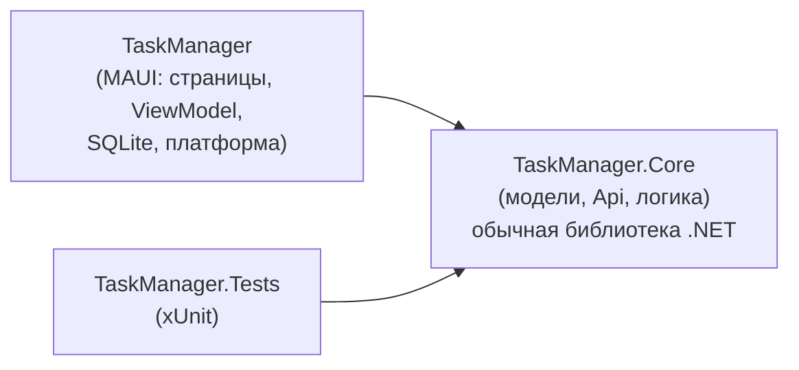
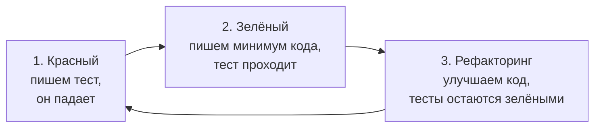
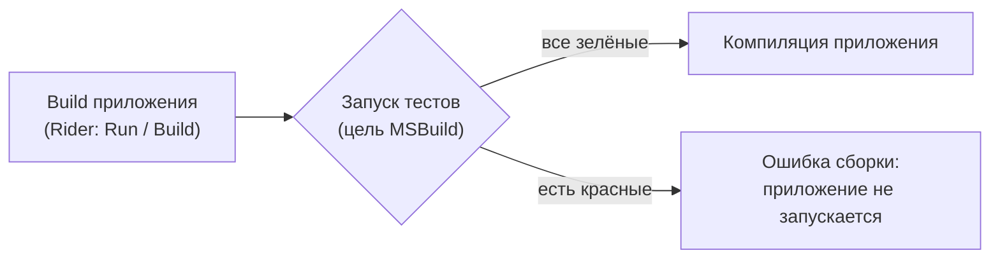

# Практическая работа №10. Unit-тестирование: разработка тестов, покрытие кода, автоматический запуск при сборке

| | |
|---|---|
| **Дисциплина** | Разработка мобильных приложений на .NET MAUI |
| **Тема** | Unit-тесты на xUnit, тестовые двойники, процент покрытия кода, автоматический запуск тестов при сборке |
| **Среда разработки** | JetBrains Rider |
| **Платформа / язык** | .NET MAUI / C# |
| **Проект** | Task Manager (продолжение практических работ №2–№11) |
| **Время выполнения** | 4 академических часа (2 занятия по 2 часа) |
| **Теоретическая основа** | Лекция 12. Unit-тестирование в мобильных приложениях |
| **Инструменты** | xUnit, coverlet, ReportGenerator, MSBuild, Git hooks, GitHub Actions |


---
## 1. Цель работы

Научиться проверять логику приложения автоматическими тестами: выносить её в библиотеку, которую можно тестировать без эмулятора, писать тесты на xUnit (в том числе с тестовыми двойниками для сети), измерять процент покрытия кода тестами и настраивать так, чтобы упавшие тесты останавливали сборку.

## 2. Задание

| № | Действие |
|---|---|
| 1 | Создать библиотеку `TaskManager.Core` и тестовый проект `TaskManager.Tests` |
| 2 | Вынести в библиотеку модели и сетевой слой из практической №11 |
| 3 | Добавить в библиотеку чистую логику: проверка названия, сводка, сортировка, фильтр |
| 4 | Написать первые тесты и запустить их в Rider и из командной строки |
| 5 | Написать тесты для логики (граничные значения, `[Theory]`, построитель данных) |
| 6 | Написать тесты с тестовыми двойниками: маппер и `UserApiService` без реальной сети |
| 7 | Выполнить разработку через тестирование (TDD) для форматирования сводки |
| 8 | Измерить процент покрытия и построить HTML-отчёт |
| 9 | Задать минимальный порог покрытия |
| 10 | Настроить автоматический запуск тестов при сборке приложения |
| 11 | Настроить проверку перед `git push` и запуск тестов в GitHub Actions |

## 3. Исходное состояние проекта

Работа продолжает практическую работу №11. Предполагается, что:

- в решении есть MAUI-проект `TaskManager` с папками `Models`, `Api`, `ViewModels`, `Services`;
- есть `TaskItem` (с `Title`, `Priority`, `IsCompleted`, атрибутами SQLite) и перечисление `TaskPriority` (значения `Low`, `Medium`, `High`);
- из работы №11 есть `ApiConstants`, `UserDto` (и вложенные), `UserItem`, `UserMapper`, `ApiException`, `IUserApiService`, `UserApiService`;
- приложение собирается и запускается.

> Если в вашем проекте имена членов `TaskItem` или значений `TaskPriority` отличаются, замените их в листингах. Все места, где тесты создают задачи, сосредоточены в одном классе `TestData` (шаг 5.1), поэтому правка будет локальной.

### 3.1. Целевая структура



Идея: всё, что можно проверить **без телефона и эмулятора** (правила, расчёты, разбор ответов сервера), живёт в обычной библиотеке `Core`. Тесты ссылаются на неё, а не на MAUI-проект: так они запускаются за секунды на любом компьютере и в облачной сборке без MAUI-рабочих нагрузок.

### 3.2. Почему не тестируем MAUI-проект напрямую

MAUI-проект собирается под платформы (`net…-android`, `net…-ios`, `net…-windows…`), а тестовый проект — под обычный `net…`. Они несовместимы без сложной перенастройки целевых платформ. Кроме того, типы вроде `Command`, `Shell`, `Color` требуют инфраструктуры MAUI. Документация MAUI допускает оба пути; мы выбираем более простой и надёжный: **выносим логику в библиотеку**.

---

## 4. Краткая теория

| Понятие | Суть |
|---|---|
| **Unit-тест** | Автоматическая проверка небольшого фрагмента кода (метода, класса) в изоляции от остального |
| **xUnit** | Фреймворк тестирования: `[Fact]` — один случай, `[Theory]` + `[InlineData]` — несколько наборов данных |
| **AAA** | Структура теста: Arrange (подготовка), Act (действие), Assert (проверка) |
| **Граничные значения** | Проверка на границах допустимого диапазона (0, 1, максимум, максимум+1) |
| **Тестовый двойник** | Подставной объект вместо реальной зависимости: stub, fake, mock |
| **Покрытие кода** | Доля строк (веток) кода, выполненных во время тестов |
| **Порог покрытия** | Минимум покрытия, ниже которого проверка считается проваленной |
| **TDD** | Сначала тест (красный), затем код (зелёный), затем улучшение (рефакторинг) |
| **Контроль качества (quality gate)** | Правило, не пропускающее сборку или `push` при упавших тестах или низком покрытии |

---

## 5. Ход работы

### Подготовка

1. Откройте решение `TaskManager` в Rider.
2. Создайте ветку: **Git → New Branch…**, имя `lab12-tests`.
3. Убедитесь, что приложение собирается: **Build → Build Solution**.
4. Узнайте версию .NET вашего проекта: откройте файл `TaskManager.csproj`, найдите `TargetFrameworks`. Например, `net10.0-android;…` означает, что версия — `net10.0`. Запишите её: она понадобится как `<ВАША_ВЕРСИЯ>` (`net9.0`, `net10.0` и т. д.).
5. Откройте терминал Rider (**View → Tool Windows → Terminal**), перейдите в папку решения (где лежит файл решения) и выполните `dotnet --version` — запишите версию SDK в отчёт.

---

### Шаг 1. Создание библиотеки и тестового проекта

#### 1.1. Создание проектов

В терминале, из папки решения:

```bash
dotnet new classlib -n TaskManager.Core -o TaskManager.Core
dotnet new xunit -n TaskManager.Tests -o TaskManager.Tests
```

(То же в Rider: **File → Add → New Project…** → *Class Library* и *xUnit Test Project*.)

Откройте `TaskManager.Core/TaskManager.Core.csproj` и `TaskManager.Tests/TaskManager.Tests.csproj`. Если версия в `TargetFramework` не совпадает с вашей `<ВАША_ВЕРСИЯ>` (из подготовки), замените её **в обоих файлах**.

> Версия библиотеки не должна быть выше версии .NET MAUI-проекта: иначе проект приложения не сможет на неё сослаться.

Удалите шаблонные файлы `TaskManager.Core/Class1.cs` и `TaskManager.Tests/UnitTest1.cs`.

#### 1.2. Добавление в решение и ссылки

```bash
dotnet sln add TaskManager.Core/TaskManager.Core.csproj
dotnet sln add TaskManager.Tests/TaskManager.Tests.csproj
dotnet add TaskManager.Tests reference TaskManager.Core
dotnet add TaskManager reference TaskManager.Core
```

Если в корне больше одного файла решения, добавьте после `dotnet sln` имя файла решения.

#### 1.3. Настройка пространства имён

Чтобы остальной код приложения не пришлось переписывать, пространства имён оставляем прежними (`TaskManager.Models`, `TaskManager.Api`). Добавьте в `TaskManager.Core.csproj` в блок `PropertyGroup`:

```xml
    <RootNamespace>TaskManager</RootNamespace>
```

В `TaskManager.Tests.csproj` проверьте, что есть строка `<Using Include="Xunit" />` (в шаблоне она обычно присутствует) — она избавляет от `using Xunit;` в каждом файле.

#### 1.4. Проверка

```bash
dotnet build
dotnet test
```

`dotnet test` сообщит, что тестов нет — это нормально. Главное — отсутствие ошибок сборки.

---

### Шаг 2. Вынос моделей и сетевого слоя в библиотеку

#### 2.1. Что переносим

| Файл | Куда |
|---|---|
| `Models/TaskItem.cs`, файл с `TaskPriority` | `TaskManager.Core/Models/` |
| `Models/UserItem.cs` | `TaskManager.Core/Models/` |
| `Api/ApiConstants.cs`, `UserDto.cs`, `UserMapper.cs`, `ApiException.cs`, `IUserApiService.cs`, `UserApiService.cs` | `TaskManager.Core/Api/` |

Остаются в приложении: `ViewModels`, страницы, `Services` (`ITaskService`, `SqliteTaskService`, `TaskDatabase`), `MauiProgram`.

Перенос в Rider: создайте в `Core` папки `Models` и `Api`, перетащите файлы мышью (**drag-and-drop** в Solution Explorer) или используйте **Refactor → Move…**. Если Rider предлагает изменить пространство имён, выберите вариант, при котором оно остаётся `TaskManager.Models` / `TaskManager.Api`.

#### 2.2. Пакет SQLite для `TaskItem`

`TaskItem` содержит атрибуты `sqlite-net` (`[PrimaryKey]`, `[AutoIncrement]`, `[Ignore]`), поэтому библиотеке нужен тот же пакет, что и приложению. Посмотрите версию в `TaskManager.csproj` (элемент `sqlite-net-pcl`) и выполните:

```bash
dotnet add TaskManager.Core package sqlite-net-pcl --version <ВЕРСИЯ_ИЗ_ПРИЛОЖЕНИЯ>
```

> Если `TaskItem` использует типы MAUI (`Color`, `Colors`), оставьте в `TaskItem` данные, а вычисление цвета перенесите в приложение (конвертер значения или метод расширения): библиотека не должна зависеть от MAUI.

#### 2.3. Замена `IConnectivity` на собственный интерфейс

В работе №11 `UserApiService` принимал `IConnectivity` — тип MAUI, недоступный библиотеке. Вводим собственную узкую абстракцию. Создайте `TaskManager.Core/Api/INetworkStatus.cs`:

```csharp
namespace TaskManager.Api;

// Что сервису нужно знать о сети — и больше ничего
public interface INetworkStatus
{
    // true, если сети точно нет
    bool IsOffline { get; }
}
```

В `UserApiService.cs` замените поле и конструктор (остальной код метода не меняется, кроме одной строки проверки):

```csharp
    private readonly HttpClient _client;
    private readonly INetworkStatus _network;

    public UserApiService(HttpClient client, INetworkStatus network)
    {
        _client = client;
        _network = network;
    }
```

```csharp
        // 1. Быстрая проверка: если сети точно нет, запрос не отправляем
        if (_network.IsOffline)
        {
            throw new ApiException(ApiErrorKind.NoNetwork,
                "Нет подключения к интернету. Проверьте сеть и повторите попытку.");
        }
```

Реализация для приложения. Создайте в **приложении** файл `Services/MauiNetworkStatus.cs`:

```csharp
using TaskManager.Api;

namespace TaskManager.Services;

public class MauiNetworkStatus : INetworkStatus
{
    private readonly IConnectivity _connectivity;

    public MauiNetworkStatus(IConnectivity connectivity)
    {
        _connectivity = connectivity;
    }

    public bool IsOffline =>
        _connectivity.NetworkAccess is NetworkAccess.None or NetworkAccess.Local;
}
```

В `MauiProgram.cs` добавьте регистрацию (рядом с остальными сервисами; регистрация `IConnectivity` остаётся — она нужна `UsersViewModel`):

```csharp
        builder.Services.AddSingleton<INetworkStatus, MauiNetworkStatus>();
```

#### 2.4. Проверка (регрессия)

1. **Build → Rebuild Solution**. Исправьте ошибки: чаще всего это отсутствующие `using` или забытая правка в `MauiProgram`.
2. Запустите приложение, откройте вкладку «Пользователей»: список загружается, баннер при отключённой сети работает, как в работе №11.

> Это важный момент: **рефакторинг без тестов проверяется руками**. После шагов 4–6 такие проверки автоматизируются.

Зафиксируйте результат: **Git → Commit**, сообщение `lab12: вынос логики в TaskManager.Core`.

---

### Шаг 3. Чистая логика в библиотеке

Добавляем небольшие классы **без зависимостей от платформы**: именно такой код легче всего тестировать. Создайте в `TaskManager.Core` папку `Logic`.

#### 3.1. Проверка названия задачи

`Logic/TaskTitleValidator.cs`:

```csharp
namespace TaskManager.Logic;

public sealed record TitleValidationResult(bool IsValid, string? Error)
{
    public static TitleValidationResult Ok() => new(true, null);
    public static TitleValidationResult Fail(string error) => new(false, error);
}

public static class TaskTitleValidator
{
    public const int MinLength = 3;
    public const int MaxLength = 100;

    public static TitleValidationResult Validate(string? title)
    {
        if (string.IsNullOrWhiteSpace(title))
            return TitleValidationResult.Fail("Название не может быть пустым.");

        int length = title.Trim().Length;

        if (length < MinLength)
            return TitleValidationResult.Fail($"Название должно содержать не менее {MinLength} символов.");

        if (length > MaxLength)
            return TitleValidationResult.Fail($"Название не должно превышать {MaxLength} символов.");

        return TitleValidationResult.Ok();
    }

    // Убирает лишние пробелы: "  Купить   хлеб " -> "Купить хлеб"
    public static string Normalize(string? title)
    {
        if (string.IsNullOrWhiteSpace(title))
            return string.Empty;

        var words = title.Split((char[]?)null, StringSplitOptions.RemoveEmptyEntries);
        return string.Join(' ', words);
    }
}
```

#### 3.2. Сводка по задачам

`Logic/TaskSummaryCalculator.cs`:

```csharp
using TaskManager.Models;

namespace TaskManager.Logic;

public sealed record TaskSummary(
    int Total,
    int Completed,
    int Active,
    int HighPriorityActive,
    double CompletedPercent);

public static class TaskSummaryCalculator
{
    public static TaskSummary Calculate(IEnumerable<TaskItem> tasks)
    {
        ArgumentNullException.ThrowIfNull(tasks);

        int total = 0, completed = 0, highActive = 0;

        foreach (var task in tasks)
        {
            total++;

            if (task.IsCompleted)
                completed++;
            else if (task.Priority == TaskPriority.High)
                highActive++;
        }

        double percent = total == 0
            ? 0
            : Math.Round(completed * 100.0 / total, 1);

        return new TaskSummary(total, completed, total - completed, highActive, percent);
    }
}
```

#### 3.3. Сортировка и фильтр

`Logic/TaskSorter.cs`:

```csharp
using TaskManager.Models;

namespace TaskManager.Logic;

public static class TaskSorter
{
    // Сначала невыполненные, внутри — по убыванию приоритета, затем по названию
    public static IReadOnlyList<TaskItem> Sort(IEnumerable<TaskItem> tasks)
    {
        ArgumentNullException.ThrowIfNull(tasks);

        return tasks
            .OrderBy(t => t.IsCompleted)
            .ThenByDescending(t => t.Priority)
            .ThenBy(t => t.Title, StringComparer.OrdinalIgnoreCase)
            .ToList();
    }
}
```

`Logic/TaskFilter.cs`:

```csharp
using TaskManager.Models;

namespace TaskManager.Logic;

public static class TaskFilter
{
    public static IReadOnlyList<TaskItem> Filter(
        IEnumerable<TaskItem> tasks, string? query, bool hideCompleted)
    {
        ArgumentNullException.ThrowIfNull(tasks);

        string? text = query?.Trim();

        return tasks
            .Where(t => !(hideCompleted && t.IsCompleted))
            .Where(t => string.IsNullOrEmpty(text)
                        || t.Title.Contains(text, StringComparison.OrdinalIgnoreCase))
            .ToList();
    }
}
```

**Замечания**

| Решение | Причина |
|---|---|
| `static` классы без состояния | Один вход — один выход: проще всего тестировать |
| `StringComparer.OrdinalIgnoreCase` | Результат не зависит от языка и региональных настроек компьютера, где запущен тест |
| `ThenByDescending(t => t.Priority)` | Работает, если значения перечисления идут по возрастанию важности (`Low < Medium < High`) |
| `ToList()` в конце | Проверка аргумента и вычисление происходят сразу, а не при последующем переборе |

#### 3.4. Подключение в приложении (по возможности)

- Там, где `TaskListViewModel` проверяет введённое название, используйте валидатор:

```csharp
var check = TaskTitleValidator.Validate(NewTitle);
if (!check.IsValid)
{
    StatusMessage = check.Error ?? string.Empty;
    return;
}

string title = TaskTitleValidator.Normalize(NewTitle);
```

- Если в проекте есть вычисление статистики, замените его вызовом `TaskSummaryCalculator.Calculate(tasks)`.

Адаптируйте код под реальные имена членов вашей ViewModel. Убедитесь, что приложение работает. **Commit:** `lab12: чистая логика в Core`.

---

### Шаг 4. Первые тесты

#### 4.1. Первый тест

Создайте в `TaskManager.Tests` файл `TaskTitleValidatorTests.cs`:

```csharp
using TaskManager.Logic;

namespace TaskManager.Tests;

public class TaskTitleValidatorTests
{
    [Fact]
    public void Validate_NormalTitle_IsValid()
    {
        // Arrange
        string title = "Купить хлеб";

        // Act
        var result = TaskTitleValidator.Validate(title);

        // Assert
        Assert.True(result.IsValid);
        Assert.Null(result.Error);
    }
}
```

**Разбор**

| Фрагмент | Пояснение |
|---|---|
| `[Fact]` | Метод — тест; он должен быть `public void` (или `async Task`) |
| Имя `Метод_Сценарий_Результат` | По имени упавшего теста сразу ясно, что сломалось |
| `Arrange / Act / Assert` | Три части теста; в Assert проверяется одно поведение |
| `Assert.True(...)`, `Assert.Null(...)` | Сначала ожидаемое значение, затем фактическое: `Assert.Equal(expected, actual)` |

#### 4.2. Запуск в Rider

1. Откройте окно **View → Tool Windows → Unit Tests**.
2. Нажмите значок запуска слева от метода теста либо кнопку **Run All** в окне Unit Tests.
3. Зелёная отметка — тест пройден.

#### 4.3. Запуск из командной строки

```bash
dotnet test
```

Ожидаемый итог: `Passed! … Total: 1`. Запишите количество тестов и время.

#### 4.4. Красный тест

Чтобы убедиться, что тесты действительно проверяют код:

1. В `Validate` замените `MinLength = 3` на `MinLength = 30`.
2. Запустите тест — он должен упасть (красный): название «Купить хлеб» короче 30 символов.
3. Прочитайте сообщение об ошибке: ожидалось, получено, строка теста.
4. Верните `3`. Тест снова зелёный.

Сделайте снимок красного состояния для отчёта.

#### 4.5. Параметризованные тесты и границы

Замените содержимое класса тестами:

```csharp
using TaskManager.Logic;

namespace TaskManager.Tests;

public class TaskTitleValidatorTests
{
    [Fact]
    public void Validate_NormalTitle_IsValid()
    {
        var result = TaskTitleValidator.Validate("Купить хлеб");

        Assert.True(result.IsValid);
        Assert.Null(result.Error);
    }

    [Theory]
    [InlineData(null)]
    [InlineData("")]
    [InlineData("   ")]
    public void Validate_EmptyOrWhitespace_IsInvalid(string? title)
    {
        var result = TaskTitleValidator.Validate(title);

        Assert.False(result.IsValid);
        Assert.NotNull(result.Error);
    }

    // Границы допустимого диапазона: 2 — мало, 3 — минимум, 100 — максимум, 101 — много
    [Theory]
    [InlineData(2, false)]
    [InlineData(3, true)]
    [InlineData(4, true)]
    [InlineData(99, true)]
    [InlineData(100, true)]
    [InlineData(101, false)]
    public void Validate_LengthBoundaries(int length, bool expectedValid)
    {
        string title = new string('а', length);

        var result = TaskTitleValidator.Validate(title);

        Assert.Equal(expectedValid, result.IsValid);
    }

    [Fact]
    public void Validate_SurroundingSpaces_AreNotCounted()
    {
        // "  аб  " — после обрезки 2 символа, это меньше минимума
        var result = TaskTitleValidator.Validate("  аб  ");

        Assert.False(result.IsValid);
    }

    [Theory]
    [InlineData("  Купить   хлеб ", "Купить хлеб")]
    [InlineData("Задача", "Задача")]
    [InlineData("   ", "")]
    [InlineData(null, "")]
    public void Normalize_CollapsesWhitespace(string? input, string expected)
    {
        Assert.Equal(expected, TaskTitleValidator.Normalize(input));
    }
}
```

**Разбор**

| Приём | Назначение |
|---|---|
| `[Theory]` + `[InlineData]` | Один метод — несколько наборов данных; каждый набор показывается отдельной строкой в результатах |
| Тесты на границах (2, 3, 100, 101) | Именно на границах чаще всего прячутся ошибки «на единицу» |
| Типы `string?` | Тест передаёт `null` — допустимый вход, который метод обязан обработать |

Запустите тесты. Раскройте результаты `Validate_LengthBoundaries` и убедитесь, что видны 6 строк.

Запишите в отчёт ответы:

- Почему для длины 2 и 3 нужны **оба** набора данных?
- Что показал бы тест, если в коде написать `length <= MinLength`?

---

### Шаг 5. Тесты логики

#### 5.1. Построитель тестовых данных

Чтобы не повторять создание задач в каждом тесте, создайте `TaskManager.Tests/TestData.cs`:

```csharp
using TaskManager.Models;

namespace TaskManager.Tests;

// Единое место создания объектов для тестов
public static class TestData
{
    public static TaskItem Task(
        string title = "Задача",
        TaskPriority priority = TaskPriority.Medium,
        bool done = false)
        => new() { Title = title, Priority = priority, IsCompleted = done };
}
```

Если у `TaskItem` нет открытого конструктора без параметров или свойства называются иначе — исправьте только этот метод.

#### 5.2. Сводка

`TaskSummaryCalculatorTests.cs`:

```csharp
using TaskManager.Logic;
using TaskManager.Models;

namespace TaskManager.Tests;

public class TaskSummaryCalculatorTests
{
    [Fact]
    public void Calculate_EmptyList_ReturnsZeros()
    {
        var summary = TaskSummaryCalculator.Calculate(Array.Empty<TaskItem>());

        Assert.Equal(0, summary.Total);
        Assert.Equal(0, summary.Completed);
        Assert.Equal(0, summary.Active);
        Assert.Equal(0, summary.CompletedPercent);   // и никакого деления на ноль
    }

    [Fact]
    public void Calculate_MixedTasks_CountsCorrectly()
    {
        var tasks = new[]
        {
            TestData.Task(done: true),
            TestData.Task(priority: TaskPriority.High),
            TestData.Task(priority: TaskPriority.Low),
            TestData.Task(priority: TaskPriority.High, done: true),
        };

        var summary = TaskSummaryCalculator.Calculate(tasks);

        Assert.Equal(4, summary.Total);
        Assert.Equal(2, summary.Completed);
        Assert.Equal(2, summary.Active);
        Assert.Equal(1, summary.HighPriorityActive);   // выполненная важная не считается
        Assert.Equal(50, summary.CompletedPercent);
    }

    [Fact]
    public void Calculate_OneOfThree_PercentIsRoundedToOneDecimal()
    {
        var tasks = new[]
        {
            TestData.Task(done: true),
            TestData.Task(),
            TestData.Task(),
        };

        var summary = TaskSummaryCalculator.Calculate(tasks);

        Assert.Equal(33.3, summary.CompletedPercent, precision: 1);
    }

    [Fact]
    public void Calculate_AllCompleted_Is100Percent()
    {
        var summary = TaskSummaryCalculator.Calculate(new[]
        {
            TestData.Task(done: true),
            TestData.Task(done: true),
        });

        Assert.Equal(100, summary.CompletedPercent);
        Assert.Equal(0, summary.Active);
    }

    [Fact]
    public void Calculate_Null_Throws()
    {
        Assert.Throws<ArgumentNullException>(() => TaskSummaryCalculator.Calculate(null!));
    }
}
```

| Приём | Пояснение |
|---|---|
| `Assert.Equal(33.3, значение, precision: 1)` | Сравнение дробных чисел с допуском: нельзя полагаться на точное равенство `double` |
| `Assert.Throws<T>(…)` | Проверяет, что код бросает исключение именно этого типа |
| `null!` | Сознательная передача `null` (оператор `!` подавляет предупреждение компилятора) |

#### 5.3. Сортировка

`TaskSorterTests.cs`:

```csharp
using TaskManager.Logic;
using TaskManager.Models;

namespace TaskManager.Tests;

public class TaskSorterTests
{
    [Fact]
    public void Sort_ActiveTasksComeBeforeCompleted()
    {
        var done = TestData.Task("Сделано", done: true);
        var active = TestData.Task("Активная");

        var result = TaskSorter.Sort(new[] { done, active });

        Assert.Equal(new[] { active, done }, result);
    }

    [Fact]
    public void Sort_HigherPriorityFirst()
    {
        var low = TestData.Task("А", TaskPriority.Low);
        var high = TestData.Task("Б", TaskPriority.High);
        var medium = TestData.Task("В", TaskPriority.Medium);

        var result = TaskSorter.Sort(new[] { low, high, medium });

        Assert.Equal(new[] { high, medium, low }, result);
    }

    [Fact]
    public void Sort_SamePriority_OrderedByTitleIgnoringCase()
    {
        var b = TestData.Task("банк");
        var a = TestData.Task("Автобус");

        var result = TaskSorter.Sort(new[] { b, a });

        Assert.Equal(new[] { a, b }, result);
    }

    [Fact]
    public void Sort_DoesNotModifyInput()
    {
        var input = new List<TaskItem>
        {
            TestData.Task("Я", done: true),
            TestData.Task("А"),
        };
        var copy = input.ToList();

        TaskSorter.Sort(input);

        Assert.Equal(copy, input);
    }
}
```

#### 5.4. Фильтр

`TaskFilterTests.cs`:

```csharp
using TaskManager.Logic;
using TaskManager.Models;

namespace TaskManager.Tests;

public class TaskFilterTests
{
    private static readonly TaskItem[] Sample =
    {
        TestData.Task("Купить молоко"),
        TestData.Task("Позвонить маме", done: true),
        TestData.Task("Купить хлеб", done: true),
    };

    [Fact]
    public void Filter_NoQueryNoHide_ReturnsAll()
    {
        var result = TaskFilter.Filter(Sample, query: null, hideCompleted: false);

        Assert.Equal(3, result.Count);
    }

    [Fact]
    public void Filter_HideCompleted_ReturnsOnlyActive()
    {
        var result = TaskFilter.Filter(Sample, null, hideCompleted: true);

        var only = Assert.Single(result);
        Assert.Equal("Купить молоко", only.Title);
    }

    [Theory]
    [InlineData("купить", 2)]       // без учёта регистра
    [InlineData("  КУПИТЬ ", 2)]    // пробелы по краям игнорируются
    [InlineData("маме", 1)]
    [InlineData("слон", 0)]
    [InlineData("", 3)]
    [InlineData("   ", 3)]
    public void Filter_ByQuery_ReturnsMatching(string query, int expectedCount)
    {
        var result = TaskFilter.Filter(Sample, query, hideCompleted: false);

        Assert.Equal(expectedCount, result.Count);
    }

    [Fact]
    public void Filter_QueryAndHide_AreCombined()
    {
        var result = TaskFilter.Filter(Sample, "купить", hideCompleted: true);

        var only = Assert.Single(result);
        Assert.Equal("Купить молоко", only.Title);
    }
}
```

#### 5.5. Запуск и анализ

1. Запустите все тесты: **Unit Tests → Run All** и `dotnet test`.
2. Если тест красный, **сначала разберитесь**: ошибка в тесте или в коде? Исправьте то, что ошибочно.
3. Запишите общее количество тестов и время выполнения.

#### 5.6. Эксперимент: «поломка» кода

Проверьте, что тесты ловят ошибки. По очереди внесите изменения, запускайте тесты и записывайте, **какие** тесты упали, затем **возвращайте** код:

| № | Изменение в коде | Какие тесты упали? |
|---|---|---|
| 1 | В `TaskSummaryCalculator` заменить `completed * 100.0 / total` на `completed * 100 / total` (целочисленное деление) | |
| 2 | В `TaskSorter` убрать `.ThenByDescending(...)` | |
| 3 | В `TaskFilter` заменить `OrdinalIgnoreCase` на `Ordinal` | |
| 4 | В `TaskTitleValidator` заменить `length < MinLength` на `length <= MinLength` | |
| 5 | В `TaskSummaryCalculator` убрать проверку `total == 0` | |

Сделайте вывод: какая ошибка осталась **незамеченной** (если такая есть) и почему? Напишите недостающий тест.

---

### Шаг 6. Тесты с тестовыми двойниками

#### 6.1. Зачем нужны двойники

`UserApiService` обращается к сети. Тест не должен:

- зависеть от интернета и доступности чужого сервера;
- быть медленным;
- давать разные результаты в разное время.

Поэтому вместо настоящей сети подставляем **двойников**: объект, возвращающий заранее заданный ответ, и объект, изображающий «сети нет». Это возможно, потому что сервис получает зависимости через конструктор (лекция 9) и скрыт за интерфейсом.

| Зависимость | Двойник | Вид |
|---|---|---|
| `HttpClient` | `HttpClient` с подставным обработчиком `StubHandler` | stub (заготовленные ответы) + spy (запоминает запросы) |
| `INetworkStatus` | `FakeNetworkStatus` | fake (простая рабочая подмена) |

#### 6.2. Двойники

`TaskManager.Tests/Doubles/StubHandler.cs`:

```csharp
using System.Net;
using System.Text;

namespace TaskManager.Tests.Doubles;

// Подставной «сетевой» обработчик: возвращает заранее заданный ответ
public sealed class StubHandler : HttpMessageHandler
{
    private readonly Func<HttpRequestMessage, CancellationToken, Task<HttpResponseMessage>> _responder;

    public int CallCount { get; private set; }
    public HttpRequestMessage? LastRequest { get; private set; }

    public StubHandler(
        Func<HttpRequestMessage, CancellationToken, Task<HttpResponseMessage>> responder)
    {
        _responder = responder;
    }

    // Ответ с заданным кодом и JSON-телом
    public static StubHandler Json(string json, HttpStatusCode code = HttpStatusCode.OK)
        => new((_, _) => Task.FromResult(new HttpResponseMessage(code)
        {
            Content = new StringContent(json, Encoding.UTF8, "application/json")
        }));

    // Сбой: обработчик бросает исключение, как при обрыве соединения
    public static StubHandler Throws(Exception exception)
        => new((_, _) => throw exception);

    protected override Task<HttpResponseMessage> SendAsync(
        HttpRequestMessage request, CancellationToken cancellationToken)
    {
        CallCount++;
        LastRequest = request;
        return _responder(request, cancellationToken);
    }
}
```

`TaskManager.Tests/Doubles/FakeNetworkStatus.cs`:

```csharp
using TaskManager.Api;

namespace TaskManager.Tests.Doubles;

public sealed class FakeNetworkStatus : INetworkStatus
{
    public bool IsOffline { get; set; }
}
```

#### 6.3. Тесты маппера

`UserMapperTests.cs`:

```csharp
using TaskManager.Api;
using TaskManager.Models;

namespace TaskManager.Tests;

public class UserMapperTests
{
    [Fact]
    public void ToItem_FullDto_CopiesFields()
    {
        var dto = new UserDto
        {
            Id = 1,
            Name = "Leanne Graham",
            Username = "Bret",
            Email = "bret@example.com",
            Address = new AddressDto { City = "Gwenborough" },
            Company = new CompanyDto { Name = "Romaguera-Crona" }
        };

        var item = dto.ToItem();

        Assert.Equal(1, item.Id);
        Assert.Equal("Leanne Graham", item.Name);
        Assert.Equal("Gwenborough", item.City);
        Assert.Equal("Romaguera-Crona", item.Company);
    }

    [Fact]
    public void ToItem_MissingNestedObjects_GivesEmptyStrings()
    {
        var dto = new UserDto { Id = 2, Name = "Без адреса" };   // Address и Company == null

        var item = dto.ToItem();

        Assert.Equal(string.Empty, item.City);
        Assert.Equal(string.Empty, item.Company);
    }

    [Theory]
    [InlineData("Leanne Graham", "LG")]
    [InlineData("Mrs. Dennis Schulist", "DS")]   // обращение пропускается
    [InlineData("madonna", "M")]                 // одно слово
    [InlineData("  ", "?")]                      // нет букв
    public void Initials_ReturnsFirstLettersOfNameWords(string name, string expected)
    {
        var item = new UserItem(1, name, "", "", "", "", "", "");

        Assert.Equal(expected, item.Initials);
    }

    [Theory]
    [InlineData("Минск", "Альфа", "Минск · Альфа")]
    [InlineData("Минск", "", "Минск")]
    public void Subtitle_JoinsCityAndCompany(string city, string company, string expected)
    {
        var item = new UserItem(1, "Имя", "", "", "", "", city, company);

        Assert.Equal(expected, item.Subtitle);
    }
}
```

#### 6.4. Тесты сервиса `UserApiService`

`UserApiServiceTests.cs`:

```csharp
using System.Net;
using TaskManager.Api;
using TaskManager.Tests.Doubles;

namespace TaskManager.Tests;

public class UserApiServiceTests
{
    private const string UsersJson = """
        [
          {
            "id": 1,
            "name": "Leanne Graham",
            "username": "Bret",
            "email": "bret@example.com",
            "address": { "city": "Gwenborough", "geo": { "lat": "-37.3", "lng": "81.1" } },
            "company": { "name": "Romaguera-Crona", "catchPhrase": "Multi-layered" }
          },
          { "id": 2, "name": "Ervin Howell" }
        ]
        """;

    private static UserApiService CreateService(StubHandler handler, bool offline = false)
    {
        var client = new HttpClient(handler) { BaseAddress = new Uri("https://test.local/") };
        return new UserApiService(client, new FakeNetworkStatus { IsOffline = offline });
    }

    [Fact]
    public async Task GetUsersAsync_ValidJson_ReturnsParsedUsers()
    {
        var service = CreateService(StubHandler.Json(UsersJson));

        var users = await service.GetUsersAsync();

        Assert.Equal(2, users.Count);
        Assert.Equal("Leanne Graham", users[0].Name);
        Assert.Equal("Gwenborough", users[0].Address!.City);
        Assert.Equal("Multi-layered", users[0].Company!.CatchPhrase);   // camelCase -> PascalCase
        Assert.Null(users[1].Address);                                   // блока нет в JSON
    }

    [Fact]
    public async Task GetUsersAsync_SendsGetToUsersEndpoint()
    {
        var handler = StubHandler.Json("[]");
        var service = CreateService(handler);

        await service.GetUsersAsync();

        Assert.Equal(1, handler.CallCount);
        Assert.Equal(HttpMethod.Get, handler.LastRequest!.Method);
        Assert.Equal("https://test.local/users", handler.LastRequest.RequestUri!.ToString());
    }

    [Theory]
    [InlineData("[]")]
    [InlineData("null")]
    public async Task GetUsersAsync_EmptyOrNullBody_ReturnsEmptyList(string body)
    {
        var service = CreateService(StubHandler.Json(body));

        var users = await service.GetUsersAsync();

        Assert.Empty(users);
    }

    [Fact]
    public async Task GetUsersAsync_Offline_ThrowsNoNetworkAndSendsNothing()
    {
        var handler = StubHandler.Json(UsersJson);
        var service = CreateService(handler, offline: true);

        var ex = await Assert.ThrowsAsync<ApiException>(() => service.GetUsersAsync());

        Assert.Equal(ApiErrorKind.NoNetwork, ex.Kind);
        Assert.Equal(0, handler.CallCount);          // запрос в сеть не уходил
    }

    [Theory]
    [InlineData(404)]
    [InlineData(500)]
    [InlineData(503)]
    public async Task GetUsersAsync_ErrorStatus_ThrowsServerError(int statusCode)
    {
        var service = CreateService(StubHandler.Json("{}", (HttpStatusCode)statusCode));

        var ex = await Assert.ThrowsAsync<ApiException>(() => service.GetUsersAsync());

        Assert.Equal(ApiErrorKind.Server, ex.Kind);
        Assert.Equal(statusCode, ex.StatusCode);
    }

    [Fact]
    public async Task GetUsersAsync_BrokenJson_ThrowsBadData()
    {
        var service = CreateService(StubHandler.Json("это не JSON"));

        var ex = await Assert.ThrowsAsync<ApiException>(() => service.GetUsersAsync());

        Assert.Equal(ApiErrorKind.BadData, ex.Kind);
    }

    [Fact]
    public async Task GetUsersAsync_WrongFieldType_ThrowsBadData()
    {
        var service = CreateService(StubHandler.Json("""[ { "id": "abc" } ]"""));

        var ex = await Assert.ThrowsAsync<ApiException>(() => service.GetUsersAsync());

        Assert.Equal(ApiErrorKind.BadData, ex.Kind);
    }

    [Fact]
    public async Task GetUsersAsync_ConnectionFailure_ThrowsConnection()
    {
        var service = CreateService(StubHandler.Throws(new HttpRequestException("нет маршрута")));

        var ex = await Assert.ThrowsAsync<ApiException>(() => service.GetUsersAsync());

        Assert.Equal(ApiErrorKind.Connection, ex.Kind);
    }

    [Fact]
    public async Task GetUsersAsync_TimeoutWithoutOurCancel_ThrowsTimeout()
    {
        var service = CreateService(StubHandler.Throws(new TaskCanceledException()));

        var ex = await Assert.ThrowsAsync<ApiException>(() => service.GetUsersAsync());

        Assert.Equal(ApiErrorKind.Timeout, ex.Kind);
    }

    [Fact]
    public async Task GetUsersAsync_CancelledByCaller_ThrowsCancellationNotApiException()
    {
        var service = CreateService(StubHandler.Json(UsersJson));
        using var cts = new CancellationTokenSource();
        cts.Cancel();

        await Assert.ThrowsAnyAsync<OperationCanceledException>(
            () => service.GetUsersAsync(cts.Token));
    }
}
```

**Разбор**

| Приём | Пояснение |
|---|---|
| `"""…"""` | Сырой строковый литерал C#: удобно вставлять JSON с кавычками |
| `async Task` вместо `async void` | Тест, возвращающий `Task`, дожидается завершения; `async void` ломает учёт результатов |
| `Assert.ThrowsAsync<T>` | Проверяет асинхронное исключение **точного** типа и возвращает его для дальнейших проверок |
| `Assert.ThrowsAnyAsync<T>` | Допускает наследников (`TaskCanceledException` — наследник `OperationCanceledException`) |
| `Assert.Equal(0, handler.CallCount)` | Проверка поведения: при отсутствии сети обращение к серверу не происходило |
| `Assert.Empty(users)` | Коллекция пуста |

Если какой-то тест красный, не «подгоняйте» тест под результат. Разберитесь, где ошибка: в тесте, в коде сервиса или в предположении о поведении `HttpClient`. Для отчёта запишите все такие случаи.

---

### Шаг 7. Разработка через тестирование (TDD)

#### 7.1. Требование

Нужен класс `TaskSummaryFormatter` с методом `Format(TaskSummary)`, возвращающим строку для экрана статистики:

| Условие | Результат |
|---|---|
| `Total == 0` | `Задач нет` |
| `Total = 10`, `Completed = 3`, процент 30 | `Выполнено 3 из 10 (30%)` |
| `Total = 3`, `Completed = 1`, процент 33.3 | `Выполнено 1 из 3 (33.3%)` |
| Все выполнены (`2` из `2`) | `Выполнено 2 из 2 (100%)` |

Число процентов выводится без лишних нулей (`30`, а не `30.0`) и всегда с точкой, независимо от региональных настроек (`CultureInfo.InvariantCulture`).

#### 7.2. Цикл «красный → зелёный → рефакторинг»



**Красный.** Сначала создайте **пустую заготовку**, чтобы код компилировался (`Logic/TaskSummaryFormatter.cs`):

```csharp
namespace TaskManager.Logic;

public static class TaskSummaryFormatter
{
    public static string Format(TaskSummary summary)
        => throw new NotImplementedException();
}
```

Затем напишите тесты `TaskSummaryFormatterTests.cs`:

```csharp
using TaskManager.Logic;

namespace TaskManager.Tests;

public class TaskSummaryFormatterTests
{
    [Fact]
    public void Format_NoTasks_ReturnsNoTasksText()
    {
        var summary = new TaskSummary(0, 0, 0, 0, 0);

        Assert.Equal("Задач нет", TaskSummaryFormatter.Format(summary));
    }

    [Theory]
    [InlineData(10, 3, 30.0, "Выполнено 3 из 10 (30%)")]
    [InlineData(3, 1, 33.3, "Выполнено 1 из 3 (33.3%)")]
    [InlineData(2, 2, 100.0, "Выполнено 2 из 2 (100%)")]
    public void Format_WithTasks_ReturnsProgressText(
        int total, int completed, double percent, string expected)
    {
        var summary = new TaskSummary(total, completed, total - completed, 0, percent);

        Assert.Equal(expected, TaskSummaryFormatter.Format(summary));
    }
}
```

Запустите: все 4 теста должны быть **красными** (`NotImplementedException`). Это важно: красный тест доказывает, что он способен упасть.

**Зелёный.** Реализуйте метод минимально:

```csharp
using System.Globalization;

namespace TaskManager.Logic;

public static class TaskSummaryFormatter
{
    public static string Format(TaskSummary summary)
    {
        if (summary.Total == 0)
            return "Задач нет";

        string percent = summary.CompletedPercent.ToString("0.#", CultureInfo.InvariantCulture);

        return $"Выполнено {summary.Completed} из {summary.Total} ({percent}%)";
    }
}
```

Запустите тесты: все зелёные.

**Рефакторинг.** Улучшений не требуется; для отчёта предложите одно (например, вынос текстов в ресурсы для локализации) и объясните, как тесты защитят вас при изменении.

#### 7.3. Дополнительный цикл

Добавьте требование: если выполнены все задачи (`Active == 0` и `Total > 0`), вместо процентов выводить `Всё выполнено! (N)`, где `N` — число задач. Выполните цикл **самостоятельно**: сначала тест (красный), затем код (зелёный). Не забудьте обновить прежний тест для `2 из 2` — требование изменилось. Что это говорит о тестах как о документации требований?

Зафиксируйте результат: **Commit** `lab12: тесты логики и API`.

---

### Шаг 8. Процент покрытия кода

#### 8.1. Что измеряем

| Метрика | Что считает |
|---|---|
| Покрытие строк (line) | Доля строк, выполнившихся хотя бы в одном тесте |
| Покрытие ветвей (branch) | Доля выполненных вариантов в `if`, `?:`, `switch`, `&&`, `||` |
| Покрытие методов | Доля методов, вызванных хотя бы раз |

Покрытие показывает, что код **выполнялся**, но не доказывает, что результат **проверен**. Тест без `Assert` даёт покрытие, но не защищает.

#### 8.2. Сбор данных

Шаблон xUnit-проекта уже содержит пакет `coverlet.collector`. Выполните из папки решения:

```bash
dotnet test TaskManager.Tests --collect:"XPlat Code Coverage"
```

В папке `TaskManager.Tests/TestResults/<идентификатор>/` появится файл `coverage.cobertura.xml`. Откройте его и найдите атрибуты `line-rate` и `branch-rate` корневого элемента `coverage` (значения от 0 до 1). Запишите их.

#### 8.3. HTML-отчёт

Установите инструмент ReportGenerator (один раз на компьютер):

```bash
dotnet tool install -g dotnet-reportgenerator-globaltool
```

Постройте отчёт (имя папки внутри `TestResults` у вас своё — используйте шаблон с `*`):

```bash
reportgenerator -reports:"TaskManager.Tests/TestResults/*/coverage.cobertura.xml" -targetdir:"coveragereport" -reporttypes:Html
```

(Если команда `reportgenerator` не найдена — перезапустите терминал или добавьте каталог глобальных инструментов .NET в `PATH`.) Откройте `coveragereport/index.html` в браузере.

Изучите отчёт:

| Что смотреть | Для чего |
|---|---|
| Сводка (Line coverage, Branch coverage) | Общие числа |
| Таблица по классам | Где покрытие низкое |
| Страница класса: зелёные и красные строки | Какие строки не выполнялись |

#### 8.4. Анализ и доработка

1. Выпишите три класса или метода с самым низким покрытием.
2. Для каждого решите: тест нужен (логика) или нет (шаблонный код). Например, свойства DTO без логики можно не проверять отдельно.
3. Напишите недостающие тесты как минимум для **двух** найденных мест (например, непокрытые ветви в `ApiException`, `UserItem`, пограничные случаи).
4. Повторите шаги 8.2–8.3. Заполните таблицу в отчёте:

| Показатель | До доработки | После доработки |
|---|---|---|
| Покрытие строк, % | | |
| Покрытие ветвей, % | | |
| Количество тестов | | |

> Если папка `coveragereport` и `TestResults` оказались в репозитории, добавьте их в `.gitignore`: это результаты работы, а не исходный код.

#### 8.5. Покрытие в Rider (по возможности)

В Rider есть встроенный запуск с покрытием: в окне **Unit Tests** — **Cover All Tests** (на основе dotCover; доступность зависит от вашей лицензии Rider). Результат показывается в окне покрытия, а покрытые строки подсвечиваются в редакторе. Сравните числа с отчётом ReportGenerator: если они расходятся, объясните возможную причину (разные инструменты, разные правила включения сборок).

#### 8.6. Исключение кода из подсчёта

Код, который не имеет смысла проверять юнит-тестами (генерируемый, чисто «обвязочный»), можно исключить атрибутом:

```csharp
using System.Diagnostics.CodeAnalysis;

[ExcludeFromCodeCoverage]
public class MauiNetworkStatus ...
```

Используйте это **осмотрительно**: исключение «неудобного» кода для красивой цифры — самообман. В отчёте перечислите, что вы исключили и почему (если исключали).

---

### Шаг 9. Порог покрытия

#### 9.1. Зачем порог

Порог превращает покрытие из «справочной цифры» в **правило**: если при изменениях покрытие падает ниже минимума, проверка не проходит.

Порог задаётся пакетом `coverlet.msbuild`. Добавьте его в тестовый проект:

```bash
dotnet add TaskManager.Tests package coverlet.msbuild
```

> Пакеты `coverlet.collector` (шаг 8) и `coverlet.msbuild` — два способа сбора. Включайте **один за раз**: для сбора через `--collect` параметр `/p:CollectCoverage` не указывается, и наоборот.

#### 9.2. Запуск с порогом

Сначала запустите без порога и посмотрите итоговую таблицу:

```bash
dotnet test TaskManager.Tests /p:CollectCoverage=true /p:CoverletOutputFormat=cobertura /p:CoverletOutput=./TestResults/
```

В конце вывода появится таблица по модулям (Line / Branch / Method). Затем установите порог **немного ниже текущего значения**, например, на 5–10 процентных пунктов (подставьте своё значение вместо `70`):

```bash
dotnet test TaskManager.Tests /p:CollectCoverage=true /p:CoverletOutputFormat=cobertura /p:CoverletOutput=./TestResults/ /p:Threshold=70 /p:ThresholdType=line /p:ThresholdStat=total
```

| Параметр | Значение |
|---|---|
| `Threshold` | Минимум, % |
| `ThresholdType` | `line`, `branch` или `method` (можно списком через запятую) |
| `ThresholdStat` | `total` — по всем модулям вместе; `minimum` — каждый модуль не ниже порога |

Если покрытие ниже порога, команда завершается с ошибкой (ненулевой код выхода), а в конце вывода сообщается, какой порог не выполнен.

#### 9.3. Проверка срабатывания

1. Поставьте порог выше фактического (например, `/p:Threshold=99`) — команда должна завершиться с ошибкой.
2. Верните разумное значение — ошибки нет.
3. Сделайте снимок консоли с ошибкой порога.

> **Какое число выбрать.** Универсального «правильного» процента нет. Разумная практика: измерить текущее покрытие, зафиксировать порог чуть ниже и повышать его по мере развития проекта; для критичной логики требовать больше, для «обвязки» — меньше. Гонка за 100 % приводит к бесполезным тестам.

Зафиксируйте итоговое значение порога для отчёта.

---

### Шаг 10. Автоматический запуск тестов при сборке

#### 10.1. Идея

Хотим, чтобы **сборка приложения не завершалась успешно, если тесты не проходят**. В MSBuild это делается целью (`Target`), которая выполняется до компиляции и запускает `dotnet test`.



Цель размещаем в проекте **приложения**, а не тестов: тестовый проект приложение не собирает, поэтому циклических вызовов не возникает, а команда `dotnet test` в тестовом проекте не запускает тесты дважды.

#### 10.2. Цель MSBuild

Откройте `TaskManager.csproj` (приложение) и добавьте перед закрывающим тегом `</Project>`:

```xml
	<!-- Запуск unit-тестов перед сборкой приложения -->
	<Target Name="RunUnitTests"
	        BeforeTargets="BeforeBuild"
	        Condition="'$(SkipTests)' != 'true' And '$(DesignTimeBuild)' != 'true'">

		<Message Importance="high" Text="=== Запуск unit-тестов TaskManager.Tests ===" />

		<Exec Command="dotnet test &quot;$(MSBuildProjectDirectory)/../TaskManager.Tests/TaskManager.Tests.csproj&quot; --nologo --configuration $(Configuration)" />
	</Target>
```

**Разбор**

| Элемент | Пояснение |
|---|---|
| `BeforeTargets="BeforeBuild"` | Цель выполняется перед сборкой |
| `Condition … SkipTests` | Возможность отключить: `dotnet build -p:SkipTests=true` |
| `DesignTimeBuild` | Фоновые «сборки для подсказок» IDE тесты не запускают |
| `Exec` | Запускает команду; при ненулевом коде выхода (есть упавшие тесты) выполнение прерывается, сборка завершается ошибкой |
| `$(MSBuildProjectDirectory)/../TaskManager.Tests/…` | Путь к тестовому проекту относительно проекта приложения |

> Проект MAUI собирается отдельно под каждую платформу, поэтому тесты запускаются для каждой собираемой платформы. Если вы собираете одновременно несколько платформ, время сборки возрастёт; для запуска на одном эмуляторе это одна проверка.

#### 10.3. Проверка

| № | Действие | Ожидаемый результат |
|---|---|---|
| 1 | **Build → Build Solution** | В окне Build: «Запуск unit-тестов…», затем сообщение `Passed!`, сборка успешна |
| 2 | В `TaskTitleValidator` временно изменить `MinLength = 3` на `30`, снова собрать | Сборка завершается **ошибкой**, в выводе видно упавшие тесты |
| 3 | Попытаться запустить приложение (**Run**) | Приложение не запускается, пока тесты красные |
| 4 | Вернуть `3`, собрать | Сборка успешна, приложение запускается |
| 5 | `dotnet build TaskManager -p:SkipTests=true` (флаг отключения) | Тесты пропущены |
| 6 | `dotnet test TaskManager.Tests` | Тесты выполняются **один раз** (дублирования нет) |

Если в Rider не видно вывода тестов, откройте окно **Build** (значок молотка) и раскройте узлы сборки.

#### 10.4. Что учесть

- Время запуска возрастает на время тестов: поэтому юнит-тесты должны быть **быстрыми** (секунды).
- Для Release-сборок и CI порог покрытия можно добавить к команде `dotnet test` в `Exec` (см. шаг 9).
- Параметр `SkipTests` нужен для экстренных случаев; не используйте его как привычку.

---

### Шаг 11. Проверка перед `push` и запуск в GitHub Actions

#### 11.1. Локальная проверка перед отправкой (Git hook)

Git умеет запускать скрипты в определённые моменты. Скрипт `pre-push` выполняется перед отправкой коммитов на сервер: если он завершается с ошибкой, `push` отменяется.

1. Создайте в корне репозитория папку `.githooks` и файл `.githooks/pre-push` (без расширения):

```sh
#!/bin/sh
echo "pre-push: запуск unit-тестов..."

dotnet test TaskManager.Tests --nologo --verbosity quiet
if [ $? -ne 0 ]; then
  echo "Тесты не пройдены. Push отменён."
  exit 1
fi

echo "Тесты пройдены."
exit 0
```

2. Укажите Git, откуда брать скрипты (хуки в папке `.githooks` попадают в репозиторий и доступны всей команде):

```bash
git config core.hooksPath .githooks
```

3. В Linux и macOS сделайте скрипт исполняемым: `chmod +x .githooks/pre-push`. В Windows хуки выполняются через Git Bash, дополнительных действий обычно не требуется.
4. Проверка: сломайте тест, сделайте коммит и выполните `git push` — отправка должна быть отменена. Верните исправление.

> Хук можно обойти (`git push --no-verify`), поэтому он служит удобным барьером, а не гарантией. Гарантию даёт проверка на сервере (см. ниже).

#### 11.2. Запуск в GitHub Actions

Проект хранится на GitHub (как и в работе по GitHub Projects). Создайте файл `.github/workflows/tests.yml`:

```yaml
name: Unit tests

on:
  push:
    branches: [ main ]
  pull_request:

jobs:
  test:
    runs-on: ubuntu-latest
    steps:
      - uses: actions/checkout@v4

      - name: Установка .NET
        uses: actions/setup-dotnet@v4
        with:
          dotnet-version: '10.0.x'      # замените на версию вашего проекта, например '9.0.x'

      - name: Тесты с покрытием и порогом
        run: >
          dotnet test TaskManager.Tests --configuration Release
          /p:CollectCoverage=true
          /p:CoverletOutputFormat=cobertura
          /p:CoverletOutput=./TestResults/
          /p:Threshold=70
          /p:ThresholdType=line
          /p:ThresholdStat=total

      - name: Сохранить отчёт о покрытии
        if: always()
        uses: actions/upload-artifact@v4
        with:
          name: coverage
          path: TaskManager.Tests/TestResults/
```

**Разбор**

| Элемент | Пояснение |
|---|---|
| `on: push / pull_request` | Запуск при каждой отправке в `main` и при каждом запросе на слияние |
| `runs-on: ubuntu-latest` | Дешёвая Linux-машина: хватает, так как тестируется библиотека без MAUI |
| `dotnet-version` | Должна соответствовать версии `TargetFramework` библиотек |
| Порог `70` | Подставьте значение из шага 9 |
| `if: always()` | Отчёт сохраняется и при провале |

> Именно благодаря шагу 2 (логика вынесена в библиотеку) для проверки не нужны ни MAUI-рабочие нагрузки, ни эмулятор. Сборка MAUI-приложения в облаке — отдельная, более тяжёлая задача.

#### 11.3. Проверка

1. Отправьте ветку на GitHub (**Git → Push**) и создайте запрос на слияние (Pull Request).
2. На вкладке **Actions** дождитесь завершения: должна быть зелёная отметка. Сделайте снимок.
3. Намеренно сломайте тест, отправьте изменение и убедитесь, что проверка красная и в запросе на слияние отображается ошибка. Верните исправление.
4. *(По желанию)* В настройках репозитория (**Settings → Branches → Branch protection rules**) требуйте успешной проверки `test` перед слиянием в `main`.

Зафиксируйте итог: **Commit** `lab12: покрытие, автозапуск тестов, CI`.

---

## 6. Итоговая проверка

Выполните **Build → Rebuild Solution** и убедитесь:

| № | Проверка | Выполнено |
|---|---|---|
| 1 | Решение содержит три проекта: приложение, `Core`, `Tests` | |
| 2 | Приложение запускается, вкладка «Пользователи» работает | |
| 3 | `dotnet test` — все тесты зелёные | |
| 4 | Отчёт покрытия построен, значения записаны | |
| 5 | Порог покрытия настроен и проверен (срабатывает на завышенном значении) | |
| 6 | Упавший тест останавливает сборку приложения | |
| 7 | `git push` с красным тестом отменяется хуком | |
| 8 | В GitHub Actions проверка зелёная | |
| 9 | В репозиторий не попали `TestResults`, `coveragereport`, `bin`, `obj` | |
| 10 | В проекте нет оставшихся временных правок (изменённых `MinLength` и т. д.) | |

---

## 7. Типичные ошибки

| Симптом | Причина и решение |
|---|---|
| Проект приложения не видит `Core` / ошибка совместимости целевых платформ | Версия `TargetFramework` библиотеки выше, чем у приложения. Используйте ту же версию (`net9.0`, `net10.0`) |
| В `Core` ошибки «тип `Color` не найден» | `TaskItem` использует типы MAUI. Оставьте в модели только данные, цвет вычисляйте в приложении |
| После переноса файлов не находятся `TaskItem`, `ApiException` | Изменилось пространство имён при переносе. Верните `TaskManager.Models` / `TaskManager.Api` |
| `SQLite`-атрибуты в `Core` не распознаны | Не добавлен пакет `sqlite-net-pcl` в `Core` |
| `Unable to resolve service for type INetworkStatus` | Не добавлена регистрация `AddSingleton<INetworkStatus, MauiNetworkStatus>()` |
| Тесты не обнаруживаются в Rider | Нет `[Fact]`/`[Theory]`, метод не `public`, нет пакетов `Microsoft.NET.Test.Sdk` и `xunit.runner.visualstudio`, не собран проект |
| `The type or namespace name 'Fact' could not be found` | Нет `<Using Include="Xunit" />` в проекте или `using Xunit;` в файле |
| Тест зелёный, хотя код неверный | Нет `Assert` или проверяется не то. Проверьте «поломкой» кода (шаг 5.6) |
| Тест проходит у одного студента, у другого нет | Зависимость от региональных настроек, часового пояса, текущего времени или порядка запуска тестов |
| `async void` в тестах | Метод должен возвращать `Task` |
| Сравнение `double` через `Assert.Equal(0.1 + 0.2, 0.3)` падает | Используйте `precision:` |
| `reportgenerator` не найден | Инструмент не установлен или каталог глобальных инструментов не в `PATH` |
| Отчёт покрытия пуст или 0 % | Покрытие собирается для другого проекта; нет ссылки `Tests → Core`; тесты не выполнялись |
| Порог не срабатывает | Нет `/p:CollectCoverage=true` либо используется `--collect` вместе с параметрами `msbuild` |
| Цифры Rider и ReportGenerator различаются | Разные инструменты и правила включения сборок; сравнивайте тенденцию, а не десятые доли процента |
| Сборка приложения очень медленная | Тесты запускаются на каждую платформу; сократите набор собираемых платформ или используйте `-p:SkipTests=true` для отладочных сборок |
| Тесты запускаются дважды при `dotnet test` | Цель `RunUnitTests` ошибочно добавлена в тестовый проект. Её место — проект приложения |
| `pre-push` не срабатывает | Не выполнено `git config core.hooksPath .githooks`; файл имеет расширение; на Linux/macOS не `chmod +x` |
| В GitHub Actions: «не удалось найти SDK» | `dotnet-version` не соответствует `TargetFramework` |
| В Actions тесты зелёные, локально красные (или наоборот) | Разные версии SDK, зависимость от ОС (регистр в путях, разделители), от культуры, от времени |

## 8. Дополнительные задания

### 8.1. Тестирование ViewModel

`UsersViewModel` использует `Command` (тип MAUI) и `MainThread`, поэтому из обычного тестового проекта его напрямую не проверить. Предложите и реализуйте решение: вынесите в `Core` ViewModel без MAUI-зависимостей (реализовав `ICommand` собственным классом `RelayCommand` и абстракцию `IMainThread`) и напишите тесты:

- после успешной загрузки заполнен список, `ErrorMessage` пуст, `LastUpdatedText` изменён;
- при `ApiException(NoNetwork)` список не очищен, `HasError == true`;
- второй вызов команды во время загрузки игнорируется;
- `Stop()` отменяет токен.

Для проверки уведомлений используйте подписку на `PropertyChanged`.

### 8.2. Подмена времени

Добавьте интерфейс `IClock { DateTime Now { get; } }` и перепишите формирование `LastUpdatedText` так, чтобы время передавалось через `IClock`. Напишите тест с фиксированным временем. Объясните, почему тест, зависящий от `DateTime.Now`, ненадёжен.

### 8.3. Библиотека для тестовых двойников

Замените `FakeNetworkStatus` двойником из библиотеки (например, NSubstitute) и сравните: что стало короче, что менее прозрачно, как проверить количество вызовов.

### 8.4. Тестирование SQLite-сервиса

Протестируйте `SqliteTaskService`, используя базу `:memory:` или временный файл. Объясните, почему такие тесты называют **интеграционными**, а не модульными, и чем они отличаются по скорости и стабильности.

### 8.5. Мутационное тестирование

Установите инструмент Stryker.NET (`dotnet tool install -g dotnet-stryker`), запустите его для `TaskManager.Core`, найдите выжившие мутанты и допишите тесты. Объясните, чем мутационный показатель отличается от покрытия.

### 8.6. Публикация отчёта

Добавьте в workflow публикацию краткой сводки покрытия в страницу выполнения (шаг «Job summary») либо сохранение HTML-отчёта ReportGenerator как артефакта.

### 8.7. Тесты свойств

Напишите тест, который подаёт в `TaskFilter` и `TaskSorter` случайные наборы задач (с зафиксированным начальным значением `Random`) и проверяет **свойства результата**: сортировка не меняет количество элементов, результат фильтра — подмножество входа, повторная сортировка отсортированного списка даёт тот же порядок.

---

## 9. Контрольные вопросы

1. Что такое unit-тест? Чем он отличается от интеграционного и UI-теста?
2. Почему логику приложения выносят в отдельную библиотеку для тестирования?
3. Из каких частей состоит тест по схеме AAA?
4. Чем отличаются `[Fact]` и `[Theory]`? Когда использовать `[InlineData]`?
5. Какие значения проверяют на границах диапазона? Почему?
6. Как правильно сравнивать числа с плавающей точкой в тестах?
7. Как проверить, что код бросает исключение? Как это сделать для асинхронного кода?
8. Почему тест не должен зависеть от реальной сети, текущего времени, порядка запуска других тестов?
9. Чем отличаются stub, fake, mock, spy? Какие двойники использованы в работе?
10. Почему внедрение зависимостей через конструктор облегчает тестирование?
11. Что такое покрытие кода? Чем отличаются покрытие строк и ветвей?
12. Означает ли 100 % покрытия отсутствие ошибок? Почему?
13. Как выбирается порог покрытия? Почему не стоит гнаться за 100 %?
14. Что такое TDD? Что означают «красный», «зелёный», «рефакторинг»?
15. Как работает цель MSBuild `RunUnitTests`? Почему её нельзя размещать в тестовом проекте?
16. Чем отличается проверка через `pre-push` от проверки в CI? Какая надёжнее и почему?
17. Какие виды проверок невозможно выполнить юнит-тестами в мобильном приложении?
18. Что такое «хрупкий» (flaky) тест, как их выявлять и избегать?

## 10. Список источников

1. Документация .NET MAUI — Unit testing: <https://learn.microsoft.com/dotnet/maui/deployment/unit-testing>
2. Документация .NET — Unit testing C# in .NET using dotnet test and xUnit: <https://learn.microsoft.com/dotnet/core/testing/unit-testing-csharp-with-xunit>
3. Документация .NET — Use code coverage for unit testing: <https://learn.microsoft.com/dotnet/core/testing/unit-testing-code-coverage>
4. Документация .NET — Unit testing best practices: <https://learn.microsoft.com/dotnet/core/testing/unit-testing-best-practices>
5. Документация .NET Architecture (MAUI) — Unit testing: <https://learn.microsoft.com/dotnet/architecture/maui/unit-testing>
6. xUnit.net: <https://xunit.net>
7. Coverlet — интеграция с MSBuild: <https://github.com/coverlet-coverage/coverlet/blob/master/Documentation/MSBuildIntegration.md>
8. ReportGenerator: <https://github.com/danielpalme/ReportGenerator>
9. Документация MSBuild — Targets и Exec: <https://learn.microsoft.com/visualstudio/msbuild/msbuild-targets>
10. Документация GitHub Actions: <https://docs.github.com/actions>
11. Документация Git — Git hooks: <https://git-scm.com/docs/githooks>
12. Документация JetBrains Rider — Unit testing и dotCover: <https://www.jetbrains.com/help/rider/Unit_Testing_in__Product__.html>
