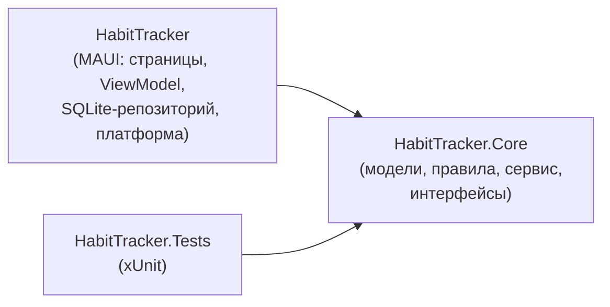
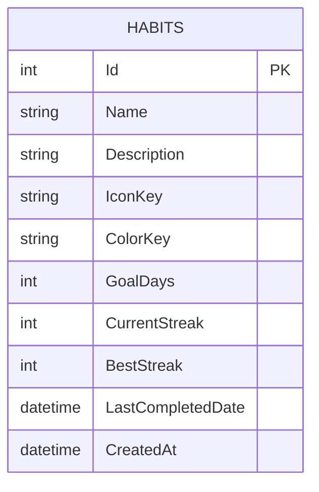
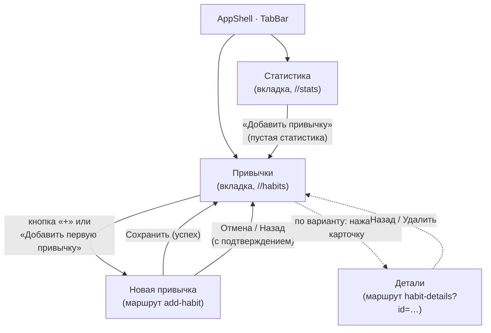

# Итоговая самостоятельная практическая работа. Приложение «Трекер привычек»

| | |
|---|---|
| **Дисциплина** | Разработка мобильных приложений на .NET MAUI |
| **Вид работы** | Итоговая самостоятельная практическая работа |
| **Тема проекта** | «Трекер привычек»: приложение для отслеживания ежедневных привычек |
| **Среда разработки** | JetBrains Rider |
| **Платформа / язык** | .NET MAUI / C#, XAML |
| **Рекомендуемый объём** | 10–12 академических часов самостоятельной работы, защита 15 минут |
| **Опирается на** | Практические работы №2–№12 (проект Task Manager) |

> Скриншоты для отчёта сохраняйте в папку `docs/images` репозитория под именами `fig1.png`, `fig2.png` и т. д. (перечень обязательных снимков — в разделе 14).

---

## 1. Цель работы

Самостоятельно спроектировать и разработать законченное мобильное приложение, применив всё изученное в курсе: разметку и стили, навигацию Shell, паттерн MVVM, привязки и команды, внедрение зависимостей, хранение данных в SQLite, обработку ошибок, уведомления пользователя и автоматические тесты с измерением покрытия.

Работа не содержит пошаговых инструкций: вы получаете **требования** (что должно получиться) и **ограничения** (как это должно быть устроено), а решения о реализации принимаете сами. Всё, что нужно, вы уже делали в практических работах №2–№12.

## 2. Что вы должны уметь к началу работы

| Навык | Где отрабатывался |
|---|---|
| Создание проекта и страниц, Git-ветки, коммиты | Работы №2–№4 |
| Разметка, стили, ресурсы, светлая и тёмная темы | Работы №3–№5 |
| Навигация Shell, `TabBar`, маршруты, передача параметров | Работы №6–№7 |
| MVVM, `BaseViewModel`, `ObservableCollection` | Работа №8 |
| Привязки, команды, `CanExecute`, внедрение зависимостей | Работа №9 |
| SQLite, `sqlite-net-pcl`, асинхронные сервисы | Работа №10 |
| `async/await`, состояния «загрузка / данные / пусто / ошибка», обработка сбоев | Работа №11 |
| xUnit, тестовые двойники, покрытие, порог, автозапуск, CI | Работа №12 |

## 3. Общая постановка задачи

Разработать приложение **HabitTracker**, которое позволяет:

1. вести список ежедневных привычек (название, текущая серия дней подряд);
2. добавлять новую привычку: название, описание, иконка и цвет (выбор из `Picker`), цель в днях;
3. отмечать привычку выполненной **сегодня** — серия увеличивается;
4. видеть прогресс до цели (по умолчанию 21 день) на индикаторе `ProgressBar`;
5. просматривать страницу статистики со сводным списком всех привычек и их прогрессом.

Приложение работает **автономно** (без сервера и входа в аккаунт), данные хранятся на устройстве и сохраняются между запусками.

### 3.1. Допущения и ограничения

| Допущение | Пояснение |
|---|---|
| Один пользователь, одно устройство | Синхронизации и учётных записей нет |
| Отметка — не чаще одного раза в календарный день | «День» определяется **локальной** датой устройства |
| Серия считается только по дате последней отметки | История всех отметок не хранится (расширение — вариант 5 в разделе 13) |
| Платформы | Обязательна одна платформа по выбору (Android или Windows); остальные — по желанию |
| Интерфейс | На русском языке |

---

## 4. Архитектура и состав решения

### 4.1. Структура решения



Решение состоит из трёх проектов (как в работе №12):

| Проект | Содержимое | Зависимости |
|---|---|---|
| `HabitTracker` | Страницы XAML, ViewModel, конвертеры, регистрация DI, реализация репозитория на SQLite, служба диалогов | MAUI, `HabitTracker.Core` |
| `HabitTracker.Core` | Модель `Habit`, правила серии и прогресса, валидация, статистика, `HabitService`, интерфейсы `IHabitRepository`, `IClock`, `INotifier` | Только .NET; из сторонних — допускается `sqlite-net-pcl` для атрибутов модели |
| `HabitTracker.Tests` | Тесты xUnit, тестовые двойники | `HabitTracker.Core` |

> **Правило:** в `Core` не должно быть ссылок на типы MAUI (`Color`, `Command`, `Shell`, `MainThread`…). Всё, что требует платформы, скрывается за интерфейсом.

### 4.2. Слои и обязанности

| Слой | Обязанность | Чего делать нельзя |
|---|---|---|
| Страница (XAML) | Разметка, привязки, события жизненного цикла (`OnAppearing`) | Бизнес-правила, обращения к БД |
| ViewModel | Состояние экрана, команды, вызов сервисов, преобразование ошибок в сообщения | Знать про SQLite, `DisplayAlert`, `Shell` напрямую |
| `HabitService` (Core) | Бизнес-правила: проверка, отметка, расчёт серии, лимиты | Знать про интерфейс и платформу |
| `IHabitRepository` | Доступ к данным (CRUD) | Бизнес-правила |
| Службы приложения (`INavigationService`, `IDialogService`) | Переходы и диалоги, вызываемые из ViewModel | Содержать бизнес-логику |

### 4.3. Обязательные интерфейсы

```csharp
// Core
public interface IClock
{
    DateTime Today { get; }                 // локальная дата без времени
}

public interface IHabitRepository
{
    Task<IReadOnlyList<Habit>> GetAllAsync();
    Task<Habit?> GetByIdAsync(int id);
    Task<int> InsertAsync(Habit habit);     // возвращает Id
    Task UpdateAsync(Habit habit);
    Task DeleteAsync(int id);
}

public interface IHabitService
{
    Task<IReadOnlyList<Habit>> GetAllAsync();
    Task<Habit> AddAsync(NewHabit request);                     // бросает HabitException
    Task<MarkResult> MarkCompletedTodayAsync(int habitId);      // бросает HabitException
    Task DeleteAsync(int habitId);
    Task<HabitStatistics> GetStatisticsAsync();
}
```

```csharp
// App: службы, которые нужны ViewModel, но зависят от платформы
public interface IDialogService
{
    Task<bool> ConfirmAsync(string title, string message, string accept, string cancel);
    Task AlertAsync(string title, string message, string close = "OK");
}

public interface INavigationService
{
    Task GoToAddHabitAsync();
    Task GoBackAsync();
}
```

> Имена и состав интерфейсов можно изменить, если вы можете обосновать решение на защите. Обязательно: `IClock`, интерфейс репозитория и интерфейс сервиса (они нужны для тестов).

### 4.4. Регистрация зависимостей

| Тип | Время жизни |
|---|---|
| `IClock` → `SystemClock` | `Singleton` |
| `IHabitRepository` → `SqliteHabitRepository` | `Singleton` |
| `IHabitService` → `HabitService` | `Singleton` |
| `IDialogService`, `INavigationService` | `Singleton` |
| ViewModel всех страниц | `Transient` |
| Страницы | `Transient` |

---

## 5. Структуры данных

### 5.1. Сущность `Habit` (хранится в SQLite)

```csharp
[Table("Habits")]
public class Habit
{
    [PrimaryKey, AutoIncrement]
    public int Id { get; set; }

    public string Name { get; set; } = string.Empty;
    public string Description { get; set; } = string.Empty;

    public string IconKey { get; set; } = HabitIcons.Default;     // ключ из списка иконок
    public string ColorKey { get; set; } = HabitColors.Default;   // ключ из списка цветов

    public int GoalDays { get; set; } = 21;                       // цель, дней подряд

    public int CurrentStreak { get; set; }                        // сохранённая серия
    public int BestStreak { get; set; }                           // лучшая серия за всё время
    public DateTime? LastCompletedDate { get; set; }              // дата последней отметки (без времени)

    public DateTime CreatedAt { get; set; }                       // дата создания (из IClock)
}
```

| Поле | Тип | Ограничения | Значение по умолчанию |
|---|---|---|---|
| `Id` | `int` | Первичный ключ, автоинкремент | — |
| `Name` | `string` | Обязательно, после обрезки пробелов 3–50 символов, уникально без учёта регистра | — |
| `Description` | `string` | Необязательно, не более 200 символов | пустая строка |
| `IconKey` | `string` | Один из ключей справочника иконок | `book` |
| `ColorKey` | `string` | Один из ключей справочника цветов | `blue` |
| `GoalDays` | `int` | Одно из значений `7, 14, 21, 30, 66, 100` | `21` |
| `CurrentStreak` | `int` | ≥ 0 | `0` |
| `BestStreak` | `int` | ≥ `CurrentStreak` | `0` |
| `LastCompletedDate` | `DateTime?` | Только дата (время 00:00); `null` — ни разу не отмечена | `null` |
| `CreatedAt` | `DateTime` | Устанавливает сервис по `IClock`, а не по `DateTime.Now` | — |

> **Важно:** `Habit` — только данные. Свойства «выполнена ли сегодня», «процент прогресса» и подобные **вычисляются** в `Core` по текущей дате (через `IClock`) и не хранятся.

### 5.2. Справочники иконок и цветов

Иконки задаются **эмодзи**, цвета — шестнадцатеричными строками. В БД хранятся **ключи**, а не значения: так справочник можно менять без миграции данных.

```csharp
public sealed record PickerOption(string Key, string Title);

public static class HabitIcons
{
    public const string Default = "book";

    // (ключ, эмодзи, название для Picker)
    public static readonly IReadOnlyList<(string Key, string Glyph, string Title)> All = new[]
    {
        ("water",  "💧", "Вода"),
        ("run",    "🏃", "Бег"),
        ("book",   "📚", "Чтение"),
        ("yoga",   "🧘", "Медитация"),
        ("sleep",  "💤", "Сон"),
        ("food",   "🥗", "Питание"),
        ("write",  "✍️", "Письмо"),
        ("music",  "🎸", "Музыка"),
    };
}

public static class HabitColors
{
    public const string Default = "blue";

    // (ключ, цвет #RRGGBB, название)
    public static readonly IReadOnlyList<(string Key, string Hex, string Title)> All = new[]
    {
        ("blue",   "#2563EB", "Синий"),
        ("green",  "#16A34A", "Зелёный"),
        ("orange", "#EA580C", "Оранжевый"),
        ("red",    "#DC2626", "Красный"),
        ("purple", "#7C3AED", "Фиолетовый"),
        ("teal",   "#0D9488", "Бирюзовый"),
        ("pink",   "#DB2777", "Розовый"),
        ("gray",   "#475569", "Серый"),
    };
}
```

Требования:

- методы поиска по ключу: `GetGlyph(string key)` и `GetHex(string key)`; для **неизвестного ключа** возвращают значение по умолчанию (устойчивость к «испорченным» данным);
- преобразование `hex → Color` выполняется **в приложении** (конвертер значения), а не в `Core`.

### 5.3. Запрос на создание привычки

```csharp
public sealed record NewHabit(
    string Name,
    string Description,
    string IconKey,
    string ColorKey,
    int GoalDays);
```

### 5.4. Результат отметки

```csharp
public enum MarkOutcome
{
    Completed,          // серия увеличена
    GoalReached,        // серия увеличена и достигла цели (впервые)
    AlreadyDoneToday    // сегодня уже отмечено, ничего не изменилось
}

public sealed record MarkResult(MarkOutcome Outcome, Habit Habit);
```

Ошибки (недопустимые действия) выражаются исключением `HabitException`:

```csharp
public enum HabitErrorKind
{
    ValidationFailed,     // нарушены правила ввода
    DuplicateName,        // привычка с таким названием уже есть
    LimitReached,         // достигнут предел количества привычек
    NotFound,             // привычка не найдена (например, удалена)
    ClockMovedBack,       // дата устройства раньше даты последней отметки
    Storage               // сбой хранилища (обёртка над исключениями БД)
}

public class HabitException : Exception
{
    public HabitErrorKind Kind { get; }
    public IReadOnlyDictionary<string, string> FieldErrors { get; }   // для ValidationFailed: поле → сообщение
    public HabitException(HabitErrorKind kind, string message,
                          IReadOnlyDictionary<string, string>? fieldErrors = null,
                          Exception? inner = null) : base(message, inner) { … }
}
```

### 5.5. Модель карточки для экрана (ViewModel)

Карточка — **вычисленное представление** `Habit` на сегодняшнюю дату. Она реализует `INotifyPropertyChanged`, чтобы после отметки обновлялась только одна карточка.

| Свойство | Тип | Как вычисляется |
|---|---|---|
| `Id` | `int` | Из `Habit` |
| `Name` | `string` | Из `Habit` |
| `Glyph` | `string` | `HabitIcons.GetGlyph(IconKey)` |
| `ColorHex` | `string` | `HabitColors.GetHex(ColorKey)` |
| `EffectiveStreak` | `int` | Эффективная серия на сегодня (см. 6.2) |
| `GoalDays` | `int` | Из `Habit` |
| `Progress` | `double` | От 0.0 до 1.0 — см. 6.3 |
| `ProgressText` | `string` | `"{EffectiveStreak} из {GoalDays} дн."` |
| `StreakText` | `string` | `"Серия: {N} дн."`, склонение по правилам русского языка (1 день, 2–4 дня, 5+ дней) |
| `IsDoneToday` | `bool` | `LastCompletedDate == today` |
| `IsStreakBroken` | `bool` | Серия была, но прервана — см. 6.2 |
| `IsGoalReached` | `bool` | `EffectiveStreak >= GoalDays` |
| `ButtonText` | `string` | `"Отметить сегодня"` или `"Выполнено сегодня ✓"` |
| `IsBusy` | `bool` | Идёт запись; кнопка недоступна |

> Склонение и формирование текстов должны быть вынесены в чистые методы `Core` (например, `HabitTexts.DaysText(int n)`) и покрыты тестами.

### 5.6. Статистика

```csharp
public sealed record HabitStatistics(
    int TotalHabits,
    int DoneToday,                  // отмечено сегодня
    int GoalsReached,               // привычек, у которых цель достигнута
    double AverageProgressPercent,  // среднее по привычкам, 0..100, округление до 1 знака
    int LongestCurrentStreak,       // максимальная эффективная серия
    int LongestEverStreak,          // максимальное значение BestStreak
    IReadOnlyList<HabitProgressRow> Rows);

public sealed record HabitProgressRow(
    int Id, string Name, string Glyph, string ColorHex,
    int EffectiveStreak, int GoalDays, double Progress, bool IsDoneToday, bool IsGoalReached);
```

Расчёт — в `HabitStatisticsCalculator` (чистая статическая логика в `Core`, принимает список привычек и текущую дату).

### 5.7. Схема данных



Файл БД: `habits.db3` в `FileSystem.AppDataDirectory`. Инициализация — «ленивая» и потокобезопасная (`SemaphoreSlim`), как в `TaskDatabase` из работы №10.

---

## 6. Бизнес-правила

### 6.1. Отметка «выполнено сегодня»

Пусть `today = IClock.Today`, `last = LastCompletedDate`.

| № | Условие | Действие | Результат |
|---|---|---|---|
| R1 | `last == null` | `CurrentStreak = 1`, `last = today` | `Completed` |
| R2 | `last == today` | Ничего не менять | `AlreadyDoneToday` |
| R3 | `last == today − 1 день` | `CurrentStreak += 1`, `last = today` | `Completed` |
| R4 | `last < today − 1 день` | Серия прервана: `CurrentStreak = 1`, `last = today` | `Completed` |
| R5 | `last > today` | Исключение `HabitException(ClockMovedBack)`; данные не менять | — |
| R6 | После R1/R3/R4: `CurrentStreak > BestStreak` | `BestStreak = CurrentStreak` | — |
| R7 | После R1/R3/R4: `CurrentStreak == GoalDays` | Результат — `GoalReached` вместо `Completed` | `GoalReached` |

Пояснения:

- «Вчера» определяется календарно: `last.Date == today.AddDays(-1)`, **а не** разностью по 24 часа. Это корректно для границ месяцев, лет, високосного дня и перехода на летнее время.
- `GoalReached` возвращается **ровно один раз** — в день, когда серия стала равна цели. В последующие дни (серия больше цели) результат — `Completed`.
- Повторная отметка в тот же день (R2) не является ошибкой: интерфейс получает `AlreadyDoneToday` и показывает информационное сообщение.

### 6.2. Эффективная серия (что показывать на экране)

Сохранённое `CurrentStreak` не обнуляется в базе при пропуске дня — приложение может не запускаться несколько дней. Поэтому при **отображении** серия вычисляется:

| Условие | `EffectiveStreak` | `IsStreakBroken` |
|---|---|---|
| `last == null` | 0 | `false` |
| `last == today` или `last == today − 1` | `CurrentStreak` | `false` |
| `last < today − 1` | 0 | `true` (был прогресс, но серия прервана) |
| `last > today` | `CurrentStreak` (дата устройства некорректна) | `false` |

> В базе значение сбрасывается только при следующей отметке (правило R4).

### 6.3. Прогресс

```
Progress = min(EffectiveStreak / GoalDays, 1.0)       // 0.0 … 1.0 для ProgressBar
Percent  = round(Progress × 100, до целого)           // для текста
```

Цель достигнута, если `EffectiveStreak >= GoalDays`. Если серия превысила цель, индикатор остаётся заполненным на 100 %, а в тексте показывается реальная серия (например, «25 из 21 дн.»).

### 6.4. Ограничения

| Правило | Значение | Ошибка |
|---|---|---|
| Максимум привычек | 30 | `LimitReached` |
| Название | 3–50 символов после обрезки пробелов; повторные пробелы внутри схлопываются | `ValidationFailed` |
| Уникальность названия | Без учёта регистра, среди всех привычек | `DuplicateName` |
| Описание | до 200 символов | `ValidationFailed` |
| Иконка, цвет, цель | Из справочников | `ValidationFailed` |

### 6.5. Контрольная таблица сценариев серии (обязательна для тестов)

Для каждой строки напишите тест. Цель `GoalDays = 21`, если не указано иное.

Даты без года относятся к одному и тому же году (например, 2027). `Current` и `Best` — значения `CurrentStreak` и `BestStreak`.

| № | `last` | `today` | `Current` до | `Best` до | `Current` после | `Best` после | Результат |
|---|---|---|---|---|---|---|---|
| S1 | `null` | 10.03 | 0 | 0 | 1 | 1 | `Completed` |
| S2 | 09.03 | 10.03 | 3 | 5 | 4 | 5 | `Completed` |
| S3 | 10.03 | 10.03 | 3 | 5 | 3 | 5 | `AlreadyDoneToday` (данные не меняются) |
| S4 | 08.03 | 10.03 | 7 | 7 | 1 | 7 | `Completed` (серия прервана, рекорд сохранён) |
| S5 | 11.03 | 10.03 | 3 | 5 | 3 | 5 | исключение `ClockMovedBack`, данные не меняются |
| S6 | 31.01 | 01.02 | 4 | 5 | 5 | 5 | `Completed` (граница месяца) |
| S7 | 28.02.2028 | 29.02.2028 | 2 | 5 | 3 | 5 | `Completed` (високосный день) |
| S8 | 29.02.2028 | 01.03.2028 | 2 | 5 | 3 | 5 | `Completed` |
| S9 | 31.12.2026 | 01.01.2027 | 9 | 9 | 10 | 10 | `Completed` (граница года, рекорд обновился) |
| S10 | 09.03 | 10.03 | 20 | 20 | 21 | 21 | `GoalReached` |
| S11 | 09.03 | 10.03 | 21 | 21 | 22 | 22 | `Completed` (цель уже была достигнута) |
| S12 | 09.03 | 10.03 | 4 | 4 | 5 | 5 | `GoalReached` при `GoalDays = 5` |

Таблица эффективной серии (по правилу 6.2), `today = 10.03`:

| № | `last` | `CurrentStreak` | `EffectiveStreak` | `IsStreakBroken` |
|---|---|---|---|---|
| E1 | `null` | 0 | 0 | `false` |
| E2 | 10.03 | 5 | 5 | `false` |
| E3 | 09.03 | 5 | 5 | `false` |
| E4 | 08.03 | 5 | 0 | `true` |
| E5 | 01.01 | 12 | 0 | `true` |

---

## 7. Экраны и компоновка

### 7.1. Состав экранов

| № | Экран | Тип | Обязательность |
|---|---|---|---|
| 1 | **Привычки** (главная) | Вкладка `TabBar` | Обязательно |
| 2 | **Статистика** | Вкладка `TabBar` | Обязательно |
| 3 | **Новая привычка** | Страница, открываемая по маршруту | Обязательно |
| 4 | Детали / редактирование привычки | Страница по маршруту с параметром | По варианту |
| 5 | Настройки (тема, напоминание) | Вкладка | По варианту |

### 7.2. Общие требования к оформлению

| Требование | Содержание |
|---|---|
| Стили и ресурсы | Все цвета, отступы, размеры шрифтов — в `ResourceDictionary`; в разметке нет «магических» значений |
| Темы | Светлая и тёмная; цвета через `AppThemeBinding`; все тексты читаемы в обеих темах |
| Цвет привычки | Задаёт акцент карточки (круг с иконкой, цвет `ProgressBar`); не используется для текста |
| Компилируемые привязки | `x:DataType` на каждой странице и в каждом `DataTemplate` |
| Доступность | `SemanticProperties.Description` у кнопок и индикаторов; интерактивные элементы не менее 44×44 |
| Ориентация | Работает в портретной; в альбомной не ломается (прокрутка) |
| Состояния | Каждый список обязан иметь состояния «загрузка», «данные», «пусто», «ошибка» |

### 7.3. Экран 1. «Привычки» (главная)

**Назначение:** показать привычки с серией и прогрессом, дать быстро отметить выполнение.

**Компоновка**

```text
┌────────────────────────────────────────┐
│  Привычки                      [ + ]   │  ← заголовок + кнопка добавления (ToolbarItem)
├────────────────────────────────────────┤
│  ⚠ Не удалось загрузить привычки       │  ← баннер ошибки (виден только при ошибке)
│                           [Повторить]  │
├────────────────────────────────────────┤
│  Сегодня выполнено: 2 из 5             │  ← строка-сводка
│ ┌────────────────────────────────────┐ │
│ │ (💧)  Пить воду                    │ │  ← карточка привычки
│ │       Серия: 7 дн.                 │ │
│ │       ▓▓▓▓▓▓▓░░░░░░░░░░  7 из 21   │ │  ← ProgressBar + текст
│ │       [ Отметить сегодня ]     🗑  │ │
│ └────────────────────────────────────┘ │
│ ┌────────────────────────────────────┐ │
│ │ (📚)  Читать                       │ │  ← серия прервана (N05)
│ │       Серия прервана — начните     │ │
│ │       снова сегодня                │ │
│ │       ░░░░░░░░░░░░░░░░░░  0 из 21  │ │
│ │       [ Отметить сегодня ]     🗑  │ │
│ └────────────────────────────────────┘ │
│ ┌────────────────────────────────────┐ │
│ │ (🧘)  Медитация                    │ │
│ │       Серия: 3 дн.                 │ │
│ │       ▓▓▓░░░░░░░░░░░░░░░  3 из 21  │ │
│ │       [ Выполнено сегодня ✓ ]      │ │  ← кнопка недоступна
│ └────────────────────────────────────┘ │
├────────────────────────────────────────┤
│  [ Привычки ]   [ Статистика ]         │  ← TabBar
└────────────────────────────────────────┘
```

**Состав и привязки**

| Элемент | Элемент управления | Привязка / поведение |
|---|---|---|
| Кнопка добавления | `ToolbarItem` | `AddCommand` → переход на экран 3 |
| Баннер ошибки | `Border` + `Label` + `Button` «Повторить» | `IsVisible="{Binding HasError}"` |
| Строка-сводка | `Label` | Текст «Сегодня выполнено: N из M» (скрыта при пустом списке) |
| Список | `RefreshView` + `CollectionView` | `ItemsSource="{Binding Habits}"`, `SelectionMode="None"` |
| Карточка | `Border` + `Grid` в `DataTemplate` | `x:DataType="HabitCardModel"` |
| Иконка | Круг (`Border` с `StrokeShape`) + `Label` с эмодзи | Фон — `ColorHex` через конвертер |
| Название, серия | `Label` | `Name`, `StreakText` |
| Индикатор | `ProgressBar` | `Progress`, `ProgressColor` из `ColorHex` |
| Текст прогресса | `Label` | `ProgressText` |
| Кнопка отметки | `Button` | Команда родителя через `RelativeSource AncestorType`; `CommandParameter="{Binding .}"`; текст `ButtonText`; недоступна при `IsDoneToday` или `IsBusy` |
| Удаление | `SwipeView` (свайп) и/или кнопка | Команда удаления с подтверждением |
| Пустой список | `CollectionView.EmptyView` | Иллюстрация-эмодзи, текст «Привычек пока нет», кнопка «Добавить первую привычку» |
| Индикатор загрузки | `ActivityIndicator` / `RefreshView.IsRefreshing` | `IsLoading` |

**Порядок сортировки списка:** сначала невыполненные сегодня, внутри — по убыванию эффективной серии, затем по названию без учёта регистра; выполненные сегодня — в конце. Сортировка — чистая функция в `Core`, покрыта тестами.

**Поведение**

| Событие | Реакция |
|---|---|
| Страница появилась (`OnAppearing`) | Загрузить данные заново (в том числе после возврата с экрана 3 и после полуночи) |
| Возврат в приложение из фона (`Window.Resumed`) | Пересчитать состояние «сегодня» |
| Жест «потянуть вниз» | Перезагрузка списка |
| Нажатие «Отметить сегодня» | Отметка, обновление **только этой карточки**, повторная сортировка, уведомление (раздел 9) |
| Свайп/кнопка удаления | Подтверждение; после согласия — удаление и уведомление |
| Нажатие «+» | Переход на экран 3 |

### 7.4. Экран 2. «Статистика»

**Назначение:** сводная картина прогресса по всем привычкам.

```text
┌────────────────────────────────────────┐
│  Статистика                            │
├────────────────────────────────────────┤
│ ┌──────────┐ ┌──────────┐ ┌──────────┐ │
│ │ Привычек │ │ Сегодня  │ │ Цель     │ │  ← три плитки-сводки
│ │    5     │ │  2 из 5  │ │ достигн. │ │
│ │          │ │          │ │    1     │ │
│ └──────────┘ └──────────┘ └──────────┘ │
│  Средний прогресс: 48,2 %              │
│  Лучшая текущая серия: 12 дн.          │
│  Рекорд за всё время: 21 дн.           │
├────────────────────────────────────────┤
│  Все привычки                          │
│  (💧) Пить воду        7 из 21   33 %  │
│  ▓▓▓▓▓▓░░░░░░░░░░░░░░░░                │
│  (📚) Читать          21 из 21  100 %  │
│  ▓▓▓▓▓▓▓▓▓▓▓▓▓▓▓▓▓▓▓▓  🏆              │
├────────────────────────────────────────┤
│  [ Привычки ]   [ Статистика ]         │
└────────────────────────────────────────┘
```

| Элемент | Требование |
|---|---|
| Плитки-сводки | `Grid` из трёх `Border`; значения из `HabitStatistics` |
| Показатели | Среднее, лучшая текущая серия, рекорд (`LongestEverStreak`) |
| Список | `CollectionView` со строками `HabitProgressRow`: иконка, название, `ProgressBar`, «N из M», процент; выполненная цель отмечена знаком 🏆 |
| Порядок | По убыванию прогресса, затем по названию |
| Пустое состояние | «Нет данных для статистики. Добавьте первую привычку» + кнопка перехода на вкладку «Привычки» |
| Обновление | При каждом появлении страницы; жест «потянуть» |
| Ошибка | Баннер с кнопкой «Повторить» |

### 7.5. Экран 3. «Новая привычка»

**Назначение:** создание привычки с проверкой ввода.

```text
┌────────────────────────────────────────┐
│ ←  Новая привычка                      │
├────────────────────────────────────────┤
│  Название *                            │
│  ┌──────────────────────────────────┐  │
│  │ Пить воду                        │  │
│  └──────────────────────────────────┘  │
│  Введено 9 из 50                       │  ← счётчик
│  ✖ Название должно быть не короче 3    │  ← ошибка поля (по условию)
│                                        │
│  Описание                              │
│  ┌──────────────────────────────────┐  │
│  │ 2 литра в день                   │  │  ← Editor
│  └──────────────────────────────────┘  │
│  Введено 15 из 200                     │
│                                        │
│  Иконка            [ 💧 Вода       ▾ ] │  ← Picker
│  Цвет              [ ● Синий       ▾ ] │  ← Picker + образец цвета
│  Цель              [ 21 день       ▾ ] │  ← Picker
│                                        │
│  Предпросмотр:                         │
│  (💧)  Пить воду       Серия: 0 дн.    │  ← живой образец карточки
│                                        │
│  [ Сохранить ]        [ Отмена ]       │
└────────────────────────────────────────┘
```

| Элемент | Элемент управления | Требования |
|---|---|---|
| Название | `Entry` | `MaxLength=50`, `ReturnType=Next`, счётчик символов |
| Описание | `Editor` | `MaxLength=200`, `AutoSize=TextChanges`, счётчик |
| Иконка | `Picker` | `ItemsSource` — список `PickerOption`; `ItemDisplayBinding` — `Title`; значение по умолчанию «Чтение» |
| Цвет | `Picker` + круг-образец | При смене цвета образец обновляется сразу |
| Цель | `Picker` | Значения 7, 14, 21, 30, 66, 100; по умолчанию 21 |
| Предпросмотр | Карточка из экрана 1 | Меняется по мере ввода (привязка к тем же свойствам) |
| «Сохранить» | `Button` | Недоступна во время сохранения (`IsBusy`) |
| «Отмена» | `Button` | Выход с подтверждением, если введены данные |

**Правила валидации и момент показа сообщений**

| Поле | Правило | Когда показывать ошибку |
|---|---|---|
| Название | Не пусто; 3–50 после обрезки | После первой потери фокуса или после нажатия «Сохранить»; исчезает, как только ошибка устранена |
| Название | Уникально (без учёта регистра) | После ответа сервиса (`DuplicateName`) — под полем |
| Описание | ≤ 200 | Не должна возникать при `MaxLength`, но проверяется и в сервисе |
| Иконка, цвет, цель | Выбраны | Всегда выбрано значение по умолчанию |

После успешного сохранения: возврат на главную, новая привычка видна в списке, показано уведомление N01 (раздел 9).

### 7.6. Экраны по вариантам (кратко)

| Экран | Содержимое |
|---|---|
| Детали привычки | Название, описание, серия, лучшая серия, дата создания, прогресс, кнопки «Отметить», «Удалить»; открывается по нажатию на карточку; параметр `habitId` через `QueryProperty` |
| Настройки | Переключатель темы (сохраняется в `Preferences`), версия приложения |

---

## 8. Навигация и переходы

### 8.1. Карта навигации



### 8.2. Таблица переходов

| № | Откуда | Действие | Куда | Способ | Параметры | Результат / возврат |
|---|---|---|---|---|---|---|
| T1 | Привычки | Кнопка «+» | Новая привычка | `GoToAsync("add-habit")` (регистрируемый маршрут) | — | Страница помещается в стек; доступна кнопка «Назад» |
| T2 | Привычки (пусто) | «Добавить первую привычку» | Новая привычка | То же, что T1 | — | То же |
| T3 | Новая привычка | «Сохранить» (успех) | Привычки | `GoToAsync("..")` | — | Возврат; список перезагружается в `OnAppearing`; уведомление N01 |
| T4 | Новая привычка | «Сохранить» (ошибка) | — | Остаться на странице | — | Сообщения об ошибках, данные не теряются |
| T5 | Новая привычка | «Отмена» или «Назад» (поля не пусты) | Привычки | Подтверждение, затем `GoToAsync("..")` | — | N13: «Отменить ввод?»; при отказе остаёмся |
| T6 | Новая привычка | «Отмена» или «Назад» (поля пусты/без изменений) | Привычки | `GoToAsync("..")` | — | Без подтверждения |
| T7 | Вкладка «Привычки» | Нажатие на вкладку «Статистика» | Статистика | Переключение вкладки | — | Статистика пересчитывается в `OnAppearing` |
| T8 | Статистика (пусто) | «Добавить привычку» | Привычки → Новая привычка | `GoToAsync("//habits")`, затем T1 | — | — |
| T9* | Привычки | Нажатие на карточку | Детали | `GoToAsync("habit-details?id=…")` | `id` (int) | После удаления на экране «Детали» — возврат и обновление |

\* по варианту.

### 8.3. Требования к навигации

| Требование | Пояснение |
|---|---|
| Маршрут страницы добавления регистрируется в `AppShell.xaml.cs` | `Routing.RegisterRoute("add-habit", typeof(AddHabitPage))` |
| Переходы вызываются **из ViewModel через службу** `INavigationService` | В ViewModel нет ссылки на `Shell` |
| Системная кнопка «Назад» и жест «назад» обрабатываются так же, как «Отмена» | Перехват через `ShellNavigatingEventArgs` (`Cancel()`/отложенное решение) либо `Shell.BackButtonBehavior` |
| Двойное нажатие на «+» не открывает страницу дважды | Блокировка команды на время перехода |
| Состояние формы не теряется при повороте экрана | Данные формы хранятся во ViewModel |
| Вкладки сохраняют состояние | Страницы вкладок переиспользуются; перезагрузка данных — в `OnAppearing` |

---

## 9. Уведомления пользователя

### 9.1. Каналы

| Канал | Применение | Реализация |
|---|---|---|
| **Inline** | Ошибки полей формы | `Label` под полем, стиль `ErrorLabelStyle`, `IsVisible` |
| **Баннер** | Ошибки загрузки списка, ошибки хранилища | `Border` в верхней части страницы, кнопка «Повторить» |
| **Строка состояния** | Кратковременные успешные сообщения | `Label`/панель, автоматически скрывается через ~3 секунды |
| **Диалог подтверждения** | Необратимые или потенциально неожиданные действия | `IDialogService.ConfirmAsync` (`DisplayAlert`) |
| **Диалог-сообщение** | Особо важные события (цель достигнута) | `IDialogService.AlertAsync` |
| **Состояние на карточке** | Постоянные состояния («Выполнено сегодня ✓», «Серия прервана») | Изменение текста, цвета, доступности |

> Правило выбора: сообщения, которые пользователь **должен заметить**, — баннер или диалог; сообщения, которые **информируют**, — строка состояния; ошибки ввода — рядом с полем. Никогда не показывайте пользователю текст исключения (`ex.Message`) и трассировку стека.

### 9.2. Каталог уведомлений (обязательный)

| Код | Событие | Канал | Текст (русский, можно улучшить формулировку) | Тип |
|---|---|---|---|---|
| N01 | Привычка добавлена | Строка состояния | «Привычка «{название}» добавлена» | Успех |
| N02 | Привычка отмечена | Строка состояния | «Отлично! Серия: {N} {дн.}» | Успех |
| N03 | Повторная отметка за день | Строка состояния | «Сегодня эта привычка уже отмечена» | Информация |
| N04 | Цель достигнута | Диалог-сообщение | «Поздравляем! Цель «{название}» — {GoalDays} {дн.} подряд — достигнута!» | Успех |
| N05 | Серия прервана | Состояние карточки | «Серия прервана — начните снова сегодня» | Предупреждение |
| N06 | Подтверждение удаления | Диалог подтверждения | «Удалить привычку «{название}»? Серия и прогресс будут потеряны.» Кнопки «Удалить» / «Отмена» | Подтверждение |
| N07 | Привычка удалена | Строка состояния | «Привычка «{название}» удалена» | Информация |
| N08 | Ошибка валидации поля | Inline | См. таблицу 9.3 | Ошибка |
| N09 | Не удалось загрузить данные | Баннер + «Повторить» | «Не удалось загрузить привычки. Повторите попытку.» | Ошибка |
| N10 | Не удалось сохранить / отметить / удалить | Баннер или диалог-сообщение | «Не удалось сохранить изменения. Повторите попытку.» | Ошибка |
| N11 | Дата устройства раньше последней отметки | Диалог-сообщение | «Дата на устройстве раньше последней отметки. Проверьте настройки даты и времени.» | Ошибка |
| N12 | Привычка с таким названием уже есть | Inline под полем «Название» | «Привычка с таким названием уже есть» | Ошибка |
| N13 | Выход с несохранённым вводом | Диалог подтверждения | «Отменить ввод? Введённые данные будут потеряны.» Кнопки «Отменить ввод» / «Продолжить» | Подтверждение |
| N14 | Список пуст | Пустое состояние | «Привычек пока нет. Добавьте первую!» | Информация |
| N15 | Достигнут лимит привычек | Диалог-сообщение | «Достигнут предел: 30 привычек. Удалите ненужные, чтобы добавить новые.» | Ошибка |
| N16 | Привычка не найдена (удалена в другом месте/устаревший список) | Строка состояния + перезагрузка списка | «Привычка не найдена. Список обновлён.» | Информация |

### 9.3. Сообщения валидации (inline)

| Поле | Нарушение | Сообщение |
|---|---|---|
| Название | Пусто | «Введите название привычки» |
| Название | Менее 3 символов | «Название должно содержать не менее 3 символов» |
| Название | Более 50 символов | «Название не должно превышать 50 символов» |
| Название | Дубликат | «Привычка с таким названием уже есть» |
| Описание | Более 200 символов | «Описание не должно превышать 200 символов» |

### 9.4. Правила показа

1. Не более одного диалога одновременно.
2. Строка состояния заменяется новым сообщением; предыдущее исчезает немедленно, таймер сбрасывается.
3. Баннер ошибки остаётся, пока ошибка не устранена или не нажата «Повторить»; при успешной операции — скрывается.
4. Диалог N04 («цель достигнута») показывается **после** обновления карточки и не блокирует повторную отметку других привычек.
5. Для N02/N04 допускается **тактильный отклик** (`HapticFeedback.Default.Perform(HapticFeedbackType.Click)`) — по желанию; обязательно обработать отсутствие поддержки на платформе.
6. Все тексты — в одном месте (класс констант или файл ресурсов), не «разбросаны» по коду.

---

## 10. Обработка ошибок

### 10.1. Принципы

| Принцип | Содержание |
|---|---|
| Ошибки не «глотаются» | Каждое исключение либо обработано с понятной реакцией, либо записано в журнал (`Debug.WriteLine`/`ILogger`) |
| Ожидаемые ошибки — типизированы | Бизнес-ошибки выбрасываются как `HabitException` с `Kind` |
| Технические ошибки преобразуются на границе слоя | Исключения SQLite → `HabitException(Storage)` внутри репозитория/сервиса |
| ViewModel ловит `HabitException` | Преобразует `Kind` в канал и текст уведомления (таблица 10.2) |
| «Страховочный» `catch (Exception)` | В каждой команде ViewModel: приложение не должно аварийно завершаться; общее сообщение N10 + запись в журнал |
| Нет `async void` | Кроме обработчиков событий жизненного цикла страницы, внутри которых вызывается метод, **уже защищённый** `try/catch` |
| Защита от повторных запусков | `IsBusy` для формы и для каждой карточки; `CanExecute` |
| Отмена | При уходе со страницы незавершённые операции не должны менять состояние ушедшего экрана |

### 10.2. Матрица ошибок

| Источник | Исключение/ситуация | Где перехватывается | Реакция пользователю | Состояние данных |
|---|---|---|---|---|
| Создание БД, чтение списка | Исключение SQLite, нет места | Сервис → `HabitException(Storage)` | N09: баннер «Повторить» | Список не очищается, если уже был показан |
| Сохранение новой привычки | Нарушены правила | Сервис → `HabitException(ValidationFailed, FieldErrors)` | N08: сообщения под полями | Ввод сохраняется |
| Сохранение новой привычки | Повтор названия | `HabitException(DuplicateName)` | N12 под полем «Название» | Ввод сохраняется |
| Сохранение новой привычки | 30 привычек | `HabitException(LimitReached)` | N15 | Ввод сохраняется |
| Сохранение | Сбой записи | `HabitException(Storage)` | N10 | Ввод сохраняется, кнопка снова доступна |
| Отметка | `last > today` | `HabitException(ClockMovedBack)` | N11 | Данные не изменены |
| Отметка | Привычка удалена | `HabitException(NotFound)` | N16 + перезагрузка | — |
| Отметка | Сегодня уже отмечено | Не ошибка: `MarkOutcome.AlreadyDoneToday` | N03 | Без изменений |
| Отметка | Сбой записи | `HabitException(Storage)` | N10 | Карточка возвращается в прежнее состояние |
| Отметка | Двойное нажатие | `IsBusy` карточки, `CanExecute` | Нет (нажатие игнорируется) | Запись выполняется один раз |
| Удаление | Привычка не найдена | `NotFound` | N16 | — |
| Удаление | Сбой записи | `Storage` | N10 | Карточка остаётся в списке |
| Любая команда | Непредвиденное исключение | `catch (Exception)` в ViewModel | N10 + журнал | Состояние `IsBusy` сбрасывается в `finally` |
| Статистика | Сбой чтения | `Storage` | N09 | — |
| Повреждённые данные в БД (неизвестный `IconKey`) | — | Справочник возвращает значение по умолчанию | Нет | Приложение не падает |
| Поворот/сворачивание во время операции | — | Операция завершается, состояние во ViewModel | — | Согласованное |

### 10.3. Требования к устойчивости

1. Приложение **не падает** при: пустой БД, повреждённом значении ключа иконки/цвета, пустом названии в БД, смене даты устройства на более раннюю, двойных нажатиях.
2. После любой ошибки интерфейс остаётся работоспособным: кнопки не «зависают» в неактивном состоянии.
3. Ни одна операция записи не оставляет частичных данных (если запись не удалась — данные прежние).
4. При удалении выбранной привычки список обновляется без перезапуска.

---

## 11. Требования к тестированию и качеству

### 11.1. Обязательные тесты (проект `HabitTracker.Tests`)

| Объект | Минимальный набор проверок |
|---|---|
| Правила серии (`HabitRules` или метод сервиса) | Все сценарии S1–S12 из 6.5 (рекомендуется `[Theory]` или отдельные `[Fact]`) |
| Эффективная серия | Сценарии E1–E5 из 6.5 |
| Прогресс | 0 %, промежуточное значение, ровно цель, больше цели; `GoalDays` минимальная и максимальная |
| Валидация | Пустое, пробелы, границы 2/3/50/51 символов, описание 200/201, неизвестные ключи иконки/цвета/цели, схлопывание пробелов |
| `HabitService` с двойниками | Добавление, дубликат без учёта регистра, лимит 30, отметка (все исходы), отметка несуществующей, `ClockMovedBack`, удаление |
| Статистика | Пустой список, смесь привычек, округление среднего, порядок строк |
| Сортировка списка | Невыполненные раньше выполненных, по серии, по названию |
| Тексты | Склонение «день / дня / дней» для 0, 1, 2, 4, 5, 11, 12, 14, 21, 22, 25, 101, 111 |
| Справочники | Неизвестный ключ → значение по умолчанию |

Количественные требования:

| Показатель | Требование |
|---|---|
| Количество тестов | Не менее 40 (с учётом наборов данных `[Theory]`) |
| Покрытие строк `HabitTracker.Core` | Не менее **80 %** |
| Покрытие ветвей `HabitTracker.Core` | Рекомендуется не менее 70 % |
| Время выполнения набора | Не более нескольких секунд (без сети, без реальной БД, без реального времени) |

### 11.2. Тестовые двойники

| Зависимость | Двойник |
|---|---|
| `IClock` | `FakeClock` с изменяемой датой — для проверки границ дат |
| `IHabitRepository` | `InMemoryHabitRepository` (список в памяти) и, для проверки сбоев, вариант, выбрасывающий исключение |
| `IDialogService`, `INavigationService` | Двойники для проверки ViewModel (дополнительно, по варианту) |

### 11.3. Автоматизация

| Требование | Реализация (как в работе №12) |
|---|---|
| Запуск тестов при сборке приложения | Цель MSBuild в проекте приложения, флаг отключения `SkipTests` |
| Порог покрытия | `coverlet.msbuild`, `Threshold` (не ниже 80 для строк в `Core`) |
| Проверка перед отправкой | Git-хук `pre-push` в `.githooks` |
| Непрерывная интеграция | GitHub Actions: сборка `Core` и тестов, запуск с покрытием, сохранение отчёта как артефакта |

### 11.4. Качество кода

| Требование | Пояснение |
|---|---|
| Нет предупреждений компилятора в `Core` | Включить `Nullable` |
| Нет «мёртвого» кода и закомментированных блоков | — |
| Именование | Единообразное; методы, возвращающие `Task`, оканчиваются на `Async` |
| В XAML нет логики | Только привязки и стили |
| Нет дублирования | Общие стили и шаблоны вынесены в ресурсы |
| Нет секретов и личных данных в репозитории | — |

---

## 12. Содержание отчёта и репозиторий

### 12.1. Структура репозитория

```text
HabitTracker/
├── HabitTracker/                 # MAUI-приложение
├── HabitTracker.Core/            # модели, правила, сервис
├── HabitTracker.Tests/           # тесты
├── docs/
│   ├── images/                   # скриншоты fig1.png …
│   └── report.md                 # отчёт
├── .githooks/pre-push
├── .github/workflows/tests.yml
├── .gitignore                    # без bin, obj, TestResults, coveragereport
└── README.md                     # как собрать, запустить, прогнать тесты
```

### 12.2. Отчёт (`docs/report.md`)

1. Титульный лист: тема, ФИО, группа, номер варианта, ссылка на репозиторий.
2. Постановка задачи (своими словами) и перечень реализованных требований с отметками.
3. Архитектура: схема проектов и слоёв, таблица регистраций DI.
4. Структуры данных: схема таблицы, описание моделей, справочники.
5. Бизнес-правила: обоснование решений и описание расчёта серии (с примерами дат).
6. Экраны: скриншоты (светлая и тёмная тема) и краткое описание.
7. Навигация: схема переходов и таблица реализованных переходов.
8. Ошибки и уведомления: заполненная таблица «событие → канал → фактический текст» и скриншоты не менее пяти уведомлений.
9. Тестирование: количество тестов, покрытие (до и после доработок), HTML-отчёт покрытия, порог и его обоснование.
10. Автоматизация: фрагмент цели MSBuild, `pre-push`, скриншот проверки в GitHub Actions.
11. Описание функции по варианту.
12. Проблемы, возникшие в работе, и способы их решения (не менее трёх).
13. Вывод и перечень возможных улучшений.

**Обязательные скриншоты:**

| № | Содержание |
|---|---|
| fig1 | Структура решения в Rider |
| fig2 | Главная: список из ≥ 3 привычек, разные цвета, разный прогресс |
| fig3 | Главная: пустое состояние |
| fig4 | Карточка с состоянием «Серия прервана» и «Выполнено сегодня ✓» |
| fig5 | Форма добавления с ошибками валидации |
| fig6 | Форма добавления: открыт `Picker` |
| fig7 | Статистика с данными |
| fig8 | Уведомление N04 (цель достигнута) |
| fig9 | Баннер ошибки (например, N09 или N10) |
| fig10 | Диалоги N06 и N13 |
| fig11 | Тёмная тема: главная и статистика |
| fig12 | Результаты тестов и отчёт покрытия |
| fig13 | Успешная проверка GitHub Actions |

---

## 13. Приёмочные сценарии (проверяются на защите)

Преподаватель проверяет по этому списку. Для сценариев с датой используйте возможность переопределения времени в тестах или смену даты устройства (сценарии 8–10). Перед проверкой удалите данные приложения.

| № | Сценарий | Ожидаемый результат |
|---|---|---|
| A1 | Первый запуск | Главная с пустым состоянием N14 и кнопкой «Добавить первую привычку»; статистика — пустое состояние |
| A2 | Добавить привычку «Пить воду» (иконка «Вода», цвет «Синий», цель 21) | Возврат на главную, привычка видна, серия 0, прогресс 0 %, уведомление N01 |
| A3 | Нажать «Сохранить» с пустым названием | Сообщение под полем, переход не выполняется |
| A4 | Ввести название «ab», затем «abc» | В первом случае — ошибка, во втором — нет |
| A5 | Добавить привычку «пить воду» (другой регистр) | Ошибка N12 |
| A6 | Отметить «Пить воду» | Серия 1, индикатор растёт (1 из 21), кнопка меняется на «Выполнено сегодня ✓» и недоступна, N02 |
| A7 | Дважды быстро нажать «Отметить сегодня» | Серия увеличилась ровно на 1 |
| A8 | Сменить дату устройства на следующий день, вернуться в приложение, отметить | Серия 2 |
| A9 | Пропустить день (дата +2 дня), открыть главную | Серия 0, состояние «Серия прервана» (N05); после отметки серия 1 |
| A10 | Вернуть дату устройства раньше последней отметки, нажать «Отметить» | N11, данные не изменены |
| A11 | Довести серию до цели (для проверки допускается привычка с целью 7 дней и подготовленными данными) | В день достижения — N04, индикатор 100 %, 🏆 в статистике |
| A12 | Закрыть и снова открыть приложение | Все данные сохранены |
| A13 | Добавить 30 привычек, затем 31-ю | N15 |
| A14 | Удалить привычку: свайп → «Отмена» | Привычка осталась |
| A15 | Удалить привычку: свайп → «Удалить» | Привычка исчезла, N07, статистика обновилась |
| A16 | Открыть «Новая привычка», ввести название, нажать «Назад» | N13; при «Продолжить» остаёмся на форме; при «Отменить ввод» возвращаемся |
| A17 | Открыть «Новая привычка», ничего не вводя, нажать «Назад» | Возврат без диалога |
| A18 | Смоделировать сбой хранилища (двойник в тесте или временная ошибка в репозитории) | Баннер N09/N10, приложение не падает, «Повторить» работает |
| A19 | Сверить статистику | Среднее, число выполненных сегодня, лучшие серии соответствуют ручному подсчёту |
| A20 | Повернуть экран, свернуть и развернуть приложение | Приложение работает, введённые в форму данные не потеряны |
| A21 | Тёмная тема | Все экраны читаемы |
| A22 | Прогнать `dotnet test`, затем сломать правило серии и собрать приложение | Тесты падают, сборка завершается ошибкой |
| A23 | Функция по варианту | Работает по описанию в разделе 13 |

---

## 14. Критерии оценивания (100 баллов)

| Раздел | Критерии | Баллы |
|---|---|---|
| **Архитектура и DI** | Три проекта; `Core` без MAUI; интерфейсы и регистрации; ViewModel не знает о БД и `Shell` | 12 |
| **Данные** | Модель и справочники; SQLite; сохранение между запусками; ленивая и потокобезопасная инициализация | 10 |
| **Бизнес-правила** | Серия, эффективная серия, прогресс, лимиты; все сценарии 6.5 | 12 |
| **Экраны и компоновка** | Три обязательных экрана по описанию; стили, темы; `ProgressBar`; `Picker`; пустые состояния; доступность | 18 |
| **Навигация** | Переходы T1–T8; передача параметров (если нужно); подтверждение выхода; нет двойных переходов | 8 |
| **Ошибки** | Матрица 10.2; приложение не падает; защита от повторов; корректные состояния после ошибок | 12 |
| **Уведомления** | Каталог 9.2; правильные каналы и тексты; склонения | 8 |
| **Тесты и автоматизация** | Минимум 40 тестов; покрытие ≥ 80 %; автозапуск при сборке; `pre-push`; CI | 12 |
| **Оформление, Git, отчёт** | Структура репозитория; осмысленные коммиты и запросы на слияние; README; отчёт со скриншотами | 6 |
| **Функция по варианту** | Реализована, протестирована, описана в отчёте | 4 |
| **Итого** | | **100** |

**Шкала:** 90–100 — отлично; 75–89 — хорошо; 60–74 — удовлетворительно; менее 60 — работа возвращается на доработку.

**Штрафы и «стоп-факторы»**

| Нарушение | Последствие |
|---|---|
| Приложение не собирается или падает при запуске | Работа не принимается до исправления |
| В `Core` ссылки на типы MAUI | −10 баллов |
| Бизнес-логика в code-behind страниц | −8 баллов |
| Показ пользователю текста исключения | −4 балла за каждый такой случай (не более −8) |
| Отсутствуют тесты правил серии | Раздел «Бизнес-правила» не оценивается |
| Заимствованный код без понимания (не отвечает на вопросы) | Оценка снижается; возможна пересдача |
| Секреты/личные данные в репозитории | −5 баллов |

---

## 15. Вопросы для защиты

1. Почему серия не обнуляется в базе при пропуске дня, а вычисляется при показе? Что произойдёт, если хранить только `CurrentStreak`, без `LastCompletedDate`?
2. Почему «вчера» определяется календарно, а не разностью `24 часа`?
3. Зачем нужен `IClock`? Как с его помощью вы проверяли переход через границу месяца и високосный день?
4. Почему `Core` не должен ссылаться на MAUI? Что вы сделали с цветом иконки?
5. Как устроена защита от двойного нажатия «Отметить сегодня»?
6. Что произойдёт, если во время записи в базу приложение будет свёрнуто?
7. Как вы разделили ошибки на ожидаемые и непредвиденные? Куда попадает исключение SQLite?
8. Почему в базе хранятся ключи иконок и цветов, а не эмодзи и HEX-значения?
9. Почему после возврата с экрана «Новая привычка» список обновляется? Каким событием?
10. Что показывает покрытие кода? Какие части `Core` не покрыты, и почему вы считаете это допустимым?
11. Как работает ваш запуск тестов при сборке? Как его отключить и зачем нужна такая возможность?
12. Чем проверка в `pre-push` отличается от проверки в CI?
13. Какие шаги нужно выполнить, чтобы добавить в справочник новую иконку? Какие тесты потребуется изменить?
14. Как приложение поведёт себя, если в базе окажется привычка с неизвестным `ColorKey`?
15. Объясните реализацию функции по вашему варианту и связанные с ней риски.

## 16. Типичные ошибки

| Ошибка | Следствие / как избежать |
|---|---|
| Сравнение дат вместе со временем (`DateTime.Now`) | Отметка «сегодня» не распознаётся; используйте `IClock.Today` и сравнивайте `Date` |
| Хранение `DateTime.Now` вместо даты | Ошибки на границе суток; обнуляйте время |
| Расчёт «вчера» как `last.AddHours(24)` | Сбои при переходе на летнее время и в конце месяца |
| Прогресс вычисляется как целочисленное деление | Всегда 0 или 1; используйте `double` |
| `Progress > 1` | `ProgressBar` ведёт себя непредсказуемо; ограничьте значение |
| Отметка меняет только объект на экране, но не БД | После перезапуска данные потеряны |
| Полная перезагрузка списка после каждой отметки | Мерцание и потеря прокрутки; обновляйте одну карточку |
| Условие команды зависит от общего флага для всех карточек | Блокируются все кнопки сразу; нужен `IsBusy` на карточку |
| Привязка команды карточки к `BindingContext` элемента | Команды нет в элементе; используйте `RelativeSource AncestorType` |
| Логика в `OnAppearing`/обработчике кнопки | Невозможно протестировать; переносите в ViewModel/Core |
| `Picker` без значения по умолчанию | `SelectedItem == null`, исключение при сохранении |
| Хранение индекса `Picker` вместо ключа | Данные ломаются при изменении порядка справочника |
| Ошибки показываются через `ex.Message` | Непонятно пользователю, возможна утечка данных |
| `async void` без `try/catch` | Аварийное завершение приложения |
| Тесты зависят от текущей даты | Тесты «краснеют» по календарю; используйте `FakeClock` |
| Тесты без `Assert` | Покрытие есть, защиты нет |
| В репозитории `bin/obj/TestResults` | Раздутый репозиторий; настройте `.gitignore` |
| Тесты запускаются дважды при `dotnet test` | Цель MSBuild размещена в тестовом проекте; её место — проект приложения |

## 17. Рекомендации по самостоятельной работе

1. **Начинайте с `Core` и тестов.** Правила серии — сердце приложения; когда они работают и проверены, интерфейс становится тонким слоем.
2. **Идите по вертикальным срезам.** Сначала самый короткий путь «добавить → увидеть → отметить», затем детали.
3. **Сверяйтесь с таблицами.** Каждая таблица этого документа — проверочный список: коды N01–N16, сценарии S1–S12, переходы T1–T9, приёмка A1–A23.
4. **Опирайтесь на свои прежние работы.** Структура ViewModel, `RunSafeAsync`, ленивая инициализация БД, цель MSBuild и workflow уже были в практических №10–№12.
5. **Коммитьте часто и по смыслу.** Одно изменение — один коммит; сообщения в повелительном наклонении («Добавить правило серии»).
6. **Не откладывайте оформление.** Скриншоты делайте по мере выполнения этапов.
7. **Консультации.** Вопросы по постановке (а не по отладке «за вас») задавайте на контрольных точках из раздела 12.

## 18. Список источников

1. Документация .NET MAUI — Shell: <https://learn.microsoft.com/dotnet/maui/fundamentals/shell/>
2. Документация .NET MAUI — Shell navigation: <https://learn.microsoft.com/dotnet/maui/fundamentals/shell/navigation>
3. Документация .NET MAUI — Picker: <https://learn.microsoft.com/dotnet/maui/user-interface/controls/picker>
4. Документация .NET MAUI — ProgressBar: <https://learn.microsoft.com/dotnet/maui/user-interface/controls/progressbar>
5. Документация .NET MAUI — CollectionView: <https://learn.microsoft.com/dotnet/maui/user-interface/controls/collectionview/>
6. Документация .NET MAUI — SwipeView, RefreshView: <https://learn.microsoft.com/dotnet/maui/user-interface/controls/swipeview>
7. Документация .NET MAUI — Local databases (SQLite): <https://learn.microsoft.com/dotnet/maui/data-cloud/database-sqlite>
8. Документация .NET MAUI — Data binding: <https://learn.microsoft.com/dotnet/maui/fundamentals/data-binding/>
9. Документация .NET MAUI — Unit testing: <https://learn.microsoft.com/dotnet/maui/deployment/unit-testing>
10. Документация .NET — Use code coverage for unit testing: <https://learn.microsoft.com/dotnet/core/testing/unit-testing-code-coverage>
11. Документация .NET — Date and time (`DateTime`, часовые пояса): <https://learn.microsoft.com/dotnet/standard/datetime/>
12. Документация JetBrains Rider: <https://www.jetbrains.com/help/rider/>
