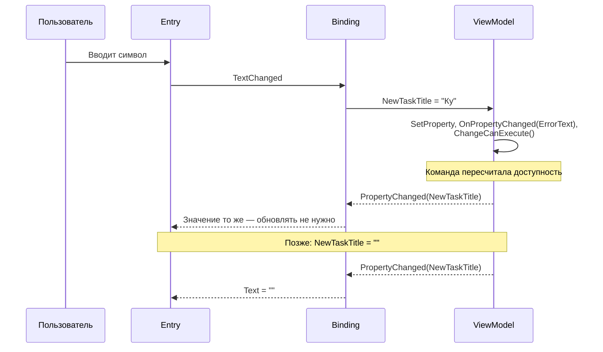
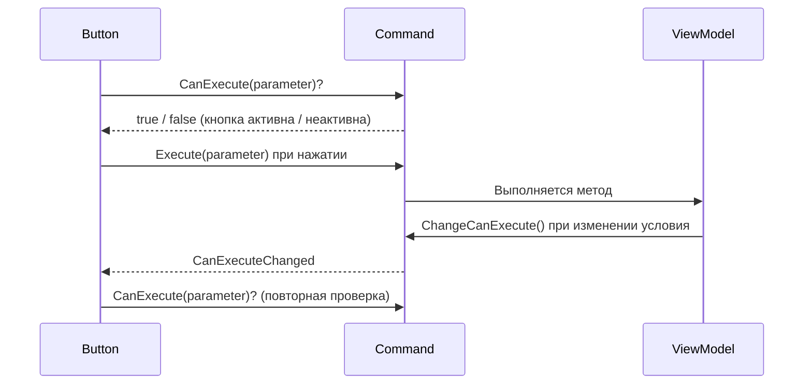
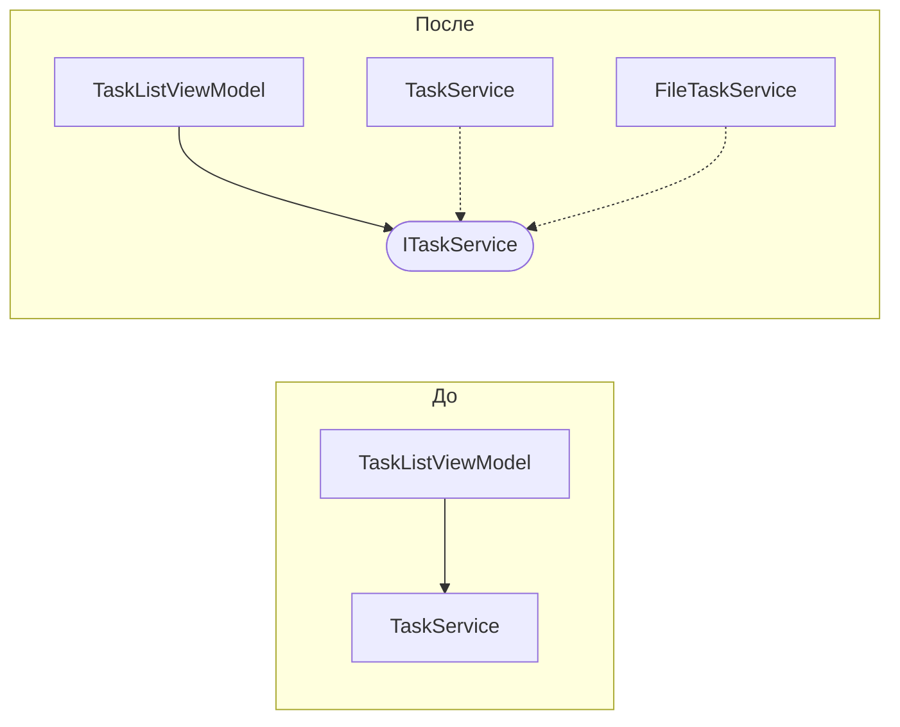
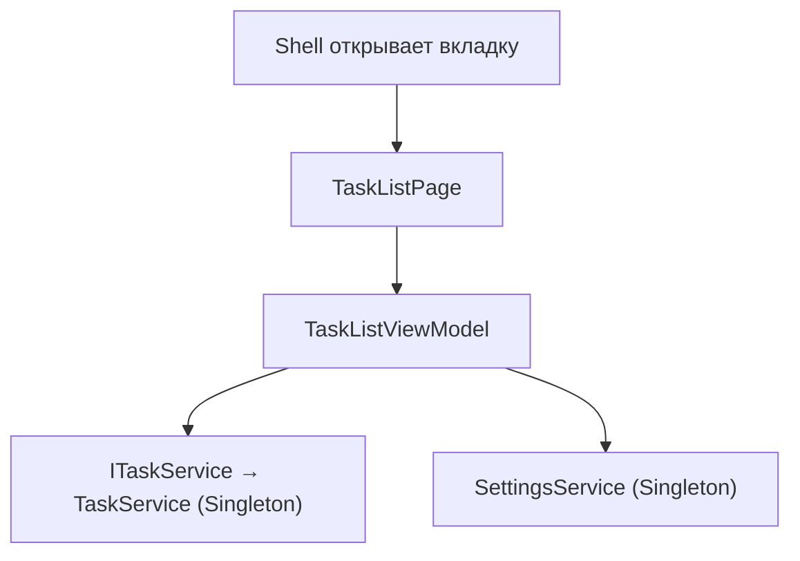

# Лекция. Binding, команды и Dependency Injection

| | |
|---|---|
| **Дисциплина** | Разработка мобильных приложений на .NET MAUI |
| **Объём** | 4 академических часа (180 минут) |
| **Предыдущая лекция** | Лекция 8. Первый MVVM-проект |
| **Практика по теме** | Практическая работа №9 «Binding и команды. Dependency Injection» |
| **Сквозной проект** | Task Manager |

---

## 1. План лекции

| № | Раздел | Время |
|---|---|---|
| 1 | Повторение MVVM. Что остаётся «кнопочного» кода и почему это плохо | 15 мин |
| 2 | Привязка данных глубже: режимы, `TwoWay`, зависимые свойства, конвертеры, валидация | 25 мин |
| 3 | Команды: `ICommand`, `Command`, `CanExecute`, параметры, команды в шаблонах | 30 мин |
| 4 | Обновление списка: `ObservableCollection`, модель с уведомлениями, фильтры | 20 мин |
| *—* | *Перерыв* | *10 мин* |
| 5 | Проблема жёсткой связи. Принцип инверсии зависимостей | 15 мин |
| 6 | Dependency Injection: контейнер, регистрация, время жизни, способы внедрения | 25 мин |
| 7 | DI в .NET MAUI: `MauiProgram`, страницы, `ViewModel`, `Shell` | 15 мин |
| 8 | Интерфейс сервиса, подмена реализации, тестирование, слабая связанность | 20 мин |
| 9 | Итоги и обсуждение | 5 мин |
| | **Итого** (с учётом перерыва) | **180 мин** |

**Цели лекции.** После занятия студент:

- выбирает режим привязки для конкретного элемента и объясняет, как работает `TwoWay` на примере `Entry`;
- описывает механизм оповещения о зависимых и вычисляемых свойствах;
- проектирует команды с `CanExecute` и параметром, подключает их в шаблоне элемента списка;
- выбирает способ обновления списка (точечный или полный) и объясняет, зачем модели уведомления об изменениях;
- формулирует принцип инверсии зависимостей и отличает внедрение зависимостей от вызова `new`;
- регистрирует сервисы в контейнере, выбирает время жизни, получает зависимости через конструктор;
- проектирует интерфейс сервиса и аргументирует выгоду слабой связанности.

---

## 2. Повторение и постановка задачи

### 2.1. Что получено в лекции 8

| Достигнуто | Как |
|---|---|
| Данные страницы вынесены в `ViewModel` | Свойство `Tasks`, `BindingContext` |
| Нажатия перенесены в команды | `OpenTaskCommand`, `AddTaskCommand` |
| Code-behind сокращён | Конструктор и `OnAppearing` |

### 2.2. Что осталось неидеальным

```csharp
// Работа с задачами всё ещё «кнопочная»
private async void OnSaveClicked(object? s, EventArgs e)
{
    if (string.IsNullOrWhiteSpace(TitleEntry.Text)) { ... }
    _service.Add(new TaskItem { Title = TitleEntry.Text.Trim(), ... });
    await Shell.Current.GoToAsync("..");
}

// ViewModel сама создаёт зависимость
public TaskListViewModel()
{
    _service = new TaskService();      // жёсткая связь
}
```

| Проблема | Последствие |
|---|---|
| Обработчики кнопок обращаются к элементам по имени (`TitleEntry`) | Нельзя проверить логику без интерфейса |
| Состояние разбросано: часть в элементах, часть в коде | Рассинхрон, трудно искать причину |
| Класс сам создаёт зависимость через `new` | Нельзя подменить сервис, нельзя тестировать |
| Правила проверки продублированы в нескольких местах | При изменении правила легко забыть одно из мест |

Этой лекцией закрываем оба пункта: **полностью переводим основные операции на привязки и команды** и **убираем `new` из `ViewModel`** с помощью внедрения зависимостей.

---

# ЧАСТЬ 1. BINDING И КОМАНДЫ

## 3. Привязка данных глубже

### 3.1. Напоминание: что такое привязка

Привязка связывает свойство **элемента** (`Entry.Text`) со свойством **источника** (`ViewModel.NewTaskTitle`). Источник определяется `BindingContext`; путь — выражением после слова `Binding`.

### 3.2. Режимы привязки

| Режим | Направление | Когда |
|---|---|---|
| `OneTime` | Источник → элемент, один раз | Данные не меняются |
| `OneWay` | Источник → элемент | Отображение (`Label.Text`) |
| `TwoWay` | Источник ↔ элемент | Ввод пользователя (`Entry.Text`, `Switch.IsToggled`, `Picker.SelectedIndex`) |
| `OneWayToSource` | Элемент → источник | Редкие случаи: передать значение, не показывая его |

Для интерактивных свойств режим по умолчанию — `TwoWay`; поэтому `Text="{Binding NewTaskTitle}"` уже двусторонняя привязка. Явная запись `Mode=TwoWay` не обязательна, но делает намерение очевидным.

### 3.3. Как работает TwoWay на примере Entry

```xml
<Entry Text="{Binding NewTaskTitle, Mode=TwoWay}" />
```



Два направления:

1. **Элемент → источник.** `Entry` в MAUI передаёт значение при каждом изменении текста (не по потере фокуса), поэтому `ViewModel` реагирует сразу, символ за символом.
2. **Источник → элемент.** Когда `ViewModel` присваивает свойству значение (очистка поля после добавления), привязка обновляет `Entry`.

**Защита от зацикливания.** Присваивание того же значения не должно вызывать повторное уведомление. Именно поэтому `SetProperty` сравнивает старое и новое значения.

### 3.4. Зависимые и вычисляемые свойства

Свойство без собственного поля, значение которого получается из других, называют **вычисляемым**:

```csharp
public string ErrorText =>
    NewTaskTitle.Trim().Length > MaxTitleLength ? $"Не более {MaxTitleLength} символов" : string.Empty;

public bool HasError => ErrorText.Length > 0;
```

Интерфейс не знает, что `ErrorText` зависит от `NewTaskTitle`. Поэтому в сеттере исходного свойства нужно **явно оповестить** о зависимых:

```csharp
set
{
    if (!SetProperty(ref _newTaskTitle, value ?? string.Empty)) return;
    OnPropertyChanged(nameof(ErrorText));
    OnPropertyChanged(nameof(HasError));
    _addTaskCommand.ChangeCanExecute();
}
```

**Правило.** Если свойство B вычисляется из A, то при каждом изменении A сообщаем и о B. Забытое уведомление — частая причина «экран не обновился».

Способ оповестить обо всех свойствах разом: `OnPropertyChanged(string.Empty)`.

### 3.5. Конвертеры значений

Когда данные нужно показать в другом виде, а добавлять свойство во `ViewModel` избыточно, применяют конвертер.

```csharp
public class InvertedBoolConverter : IValueConverter
{
    public object? Convert(object? value, Type targetType, object? parameter, CultureInfo culture)
        => value is bool b && !b;

    public object? ConvertBack(object? value, Type targetType, object? parameter, CultureInfo culture)
        => value is bool b && !b;
}
```

```xml
<ContentPage.Resources>
    <local:InvertedBoolConverter x:Key="InvertedBool" />
</ContentPage.Resources>

<Label IsVisible="{Binding IsLoading, Converter={StaticResource InvertedBool}}" />
```

| Что использовать | Когда |
|---|---|
| Свойство во `ViewModel` | Логика отображения зависит от состояния экрана |
| Конвертер | Универсальное преобразование (инверсия, цвет по значению), одно правило для многих мест |
| `DataTrigger` | Меняется внешний вид по данным (зачёркивание, прозрачность) |
| `StringFormat` | Простое форматирование строки (дата, число) |

### 3.6. Валидация ввода во ViewModel

Простейшая схема для первого проекта:

| Элемент | Реализация |
|---|---|
| Состояние ошибки | Вычисляемые `ErrorText`, `HasError` |
| Блокировка действия | `CanExecute` команды |
| Показ ошибки | `Label` с `IsVisible="{Binding HasError}"` |
| Правила | В одном месте (`TaskRules`), а не в каждом классе |

В больших проектах используют `INotifyDataErrorInfo` и библиотеки проверки (FluentValidation).

### 3.7. Мини-упражнение 1 (5 минут)

Поле «Возраст» должно принимать только числа от 0 до 120. Какие свойства нужны во `ViewModel`?

*Ответ:* `AgeText` (строка из `Entry`, TwoWay), вычисляемые `IsAgeValid`, `AgeError`, `HasAgeError`; `ChangeCanExecute` команды сохранения в сеттере `AgeText`.

---

## 4. Команды

### 4.1. От обработчика к команде

| | Обработчик события | Команда |
|---|---|---|
| Расположение | Code-behind страницы | `ViewModel` |
| Связь с элементом | По имени, через сигнатуру `(sender, e)` | Через привязку |
| Условие доступности | Вручную (`button.IsEnabled = ...`) | `CanExecute` |
| Параметр | Приходится извлекать из `sender` | `CommandParameter` |
| Проверка без интерфейса | Нельзя | Можно |

### 4.2. Устройство ICommand

```csharp
public interface ICommand
{
    bool CanExecute(object? parameter);
    void Execute(object? parameter);
    event EventHandler? CanExecuteChanged;
}
```

Цепочка работы:



### 4.3. Command и Command< T>

```csharp
// без параметра
_addTaskCommand = new Command(AddTask, () => CanAdd);

// с параметром
_deleteTaskCommand = new Command<TaskItem>(DeleteTask);
_completeTaskCommand = new Command<TaskItem>(CompleteTask);

// публичное свойство — через ICommand
public ICommand AddTaskCommand => _addTaskCommand;
```

| Решение | Причина |
|---|---|
| Хранить команды в полях типа `Command` | Чтобы вызывать `ChangeCanExecute()` |
| Публиковать как `ICommand` | `View` не должна знать о конкретном классе |
| Создавать в конструкторе | `CanExecute` ссылается на поля и свойства |

### 4.4. CanExecute и ChangeCanExecute

`CanExecute` — это условие, а не уведомление. Чтобы кнопка перечитала условие, нужно вызвать `ChangeCanExecute()` **при каждом изменении того, от чего условие зависит**:

```csharp
public string NewTaskTitle
{
    set
    {
        if (!SetProperty(ref _newTaskTitle, value ?? "")) return;
        _addTaskCommand.ChangeCanExecute();      // условие зависит от названия
    }
}
```

Забытый вызов даёт «вечно неактивную» кнопку.

### 4.5. Параметр команды

В списке команда должна знать, **к какой** задаче относится нажатие:

```xml
<Button Command="{Binding DeleteTaskCommand,
                  Source={RelativeSource AncestorType={x:Type vm:TaskListViewModel}}}"
        CommandParameter="{Binding .}" />
```

| Часть | Смысл |
|---|---|
| `Command` | Команда живёт в `ViewModel` страницы, а контекст шаблона — задача. Поэтому `Source` указывает на предка нужного типа |
| `CommandParameter="{Binding .}"` | Параметром становится сама задача — контекст текущего шаблона |

### 4.6. Другие точки подключения

| Элемент | Свойство | Пример |
|---|---|---|
| `Button`, `ImageButton` | `Command` | Добавить, удалить |
| `ToolbarItem` | `Command` | Открыть форму |
| `TapGestureRecognizer` | `Command` | Касание карточки |
| `SwipeItem` | `Command` | Смахивание |
| `Entry` | `ReturnCommand` | Клавиша «Ввод» |
| `RefreshView` | `Command` | Потянуть вниз |
| `SearchBar` | `SearchCommand` | Поиск |

### 4.7. Асинхронные и «защищённые» команды

Асинхронное действие оформляют как метод `async Task`, а в команде вызывают через лямбду. Исключение в такой лямбде (она становится `async void`) не перехватывается вызывающим кодом, поэтому:

- оборачивайте тело в `try/catch` там, где возможна ошибка;
- сбрасывайте флаги занятости в `finally`;
- для серьёзных проектов используйте `AsyncRelayCommand` из MVVM Toolkit.

Защита от повторных нажатий:

```csharp
private async Task NavigateAsync(string route)
{
    if (IsBusy) return;
    IsBusy = true;
    try   { await Shell.Current.GoToAsync(route); }
    finally { IsBusy = false; }
}
```

Сеттер `IsBusy` вызывает `ChangeCanExecute()` для команд перехода: кнопка блокируется на время операции.

### 4.8. Три команды Task Manager

| Команда | Параметр | Действие | Обновление списка |
|---|---|---|---|
| `AddTaskCommand` | — | Создать задачу из названия и приоритета | `Tasks.Add(task)`, очистка поля |
| `DeleteTaskCommand` | `TaskItem` | Удалить из сервиса, затем из списка | `Tasks.Remove(task)` |
| `CompleteTaskCommand` | `TaskItem` | Переключить `IsCompleted` | Карточка сама перерисовывается; при фильтре — `Tasks.Remove` |

Порядок «сначала источник истины (сервис), потом представление (коллекция)» защищает от рассинхрона: если сервис не смог выполнить операцию, экран не меняется.

### 4.9. MVVM Toolkit

```csharp
[RelayCommand(CanExecute = nameof(CanAdd))]
private void AddTask() { ... }

[RelayCommand]
private void DeleteTask(TaskItem? task) { ... }
```

Генератор создаёт `AddTaskCommand`, `DeleteTaskCommand`. Для `[ObservableProperty]` и `[NotifyCanExecuteChangedFor]` нужно, чтобы класс был `partial`. В учебном проекте вручную написанный вариант показывает механизм, Toolkit убирает рутину.

### 4.10. Мини-упражнение 2 (5 минут)

Кнопка «Отправить» должна быть активна, если заполнены поля «Email» и «Тема». Что нужно сделать в сеттерах свойств `Email` и `Subject`?

*Ответ:* после `SetProperty` вызывать `_sendCommand.ChangeCanExecute()`; условие `CanExecute`: оба поля непустые.

---

## 5. Обновление списка

### 5.1. Два способа

| Способ | Код | Что видит пользователь | Когда |
|---|---|---|---|
| **Точечный** | `Tasks.Add(x)`, `Tasks.Remove(x)`, `Tasks.Insert(i, x)` | Анимируется одна карточка, прокрутка не сбрасывается | Известно, что именно изменилось |
| **Полный** | `Tasks.Clear()` + заполнение | Список перерисован целиком | Изменился фильтр, порядок, данные пришли с другой вкладки |

В Task Manager: добавление/удаление/выполнение — точечно; смена фильтра и возврат на вкладку — полная перезагрузка (`Refresh`).

### 5.2. Изменение элемента списка

`ObservableCollection<T>` уведомляет о добавлении и удалении, но **не о смене свойств внутри элементов**. Если `CompleteTaskCommand` изменил `task.IsCompleted`, а `TaskItem` об этом не сообщает, карточка останется прежней.

Решение: модель реализует `INotifyPropertyChanged`.

```csharp
public bool IsCompleted
{
    get => _isCompleted;
    set => Set(ref _isCompleted, value);
}
```

Привязки внутри шаблона (`DataTrigger` на `IsCompleted`, `Label` с зачёркиванием) подпишутся на это уведомление и перерисуют карточку.

**Оговорка по слоям.** Строго говоря, уведомление — забота слоя представления. Поэтому в больших проектах модель оставляют «чистой», а для показа создают обёртку (`TaskItemViewModel`). В учебном проекте допускается добавить уведомления прямо в модель.

### 5.3. Фильтры и сводка

| Аспект | Решение |
|---|---|
| Фильтр «скрыть выполненные» | Состояние `HideCompleted` во `ViewModel`, фильтрация при загрузке; при выполнении задачи под включённым фильтром — `Tasks.Remove` |
| Сводка «Выполнено N из M» | Вычисляется по данным сервиса после каждой операции (`UpdateSummary()`) |
| Данные с других вкладок | Обновление в `OnAppearing` → `Refresh()` |

### 5.4. Распространённые ошибки обновления

| Ошибка | Следствие |
|---|---|
| Изменили сервис, но не коллекцию | Экран не отражает данных |
| Изменили коллекцию, но не сервис | Данные теряются при перезагрузке, статистика расходится |
| `Tasks = new ObservableCollection<>(...)` без `OnPropertyChanged` | Экран остаётся со старой коллекцией |
| Обновление коллекции из фонового потока | Исключение или «зависание» списка; используйте главный поток (`MainThread.BeginInvokeOnMainThread`) |
| Нет `INotifyPropertyChanged` у элемента | Карточка не перерисовывается |

### 5.5. Мини-упражнение 3 (5 минут)

После нажатия «Удалить» в списке карточка исчезла, но в «Статистике» задача по-прежнему считается. Где ошибка?

*Ответ:* удалили из `Tasks`, но не вызвали `Remove` сервиса.

---

# ЧАСТЬ 2. DEPENDENCY INJECTION

## 6. Проблема жёсткой связи

### 6.1. Пример

```csharp
public class TaskListViewModel : BaseViewModel
{
    private readonly TaskService _service = new TaskService();   // жёсткая связь
}
```

| Проблема | Последствие |
|---|---|
| `ViewModel` знает, **какой именно** класс используется | Замена реализации требует правки `ViewModel` |
| Каждый класс создаёт свой экземпляр | Вкладки получат разные списки задач |
| Нельзя подставить заглушку | Невозможно проверить `ViewModel` отдельно |
| Зависимости не видны в сигнатуре | Нужно читать весь код, чтобы понять, что нужно классу |
| Цепочки: сервис тоже что-то создаёт через `new` | «Лавина» зависимостей |

### 6.2. Принципы SOLID, связанные с темой

| Принцип | Формулировка | Как проявляется |
|---|---|---|
| **S** (единственная ответственность) | У класса одна причина для изменения | Хранение данных не в `ViewModel` |
| **O** (открытость/закрытость) | Расширяем без правки существующего | Новая реализация сервиса, `ViewModel` не меняется |
| **L** (подстановка Лисков) | Реализации взаимозаменяемы | Любой `ITaskService` подходит |
| **I** (разделение интерфейсов) | Мелкие интерфейсы лучше «толстых» | `ITaskService`, `IDialogService` отдельно |
| **D** (инверсия зависимостей) | Зависим от абстракций | `ViewModel` → `ITaskService` |

### 6.3. Принцип инверсии зависимостей (DIP)

1. Модули верхнего уровня не должны зависеть от модулей нижнего уровня. И те, и другие зависят от **абстракций**.
2. Абстракции не должны зависеть от деталей. Детали зависят от абстракций.



Стрелка от `TaskService` к интерфейсу направлена «вверх» — зависимость **инвертирована**.

### 6.4. Мини-упражнение 4 (5 минут)

Назовите три места в проекте Task Manager, где логично выделить интерфейс.

*Варианты ответов:* `ITaskService`, `ISettingsService`, `IDialogService`, `INavigationService`.

---

## 7. Dependency Injection

### 7.1. Понятия

| Термин | Значение |
|---|---|
| **IoC** (инверсия управления) | Не класс решает, какие зависимости создать, а внешний код |
| **DI** (внедрение зависимостей) | Способ реализации IoC: зависимости передаются классу извне |
| **Контейнер** | Объект, хранящий регистрации и создающий экземпляры |
| **Регистрация** | Запись «если просят X, создай Y» |
| **Разрешение** (resolve) | Получение экземпляра из контейнера |

### 7.2. Способы внедрения

| Способ | Пример | Оценка |
|---|---|---|
| **Через конструктор** | `public VM(ITaskService s)` | **Основной**: зависимости обязательны, видны сразу |
| Через свойство | `public ITaskService Service { get; set; }` | Для необязательных зависимостей |
| Через метод | `void Init(ITaskService s)` | Редко |

### 7.3. Сравнение

**Без DI**

```csharp
public TaskListViewModel()
{
    _service = new TaskService();
    _settings = new SettingsService();
}
```

**С DI**

```csharp
public TaskListViewModel(ITaskService service, SettingsService settings)
{
    _service = service;
    _settings = settings;
}
```

Класс **объявляет**, что ему нужно, но не создаёт и не выбирает.

### 7.4. Время жизни

| Время жизни | Поведение | Применение |
|---|---|---|
| **Singleton** | Один экземпляр на приложение | Общие данные и настройки (`ITaskService`) |
| **Transient** | Новый экземпляр при каждом запросе | Страницы, `ViewModel` экранов |
| **Scoped** | Один экземпляр на «область» | В MAUI применяют редко |

**Ловушка «пленённой зависимости» (captive dependency).** Если `Singleton` получает в конструкторе `Transient`, то этот `Transient` «застрянет» внутри одиночки и проживёт столько же, сколько он. Поэтому сервисы с большим временем жизни не должны зависеть от короткоживущих объектов.

### 7.5. Формы регистрации

```csharp
// интерфейс -> реализация
builder.Services.AddSingleton<ITaskService, TaskService>();

// только конкретный класс
builder.Services.AddSingleton<SettingsService>();

// через фабрику (нужна своя логика создания)
builder.Services.AddSingleton<ITaskService>(sp =>
    new LoggingTaskService(sp.GetRequiredService<TaskService>()));
```

Важное правило: **не регистрируйте один и тот же сервис двумя способами без необходимости.** `AddSingleton<ITaskService, TaskService>()` и `AddSingleton<TaskService>()` дадут два разных экземпляра, и вкладки увидят разные списки.

### 7.6. Service Locator: антипаттерн

```csharp
var service = App.Current.Handler.MauiContext.Services.GetService<ITaskService>();
```

| Недостаток | Пояснение |
|---|---|
| Скрытые зависимости | Из сигнатуры класса не видно, что ему нужно |
| Ошибки в рантайме | Забытая регистрация обнаруживается при вызове, а не при создании |
| Трудно тестировать | Нужен контейнер даже в тестах |

Допустимо только в «стыковочных» местах (например, когда фреймворк создаёт объект без DI). В остальном — внедрение через конструктор.

### 7.7. Мини-упражнение 5 (5 минут)

В приложении две страницы получают `ITaskService`. После добавления задачи на первой, вторая её не видит. Назовите две вероятные причины.

*Ответ:* сервис зарегистрирован как `Transient`; либо зарегистрированы две разные регистрации (интерфейс и конкретный класс) и страницы получают разные объекты; либо вторая страница читает данные только в конструкторе, а не в `OnAppearing`.

---

## 8. DI в .NET MAUI

### 8.1. Где всё настраивается

```csharp
public static MauiApp CreateMauiApp()
{
    var builder = MauiApp.CreateBuilder();
    builder.UseMauiApp<App>();

    // Сервисы (общие данные и возможности)
    builder.Services.AddSingleton<ITaskService, TaskService>();
    builder.Services.AddSingleton<SettingsService>();

    // ViewModel и страницы (на каждый экран своя)
    builder.Services.AddTransient<TaskListViewModel>();
    builder.Services.AddTransient<TaskListPage>();
    builder.Services.AddTransient<StatisticsPage>();
    builder.Services.AddTransient<SettingsPage>();
    builder.Services.AddTransient<AddTaskPage>();
    builder.Services.AddTransient<TaskDetailsPage>();

    return builder.Build();
}
```

Контейнер строится при запуске. Если не хватает регистрации, приложение сообщает об этом исключением с указанием типа.

### 8.2. Как контейнер собирает цепочку



Страницы создаются контейнером в двух случаях:

1. Страница вкладки объявлена с `ContentTemplate="{DataTemplate local:Page}"` — `Shell` создаёт её через контейнер.
2. Страница зарегистрирована маршрутом (`Routing.RegisterRoute`) и **её тип зарегистрирован в контейнере** — `Shell` получает её из контейнера.

Если страницу создать вручную (`new TaskListPage()`), внедрение не сработает.

### 8.3. Что чаще всего ломается

| Симптом | Причина |
|---|---|
| Исключение «невозможно разрешить сервис» при запуске | Нет регистрации интерфейса, страницы или `ViewModel` |
| У страницы нет конструктора без параметров | Забыли `ContentTemplate` либо ручное создание через `new` |
| Данные расходятся между вкладками | `Transient` вместо `Singleton`, или две регистрации |
| Циклическая зависимость | `A` требует `B`, а `B` требует `A` |

### 8.4. Мини-упражнение 6 (5 минут)

Нарисуйте цепочку зависимостей для вкладки «Статистика» при наличии `StatisticsPage`, `StatisticsViewModel`, `ITaskService`.

*Ответ:* `StatisticsPage → StatisticsViewModel → ITaskService (→ TaskService)`.

---

## 9. Интерфейс сервиса и слабая связанность

### 9.1. Как проектируется интерфейс

| Правило | Пример |
|---|---|
| Описывает **что**, а не **как** | `GetTasks(hideCompleted)`, а не `ReadListFromMemory()` |
| Содержит только нужное потребителям | `ViewModel` не нужен `_nextId` |
| Не раскрывает детали хранения | Нет `List<T>` в сигнатурах: `IReadOnlyList<T>` |
| Сигнатуры не привязаны к интерфейсу | Нет `Page`, `Shell`, `Command` |
| Правила предметной области — в сервисе/модели | `Create(...)` проверяет название; общая константа `TaskRules` |

```csharp
public interface ITaskService
{
    IReadOnlyList<TaskItem> GetTasks(bool hideCompleted = false);
    TaskItem? GetById(int id);
    TaskItem Add(TaskItem task);
    TaskItem Create(string title, TaskPriority priority);
    bool Remove(int id);
    bool SetCompleted(int id, bool isCompleted);
    int ClearCompleted();
    TaskStatistics GetStatistics();
}
```

### 9.2. Что переносим из ViewModel в сервис

| Было во `ViewModel` | Стало |
|---|---|
| `Where(t => !t.IsCompleted)` | `GetTasks(hideCompleted)` |
| `new TaskItem { Title = x.Trim(), ... }` | `Create(title, priority)` |
| `const int MaxTitleLength = 100` | `TaskRules.MaxTitleLength` |

**Критерий.** Всё, что относится к *правилам предметной области* (фильтры, проверки, расчёты), — в сервис или модель. Во `ViewModel` остаётся *состояние экрана* и *команды*.

### 9.3. Подмена реализации

Интерфейс позволяет подставить разные реализации без изменения потребителей.

| Реализация | Назначение |
|---|---|
| `TaskService` | Данные в памяти (учебная) |
| `FileTaskService` | Сохранение в JSON-файл |
| `ApiTaskService` | Работа через сервер |
| `LoggingTaskService` | Декоратор: пишет журнал и передаёт вызовы настоящему сервису |
| `FakeTaskService` | Заглушка для тестов |

Подмена — одна строка в `MauiProgram`:

```csharp
builder.Services.AddSingleton<ITaskService, FileTaskService>();
```

### 9.4. Паттерн «Декоратор»

Обёртка реализует тот же интерфейс и добавляет поведение:

```csharp
public class LoggingTaskService : ITaskService
{
    private readonly ITaskService _inner;
    public LoggingTaskService(ITaskService inner) => _inner = inner;

    public bool Remove(int id)
    {
        var result = _inner.Remove(id);
        Debug.WriteLine($"[SVC] Remove({id}) -> {result}");
        return result;
    }
    // остальные методы аналогично
}
```

Регистрация:

```csharp
builder.Services.AddSingleton<TaskService>();
builder.Services.AddSingleton<ITaskService>(sp =>
    new LoggingTaskService(sp.GetRequiredService<TaskService>()));
```

Здесь `TaskService` регистрируется как конкретный класс сознательно: он нужен фабрике как внутренняя часть, а все потребители получают только `ITaskService`.

### 9.5. Тестирование

```csharp
public class FakeTaskService : ITaskService
{
    private readonly List<TaskItem> _items;
    public FakeTaskService(params TaskItem[] items) => _items = items.ToList();

    public IReadOnlyList<TaskItem> GetTasks(bool hideCompleted = false)
        => _items.Where(t => !hideCompleted || !t.IsCompleted).ToList();
    // остальные методы: минимальные реализации
}

[Fact]
public void HideCompleted_ShowsOnlyActive()
{
    var service = new FakeTaskService(
        new TaskItem { Title = "A", IsCompleted = true },
        new TaskItem { Title = "B" });

    var vm = new TaskListViewModel(service, new FakeSettings());
    vm.HideCompleted = true;

    Assert.Single(vm.Tasks);
}
```

Условия: `ViewModel` не должна зависеть от платформенных классов. В нашем учебном варианте используются `Command` из MAUI и `Shell.Current`; для настоящих тестов их заменяют на MVVM Toolkit и интерфейс навигации.

### 9.6. Преимущества слабой связанности

| Преимущество | Пояснение |
|---|---|
| **Заменяемость** | Меняем реализацию в одном месте |
| **Тестируемость** | Подставляем заглушку |
| **Расширяемость** | Добавляем поведение декоратором, не трогая код |
| **Параллельная разработка** | Команды договариваются об интерфейсе и работают независимо |
| **Читаемость** | Зависимости перечислены в конструкторе |
| **Меньше распространение изменений** | Правки внутри сервиса не затрагивают `ViewModel` |

### 9.7. Недостатки и разумная мера

| Недостаток | Что делать |
|---|---|
| Больше файлов и абстракций | Не создавать интерфейс «на всякий случай» для каждого класса; выделять там, где реально возможна замена или нужны тесты |
| «Магия» контейнера | Держать регистрации в одном месте и читаемыми |
| Ошибки обнаруживаются при запуске | Это достоинство: падение сразу, а не в середине операции |
| Риск переусложнения | Применять правило: абстракция оправдана, если у неё есть как минимум две причины существовать (две реализации, тест, декоратор) |

### 9.8. Мини-упражнение 7 (10 минут)

В парах: для сценария «приложение должно хранить задачи на сервере» перечислите файлы, которые придётся менять **при наличии** и **при отсутствии** интерфейса `ITaskService`.

*Ориентир:* с интерфейсом — новый класс `ApiTaskService` и строка в `MauiProgram`; без интерфейса — каждая `ViewModel` и страница, обращающиеся к `TaskService`.

---

## 10. Итоги лекции

1. Основные операции приложения выполняются через **привязки и команды**, а не через обработчики.
2. `TwoWay`-привязка передаёт ввод пользователя в свойство `ViewModel` и обратно; вычисляемые свойства оповещаются явно.
3. Команда состоит из действия и условия; `ChangeCanExecute()` нужно вызывать при изменении условия; параметр передаётся через `CommandParameter`; в шаблоне команда страницы берётся через `RelativeSource`.
4. Список обновляется точечно (`Add`/`Remove`) или целиком (`Clear` + заполнение); элементам, изменяемым программно, нужны уведомления об изменениях.
5. Жёсткая связь (`new`) мешает замене и тестированию; принцип инверсии зависимостей предлагает зависеть от интерфейсов.
6. Внедрение зависимостей передаёт объекты в конструктор; контейнер знает, что подставить; время жизни: `Singleton` для общего состояния, `Transient` для экранов.
7. Интерфейс сервиса — контракт; он позволяет подменять реализации (файл, сервер, журнал, заглушка) одной строкой регистрации.
8. Абстракции нужны там, где они дают пользу: замена, тестирование, расширение.

---

## 11. Вопросы для самопроверки

**Binding и команды**

1. Какие режимы привязки существуют? Для каких свойств `TwoWay` включён по умолчанию?
2. Когда `Entry` передаёт новое значение в источник?
3. Зачем нужны вызовы `OnPropertyChanged(nameof(ErrorText))` в сеттере другого свойства?
4. Чем конвертер отличается от `DataTrigger` и от вычисляемого свойства?
5. Что такое `CanExecute`? Что делает `ChangeCanExecute()`?
6. Как передать нажатую задачу в команду из шаблона `CollectionView`?
7. Зачем нужен `RelativeSource AncestorType`?
8. В чём разница между точечным и полным обновлением списка?
9. Почему `TaskItem` должен уведомлять об изменении `IsCompleted`?
10. Почему в `DeleteTask` сначала вызывается сервис, а потом изменяется коллекция?

**Dependency Injection**

11. Чем плох вызов `new TaskService()` в `ViewModel`?
12. Сформулируйте принцип инверсии зависимостей.
13. Чем DI отличается от IoC?
14. Какие способы внедрения вы знаете? Какой основной?
15. Объясните времена жизни `Singleton`, `Transient`, `Scoped`.
16. Что такое «пленённая зависимость»?
17. Чем плох Service Locator?
18. Почему нельзя регистрировать один и тот же сервис и как интерфейс, и как конкретный класс без необходимости?
19. Что такое декоратор? Приведите пример для `ITaskService`.
20. Когда выделение интерфейса оправдано, а когда избыточно?
